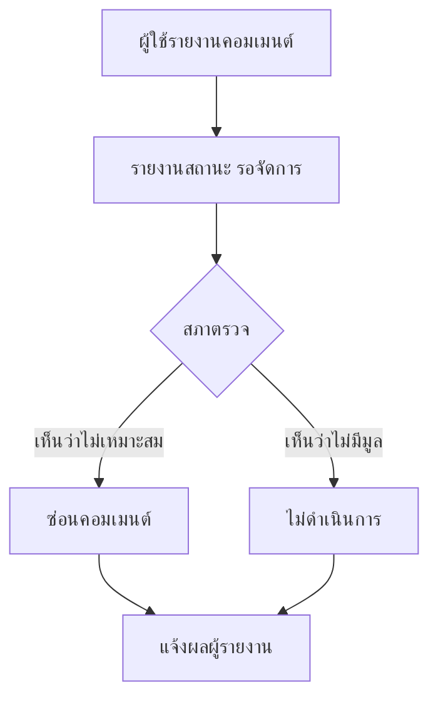

# บอร์ดและการโหวต

บทนี้อธิบายวิธีอ่านบอร์ด โหวต แสดงความคิดเห็น เสนอไอเดีย และรายงานเนื้อหาไม่เหมาะสม

## ใครใช้บทนี้

ผู้ใช้ทุกคนที่เข้าสู่ระบบแล้ว

## ก่อนเริ่ม

- บอร์ดสาธารณะต้องเข้าสู่ระบบก่อนอ่าน
- บอร์ดมี 3 ชนิด คือ **โหวต** **พูดคุย** และ **ข้อเสนอแนะ**
- การโหวตหนึ่งคนทำได้หนึ่งครั้งต่อบอร์ด

## ถ้าต้องการดูบอร์ดทั้งหมด

1. กดแท็บ **บอร์ด**
2. เลือกตัวกรอง **ทั้งหมด** **โหวต** **พูดคุย** หรือ **ข้อเสนอแนะ**
3. พิมพ์คำค้นในช่อง **ค้นหาบอร์ด...** หากต้องการหาเรื่องที่สนใจ
4. กดการ์ดเพื่อเปิดรายละเอียด

บอร์ดที่ถูกซ่อนหรือปิดจะไม่แสดงในรายการ

## ถ้าต้องการโหวต

1. เปิดบอร์ดประเภท **โหวต**
2. อ่านตัวเลือกและรายละเอียด
3. เลือกหนึ่งตัวเลือก
4. กด **ส่งเสียงโหวต**
5. ระบบจะแสดง **คุณส่งเสียงโหวตแล้ว — แต่ละคนโหวตได้ 1 ครั้ง**

::: warning โหวตแล้วเปลี่ยนไม่ได้
- เลือกได้หนึ่งตัวเลือกต่อบอร์ด และโหวตซ้ำไม่ได้
- ระบบแสดงจำนวนเสียงและเปอร์เซ็นต์ของแต่ละตัวเลือก
:::

## ถ้าต้องการแสดงความคิดเห็น

1. เปิดบอร์ดประเภท **พูดคุย** หรือ **ข้อเสนอแนะ**
2. เลื่อนไปที่ช่อง **ร่วมแสดงความเห็น...**
3. พิมพ์ข้อความแล้วกด **ส่ง**
4. หากต้องการตอบความคิดเห็นของผู้อื่น ให้กดตอบใต้คอมเมนต์นั้น

บอร์ดประเภท **โหวต** ใช้สำหรับออกเสียง ไม่ได้เปิดให้แสดงความคิดเห็นในหน้าเดียวกัน

## ถ้าต้องการตอบกลับความคิดเห็น

1. กดปุ่มตอบใต้คอมเมนต์ที่ต้องการ
2. พิมพ์ข้อความ
3. กด **ส่ง**

ระบบจำกัดความลึกของการตอบกลับ หากเกินจะแสดงข้อความ **รีพลายได้ลึกไม่เกิน N ชั้น**
ให้ตอบในระดับที่ใกล้ที่สุดแทน

## ถ้าต้องการเสนอไอเดียใหม่

1. เปิดแท็บ **บอร์ด**
2. กด **เสนอไอเดีย**
3. กรอก **หัวข้อ** อย่างน้อย 3 ตัวอักษร
4. กรอก **รายละเอียด** ว่ามีประโยชน์อย่างไร
5. หากไม่ต้องการแสดงชื่อ ให้ติ๊ก **ไม่แสดงชื่อผู้เสนอ**
6. กด **เผยแพร่ข้อเสนอ**

::: info ข้อเสนอขึ้นบอร์ดทันที
ไม่ต้องรออนุมัติ แต่สภานักเรียนยังเห็นว่าใครเสนอ และสามารถซ่อนย้อนหลังได้หากไม่เหมาะสม
:::

## ถ้าต้องการรายงานคอมเมนต์ที่ไม่เหมาะสม

1. เปิดคอมเมนต์ที่ต้องการรายงาน
2. กดตัวเลือก **รายงาน**
3. เลือกเหตุผล

| เหตุผล | ใช้เมื่อ |
|---|---|
| **กลั่นแกล้ง/คุกคาม** | มีการข่มขู่หรือคุกคาม |
| **คำหยาบคาย** | ใช้ถ้อยคำไม่สุภาพ |
| **สแปม/โฆษณา** | โพสต์ซ้ำหรือขายของ |
| **เปิดเผยข้อมูลส่วนตัว** | เปิดเผยชื่อ เบอร์ หรือข้อมูลของผู้อื่น |
| **อื่นๆ** | กรณีอื่นที่ไม่อยู่ในรายการ |

4. กรอกรายละเอียดเพิ่มเติมได้ไม่เกิน 500 ตัวอักษร
5. กดส่ง

::: info รายงานเข้าคิวของสภานักเรียน
- ผู้ใช้หนึ่งคนมีรายงานที่ยังเปิดได้ไม่เกิน 10 รายการ
- รายงานคอมเมนต์เดิมซ้ำไม่ได้
:::

## ถ้ากระทู้หรือคอมเมนต์ถูกซ่อน

- กระทู้จะหายจากรายการและเปิดจากลิงก์เดิมไม่ได้
- คอมเมนต์ที่ถูกซ่อนจะไม่แสดง พร้อมคอมเมนต์ตอบกลับใต้คอมเมนต์นั้น
- หากเปิดลิงก์ที่ถูกซ่อน ระบบจะพาไปหน้าแจ้งเตือนพร้อมข้อความ **เนื้อหานี้เปิดดูไม่ได้แล้ว**

## ถ้าต้องการเสนอชื่อแบบไม่ระบุตัวตน

::: warning ชื่อถูกซ่อนเฉพาะบนบอร์ด
- ผู้อื่นจะไม่เห็นชื่อผู้เสนอ
- สภานักเรียนยังเห็นว่าใครเสนอ เพื่อความรับผิดชอบ
- คอมเมนต์ที่เขียนยังแสดงชื่อจริงของผู้เขียน
:::

## ระบบทำอะไรเบื้องหลัง

- บอร์ดที่มาจากเรื่องที่ได้รับอนุมัติจะผูกกับเรื่องต้นทาง
- การโหวตถูกบันทึกหนึ่งครั้งต่อผู้ใช้ต่อบอร์ด และนับคะแนนทันที
- การเปิดบอร์ดจะนับวิวแบบไม่ซ้ำต่อผู้ใช้
- คอมเมนต์ใหม่จะแจ้งเตือนเจ้าของกระทู้หรือเจ้าของคอมเมนต์ที่ตอบ
- การรายงานจะแจ้งเตือนสภานักเรียน และผลการจัดการจะแจ้งกลับผู้รายงาน

## ข้อจำกัดและข้อควรระวัง

- โหวตแล้วเปลี่ยนไม่ได้
- บอร์ดโหวตไม่เปิดคอมเมนต์
- ไม่มีการแก้ไขกระทู้หลังเผยแพร่จากหน้าผู้ใช้
- ไม่มีแชทส่วนตัว
- การซ่อนกระทู้ทำได้เฉพาะสภานักเรียนและผู้ดูแลระบบ

## แก้ไขปัญหาและคำถามที่พบบ่อย

**ถาม: กดโหวตแล้วขึ้น "คุณโหวต board นี้ไปแล้ว"**
ตอบ: บัญชีนี้เคยโหวตบอร์ดนี้แล้ว ระบบอนุญาตหนึ่งเสียงต่อคนต่อบอร์ด

**ถาม: เสนอไอเดียแล้วไม่เห็นบนบอร์ด**
ตอบ: ตรวจว่ากด **เผยแพร่ข้อเสนอ** สำเร็จหรือไม่ หากขึ้นข้อความผิดพลาดให้ลองใหม่
ข้อเสนอที่เผยแพร่แล้วจะขึ้นทันที

**ถาม: ทำไมตอบคอมเมนต์ไม่ได้**
ตอบ: อาจถึงความลึกสูงสุดของเธรด ให้ตอบที่คอมเมนต์ระดับบนแทน

**ถาม: รายงานคอมเมนต์แล้วต้องรอนานเท่าไร**
ตอบ: ไม่มีกำหนดเวลาตายตัว สภาจะตรวจตามลำดับคิว สถานะจะแจ้งกลับเมื่อจัดการ

**ถาม: กระทู้หายไปไหน**
ตอบ: อาจถูกซ่อนโดยสภา หรือถูกลบโดยผู้ดูแล หากเปิดจากลิงก์เดิมจะเห็นข้อความแจ้ง
ให้กลับไปที่หน้ารวมบอร์ด

**ถาม: ข้อเสนอของฉันแสดงชื่อหรือไม่**
ตอบ: หากติ๊ก **ไม่แสดงชื่อผู้เสนอ** ผู้อื่นจะไม่เห็นชื่อ แต่สภานักเรียนยังเห็นเพื่อตรวจสอบ
