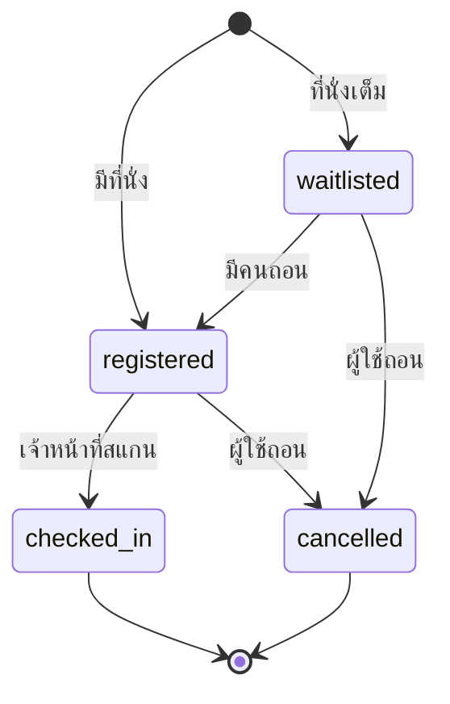

# กิจกรรม การลงทะเบียน และคิวอาร์เช็คอิน

บทนี้อธิบายวิธีดูกิจกรรม ลงทะเบียน เข้าคิวสำรอง และใช้บัตรคิวอาร์เช็คอินที่หน้างาน

## ใครใช้บทนี้

นักเรียนและบุคลากรที่ต้องการเข้าร่วมกิจกรรมของโรงเรียน

## ก่อนเริ่ม

- เข้าสู่ระบบแล้ว
- กิจกรรมที่แสดงในแท็บ **กิจกรรม** ต้องถูกเผยแพร่แล้วเท่านั้น
- การเช็คอินทำโดยเจ้าหน้าที่ที่หน้างาน ไม่ใช่ผู้เข้าร่วมสแกนเอง

## ถ้าต้องการดูกิจกรรมที่เปิดรับ

1. กดแท็บ **กิจกรรม**
2. เลือก **ทั้งหมด**
3. กรองตามหมวดหากต้องการ
4. กดการ์ดกิจกรรมเพื่ออ่านรายละเอียด

ป้ายบนการ์ดบอกสถานะ

| ป้าย | ความหมาย |
|---|---|
| **เปิดรับสมัคร** | ลงทะเบียนได้ |
| **ปิดรับสมัครแล้ว** | เลยกำหนดหรือกิจกรรมเริ่มแล้ว |
| **ยกเลิกแล้ว** | กิจกรรมถูกยกเลิก |
| **N คน** | จำนวนผู้ลงทะเบียน |

> **ภาพที่ 9 — หน้ารายละเอียดกิจกรรม**
> - **ไฟล์:** `docs/assets/screenshots/user/event-detail.webp`
> - **แคป:** กิจกรรมที่เปิดรับสมัครและยังมีที่นั่ง — **ใช้เป็น placeholder** เพราะ staging มีเฉพาะกิจกรรมที่ปิดรับสมัครแล้ว แคปเองได้เมื่อมีกิจกรรมที่เปิดรับสมัคร โดยใช้บัญชี e2e และไม่ให้มีรายชื่อผู้เข้าร่วมจริงในเฟรม
> - **ครอป/ไฮไลต์:** ครอปปุ่ม **ลงทะเบียนเข้าร่วม** และแถบ **ที่นั่ง / ลงทะเบียนแล้ว / คิวสำรอง**
> - **PDPA:** ใช้กิจกรรม e2e ที่ไม่มีรายชื่อผู้เข้าร่วมจริง

## ถ้าต้องการลงทะเบียนกิจกรรม

1. เปิดรายละเอียดกิจกรรม
2. ตรวจวันเวลา สถานที่ และกำหนดปิดรับสมัคร
3. กด **ลงทะเบียนเข้าร่วม**
4. รอข้อความยืนยัน

หากยังมีที่นั่ง ระบบจะแสดง **ลงทะเบียนสำเร็จ**
หากที่นั่งเต็ม ระบบจะพาเข้าคิวสำรองอัตโนมัติ

## ถ้าที่นั่งเต็มและต้องการเข้าคิวสำรอง

1. กด **เข้าคิวสำรอง**
2. ระบบแจ้ง **ที่นั่งเต็ม — เข้าคิวสำรองแล้ว** พร้อมลำดับคิว
3. รอการเลื่อนลำดับ หากมีคนถอน ระบบจะเลื่อนให้คนแรกในคิวอัตโนมัติ
4. เมื่อได้ที่นั่ง ระบบจะแจ้ง **คุณได้ที่นั่งแล้ว**

ลำดับคิวเรียงตามเวลาที่ลงทะเบียนและหมายเลขรายการ
ผู้ใช้ไม่สามารถจัดลำดับคิวเองได้ และคิวไม่มีวันหมดอายุอัตโนมัติ

## ถ้าต้องการถอนการลงทะเบียน

1. เปิดรายละเอียดกิจกรรม
2. กด **ถอนการลงทะเบียน**
3. ยืนยัน **ถอนการลงทะเบียน**

หากคุณมีที่นั่งและมีคนอยู่ในคิวสำรอง ระบบจะเลื่อนคนแรกในคิวขึ้นมาทันที
การถอนไม่คืนสิทธิ์ให้อัตโนมัติหากกิจกรรมปิดรับแล้ว

## ถ้าต้องการเช็คอินที่หน้างาน

1. เปิดรายละเอียดกิจกรรมตอนที่ยังลงทะเบียนอยู่
2. ดูการ์ด **บัตรเช็คอินของคุณ**
3. ยื่นคิวอาร์ให้เจ้าหน้าที่สแกน
4. หากกล้องของเจ้าหน้าที่ใช้ไม่ได้ ให้อ่านรหัสใต้คิวอาร์ให้เจ้าหน้าที่พิมพ์
5. เมื่อสำเร็จ สถานะจะเปลี่ยนเป็น **เช็คอินแล้ว** พร้อมเวลา

ผู้เข้าร่วมไม่สามารถกดเช็คอินเองจากมือถือได้ เพราะระบบต้องป้องกันการเช็คอินแทนกัน

## ถ้าลืมมือถือหรือเปิดคิวอาร์ไม่ได้

แจ้งเจ้าหน้าที่ที่หน้างาน เจ้าหน้าที่สามารถเปิด **รายชื่อผู้สมัคร** แล้วกด **เช็คอิน** ที่ชื่อของคุณได้
วิธีนี้ใช้เมื่อคิวอาร์ใช้ไม่ได้เท่านั้น

## ถ้าต้องการแชร์กิจกรรมให้เพื่อน

1. เปิดรายละเอียดกิจกรรม
2. เลื่อนไปที่ **ชวนเพื่อนมาร่วมกิจกรรม**
3. กด **คัดลอก** เพื่อคัดลอกลิงก์
4. ส่งลิงก์ในกลุ่มหรือแอปแชท

ผู้รับลิงก์ต้องเข้าสู่ระบบก่อนจึงจะลงทะเบียนได้

## ถ้ากิจกรรมถูกยกเลิก

- ระบบปิดรับสมัครทันที
- ผู้ที่ลงทะเบียนไว้จะได้รับการแจ้งเตือน
- การยกเลิกไม่ใช่การลบ กิจกรรมยังเปิดดูได้
- คนในคิวสำรองจะไม่ถูกเลื่อนขึ้นเมื่อกิจกรรมถูกยกเลิก

## ระบบทำอะไรเบื้องหลัง

- ที่นั่งถูกจองแบบล็อกในฐานข้อมูล เพื่อไม่ให้คนสองคนแย่งที่นั่งสุดท้ายพร้อมกัน
- ถ้า `capacity` ว่าง หมายถึงไม่จำกัดจำนวน
- กำหนดปิดรับสมัครต้องไม่หลังวันจัดกิจกรรม
- การลงทะเบียนปิดเมื่อถึงเวลาจัดหรือถึงกำหนดปิดรับ แล้วแต่เวลาใดถึงก่อน
- การเช็คอินซ้ำจะไม่นับซ้ำ และตอบผลเดิม

## ข้อจำกัดและข้อควรระวัง

- ไม่มีแท็บกิจกรรมของฉัน ให้ดูจากหน้ารายละเอียดกิจกรรมที่ลงทะเบียนไว้
- ไม่มีการจัดลำดับคิวใหม่ manually
- คิวสำรองไม่หมดอายุเอง
- ไม่มีปฏิทินรายเดือน
- เจ้าหน้าที่ต้องมีสิทธิ์ **จัดการกิจกรรม** จึงจะสแกนได้

## แก้ไขปัญหาและคำถามที่พบบ่อย

**ถาม: กดลงทะเบียนแล้วขึ้น "กิจกรรมนี้ยังไม่เปิดให้ลงทะเบียน"**
ตอบ: กิจกรรมยังเป็นฉบับร่างหรือยังไม่เผยแพร่ ให้รอสภาประกาศ

**ถาม: ที่นั่งเต็มแต่ยังอยากเข้าร่วม**
ตอบ: กด **เข้าคิวสำรอง** และรอ ระบบจะเลื่อนให้อัตโนมัติเมื่อมีคนถอน

**ถาม: อยู่ในคิวสำรองแล้วจะรู้ได้อย่างไรว่าได้ที่นั่ง**
ตอบ: ระบบส่งแจ้งเตือน **คุณได้ที่นั่งแล้ว** และสถานะในหน้ารายละเอียดกิจกรรมเปลี่ยนเป็น **ลงทะเบียนแล้ว**

**ถาม: คิวอาร์หมดอายุหรือไม่**
ตอบ: คิวอาร์ผูกกับกิจกรรมและรายการลงทะเบียน ใช้ได้เมื่อยังลงทะเบียนอยู่
หากกิจกรรมถูกยกเลิกหรือการลงทะเบียนถูกถอน จะใช้ไม่ได้

**ถาม: เช็คอินแล้วแต่สถานะยังไม่เปลี่ยน**
ตอบ: กดรีเฟรชหน้ารายละเอียดกิจกรรม หากยังไม่เปลี่ยน ให้แจ้งเจ้าหน้าที่ตรวจรายชื่อ

**ถาม: ถอนแล้วอยากลงใหม่ได้ไหม**
ตอบ: ได้ หากยังอยู่ในช่วงรับสมัครและยังมีที่นั่งหรือคิวว่าง
แต่ลำดับคิวใหม่จะต่อท้าย ไม่ได้ลำดับเดิม
