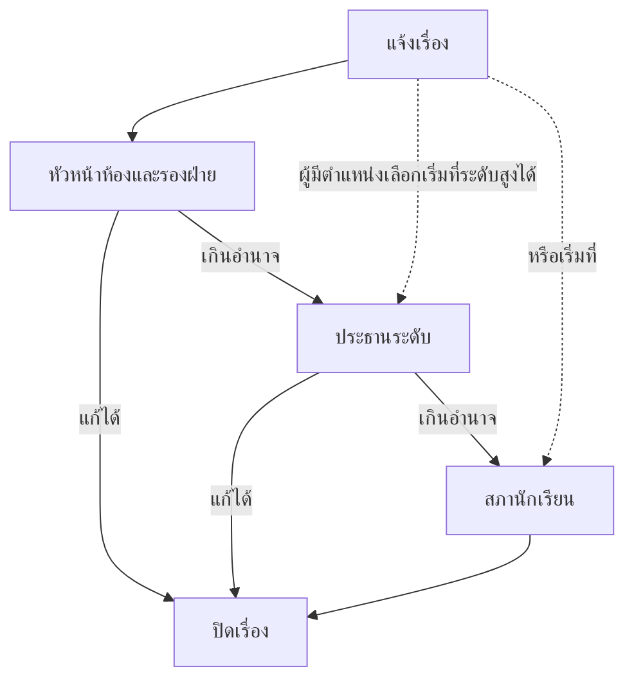

# การแจ้งเรื่องและติดตามสถานะ

เจอปัญหาที่โรงเรียนแล้วไม่รู้จะบอกใคร? ส่งผ่านหน้านี้ได้เลย
ไม่ว่าจะเป็นข้อเสนอแนะ ปัญหาสุขภาพกายใจ หรือเรื่องที่ต้องให้คนมาตรวจสอบ

- ส่งเรื่องจบได้ใน 3 ขั้น
- ตามดูได้ตลอดว่าเรื่องไปถึงใครแล้ว
- แก้หรือยกเลิกเองได้ ตราบใดที่เรื่องยังไม่ปิด

## ส่งเรื่องใหม่ในสามขั้น

กดปุ่มกลม ๆ **แจ้งเรื่อง** ที่มุมล่างขวาของหน้าแรกหรือหน้าเรื่อง แล้วทำตามนี้

### ขั้นที่ 1 เลือกประเภท

หน้าจอแรกให้เลือกหมวดหลักก่อน แล้วค่อยเลือกหมวดย่อยให้ตรงกับเรื่อง

*การ์ดหมวดหลักสามใบ เลือกอันที่ตรงกับเรื่องที่สุด*

1. **เลือกหมวดหลัก** จากสามการ์ดในภาพ
2. **เลือกหมวดย่อย** ที่ตรงกับเรื่องมากที่สุด
3. **กดถัดไป** เพื่อไปขั้นถัดไป

| หมวดหลัก | ใช้กับเรื่อง |
|---|---|
| **เสนอความคิดเห็น** | ข้อเสนอด้านวิชาการ ปฏิคม กิจกรรม วินัย หรือประชาธิปไตย |
| **สุขภาวะทางกายและใจ** | สุขภาพกาย ความเครียด ความสัมพันธ์ และสุขภาพใจ |
| **แจ้งเหตุ** | เรื่องที่ต้องให้ตรวจสอบหรือแก้ไข เช่น ร้องทุกข์ ร้องเรียน |

เลือกให้ตรง จะช่วยให้เรื่องถึงคนที่ดูแลด้านนั้นเร็วขึ้น

### ขั้นที่ 2 เขียนรายละเอียด

ขั้นนี้มีช่องให้กรอกทั้งหัวข้อ รายละเอียด และตัวเลือกซ่อนชื่อ

*หมายเลข 3 ในภาพคือช่องซ่อนชื่อ ถ้าไม่อยากให้เห็นว่าใครแจ้ง ให้ติ๊กตรงนี้*

1. **ตั้งหัวข้อให้ชัด** ว่าปัญหาคืออะไร อยู่ในช่องบนสุด
2. **เขียนรายละเอียด** ว่าที่ไหน เมื่อไร เกิดอะไรขึ้น และอยากให้แก้ยังไง
3. **ติ๊กซ่อนชื่อถ้าต้องการ** ที่ช่อง **ซ่อนชื่อฉัน (ไม่ระบุตัวตน)**
4. **กดถัดไป** เพื่อตรวจคำตอบอีกรอบ

::: tip เขียนแบบนี้ เรื่องจบไว
- บอกสถานที่ให้ชัด เช่น "ห้องน้ำอาคาร 3 ชั้น 2" ไม่ใช่แค่ "ห้องน้ำ"
- บอกเวลาที่เจอ ถ้าเกิดซ้ำให้บอกว่าซ้ำบ่อยแค่ไหน
- บอกสิ่งที่อยากให้เป็น ไม่ต้องยาว ขอให้ตรงจุด
:::

### ขั้นที่ 3 ตรวจและส่ง

ขั้นสุดท้ายคือทวนคำตอบอีกรอบ แล้วเลือกปลายทางก่อนกดส่ง

*หมายเลข 1–3 คือปลายทางที่เลือกได้ ส่วนหมายเลข 4 คือปุ่มส่ง*

1. **อ่านทวนให้ครบ** ทั้งหัวข้อ รายละเอียด และประเภท
2. **เลือกปลายทาง** ว่าจะให้เรื่องไปทางไหน
3. **กดส่งเรื่อง** แล้วรอสักครู่

ปลายทางเลือกได้สามแบบ

- 🟦 **ดำเนินการปกติ** — เรื่องไปตามลำดับชั้น เริ่มจากหัวหน้าห้องและรองฝ่าย
- 🗳️ **โหวตสาธารณะ** — ขอให้สภาพิจารณาเปิดเป็นบอร์ดโหวต
- 💬 **พูดคุยสาธารณะ** — ขอให้สภาพิจารณาเปิดเป็นบอร์ดพูดคุย

พอกดส่งเสร็จ หน้าจอจะขึ้นว่า **ส่งเรื่องสำเร็จ** พร้อม **เลขที่เรื่อง**
แคปหน้าจอหรือจดเลขนี้ไว้ก็ดี ถ้าวันหลังหาเรื่องใน **ของฉัน** ไม่เจอ
จะได้บอกเลขนี้ให้เจ้าหน้าที่ช่วยตรวจสอบ

## ซ่อนชื่อฉัน (ไม่ระบุตัวตน)

การติ๊ก **ซ่อนชื่อฉัน (ไม่ระบุตัวตน)** ช่วยให้คนที่เปิดเรื่องอ่านไม่เห็นว่าใครแจ้ง
แต่ไม่ได้ทำให้เรื่องล่องหนจากคนที่ต้องแก้

::: warning ติ๊กก่อนแล้วอ่านตรงนี้ด้วย
- คนที่ต้องลงมือแก้ปัญหาอาจยังเห็นข้อมูลเท่าที่จำเป็น
- คอมเมนต์ใต้เรื่องจะแสดงชื่อจริงของผู้เขียนเสมอ แม้เรื่องจะไม่ระบุตัวตน
- อย่าใส่ชื่อ เบอร์โทร หรือชื่อเล่นที่เพื่อนรู้กันในข้อความ
  ถ้าอยากปิดชื่อจริง ๆ ให้เล่าเหตุการณ์โดยไม่ระบุว่าเป็นใคร
:::

## ขอให้เรื่องขึ้นบอร์ดสาธารณะ

ถ้าคิดว่าเรื่องนี้ควรให้เพื่อนทั้งโรงเรียนช่วยกันตัดสิน เลือก **โหวตสาธารณะ**
หรือ **พูดคุยสาธารณะ** ตอนขั้นที่ 3

การขอเผยแพร่ไม่ได้แปลว่าจะได้บอร์ดทันที สภานักเรียนต้องพิจารณาก่อน
ถ้าอนุมัติ เรื่องจะกลายเป็นบอร์ดให้คนอื่นเข้ามาโหวตหรือแสดงความคิดเห็น
ถ้าไม่อนุมัติ เรื่องจะดำเนินต่อตามขั้นตอนปกติ

ถ้าเป็นคนที่มีตำแหน่งในสภา ในขั้นที่ 2 จะเลือกได้ว่าให้เรื่องเริ่มที่ระดับไหน
เช่น เริ่มที่ประธานระดับหรือสภานักเรียนเลย ไม่ต้องเริ่มจากห้อง

## ติดตามว่าเรื่องถึงไหนแล้ว

**ทางเข้า:** แท็บ **เรื่อง** (แถบล่าง) ➔ **ของฉัน** ➔ กดเรื่องที่ต้องการ

หน้ารายการเรื่องของฉันหน้าตาแบบนี้

*ในรายการจะเห็นชื่อเรื่อง สถานะ และวันที่แจ้ง*

เหนือรายการขึ้นไปมีช่องค้นหากับปุ่มกรอง ใช้พิมพ์คำที่จำได้ เช่น ชื่อเรื่อง ห้อง หรือชื่อคนรับผิดชอบ
แล้วกดชิปสถานะเพื่อตัดให้เหลือเฉพาะกลุ่มที่อยากดู

*ช่องค้นหาด้านบนใช้ได้ทุกบริบท · หมายเลข 1 แถวชิปกรองสถานะ · 2 การ์ดเรื่องพร้อมป้ายสถานะ*

กดเข้าไปจะเจอรายละเอียดเต็ม พร้อมประวัติว่าเรื่องผ่านมือใครมาบ้าง

*หัวเรื่องบอกสถานะของเรื่อง และมีกำหนดแก้ไขนับถอยหลังให้เห็น*

ในหน้ารายละเอียดมีสามจุดที่ใช้บ่อย สถานะปัจจุบันบอกว่าเรื่องอยู่ระดับไหน
ไอคอนบุ๊กมาร์กใช้เก็บเรื่องไว้อ่านทีหลัง และประวัติการดำเนินงานไล่ให้เห็นว่าเรื่องผ่านมือใครมาบ้าง

*หมายเลข 1 สถานะปัจจุบันและระดับที่เรื่องอยู่ · 2 ปุ่มบุ๊กมาร์ก · 3 ประวัติการดำเนินงาน*

ถ้ากดบุ๊กมาร์กไว้ กลับมาดูได้ที่ **เพิ่มเติม** ➔ **กิจกรรมของฉัน** ➔ **บันทึกไว้**

สถานะที่อาจเจอมีหกแบบ

- 🟡 **รอรับ** — ส่งเรื่องเข้าระบบแล้ว กำลังรอหัวหน้าห้องหรือสภาฯ กดรับเรื่อง
- 🔵 **กำลังทำ** — มีคนรับเรื่องไปประสานงานแก้ไขให้แล้ว
- 🟣 **ส่งต่อ** — เรื่องถูกส่งต่อให้ระดับที่สูงขึ้นช่วยดูแล (เช่น จากห้องไปสภานักเรียน)
- 🟢 **เสร็จแล้ว** — แก้ไขเรียบร้อย ปิดเคส!
- ⚪ **ยกเลิก** — เรากดยกเลิกเอง
- 🔴 **ปฏิเสธ** — ผู้ดูแลอ่านแล้วไม่รับเรื่องนี้

ถ้ามี **กำหนดแก้ไข** ระบบจะนับถอยหลังให้เห็นว่าเหลือกี่วัน
ถ้าเลยกำหนดจะขึ้นว่า **เกินเวลา!** แปลว่าต้องมีการขยายเวลาหรือส่งต่อขึ้นไป

## แก้ไขหรือยกเลิกเรื่อง

**ทางเข้า:** เปิดรายละเอียดเรื่อง ➔ เมนูตัวเลือก ➔ **แก้ไขเรื่อง**

แก้หัวข้อ รายละเอียด หรือการไม่ระบุตัวตนได้ แล้วกด **บันทึกการแก้ไข**

ถ้าเปลี่ยนใจไม่อยากให้ดำเนินการต่อ ให้กด **ยกเลิกเรื่อง** แล้วยืนยัน
เรื่องที่ **เสร็จแล้ว** **ยกเลิก** หรือ **ปฏิเสธ** แล้วจะแก้ไม่ได้อีก
ถ้าอยากได้เรื่องใหม่ ให้แจ้งใหม่แทน

## ลำดับการดูแลและส่งต่อเรื่อง

เรื่องหนึ่งเรื่องจะไต่ขึ้นไปตามระดับ จนกว่าจะมีคนแก้ได้จริง
เริ่มที่หัวหน้าห้องและรองฝ่าย ถ้าแก้ไม่ได้จะส่งต่อให้ประธานระดับ
และส่งต่อไปถึงสภานักเรียนตามลำดับ

คนที่เห็นเรื่องได้คือผู้แจ้งเอง ระดับที่สูงกว่าจะมองเห็นเรื่องของระดับล่าง
ครูเห็นเฉพาะระดับชั้นที่ดูแล และสภานักเรียนเห็นทั้งโรงเรียน
การซ่อนชื่อช่วยปิดชื่อผู้แจ้ง แต่ไม่ได้ซ่อนเรื่องจากคนที่มีสิทธิ์ดูแล

## ข้อจำกัดและข้อควรระวัง

- แนบรูปหรือไฟล์ไม่ได้ ถ้าอยากให้เห็นภาพ ให้อธิบายสถานที่ให้ชัด
- ไม่มีช่องค้นหาด้วยเลขที่เรื่องจากหน้าแรก ต้องเข้าไปดูใน **ของฉัน**
- แก้ไขหรือยกเลิกไม่ได้หลังเรื่องปิดแล้ว
- การขอเผยแพร่เป็นบอร์ดต้องรอสภาอนุมัติก่อน
- คอมเมนต์ในเรื่องแสดงชื่อจริงเสมอ แม้ตัวเรื่องจะไม่ระบุตัวตน
- พอส่งเรื่องแล้ว คนที่ต้องรับเรื่องในระดับนั้นจะได้รับแจ้งเตือนทันที
  และทุกครั้งที่สถานะเปลี่ยนหรือมีคนคอมเมนต์ เราจะได้แจ้งเตือนด้วย

## ติดปัญหาตรงไหน? ดูวิธีแก้ตรงนี้เลย

**Q: ส่งเรื่องแล้วไม่เห็นใน "ของฉัน"?**

👉 **วิธีแก้:** เช็กว่าเข้าด้วยบัญชีเดียวกับตอนส่ง แล้วกดรีเฟรชรายการ
ถ้ายังไม่เห็น ให้บอกผู้ดูแลพร้อมเลขที่เรื่อง

**Q: ทำไมไม่มีปุ่มแก้ไขเรื่อง?**

👉 **วิธีแก้:** เรื่องอาจปิดแล้ว หรือบัญชีนี้ไม่ใช่คนที่แจ้งเรื่องนั้น

**Q: ขึ้นว่าเกินเวลาแล้วแต่ยังไม่เสร็จ ต้องทำยังไง?**

👉 **วิธีแก้:** ผู้รับเรื่องต้องขยายเวลาหรือส่งต่อ ระหว่างนี้เราคอมเมนต์ถามความคืบหน้าในเรื่องได้

**Q: ขอโหวตสาธารณะแล้วแต่ไม่เห็นบอร์ด?**

👉 **วิธีแก้:** สภายังไม่ได้อนุมัติ ติดตามสถานะใน **ของฉัน** ก่อน
ถ้าอนุมัติแล้วบอร์ดจะขึ้นในแท็บ **บอร์ด**

**Q: แจ้งแบบไม่ระบุตัวตนแล้วทำไมครูยังติดต่อได้?**

👉 **วิธีแก้:** ระบบซ่อนชื่อจากคนที่เปิดเรื่อง แต่คนที่ต้องแก้ปัญหาอาจเห็นข้อมูลที่จำเป็น
ถ้าอยากเป็นส่วนตัวมากกว่านี้ ให้เลี่ยงการใส่ข้อมูลที่ระบุตัวตนในข้อความ

**Q: ยกเลิกเรื่องแล้วกลับมาแก้ได้ไหม?**

👉 **วิธีแก้:** ไม่ได้ ถ้าอยากดำเนินการต่อต้องแจ้งเรื่องใหม่
