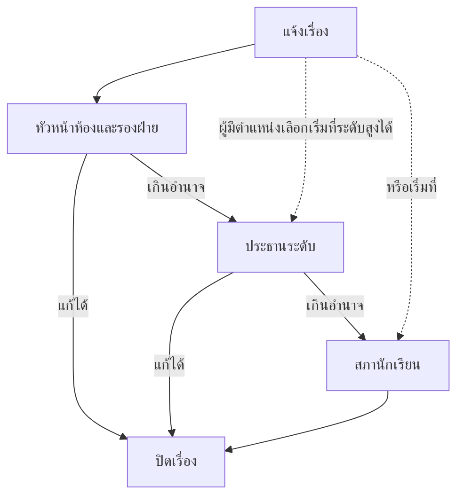

# การแจ้งเรื่องและติดตามสถานะ

เจอปัญหาที่โรงเรียนแล้วไม่รู้จะบอกใคร ใช้หน้านี้ส่งเรื่องได้เลย
ไม่ว่าจะเป็นข้อเสนอแนะ เรื่องสุขภาพกายและใจ หรือเหตุที่ต้องให้คนตรวจสอบ
ส่งแล้วยังตามดูได้ด้วยว่าเรื่องไปถึงใครและอยู่ขั้นไหน

## ส่งเรื่องใหม่ในสามขั้น

กดปุ่มกลม ๆ **แจ้งเรื่อง** ที่มุมล่างขวาของหน้าแรกหรือหน้าเรื่อง
แล้วทำตามสามขั้นต่อไปนี้

### ขั้นที่ 1 เลือกประเภท

1. เลือกหมวดหลักจากสามการ์ดในภาพ
2. เลือกหมวดย่อยที่ตรงกับเรื่องมากที่สุด
3. กด **ถัดไป**

| หมวดหลัก | ใช้กับเรื่อง |
|---|---|
| **เสนอความคิดเห็น** | ข้อเสนอด้านวิชาการ ปฏิคม กิจกรรม วินัย หรือประชาธิปไตย |
| **สุขภาวะทางกายและใจ** | สุขภาพกาย ความเครียด ความสัมพันธ์ และสุขภาพใจ |
| **แจ้งเหตุ** | เรื่องที่ต้องให้ตรวจสอบหรือแก้ไข เช่น ร้องทุกข์ ร้องเรียน |

เลือกให้ตรงจะช่วยให้เรื่องถึงคนที่ดูแลด้านนั้นเร็วขึ้น

### ขั้นที่ 2 เขียนรายละเอียด

1. ตั้ง **หัวข้อ** ให้สั้นและบอกเรื่องตรง ๆ อย่างน้อย 3 ตัวอักษร
2. เขียน **รายละเอียด** ว่าที่ไหน เมื่อไร เกิดอะไรขึ้น และอยากให้แก้อย่างไร
3. ถ้าไม่อยากให้เห็นชื่อ ให้ติ๊ก **ซ่อนชื่อฉัน (ไม่ระบุตัวตน)** ตามหมายเลข 3 ในภาพ
4. กด **ถัดไป**

::: tip เขียนอย่างไรให้เรื่องจบเร็ว
- บอกสถานที่ให้ชัด เช่น "ห้องน้ำอาคาร 3 ชั้น 2" ไม่ใช่แค่ "ห้องน้ำ"
- บอกเวลาที่เจอ ถ้าเกิดซ้ำให้บอกว่าซ้ำบ่อยแค่ไหน
- บอกสิ่งที่อยากให้เป็น ไม่ต้องยาว แต่ขอให้ตรงจุด
:::

### ขั้นที่ 3 ตรวจและส่ง

1. อ่านทวนหัวข้อ รายละเอียด และประเภทอีกครั้ง
2. เลือกปลายทางตามหมายเลข 1–3 ในภาพ
3. กด **ส่งเรื่อง** ตามหมายเลข 4

| ปลายทาง | เรื่องจะไปที่ไหน |
|---|---|
| **ดำเนินการปกติ** | ไปตามลำดับชั้น เริ่มจากหัวหน้าห้องและรองฝ่าย |
| **โหวตสาธารณะ** | ขอให้สภานักเรียนพิจารณาเปิดเป็นบอร์ดโหวต |
| **พูดคุยสาธารณะ** | ขอให้สภานักเรียนพิจารณาเปิดเป็นบอร์ดพูดคุย |

หลังส่งสำเร็จ ระบบจะแสดงหน้า **ส่งเรื่องสำเร็จ** พร้อม **เลขที่เรื่อง**

::: tip จดเลขที่เรื่องไว้
แคปหน้าจอหรือจดเลขไว้ก็ได้ ถ้าวันหลังหาเรื่องใน **ของฉัน** ไม่เจอ
จะได้บอกเลขนี้ให้เจ้าหน้าที่ช่วยตรวจสอบ
:::

## ซ่อนชื่อฉัน (ไม่ระบุตัวตน)

การติ๊ก **ซ่อนชื่อฉัน (ไม่ระบุตัวตน)** ช่วยให้คนที่เปิดเรื่องอ่านไม่เห็นว่าใครแจ้ง
แต่ไม่ได้ทำให้เรื่องล่องหนจากคนที่ต้องแก้

::: warning เรื่องที่ควรรู้ก่อนติ๊ก
- คนที่ต้องลงมือแก้ปัญหาอาจยังเห็นข้อมูลเท่าที่จำเป็น
- คอมเมนต์ใต้เรื่องจะแสดงชื่อจริงของผู้เขียนเสมอ แม้เรื่องจะไม่ระบุตัวตน
- อย่าใส่ชื่อ เบอร์โทร หรือชื่อเล่นที่เพื่อนรู้กันในข้อความ
  ถ้าอยากปิดชื่อจริง ๆ ให้เล่าเหตุการณ์โดยไม่ระบุว่าเป็นใคร
:::

## ขอให้เรื่องขึ้นบอร์ดสาธารณะ

ถ้าคิดว่าเรื่องนี้ควรให้เพื่อนทั้งโรงเรียนช่วยกันตัดสิน เลือก **โหวตสาธารณะ**
หรือ **พูดคุยสาธารณะ** ตอนขั้นที่ 3

::: info ต้องรอสภาอนุมัติ
การขอเผยแพร่ไม่ได้แปลว่าจะได้บอร์ดทันที สภานักเรียนต้องพิจารณาก่อน
ถ้าอนุมัติ เรื่องจะกลายเป็นบอร์ดให้คนอื่นเข้ามาโหวตหรือแสดงความคิดเห็น
ถ้าไม่อนุมัติ เรื่องจะดำเนินต่อตามขั้นตอนปกติ
:::

ถ้าเป็นผู้มีตำแหน่งในสภา ในขั้นที่ 2 จะเลือกได้ว่าให้เรื่องเริ่มที่ระดับไหน
เช่น เริ่มที่ประธานระดับหรือสภานักเรียนเลย ไม่ต้องเริ่มจากห้อง

## ติดตามว่าเรื่องถึงไหนแล้ว

1. กดแท็บ **เรื่อง** ที่แถบล่าง
2. เลือก **ของฉัน**
3. กดเรื่องที่ต้องการ

ในรายการจะเห็นชื่อเรื่อง สถานะ และวันที่แจ้ง กดเข้าไปจะเจอรายละเอียดเต็ม

สถานะที่อาจเจอมีหกแบบ

| ป้าย | ความหมาย |
|---|---|
| **รอรับ** | ส่งเรื่องแล้ว แต่ยังไม่มีคนกดรับ |
| **กำลังทำ** | มีคนรับเรื่องและกำลังดำเนินการ |
| **ส่งต่อ** | ส่งขึ้นไปยังระดับที่สูงกว่า เพราะเกินอำนาจของระดับเดิม |
| **เสร็จแล้ว** | แก้ไขเรียบร้อยและปิดเรื่องแล้ว |
| **ยกเลิก** | ผู้แจ้งยกเลิกเอง |
| **ปฏิเสธ** | ผู้ดูแลพิจารณาแล้วไม่รับเรื่อง |

ถ้ามี **กำหนดแก้ไข** ระบบจะนับถอยหลังให้เห็นว่าเหลือกี่วัน
ถ้าเลยกำหนดจะขึ้นว่า **เกินเวลา!** ซึ่งหมายถึงต้องมีการขยายเวลาหรือส่งต่อ

## แก้ไขหรือยกเลิกเรื่อง

แก้ได้เฉพาะเรื่องที่ยังไม่ปิด และต้องเป็นคนที่แจ้งเอง

1. เปิดรายละเอียดเรื่อง
2. กดเมนูตัวเลือกแล้วเลือก **แก้ไขเรื่อง**
3. แก้หัวข้อ รายละเอียด หรือการไม่ระบุตัวตน
4. กด **บันทึกการแก้ไข**

ถ้าเปลี่ยนใจไม่อยากให้ดำเนินการต่อ ให้กด **ยกเลิกเรื่อง** แล้วยืนยัน
เรื่องที่ **เสร็จแล้ว** **ยกเลิก** หรือ **ปฏิเสธ** แล้วจะแก้ไม่ได้อีก
ถ้าอยากได้เรื่องใหม่ ให้แจ้งใหม่แทน

## ลำดับการดูแลและส่งต่อเรื่อง

เรื่องหนึ่งเรื่องจะไต่ขึ้นไปตามระดับ จนกว่าจะมีคนแก้ได้จริง
เริ่มที่หัวหน้าห้องและรองฝ่าย ถ้าแก้ไม่ได้จะส่งต่อให้ประธานระดับ
และส่งต่อไปถึงสภานักเรียนตามลำดับ

คนที่เห็นเรื่องได้คือผู้แจ้งเอง ระดับที่สูงกว่าจะมองเห็นเรื่องของระดับล่าง
ครูเห็นเฉพาะระดับชั้นที่ดูแล และสภานักเรียนเห็นทั้งโรงเรียน
การซ่อนชื่อช่วยปิดชื่อผู้แจ้ง แต่ไม่ได้ซ่อนเรื่องจากคนที่มีสิทธิ์ดูแล

## ระบบทำอะไรเบื้องหลัง

เมื่อส่งเรื่อง ระบบจะแจ้งเตือนคนที่ต้องรับเรื่องในระดับนั้นทันที
ทุกครั้งที่สถานะเปลี่ยนหรือมีคนคอมเมนต์ ผู้แจ้งจะได้รับการแจ้งเตือนด้วย

เรื่องที่ขอเป็นบอร์ดจะถูกส่งตรงไปที่สภานักเรียนก่อนเสมอ
ไม่ว่าผู้แจ้งจะอยู่ระดับไหน

การแก้ไขทุกครั้งถูกบันทึกไว้ในประวัติของเรื่อง เพื่อให้ตรวจย้อนหลังได้ว่าใครทำอะไร

## ข้อจำกัดและข้อควรระวัง

- แนบรูปหรือไฟล์ไม่ได้ ถ้าต้องการให้เห็นภาพ ให้อธิบายสถานที่ให้ชัด
- ไม่มีช่องค้นหาด้วยเลขที่เรื่องจากหน้าแรก ต้องเข้าไปดูใน **ของฉัน**
- แก้ไขหรือยกเลิกไม่ได้หลังเรื่องปิดแล้ว
- การขอเผยแพร่เป็นบอร์ดต้องรอสภาอนุมัติ
- คอมเมนต์แสดงชื่อจริงเสมอ

## แก้ไขปัญหาและคำถามที่พบบ่อย

**ถาม: ส่งเรื่องแล้วไม่เห็นใน "ของฉัน"**
ตอบ: เช็กว่าเข้าด้วยบัญชีเดียวกับตอนส่ง แล้วกดรีเฟรชรายการ
ถ้ายังไม่เห็น ให้บอกผู้ดูแลพร้อมเลขที่เรื่อง

**ถาม: ทำไมไม่มีปุ่มแก้ไขเรื่อง**
ตอบ: เรื่องอาจปิดแล้ว หรือบัญชีนี้ไม่ใช่คนที่แจ้งเรื่องนั้น

**ถาม: ขึ้นว่าเกินเวลาแล้วแต่ยังไม่เสร็จ ต้องทำอย่างไร**
ตอบ: ผู้รับเรื่องต้องขยายเวลาหรือส่งต่อ ระหว่างนี้เราคอมเมนต์ถามความคืบหน้าในเรื่องได้

**ถาม: ขอโหวตสาธารณะแล้วแต่ไม่เห็นบอร์ด**
ตอบ: สภายังไม่ได้อนุมัติ ติดตามสถานะใน **ของฉัน** ก่อน
ถ้าอนุมัติแล้วบอร์ดจะขึ้นในแท็บ **บอร์ด**

**ถาม: แจ้งแบบไม่ระบุตัวตนแล้วทำไมครูยังติดต่อได้**
ตอบ: ระบบซ่อนชื่อจากคนที่เปิดเรื่อง แต่คนที่ต้องแก้ปัญหาอาจเห็นข้อมูลที่จำเป็น
ถ้าอยากเป็นส่วนตัวมากกว่านี้ ให้เลี่ยงการใส่ข้อมูลที่ระบุตัวตนในข้อความ

**ถาม: ยกเลิกเรื่องแล้วกลับมาแก้ได้ไหม**
ตอบ: ไม่ได้ ถ้าอยากดำเนินการต่อต้องแจ้งเรื่องใหม่
