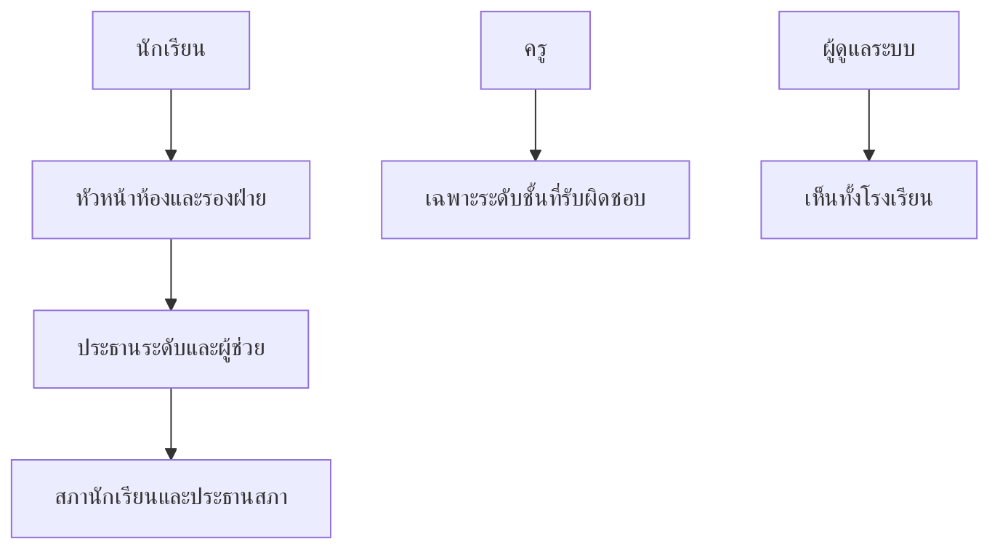

# แจ้งเรื่องและติดตามสถานะ

บทนี้อธิบายวิธีส่งปัญหา ข้อเสนอแนะ หรือคำร้องเรียน และวิธีติดตามว่าถูกส่งไปถึงใครแล้ว

## ใครใช้บทนี้

นักเรียนและบุคลากรทุกคนที่ต้องการแจ้งเรื่องหรือติดตามเรื่องของตนเอง

## ก่อนเริ่ม

- เข้าสู่ระบบแล้ว
- เรื่องทุกเรื่องต้องเลือกหมวดหลักและหมวดย่อย
- ระบบยังไม่รองรับการแนบรูปหรือไฟล์ในเรื่อง

## ถ้าต้องการแจ้งเรื่องใหม่

1. กดปุ่ม **แจ้งเรื่อง** ที่มุมล่างขวา หรือเปิดแท็บ **เรื่อง** แล้วกดปุ่มเดียวกัน
2. ขั้นที่ 1 **ประเภท** เลือกหมวดหลัก เช่น **เสนอความคิดเห็น** **สุขภาวะทางกายและใจ** หรือ **แจ้งเหตุ**
3. เลือกหมวดย่อยให้ตรงกับเรื่องมากที่สุด
4. กด **ถัดไป**
5. ขั้นที่ 2 **รายละเอียด** ตั้ง **หัวข้อ** อย่างน้อย 3 ตัวอักษร
6. อธิบาย **รายละเอียด** อย่างน้อย 3 ตัวอักษร บอกสถานที่ เวลา และสิ่งที่เกิดขึ้น
7. หากไม่ต้องการให้ผู้ที่เปิดเรื่องเห็นชื่อ ให้ติ๊ก **ซ่อนชื่อฉัน (ไม่ระบุตัวตน)**
8. กด **ถัดไป**
9. ขั้นที่ 3 **ตรวจสอบ** ตรวจประเภท หัวข้อ รายละเอียด และผู้แจ้ง
10. เลือกรูปแบบการดำเนินการ
11. กด **ส่งเรื่อง**

หลังส่งสำเร็จ ระบบแสดงหน้า **ส่งเรื่องสำเร็จ** พร้อม **เลขที่เรื่อง**
และบอกว่าเรื่องถูกส่งไปยังหัวหน้าห้องและรองฝ่าย หรือส่งไปยังสภานักเรียน

## ถ้าต้องการเลือกหมวดให้ตรง

| หมวดหลัก | ใช้กับเรื่อง |
|---|---|
| **เสนอความคิดเห็น** | ข้อเสนอแนะด้านวิชาการ ปฏิคม กิจกรรม วินัย หรือประชาธิปไตย |
| **สุขภาวะทางกายและใจ** | สุขภาพกาย ความเครียด ความสัมพันธ์ และสุขภาพใจ |
| **แจ้งเหตุ** | เรื่องที่ต้องการให้ตรวจสอบหรือแก้ไข เช่น ร้องทุกข์ ร้องเรียน |

หมวดย่อยที่เลือกจะถูกบันทึกพร้อมเรื่อง และใช้กรองในหน้าของเจ้าหน้าที่

## ถ้าต้องการแจ้งแบบไม่ระบุตัวตน

1. ในขั้นที่ 2 ติ๊ก **ซ่อนชื่อฉัน (ไม่ระบุตัวตน)**
2. อ่านข้อความกำกับ: ชื่อผู้แจ้งจะถูกซ่อนจากผู้ที่เปิดเรื่อง
3. ส่งเรื่องตามปกติ

ข้อควรรู้

- คอมเมนต์ใต้เรื่องยังแสดงชื่อจริงของผู้เขียนเสมอ
- ผู้ที่ต้องดำเนินการอาจเห็นข้อมูลเท่าที่จำเป็นต่อการแก้ปัญหา
- การแจ้งแบบไม่ระบุตัวตนไม่ได้หมายความว่าไม่มีใครตรวจสอบได้

## ถ้าต้องการให้เรื่องถูกพิจารณาเป็นบอร์ดสาธารณะ

ในขั้นที่ 3 เลือกหนึ่งในสามรูปแบบ

| ตัวเลือก | ระบบทำอะไร |
|---|---|
| **ดำเนินการปกติ** | ส่งตามลำดับชั้นของพีระมิด |
| **โหวตสาธารณะ** | ส่งตรงไปสภานักเรียนเพื่อพิจารณาอนุมัติเป็นบอร์ดโหวต |
| **พูดคุยสาธารณะ** | ส่งตรงไปสภานักเรียนเพื่อพิจารณาอนุมัติเป็นบอร์ดพูดคุย |

การขอเผยแพร่ไม่ได้รับประกันว่าจะได้บอร์ด สภาต้องอนุมัติก่อน
หากไม่อนุมัติ เรื่องจะถูกปิดตามขั้นตอน

## ถ้าต้องการเริ่มที่ระดับสูงขึ้น

ผู้ที่มีตำแหน่งสามารถเลือก **ระดับเริ่มต้นของเรื่อง** ในขั้นที่ 2
เช่น เริ่มที่ระดับสภานักเรียนโดยไม่ต้องส่งต่อภายหลัง
ระบบจะตรวจว่าตำแหน่งของคุณมีสิทธิ์ถึงระดับนั้นหรือไม่

## ถ้าต้องการติดตามสถานะ

1. เปิดแท็บ **เรื่อง**
2. เลือก **ของฉัน**
3. กดเรื่องที่ต้องการ
4. อ่าน **สถานะปัจจุบัน** และ **ประวัติการดำเนินงาน**
5. หากมี **กำหนดแก้ไข** ระบบจะแสดงจำนวนวันที่เหลือหรือข้อความ **เกินเวลา!**

สถานะที่อาจพบ

| ป้าย | ความหมาย |
|---|---|
| **รอรับ** | ยังไม่มีผู้รับ |
| **กำลังทำ** | มีผู้รับและกำลังดำเนินการ |
| **ส่งต่อ** | ส่งขึ้นระดับสูงกว่า |
| **เสร็จแล้ว** | ปิดงานแล้ว |
| **ยกเลิก** | ผู้แจ้งยกเลิก |
| **ปฏิเสธ** | ผู้ดูแลไม่รับเรื่อง |

## ถ้าต้องการแสดงความคิดเห็นในเรื่อง

1. เปิดรายละเอียดเรื่อง
2. เลื่อนไปที่ **คอมเมนต์**
3. พิมพ์ข้อความแล้วกด **ส่ง**
4. คอมเมนต์ของตนเองแก้ไขหรือลบได้

ผู้ที่เห็นเรื่องได้จะเห็นคอมเมนต์ด้วย ผู้แจ้งแบบไม่ระบุตัวตนยังต้องระวังว่าคอมเมนต์จะแสดงชื่อจริง

## ถ้าต้องการแก้ไขเรื่องที่แจ้งไปแล้ว

1. เปิดรายละเอียดเรื่อง
2. กด **แก้ไขเรื่อง** ในเมนูตัวเลือก
3. แก้หมวด หัวข้อ รายละเอียด หรือการไม่ระบุตัวตน
4. กด **บันทึกการแก้ไข**

แก้ไขได้เฉพาะผู้แจ้ง และทำได้เฉพาะเรื่องที่ยังไม่ปิด
หากเรื่อง **เสร็จแล้ว** **ยกเลิก** หรือ **ปฏิเสธ** จะแก้ไม่ได้

## ถ้าต้องการยกเลิกเรื่อง

1. เปิดรายละเอียดเรื่อง
2. กด **ยกเลิกเรื่อง**
3. ยืนยัน

ผู้แจ้งยกเลิกได้จนกว่าเรื่องจะปิด หากผู้ดูแลเป็นผู้ปิด เรื่องจะมีสถานะ **ปฏิเสธ** ไม่ใช่ **ยกเลิก**

## ถ้าต้องการเก็บเรื่องไว้ดูภายหลัง

1. เปิดรายละเอียดเรื่องหรือบอร์ด
2. กดไอคอนบุ๊กมาร์กที่หัวเรื่อง
3. ไปที่ **เพิ่มเติม** แล้วเลือก **กิจกรรมของฉัน**
4. เปิดแท็บ **บันทึกไว้**

## ใครเห็นเรื่องของฉันได้บ้าง

ระบบใช้พีระมิดสิทธิ์

- ผู้แจ้งเห็นเรื่องของตนเองเสมอ
- ระดับที่สูงกว่ามองเห็นเรื่องของระดับล่าง
- ครูเห็นเฉพาะระดับชั้นที่รับผิดชอบ
- ประธานระดับเห็นเฉพาะระดับของตน
- สภานักเรียนและผู้ดูแลระบบเห็นทั้งโรงเรียน
- การแจ้งแบบไม่ระบุตัวตนซ่อนชื่อผู้แจ้ง แต่ไม่ซ่อนเรื่องจากผู้ที่มีสิทธิ์

## ระบบทำอะไรเบื้องหลัง

- สร้างแถวใน `issues` พร้อมสถานะ `pending` และบันทึกประวัติการเปลี่ยนแปลง
- แจ้งเตือนผู้รับในระดับเริ่มต้นทันที
- หากเลือกโหวตหรือพูดคุย ระบบบังคับระดับเริ่มต้นเป็นสภานักเรียน
- ทุกการกระทำถูกบันทึกในบันทึกการใช้งาน
- กำหนดแก้ไขถูกเก็บใน `issue_countdowns` และแสดงผลตามเวลาไทย

## ข้อจำกัดและข้อควรระวัง

- แนบรูปหรือไฟล์ไม่ได้
- ไม่มีช่องติดตามด้วยเลขที่เรื่องจากหน้าแรก ต้องเข้าผ่าน **เรื่องของฉัน**
- การแก้ไขหลังปิดเรื่องทำไม่ได้
- การขอเผยแพร่เป็นบอร์ดต้องรอสภาอนุมัติ
- เรื่องที่ถูกลบหรือซ่อนจากระบบจะเปิดจากลิงก์เดิมไม่ได้

## แก้ไขปัญหาและคำถามที่พบบ่อย

**ถาม: ส่งเรื่องแล้วไม่เห็นใน "ของฉัน"**
ตอบ: ตรวจว่าเข้าด้วยบัญชีเดียวกับตอนส่ง และกดรีเฟรชรายการ
หากยังไม่เห็น ให้แจ้งผู้ดูแลพร้อมเลขที่เรื่อง

**ถาม: ทำไมไม่มีปุ่มแก้ไขเรื่อง**
ตอบ: เรื่องอาจปิดแล้ว หรือบัญชีไม่ใช่ผู้แจ้งเรื่องนั้น

**ถาม: เรื่องขึ้น "เกินเวลา!" แต่ยังไม่เสร็จ ต้องทำอย่างไร**
ตอบ: ผู้รับเรื่องต้องขยายเวลาหรือส่งต่อ ผู้แจ้งสามารถคอมเมนต์สอบถามในเรื่องได้

**ถาม: ขอโหวตสาธารณะแล้วแต่ไม่เห็นบอร์ด**
ตอบ: สภาต้องอนุมัติก่อน หากยังไม่อนุมัติ เรื่องจะยังไม่กลายเป็นบอร์ด
ติดตามสถานะใน **เรื่องของฉัน**

**ถาม: แจ้งแบบไม่ระบุตัวตนแล้วทำไมครูยังติดต่อได้**
ตอบ: ระบบซ่อนชื่อจากผู้ที่เปิดเรื่อง แต่ผู้ที่ต้องแก้ปัญหาอาจเห็นข้อมูลที่จำเป็น
หากต้องการความเป็นส่วนตัวมากขึ้น ให้หลีกเลี่ยงการใส่ข้อมูลที่ระบุตัวตนในข้อความ

**ถาม: ยกเลิกเรื่องแล้วกลับมาแก้ไม่ได้หรือ**
ตอบ: ไม่ได้ สถานะยกเลิกเป็นการปิดเรื่องถาวรสำหรับผู้ใช้ หากต้องการแจ้งใหม่ให้สร้างเรื่องใหม่
