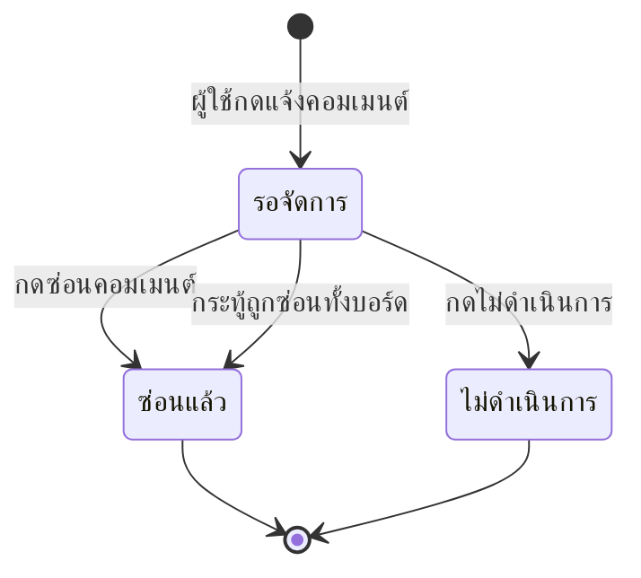

# ตรวจเนื้อหาและการรายงาน

บทนี้อธิบายวิธีตรวจคิวรายงานคอมเมนต์ ตัดสินว่าจะซ่อนหรือไม่ดำเนินการ และวิธีซ่อนกระทู้ทั้งบอร์ดเมื่อเนื้อหาผิดกฎ

## ใครใช้บทนี้

สภานักเรียน ประธานสภา ครูสภานักเรียน และผู้ดูแลระบบ
ระบบตรวจสิทธิ์จากบทบาทโดยตรง ไม่ได้ใช้สิทธิ์รายข้อ

## ก่อนเริ่ม

- ต้องมีบทบาท `council_member` `council_president` `teacher_council` หรือเป็นผู้ดูแลระบบ
- อ่านคอมเมนต์และบริบทของกระทู้ก่อนตัดสิน ไม่ใช่ดูแค่ข้อความที่ถูกแจ้ง
- การซ่อนมีผลทันทีกับทุกคน และหน้าจอยังไม่มีปุ่มเลิกซ่อน
- เก็บเหตุผลให้ชัด เพราะระบบส่งเหตุผลถึงเจ้าของเนื้อหาและบันทึกไว้ตรวจย้อนหลัง

## เปิดคิวรายงาน

1. เปิด **เพิ่มเติม**
2. ในกลุ่ม **ผู้ดูแล** เลือก **จัดการรายงาน**
3. ระบบเปิดแท็บ **รอจัดการ** ให้อัตโนมัติ
4. อ่านการ์ดแต่ละรายการ ซึ่งแสดงชื่อบอร์ด ข้อความที่ถูกแจ้ง เหตุผล ผู้แจ้ง และเวลา
5. กดชื่อบอร์ดเพื่อเปิดกระทู้และอ่านบริบทก่อนตัดสิน

แท็บที่มีให้เลือกคือ **ทั้งหมด** **รอจัดการ** **ซ่อนแล้ว** และ **ไม่ดำเนินการ**
ใช้ช่องค้นหาเพื่อหาชื่อบอร์ดหรือข้อความในคอมเมนต์ และใช้เมนู **ทุกเหตุผล** เพื่อกรองตามประเภท
รายการแสดงหน้าละ 15 รายการ และตัวเลขมุมขวาบอกจำนวนทั้งหมดในเงื่อนไขที่กรองอยู่

> **ภาพที่ 17 — คิวรายงาน**
> - **ไฟล์:** `docs/assets/screenshots/staff/17-moderation.webp`
> - **แคป:** แท็บ **รอจัดการ** ที่มีรายงานค้างอย่างน้อย 1 รายการ — **ใช้เป็น placeholder** เพราะ staging ไม่มีรายงานที่รอตัดสินในขณะแคป แคปเองได้โดยใช้บัญชี e2e รายงานโพสต์ทดสอบหนึ่งครั้งแล้วเปิดแท็บนี้ ก่อนลบโพสต์ทดสอบทิ้ง
> - **ครอป/ไฮไลต์:** ครอปการ์ดรายงาน ป้ายเหตุผล และปุ่ม **ซ่อนคอมเมนต์** กับ **ไม่ดำเนินการ**
> - **PDPA:** ใช้บอร์ด e2e และเบลอชื่อผู้แจ้งทุกรายการ

## ตัดสินรายงานแต่ละรายการ

เลือกได้สองทาง

| ทางเลือก | ใช้เมื่อ | ผล |
|---|---|---|
| **ซ่อนคอมเมนต์** | ข้อความผิดกฎ กลั่นแกล้ง หรือเปิดเผยข้อมูลส่วนตัว | ซ่อนคอมเมนต์และรีพลายทั้งหมดใต้คอมเมนต์นั้น |
| **ไม่ดำเนินการ** | ข้อความไม่ผิดกฎ หรือเป็นการวิจารณ์ที่รับได้ | คอมเมนต์ยังแสดงอยู่ ปิดเฉพาะรายงานนี้ |

### ซ่อนคอมเมนต์จากคิวรายงาน

1. เปิด **จัดการรายงาน**
2. กด **ซ่อนคอมเมนต์** ที่รายการที่ต้องการ
3. อ่านคำเตือนว่าคอมเมนต์และรีพลายจะถูกซ่อนทันที
4. กรอกหมายเหตุ (ไม่บังคับ) ไม่เกิน 500 ตัวอักษร
5. กด **ซ่อนคอมเมนต์**

ระบบปิดรายงานที่ค้างอยู่ทั้งหมดของคอมเมนต์ชุดเดียวกันให้ด้วย
ผู้แจ้งทุกคนได้รับแจ้งเตือนว่าสภานักเรียนจัดการแล้ว

### ไม่ดำเนินการ

1. กด **ไม่ดำเนินการ** ที่รายการ
2. กรอกหมายเหตุ (ไม่บังคับ)
3. กด **ไม่ดำเนินการ**

ระบบปิดเฉพาะรายงานนี้ คอมเมนต์ยังอยู่ และผู้แจ้งได้รับการแจ้งเตือนผลการตรวจ
รายงานอื่นที่แจ้งคอมเมนต์เดียวกันยังค้างอยู่และต้องตัดสินแยก

## ซ่อนคอมเมนต์ตรงจากหน้ากระทู้

ใช้เมื่ออ่านกระทู้แล้วพบข้อความผิดกฎโดยยังไม่มีใครแจ้ง

1. เปิดกระทู้จากบอร์ด
2. กด **ซ่อน** ใต้คอมเมนต์นั้น
3. กรอกเหตุผล (จำเป็น) ไม่เกิน 200 ตัวอักษร
4. กด **ซ่อนคอมเมนต์**

ปุ่ม **ซ่อน** แสดงเฉพาะผู้มีอำนาจระดับสภาและผู้ดูแลระบบ
คอมเมนต์ของตัวเองก็ซ่อนได้ด้วยวิธีนี้

## ซ่อนกระทู้ทั้งบอร์ด

ใช้เมื่อตัวกระทู้เองผิดกฎ เช่น พาดหัวใส่ร้าย หรือเนื้อหาเปิดเผยข้อมูลส่วนตัว

1. เปิดหน้ารายละเอียดกระทู้
2. กด **ซ่อนบอร์ด** ที่มุมขวาของหัวกระทู้
3. กรอกเหตุผล (จำเป็น) ไม่เกิน 200 ตัวอักษร
4. กด **ซ่อนบอร์ด**

ผลที่เกิดขึ้น

- กระทู้หายจากรายการบอร์ดและเปิดจากลิงก์เดิมไม่ได้
- รายงานที่ค้างทั้งหมดของกระทู้นี้ถูกปิดพร้อมหมายเหตุว่า **ซ่อนบอร์ด: เหตุผล**
- เจ้าของกระทู้ได้รับการแจ้งเตือน **กระทู้ของคุณถูกซ่อน** พร้อมเหตุผล
- คอมเมนต์ทั้งหมดในกระทู้ไม่แสดงเพราะเปิดกระทู้ไม่ได้

## ลำดับการตัดสินรายงาน

สถานะที่ระบบเก็บจริงคือ `open`, `resolved`, `dismissed`
ระบบไม่ให้จัดการรายงานที่ปิดแล้วซ้ำ และตอบ **รายงานนี้ถูกจัดการไปแล้ว**

## เหตุผลการแจ้งที่ระบบรองรับ

| เหตุผล | ใช้กับ |
|---|---|
| **กลั่นแกล้ง/คุกคาม** | ข้อความที่มุ่งทำร้ายหรือข่มขู่บุคคล |
| **คำหยาบคาย** | ถ้อยคำหยาบที่ไม่มีเนื้อหาสาระ |
| **สแปม/โฆษณา** | โพสต์ซ้ำ ขายของ หรือลิงก์ชักชวน |
| **เปิดเผยข้อมูลส่วนตัว** | เบอร์โทร ที่อยู่ รูป หรือข้อมูลระบุตัวบุคคล |
| **อื่นๆ** | กรณีที่ไม่อยู่ในสี่ประเภทข้างต้น |

ผู้แจ้งเลือกได้หนึ่งเหตุผลและใส่รายละเอียดเพิ่มได้ไม่เกิน 500 ตัวอักษร
ผู้แจ้งแจ้งคอมเมนต์ของตัวเองไม่ได้ และแจ้งซ้ำคอมเมนต์เดิมไม่ได้

## ระบบทำอะไรเบื้องหลัง

- การซ่อนคอมเมนต์ไล่ซ่อนลูกหลานทั้งหมดใต้คอมเมนต์นั้น และลดตัวนับคอมเมนต์ของบอร์ดตามจำนวนที่ซ่อนจริง
- ระบบซ่อนซ้ำได้ปลอดภัย ตัวนับไม่ติดลบ และไม่นับคอมเมนต์ที่ซ่อนไปแล้ว
- มีการตรวจซ้ำสูงสุด 3 รอบเพื่อจับรีพลายที่เพิ่งเข้ามาระหว่างการซ่อน
- คอมเมนต์ที่ซ่อนแล้วไม่แสดงให้ใครเห็นในหน้าจอ รวมถึงสภานักเรียน
- การซ่อนบอร์ดเปลี่ยนสถานะเป็น `hidden` และปิดรายงานที่ค้างทั้งหมดของบอร์ดในทรานแซกชันเดียว
- ทุกการซ่อนและการตัดสินรายงานเขียนบันทึกการใช้งานพร้อมผู้ทำ เหตุผล และจำนวนคอมเมนต์ที่ถูกซ่อน
- การแจ้งของผู้ใช้บันทึกเป็น `REPORT_COMMENT` และผู้แจ้งเห็นสถานะการจัดการในแท็บ **ไม่ดำเนินการ** หรือ **ซ่อนแล้ว**

## ข้อจำกัดและข้อควรระวัง

- หน้าจอไม่มีปุ่มเลิกซ่อนทั้งคอมเมนต์และบอร์ด ต้องให้ผู้ดูแลระบบเรียก API `POST /api/boards/{id}/unhide` หรือ `POST /api/boards/{board_id}/comments/{comment_id}/unhide`
- คอมเมนต์ที่ซ่อนแล้วมองไม่เห็นจากหน้าจอแม้เป็นผู้ดูแลระบบ ต้องเปิดจากฐานข้อมูลหรือบันทึกการใช้งาน
- การซ่อนคอมเมนต์แม่จะซ่อนรีพลายทั้งหมดด้วย ไม่สามารถซ่อนเฉพาะรีพลายเดียวได้
- ไม่มีการแจ้งเตือนเจ้าของคอมเมนต์เมื่อคอมเมนต์ถูกซ่อน ยกเว้นกรณีซ่อนบอร์ดที่จะแจ้งเจ้าของกระทู้
- ผู้ใช้แจ้งค้างได้ไม่เกิน 10 รายการ ระบบตอบ **แจ้งได้ไม่เกิน 10 รายการค้างอยู่ รอสภานักเรียนจัดการก่อน**
- ระบบไม่มีคิวแยกตามระดับชั้น รายงานทุกอันไปที่ศูนย์กลางเดียวกัน
- ไม่มีระบบลงโทษหรือระงับบัญชีอัตโนมัติ การตัดสินทั้งหมดทำด้วยคน

## แก้ไขปัญหาและคำถามที่พบบ่อย

**ถาม: เข้าหน้ารายการรายงานแล้วขึ้นว่าเฉพาะสภานักเรียน/แอดมิน**
ตอบ: บัญชีไม่มีบทบาทระดับสภา หรือยังไม่มีแถวสมาชิกในปีการศึกษาปัจจุบัน
ให้ผู้ดูแลระบบตรวจบทบาทและปีการศึกษาที่ผูกกับบัญชี

**ถาม: กดซ่อนคอมเมนต์แล้วขึ้น "รายงานนี้ถูกจัดการไปแล้ว"**
ตอบ: มีผู้จัดการรายงานนี้ก่อนแล้ว หรือบอร์ดถูกซ่อนทั้งกระทู้
กดรีเฟรชคิวเพื่อดูสถานะล่าสุด

**ถาม: ซ่อนผิด อยากให้คอมเมนต์กลับมา**
ตอบ: หน้าจอยังไม่มีปุ่มเลิกซ่อน ให้แจ้งผู้ดูแลระบบเรียก API เลิกซ่อน
พร้อมระบุเลขบอร์ดและเลขคอมเมนต์จากบันทึกการใช้งาน

**ถาม: ผู้ใช้บอกว่ากดแจ้งไม่ได้**
ตอบ: ตรวจสามกรณี คือ แจ้งคอมเมนต์ของตัวเอง แจ้งซ้ำคอมเมนต์เดิม หรือมีรายงานค้างครบ 10 รายการ
เมื่อจัดการรายงานที่ค้าง ผู้ใช้จะแจ้งใหม่ได้

**ถาม: ซ่อนบอร์ดแล้วทำไมรายงานในคิวยังค้าง**
ตอบ: ไม่ควรค้าง ระบบปิดรายงานทั้งหมดของบอร์ดนั้นพร้อมกัน
ให้กดรีเฟรช หากยังค้างให้แจ้งผู้ดูแลระบบพร้อมเลขรายงาน

**ถาม: คอมเมนต์ที่ซ่อนแล้วยังค้นเจอในช่องค้นหาไหม**
ตอบ: ไม่เจอ ช่องค้นหาอ่านเฉพาะรายงาน ไม่ได้อ่านคอมเมนต์ที่ซ่อน
หากต้องการตรวจย้อนหลัง ให้ใช้ **บันทึกการใช้งาน** ของผู้ดูแลระบบ

**ถาม: ต้องระบุเหตุผลทุกครั้งไหม**
ตอบ: การซ่อนคอมเมนต์และซ่อนบอร์ดต้องระบุเหตุผลเสมอ
ส่วน **ไม่ดำเนินการ** ใส่หมายเหตุหรือไม่ใส่ก็ได้ แต่ควรใส่เพื่อให้ตรวจย้อนหลังได้
