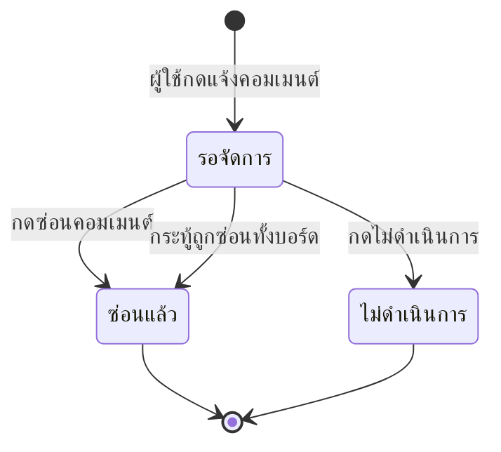

# ตรวจเนื้อหาและการรายงาน

มีคนกดรายงานคอมเมนต์หรือกระทู้เข้ามา ต้องอ่านแล้วตัดสินว่าจะซ่อนหรือปล่อยไว้
บทนี้รวมทั้งคิวรายงาน การซ่อนคอมเมนต์ และการซ่อนกระทู้ทั้งบอร์ด

- เปิดคิวรายงานได้จากเมนู **จัดการรายงาน**
- ซ่อนคอมเมนต์แล้ว รีพลายใต้คอมเมนต์นั้นหายไปด้วยทั้งหมด
- ซ่อนแล้วยังไม่มีปุ่มเลิกซ่อนจากหน้าจอ ต้องให้ผู้ดูแลระบบช่วย

## ใครใช้บทนี้

สภานักเรียน ประธานสภา ครูสภานักเรียน และผู้ดูแลระบบ
ระบบดูจากบทบาทโดยตรง ไม่ได้ใช้สิทธิ์รายข้อ

## เปิดคิวรายงาน

**ทางเข้า:** แท็บ **เพิ่มเติม** ➔ กลุ่ม **ผู้ดูแล** ➔ **จัดการรายงาน**

ระบบเปิดแท็บ **รอจัดการ** ให้เลย การ์ดแต่ละใบมีชื่อบอร์ด ข้อความที่ถูกแจ้ง เหตุผล คนแจ้ง และเวลา
กดชื่อบอร์ดเพื่อเปิดกระทู้และอ่านบริบทก่อนตัดสินได้

แท็บที่สลับดูได้มี **ทั้งหมด** **รอจัดการ** **ซ่อนแล้ว** และ **ไม่ดำเนินการ**
ใช้ช่องค้นหาเพื่อหาชื่อบอร์ดหรือข้อความในคอมเมนต์ และเมนู **ทุกเหตุผล** เพื่อกรองตามประเภท
หน้าละ 15 รายการ ตัวเลขมุมขวาบอกจำนวนทั้งหมดในเงื่อนไขที่กรองอยู่

หน้าแรกของคิวจะเปิดแท็บ **รอจัดการ** ให้เอง พร้อมตัวกรองและช่องค้นหา

*หมายเลข 1 คือแท็บ รอจัดการ หมายเลข 2 คือตัวกรองทุกเหตุผล หมายเลข 3 คือช่องค้นหา และหมายเลข 4 คือสถานะว่างเมื่อไม่มีรายงานค้าง*

## ตัดสินรายงานแต่ละรายการ

เลือกได้สองทาง

- 🚫 **ซ่อนคอมเมนต์** — ใช้เมื่อข้อความผิดกฎ กลั่นแกล้ง หรือเปิดเผยข้อมูลส่วนตัว
- ✅ **ไม่ดำเนินการ** — ใช้เมื่อข้อความไม่ผิดกฎ หรือเป็นการวิจารณ์ที่รับได้

### ซ่อนคอมเมนต์จากคิวรายงาน

1. **กด ซ่อนคอมเมนต์** ที่รายการที่ต้องการ
2. **อ่านคำเตือน** ว่าคอมเมนต์และรีพลายจะถูกซ่อนทันที
3. **กรอกหมายเหตุ** ถ้าอยากให้มี (ไม่บังคับ)
4. **กด ซ่อนคอมเมนต์** อีกครั้งเพื่อยืนยัน

ระบบปิดรายงานที่ค้างอยู่ทั้งหมดของคอมเมนต์ชุดเดียวกันให้ด้วย
และแจ้งเตือนคนที่กดแจ้งทุกคนว่าสภานักเรียนจัดการแล้ว

### ไม่ดำเนินการ

**ทางเข้า:** **จัดการรายงาน** ➔ **ไม่ดำเนินการ** ➔ กรอกหมายเหตุถ้าต้องการ ➔ **ไม่ดำเนินการ**

ระบบปิดเฉพาะรายงานใบนี้ คอมเมนต์ยังอยู่ครบ และคนแจ้งจะได้รับการแจ้งเตือนผลการตรวจ
รายงานใบอื่นที่แจ้งคอมเมนต์เดียวกันยังค้างอยู่ ต้องตัดสินแยกทีละใบ

รายงานที่ปิดแล้วจะไปอยู่ในแท็บ **ไม่ดำเนินการ** พร้อมเหตุผลกำกับ

*หมายเลข 1 คือแท็บ ไม่ดำเนินการ หมายเลข 2 คือป้ายผลตัดสิน และหมายเลข 3 คือเหตุผล อื่นๆ ที่เลือกไว้*

## ซ่อนคอมเมนต์จากหน้ากระทู้

ใช้ตอนอ่านกระทู้แล้วเจอข้อความผิดกฎเอง โดยที่ยังไม่มีใครกดแจ้ง

**ทางเข้า:** เปิดกระทู้จากบอร์ด ➔ **ซ่อน** ใต้คอมเมนต์นั้น ➔ กรอกเหตุผล (จำเป็น) ➔ **ซ่อนคอมเมนต์**

ปุ่ม **ซ่อน** จะเห็นเฉพาะคนระดับสภาและผู้ดูแลระบบ
คอมเมนต์ของตัวเองก็ซ่อนด้วยวิธีนี้ได้

## ซ่อนกระทู้ทั้งบอร์ด

ใช้เมื่อตัวกระทู้ผิดกฎ เช่น พาดหัวใส่ร้าย หรือเนื้อหาเปิดเผยข้อมูลส่วนตัว

**ทางเข้า:** เปิดหน้ารายละเอียดกระทู้ ➔ **ซ่อนบอร์ด** มุมขวาของหัวกระทู้ ➔ กรอกเหตุผล (จำเป็น) ➔ **ซ่อนบอร์ด**

ปุ่ม **ซ่อนบอร์ด** อยู่มุมขวาของหัวกระทู้ และแต่ละคอมเมนต์มีปุ่ม **ซ่อน** กับ **แจ้ง** ของตัวเอง

*หมายเลข 1 คือ ซ่อนบอร์ด หมายเลข 2 คือ ซ่อน ใต้คอมเมนต์ และหมายเลข 3 คือ แจ้ง*

พอกดแล้วจะเกิดสี่อย่างนี้

- กระทู้หายจากรายการบอร์ด และเปิดจากลิงก์เดิมไม่ได้
- รายงานที่ค้างทั้งหมดของกระทู้นี้ถูกปิดพร้อมหมายเหตุ **ซ่อนบอร์ด: เหตุผล**
- เจ้าของกระทู้ได้แจ้งเตือน **กระทู้ของคุณถูกซ่อน** พร้อมเหตุผล
- คอมเมนต์ทั้งหมดในกระทู้ไม่แสดง เพราะเปิดกระทู้ไม่ได้

## ลำดับการตัดสินรายงาน

ในฐานข้อมูล สถานะที่เก็บจริงคือ `open` `resolved` และ `dismissed`
รายงานที่ปิดแล้วกดซ้ำไม่ได้ ระบบจะตอบว่า **รายงานนี้ถูกจัดการไปแล้ว**

## เหตุผลการแจ้งที่ระบบมี

- 🤬 **กลั่นแกล้ง/คุกคาม** — ข้อความที่มุ่งทำร้ายหรือข่มขู่คนอื่น
- 🤐 **คำหยาบคาย** — ถ้อยคำหยาบที่ไม่มีเนื้อหาสาระ
- 📢 **สแปม/โฆษณา** — โพสต์ซ้ำ ขายของ หรือลิงก์ชักชวน
- 🔒 **เปิดเผยข้อมูลส่วนตัว** — เบอร์โทร ที่อยู่ รูป หรือข้อมูลระบุตัวบุคคล
- ❓ **อื่นๆ** — กรณีที่ไม่อยู่ในสี่ข้อข้างบน

คนแจ้งเลือกได้ครั้งละหนึ่งเหตุผล และพิมพ์รายละเอียดเพิ่มได้
แจ้งคอมเมนต์ของตัวเองไม่ได้ และแจ้งซ้ำคอมเมนต์เดิมก็ไม่ได้

## ข้อจำกัดและข้อควรระวัง

::: warning ซ่อนแล้วเลิกซ่อนจากหน้าจอไม่ได้
ทั้งคอมเมนต์และบอร์ดยังไม่มีปุ่มเลิกซ่อนในหน้าจอ
ถ้าซ่อนผิด ต้องให้ผู้ดูแลระบบเรียก API `POST /api/boards/{id}/unhide` หรือ `POST /api/boards/{board_id}/comments/{comment_id}/unhide`
:::

- คอมเมนต์ที่ซ่อนแล้วมองไม่เห็นจากหน้าจอแม้เป็นผู้ดูแลระบบ ต้องเปิดจากฐานข้อมูลหรือ **บันทึกการใช้งาน**
- ซ่อนคอมเมนต์แม่แล้ว รีพลายทั้งหมดหายตาม ซ่อนเฉพาะรีพลายเดียวไม่ได้
- เจ้าของคอมเมนต์ไม่ได้รับการแจ้งเตือนตอนคอมเมนต์ถูกซ่อน ยกเว้นกรณีซ่อนบอร์ด
- แต่ละคนมีรายงานค้างได้ไม่เกิน 10 รายการ ถ้าเกินระบบตอบ **แจ้งได้ไม่เกิน 10 รายการค้างอยู่ รอสภานักเรียนจัดการก่อน**
- ไม่มีคิวแยกตามระดับชั้น รายงานทุกใบไปที่ศูนย์กลางเดียวกัน
- ไม่มีระบบลงโทษหรือระงับบัญชีอัตโนมัติ ทุกการตัดสินเป็นคนกดเอง

## ระบบทำอะไรเบื้องหลัง

- ซ่อนคอมเมนต์แล้วไล่ซ่อนลูกหลานทั้งหมดใต้คอมเมนต์นั้น และลดตัวนับคอมเมนต์ของบอร์ดตามจำนวนที่ซ่อนจริง
- ซ่อนซ้ำได้ไม่พัง ตัวนับไม่ติดลบ และไม่นับคอมเมนต์ที่ซ่อนไปแล้ว
- ระบบตรวจซ้ำสูงสุด 3 รอบ เพื่อจับรีพลายที่เพิ่งเข้ามาระหว่างซ่อน
- ซ่อนบอร์ดแล้วเปลี่ยนสถานะเป็น `hidden` และปิดรายงานที่ค้างทั้งหมดของบอร์ดในทรานแซกชันเดียว
- ทุกการซ่อนและการตัดสินรายงานถูกบันทึกพร้อมคนทำ เหตุผล และจำนวนคอมเมนต์ที่ถูกซ่อน
- การกดแจ้งของผู้ใช้ถูกบันทึกเป็น `REPORT_COMMENT` และผู้แจ้งเห็นสถานะในแท็บ **ซ่อนแล้ว** หรือ **ไม่ดำเนินการ**

## ติดปัญหาตรงไหน? ดูวิธีแก้ตรงนี้เลย

**Q: เข้าหน้ารายการรายงานแล้วขึ้นว่าเฉพาะสภานักเรียน/แอดมิน?**

👉 **วิธีแก้:** บัญชีอาจยังไม่มีบทบาทระดับสภา หรือยังไม่มีชื่อในรายชื่อสมาชิกของปีนี้ ให้ผู้ดูแลระบบเช็กบทบาทและปีการศึกษาที่ผูกกับบัญชี

**Q: กดซ่อนคอมเมนต์แล้วขึ้น "รายงานนี้ถูกจัดการไปแล้ว"?**

👉 **วิธีแก้:** มีคนจัดการรายงานใบนี้ไปก่อนแล้ว หรือบอร์ดถูกซ่อนทั้งกระทู้ กดรีเฟรชคิวเพื่อดูสถานะล่าสุด

**Q: ซ่อนผิด อยากให้คอมเมนต์กลับมา?**

👉 **วิธีแก้:** หน้าจอยังไม่มีปุ่มเลิกซ่อน ให้แจ้งผู้ดูแลระบบเรียก API เลิกซ่อน พร้อมบอกเลขบอร์ดและเลขคอมเมนต์จาก **บันทึกการใช้งาน**

**Q: มีคนบอกว่ากดแจ้งไม่ได้?**

👉 **วิธีแก้:** เช็กสามกรณี — เขาแจ้งคอมเมนต์ของตัวเอง แจ้งซ้ำคอมเมนต์เดิม หรือมีรายงานค้างครบ 10 รายการ พอจัดการของเก่าเสร็จก็แจ้งใหม่ได้

**Q: ซ่อนบอร์ดแล้วทำไมรายงานในคิวยังค้าง?**

👉 **วิธีแก้:** ไม่ควรค้าง เพราะระบบปิดรายงานทั้งหมดของบอร์ดนั้นพร้อมกัน ให้กดรีเฟรช ถ้ายังค้างให้แจ้งผู้ดูแลระบบพร้อมเลขรายงาน

**Q: คอมเมนต์ที่ซ่อนแล้วยังค้นเจอในช่องค้นหาไหม?**

👉 **วิธีแก้:** ไม่เจอ ช่องค้นหาอ่านเฉพาะรายงาน ไม่ได้อ่านคอมเมนต์ที่ซ่อน ถ้าอยากตรวจย้อนหลังให้ใช้ **บันทึกการใช้งาน**

**Q: ต้องระบุเหตุผลทุกครั้งไหม?**

👉 **วิธีแก้:** ซ่อนคอมเมนต์และซ่อนบอร์ดต้องใส่เหตุผลเสมอ ส่วน **ไม่ดำเนินการ** ใส่หรือไม่ใส่ก็ได้ แต่ใส่ไว้จะตรวจย้อนหลังง่ายกว่า
