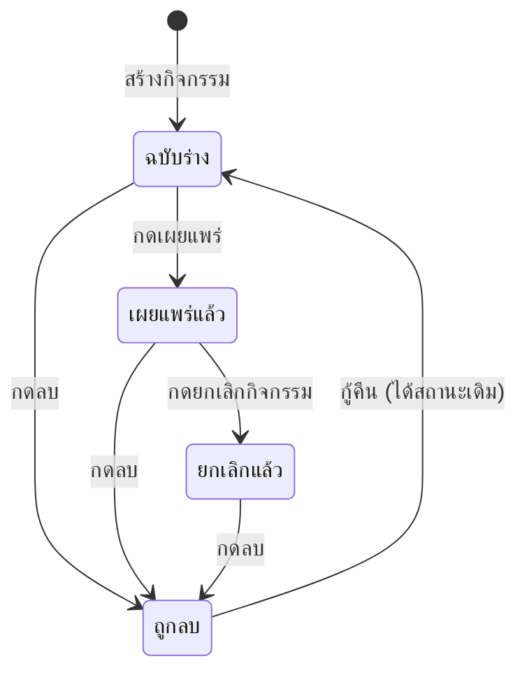

# จัดการกิจกรรมและสแกนเช็คอิน

บทนี้อธิบายวิธีสร้างกิจกรรม เปิดรับสมัคร ดูแลรายชื่อผู้สมัคร และเช็คอินหน้างานด้วยกล้องหรือรายชื่อ

## ใครใช้บทนี้

ผู้มีสิทธิ์ `MANAGE_EVENTS` เช่น สภานักเรียน ประธานสภา ครูสภานักเรียน และผู้ดูแลระบบ

## ก่อนเริ่ม

- มีแถวสมาชิกในปีการศึกษาปัจจุบัน
- เตรียมชื่อกิจกรรม วันเวลา สถานที่ และจำนวนที่นั่งให้ครบ
- หากต้องการภาพปก ต้องมีลิงก์รูปที่เปิดจากอินเทอร์เน็ตได้ ระบบไม่มีปุ่มอัปโหลดรูป

## สร้างกิจกรรมใหม่

1. เปิด **เพิ่มเติม**
2. ในกลุ่ม **ผู้ดูแล** เลือก **จัดการกิจกรรม**
3. กด **สร้างกิจกรรม**
4. กรอก **ชื่อกิจกรรม** (จำเป็น)
5. กรอก **รายละเอียด** ให้นักเรียนรู้ว่าต้องเตรียมอะไร
6. เลือก **วันและเวลาจัด** (จำเป็น)
7. ตั้ง **ปิดรับสมัคร** หรือเว้นว่างเพื่อให้ปิดเมื่อถึงเวลาจัด
8. กรอก **จำนวนที่นั่ง** หรือเว้นว่างเพื่อไม่จำกัด
9. กรอก **สถานที่**
10. เลือก **หมวดกิจกรรม**
11. ใส่ **ลิงก์ภาพปก** หากมี
12. กด **บันทึก**

กิจกรรมใหม่ถูกสร้างเป็น **ฉบับร่าง** นักเรียนยังไม่เห็นจนกว่าจะกดเผยแพร่

## เผยแพร่กิจกรรมให้ผู้เข้าร่วมเห็น

1. เปิด **จัดการกิจกรรม**
2. หาการ์ดที่ป้าย **ฉบับร่าง**
3. กด **เผยแพร่**
4. ยืนยัน **เผยแพร่เลย**

เมื่อเผยแพร่แล้ว นักเรียนทุกคนจะได้รับการแจ้งเตือน
และกิจกรรมจะแสดงในแท็บ **กิจกรรม** ของผู้ใช้

เผยแพร่แล้วย้อนกลับเป็นฉบับร่างไม่ได้ แต่แก้ไขรายละเอียดได้

## แก้ไขกิจกรรม

1. เปิดเมนู **⋯** ที่การ์ดกิจกรรม
2. เลือก **แก้ไข**
3. แก้ข้อมูลที่ต้องการ
4. กด **บันทึก**

แก้ได้ทั้งฉบับร่างและกิจกรรมที่เผยแพร่แล้ว
หากกิจกรรมถูกลบ ต้องกด **กู้คืน** ก่อนจึงจะแก้ได้

## ตั้งจำนวนที่นั่งและคิวสำรอง

- ใส่ **จำนวนที่นั่ง** เมื่อต้องการจำกัดจำนวน
- เว้นว่างหมายถึงไม่จำกัด
- เมื่อที่นั่งเต็ม ผู้ลงทะเบียนใหม่จะเข้าคิวสำรองอัตโนมัติ
- เมื่อมีคนถอน ระบบเลื่อนคนแรกในคิวขึ้นมาเป็นผู้ได้ที่นั่ง
- ระบบไม่ให้จัดลำดับคิวเอง และคิวไม่หมดอายุอัตโนมัติ

## กำหนดปิดรับสมัคร

- **ปิดรับสมัคร** ต้องไม่หลัง **วันและเวลาจัด**
- หากเว้นว่าง ระบบปิดรับเมื่อถึงเวลาจัด
- การแก้กำหนดปิดรับมีผลทันทีกับผู้ที่ยังไม่ลงทะเบียน
- ผู้ที่ลงทะเบียนแล้วไม่ถูกถอดออกเมื่อเลื่อนกำหนด

## ดูรายชื่อผู้สมัคร

1. เปิด **จัดการกิจกรรม**
2. กด **รายชื่อผู้สมัคร** ที่การ์ดกิจกรรม
3. เลือกชิป **ทุกสถานะ** **ได้ที่นั่ง** **เช็คอินแล้ว** **คิวสำรอง** หรือ **ยกเลิกแล้ว**
4. กดชื่อเพื่อดูรายละเอียดการลงทะเบียน

ตัวเลขบนชิปคือจำนวนจริงในแต่ละสถานะ
รายการแบ่งหน้า ใช้แถบเลื่อนหน้าใต้รายการ

## สแกนเช็คอินด้วยกล้อง

1. เปิด **จัดการกิจกรรม**
2. เปิดเมนู **⋯** ที่กิจกรรม
3. เลือก **สแกนเช็คอิน**
4. อนุญาตให้เบราว์เซอร์ใช้กล้อง
5. ให้นักเรียนเปิด **บัตรเช็คอินของคุณ** แล้วยื่นคิวอาร์ในกรอบ
6. ตรวจชื่อที่ขึ้นบนแถบผลลัพธ์ให้ตรงกับหน้าคนตรงหน้า
7. กด **คนถัดไป** เพื่อรับคนต่อไป

เมื่อสำเร็จ แถบสีเขียวแสดง **เช็คอินสำเร็จ** พร้อมชื่อและเวลา
หากสแกนซ้ำ แถบสีเหลืองแสดง **คนนี้เช็คอินไปแล้วก่อนหน้านี้ · ไม่ได้นับซ้ำ**

## กรอกรหัสเมื่อกล้องใช้ไม่ได้

1. ที่หน้าสแกน กด **⋯**
2. เลือก **กรอกรหัสเช็คอิน**
3. ให้นักเรียนอ่านรหัสใต้คิวอาร์บนจอของตน
4. พิมพ์รหัสในช่อง **PIRI-EVT1:…**
5. กด **เช็คอิน**

รหัสต้องเป็นของกิจกรรมที่เปิดอยู่เท่านั้น
หากเป็นของกิจกรรมอื่น ระบบตอบ **รหัสนี้เป็นของกิจกรรมอื่น**

## เช็คอินจากรายชื่อผู้สมัคร

ใช้เมื่อนักเรียนลืมมือถือ แบตหมด หรือกล้องเสีย

1. เปิด **รายชื่อผู้สมัคร**
2. ค้นหาชื่อหรือรหัสนักเรียน
3. กด **เช็คอิน** ที่แถวของคนนั้น
4. ตรวจข้อความยืนยัน

ปุ่ม **เช็คอิน** แสดงเฉพาะคนที่ **ได้ที่นั่ง** และยังไม่เช็คอิน
คนใน **คิวสำรอง** ยังไม่มีที่นั่ง จึงเช็คอินไม่ได้

## ยกเลิกกิจกรรม

1. เปิดเมนู **⋯** ของกิจกรรมที่เผยแพร่แล้ว
2. เลือก **ยกเลิกกิจกรรม**
3. ยืนยัน **ยกเลิกกิจกรรม**

ผลที่เกิดขึ้น

- กิจกรรมเปลี่ยนเป็น **ยกเลิกแล้ว**
- ระบบปิดรับสมัครทันที
- ผู้ที่ลงทะเบียนได้รับการแจ้งเตือน
- กิจกรรมยังเปิดดูได้ ไม่ถูกลบ
- คนในคิวสำรองไม่ถูกเลื่อนขึ้น

ยกเลิกแล้วเผยแพร่กลับไม่ได้ ต้องสร้างกิจกรรมใหม่

## ลบและกู้คืนกิจกรรม

1. เปิดเมนู **⋯** แล้วเลือก **ลบกิจกรรม**
2. ยืนยัน **ลบกิจกรรม**
3. หากต้องการกู้คืน ให้กรองชิป **ถูกลบ** แล้วกด **กู้คืน**

การลบเป็น soft delete ข้อมูลผู้สมัครยังอยู่และกลับมาเมื่อกู้คืน
กิจกรรมที่ถูกลบไม่แสดงให้นักเรียนเห็น และเปิดจากลิงก์เดิมไม่ได้

## สถานะกิจกรรม

สถานะจริงในฐานข้อมูลคือ `draft`, `published`, `cancelled` และใช้ `deleted_at` แยกการลบออกจากสถานะ

## ระบบทำอะไรเบื้องหลัง

- การเผยแพร่แจ้งเตือนนักเรียนทุกคนผ่านกลุ่ม **กิจกรรม**
- การลงทะเบียนจองที่นั่งแบบล็อกแถวกิจกรรม ป้องกันคนแย่งที่นั่งสุดท้ายพร้อมกัน
- การถอนการลงทะเบียนเลื่อนคิวสำรองคนแรกให้อัตโนมัติ
- บัตรเช็คอินผูกกับแถวการลงทะเบียน ไม่ใช่แค่กิจกรรมและผู้ใช้
- การเช็คอินซ้ำไม่เปลี่ยนเวลาครั้งแรก และตอบผลเดิม
- การเช็คอินได้แม้กิจกรรมถูกยกเลิก เพื่อให้ประวัติหน้างานยังครบ

## ข้อจำกัดและข้อควรระวัง

- อัปโหลดภาพปกไม่ได้ ใช้ได้เฉพาะลิงก์ URL
- สแกนได้เฉพาะผู้มีสิทธิ์ `MANAGE_EVENTS`
- ผู้เข้าร่วมเช็คอินเองไม่ได้ ต้องให้เจ้าหน้าที่สแกนหรือกดจากรายชื่อ
- ไม่มีแท็บกิจกรรมของฉันสำหรับเจ้าหน้าที่ ต้องเปิดจาก **จัดการกิจกรรม**
- ไม่มีระบบแจ้งเตือนก่อนกิจกรรมเริ่ม
- ไม่มีระบบส่งออกรายชื่อผู้เข้าร่วม
- ไม่สามารถกู้กิจกรรมที่ถูกลบถาวรจากฐานข้อมูลผ่านหน้าจอ

## แก้ไขปัญหาและคำถามที่พบบ่อย

**ถาม: กดเผยแพร่แล้วนักเรียนยังไม่เห็น**
ตอบ: ตรวจว่ากดยืนยัน **เผยแพร่เลย** สำเร็จ และป้ายเปลี่ยนเป็น **เผยแพร่แล้ว**
หากยังไม่เห็น ให้ผู้ใช้ปิดแล้วเปิดแอปใหม่

**ถาม: ตั้งปิดรับสมัครหลังวันจัดไม่ได้**
ตอบ: ระบบบังคับให้ **ปิดรับสมัคร** ไม่หลัง **วันและเวลาจัด**
ให้แก้ วันจัด หรือตั้งกำหนดปิดรับให้เร็วขึ้น

**ถาม: กล้องไม่เปิด**
ตอบ: ตรวจสิทธิ์กล้องของเบราว์เซอร์ และใช้ HTTPS
ระหว่างแก้ ให้ใช้ **กรอกรหัสเช็คอิน** หรือ **เช็คอินจากรายชื่อผู้สมัคร** แทนได้ทันที

**ถาม: สแกนแล้วขึ้น "รหัสนี้เป็นของกิจกรรมอื่น"**
ตอบ: นักเรียนเปิดบัตรของกิจกรรมอื่นอยู่ ให้เปิดกิจกรรมที่กำลังจัดแล้วจึงสแกนใหม่

**ถาม: คนในคิวสำรองขอเช็คอิน**
ตอบ: ทำไม่ได้จนกว่าจะได้ที่นั่ง หากมีคนถอน ระบบจะเลื่อนให้อัตโนมัติ
จากนั้นจึงเช็คอินได้ตามปกติ

**ถาม: ลบกิจกรรมแล้วอยากได้รายชื่อผู้สมัครคืน**
ตอบ: กรองชิป **ถูกลบ** แล้วกด **กู้คืน** ข้อมูลผู้สมัครจะกลับมาพร้อมกิจกรรม
