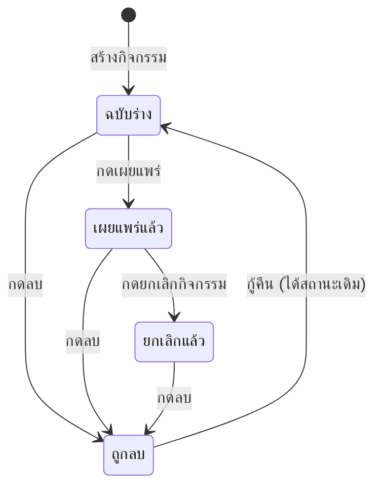

# จัดการกิจกรรมและสแกนเช็คอิน

ตั้งแต่สร้างกิจกรรม ยันยืนสแกนบัตรตอนคนเดินเข้ามา อยู่ในบทนี้บทเดียว
สร้างเสร็จก็ยังเป็นฉบับร่าง นักเรียนจะเห็นก็ต่อเมื่อกดเผยแพร่แล้วเท่านั้น

- จำกัดที่นั่งได้ ถ้าเต็มระบบจะต่อคิวสำรองให้เอง
- หน้างานสแกนคิวอาร์ได้ หรือจะกดจากรายชื่อก็ได้
- ยกเลิกกิจกรรมแล้วย้อนกลับไม่ได้ ต้องสร้างใหม่

**ทางเข้า:** แท็บ **เพิ่มเติม** ➔ กลุ่ม **ผู้ดูแล** ➔ **จัดการกิจกรรม**

หน้ารวมกิจกรรมมีแท็บกรองสถานะ การ์ดของแต่ละกิจกรรม และปุ่มสร้างที่มุมขวาล่าง

*หมายเลข 1 คือตัวกรอง เผยแพร่แล้ว หมายเลข 2 คือปุ่ม รายชื่อผู้สมัคร หมายเลข 3 คือเมนู ⋯ และหมายเลข 4 คือปุ่มสร้างกิจกรรม*

## ใครใช้บทนี้

คนที่มีสิทธิ์ `MANAGE_EVENTS` เช่น สภานักเรียน ประธานสภา ครูสภานักเรียน และผู้ดูแลระบบ

ก่อนเริ่ม เตรียมชื่อกิจกรรม วันเวลา สถานที่ และจำนวนที่นั่งให้ครบ
ถ้าอยากใส่ภาพปก ต้องมีลิงก์รูปที่เปิดจากอินเทอร์เน็ตได้ เพราะระบบยังไม่มีปุ่มอัปโหลดรูป

## สร้างกิจกรรมใหม่

1. **กด สร้างกิจกรรม**
2. **กรอก ชื่อกิจกรรม** และ **รายละเอียด** ให้นักเรียนรู้ว่าต้องเตรียมอะไร
3. **เลือก วันและเวลาจัด** (จำเป็น)
4. **ตั้ง ปิดรับสมัคร** หรือเว้นว่างให้ปิดตอนถึงเวลาจัด
5. **กรอก จำนวนที่นั่ง** หรือเว้นว่างแปลว่าไม่จำกัด
6. **ใส่ สถานที่ หมวดกิจกรรม** และ **ลิงก์ภาพปก** ถ้ามี
7. **กด บันทึก**

กิจกรรมใหม่จะยังเป็น **ฉบับร่าง** นักเรียนยังไม่เห็นจนกว่าจะกดเผยแพร่

ฟอร์มสร้างกิจกรรมถามชื่อ เวลา และจำนวนที่นั่งอยู่ในหน้าเดียว

*หมายเลข 1 คือชื่องาน หมายเลข 2 คือวันและเวลาจัด และหมายเลข 3 คือจำนวนที่นั่ง เว้นว่างแปลว่าไม่จำกัด*

## เผยแพร่ให้ทุกคนเห็น

**ทางเข้า:** **จัดการกิจกรรม** ➔ หาการ์ดที่ป้าย **ฉบับร่าง** ➔ **เผยแพร่** ➔ ยืนยัน **เผยแพร่เลย**

พอเผยแพร่แล้วนักเรียนทุกคนจะได้แจ้งเตือน และกิจกรรมจะไปโผล่ในแท็บ **กิจกรรม** ของทุกคน

::: warning เผยแพร่แล้วย้อนกลับเป็นฉบับร่างไม่ได้
ถ้าลงผิดจริง ๆ ให้แก้รายละเอียดแทน แต่ถ้าอยากให้หายจากสายตานักเรียน ต้องกดยกเลิกหรือลบ
:::

## แก้ไขกิจกรรม

**ทางเข้า:** เมนู **⋯** ที่การ์ดกิจกรรม ➔ **แก้ไข** ➔ แก้ข้อมูล ➔ **บันทึก**

เมนู ⋯ ที่การ์ดมีทางไปหน้าสแกน แก้ไข ดูหน้าเว็บ ยกเลิก และลบ

*หมายเลข 1 คือแถบจับของแผง หมายเลข 2 คือ สแกนเช็คอิน หมายเลข 3 คือ แก้ไข และหมายเลข 4 คือ ยกเลิกกิจกรรม*

แก้ได้ทั้งฉบับร่างและกิจกรรมที่เผยแพร่แล้ว
ถ้ากิจกรรมถูกลบไปก่อน ต้องกด **กู้คืน** แล้วค่อยแก้

## ที่นั่ง คิวสำรอง และกำหนดปิดรับ

- ใส่ **จำนวนที่นั่ง** เมื่ออยากจำกัดจำนวนคน
- เว้นว่าง = ไม่จำกัดคน
- ที่นั่งเต็มแล้ว คนลงทะเบียนใหม่จะเข้าคิวสำรองอัตโนมัติ
- มีคนถอน ระบบเลื่อนคนแรกในคิวขึ้นมาเป็นตัวจริงให้เอง
- จัดลำดับคิวเองไม่ได้ และคิวไม่หมดอายุเอง
- **ปิดรับสมัคร** ต้องไม่หลัง **วันและเวลาจัด**
- เว้นกำหนดปิดรับไว้ ระบบจะปิดให้ตอนถึงเวลาจัด
- แก้กำหนดปิดรับแล้วมีผลทันทีกับคนที่ยังไม่ลงทะเบียน ส่วนคนที่ลงแล้วไม่ถูกถอดออก

## ดูรายชื่อผู้สมัคร

**ทางเข้า:** **จัดการกิจกรรม** ➔ **รายชื่อผู้สมัคร** ➔ เลือกชิป **ทุกสถานะ** **ได้ที่นั่ง** **เช็คอินแล้ว** **คิวสำรอง** หรือ **ยกเลิกแล้ว**

ตัวเลขบนชิปคือจำนวนจริงในแต่ละสถานะ กดชื่อคนเพื่อดูรายละเอียดการลงทะเบียนของเขา

หน้ารายชื่อผู้สมัครมีชิปสถานะ ปุ่มเช็คอินรายคน และทางลัดไปหน้าสแกน

*หมายเลข 1 คือชิป เช็คอินแล้ว หมายเลข 2 คือปุ่ม เช็คอิน ของคนที่ได้ที่นั่ง หมายเลข 3 คือปุ่ม สแกน*

รายการแบ่งหน้า ใช้แถบเลื่อนหน้าใต้รายการ

## สแกนเช็คอินด้วยกล้อง

1. **เปิดเมนู ⋯** ที่กิจกรรม แล้วเลือก **สแกนเช็คอิน**
2. **อนุญาตให้เบราว์เซอร์ใช้กล้อง**
3. **ให้นักเรียนเปิดบัตรเช็คอิน** แล้วยื่นคิวอาร์ในกรอบ
4. **ตรวจชื่อบนแถบผลลัพธ์** ให้ตรงกับคนที่ยืนอยู่ตรงหน้า
5. **กด คนถัดไป** เพื่อรับคนต่อไป

สแกนสำเร็จแถบจะเป็นสีเขียว บอก **เช็คอินสำเร็จ** พร้อมชื่อและเวลา
ถ้าคนนี้สแกนไปแล้ว แถบจะเป็นสีเหลือง **คนนี้เช็คอินไปแล้วก่อนหน้านี้ · ไม่ได้นับซ้ำ**

หน้าสแกนใช้กล้องของเครื่องอ่านคิวอาร์ตรงหน้า

*กรอบกลางจอคือจุดที่ต้องวางคิวอาร์ให้เต็มกรอบ*

## กล้องใช้ไม่ได้ ทำยังไงต่อ

มีทางสำรองสองทาง เลือกอันที่ถนัด

**กรอกรหัส:** **⋯** ที่หน้าสแกน ➔ **กรอกรหัสเช็คอิน** ➔ ให้นักเรียนอ่านรหัสใต้คิวอาร์ให้ฟัง ➔ พิมพ์ในช่อง **PIRI-EVT1:…** ➔ **เช็คอิน**

ถ้ากล้องเปิดไม่สำเร็จ หน้าเดียวกันจะขึ้นป้าย **ใช้กล้องไม่ได้** พร้อมช่องให้พิมพ์รหัสแทน

*หมายเลข 1 คือป้าย ใช้กล้องไม่ได้ หมายเลข 2 คือหัวข้อ รหัสเช็คอิน หมายเลข 3 คือช่องกรอกรหัส และหมายเลข 4 คือปุ่ม เช็คอิน*

**กดจากรายชื่อ:** **รายชื่อผู้สมัคร** ➔ ค้นหาชื่อหรือรหัสนักเรียน ➔ **เช็คอิน** ที่แถวของคนนั้น ➔ ตรวจข้อความยืนยัน

ปุ่ม **เช็คอิน** จะขึ้นเฉพาะคนที่ **ได้ที่นั่ง** และยังไม่เช็คอิน
คนใน **คิวสำรอง** ยังไม่มีที่นั่ง เลยเช็คอินไม่ได้

รหัสใช้ได้เฉพาะกิจกรรมที่เปิดอยู่ ถ้าเป็นรหัสของกิจกรรมอื่น ระบบจะตอบ **รหัสนี้เป็นของกิจกรรมอื่น**

## ยกเลิกกิจกรรม

**ทางเข้า:** เมนู **⋯** ของกิจกรรมที่เผยแพร่แล้ว ➔ **ยกเลิกกิจกรรม** ➔ ยืนยัน

พอกดแล้วจะเกิดห้าอย่างนี้

- กิจกรรมเปลี่ยนเป็น **ยกเลิกแล้ว**
- ระบบปิดรับสมัครทันที
- คนที่ลงทะเบียนได้รับการแจ้งเตือน
- กิจกรรมยังเปิดดูได้ ไม่ได้ถูกลบ
- คนในคิวสำรองไม่ถูกเลื่อนขึ้น เพราะไม่มีที่นั่งให้แล้ว

ยกเลิกแล้วเผยแพร่กลับไม่ได้ ต้องสร้างกิจกรรมใหม่

## ลบและกู้คืน

**ลบ:** เมนู **⋯** ➔ **ลบกิจกรรม** ➔ ยืนยัน
**กู้คืน:** กรองชิป **ถูกลบ** ➔ **กู้คืน**

การลบเป็น soft delete ข้อมูลผู้สมัครยังอยู่ครบ และกลับมาเองตอนกู้คืน
กิจกรรมที่ถูกลบนักเรียนมองไม่เห็น และเปิดจากลิงก์เดิมไม่ได้

## สถานะกิจกรรม

ในฐานข้อมูล สถานะจริงคือ `draft` `published` และ `cancelled` ส่วนการลบแยกด้วย `deleted_at`

## ระบบทำอะไรเบื้องหลัง

- การเผยแพร่แจ้งเตือนนักเรียนทุกคนผ่านกลุ่ม **กิจกรรม**
- ตอนลงทะเบียน ระบบล็อกแถวกิจกรรมไว้กันสองคนแย่งที่นั่งสุดท้ายพร้อมกัน
- มีคนถอน ระบบเลื่อนคิวสำรองคนแรกให้อัตโนมัติ
- บัตรเช็คอินผูกกับแถวการลงทะเบียน ไม่ใช่แค่กิจกรรมกับผู้ใช้
- เช็คอินซ้ำไม่เปลี่ยนเวลาครั้งแรก และตอบผลเดิม
- เช็คอินได้แม้กิจกรรมถูกยกเลิก เพื่อให้ประวัติหน้างานยังครบ

## ข้อจำกัดและข้อควรระวัง

- อัปโหลดภาพปกไม่ได้ ใส่ได้แค่ลิงก์ URL
- สแกนได้เฉพาะคนที่มีสิทธิ์ `MANAGE_EVENTS`
- นักเรียนเช็คอินเองไม่ได้ ต้องให้เจ้าหน้าที่สแกนหรือกดจากรายชื่อ
- ไม่มีแท็บกิจกรรมของฉันสำหรับเจ้าหน้าที่ ต้องเปิดจาก **จัดการกิจกรรม**
- ไม่มีการแจ้งเตือนก่อนกิจกรรมเริ่ม
- ส่งออกรายชื่อคนที่ลงทะเบียนไม่ได้
- กิจกรรมที่ถูกลบถาวรจากฐานข้อมูลแล้วกู้จากหน้าจอไม่ได้

## ติดปัญหาตรงไหน? ดูวิธีแก้ตรงนี้เลย

**Q: กดเผยแพร่แล้วนักเรียนยังไม่เห็น?**

👉 **วิธีแก้:** เช็กว่ากดยืนยัน **เผยแพร่เลย** สำเร็จ และป้ายเปลี่ยนเป็น **เผยแพร่แล้ว** ถ้ายังไม่เห็น ให้ปิดแอปแล้วเปิดใหม่

**Q: ตั้งปิดรับสมัครหลังวันจัดไม่ได้?**

👉 **วิธีแก้:** ระบบบังคับให้ **ปิดรับสมัคร** ไม่หลัง **วันและเวลาจัด** ให้แก้เวลาจัด หรือตั้งกำหนดปิดรับให้เร็วขึ้น

**Q: กล้องไม่เปิด?**

👉 **วิธีแก้:** เช็กสิทธิ์กล้องของเบราว์เซอร์ และต้องเปิดเว็บผ่าน HTTPS ระหว่างรอ ใช้ **กรอกรหัสเช็คอิน** หรือ **เช็คอินจากรายชื่อ** แทนได้เลย

**Q: สแกนแล้วขึ้น "รหัสนี้เป็นของกิจกรรมอื่น"?**

👉 **วิธีแก้:** นักเรียนเปิดบัตรของกิจกรรมอื่นอยู่ ให้เขาเปิดกิจกรรมที่กำลังจัดแล้วสแกนใหม่

**Q: คนในคิวสำรองขอเช็คอิน?**

👉 **วิธีแก้:** ทำไม่ได้จนกว่าจะได้ที่นั่ง ถ้ามีคนถอนระบบจะเลื่อนให้เอง จากนั้นเช็คอินได้ตามปกติ

**Q: ลบกิจกรรมแล้วอยากได้รายชื่อผู้สมัครคืน?**

👉 **วิธีแก้:** กรองชิป **ถูกลบ** แล้วกด **กู้คืน** รายชื่อจะกลับมาพร้อมกิจกรรม
