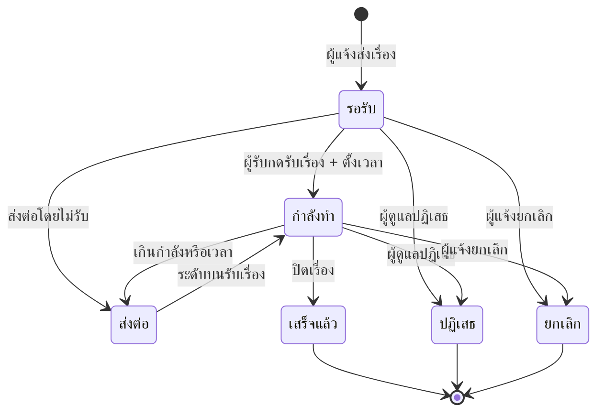

# จัดการเรื่องและขั้นตอนทำงาน

บทนี้อธิบายลำดับงานตั้งแต่เปิดคิวรับเรื่องจนปิดเรื่อง รวมถึงการส่งต่อ การขอเผยแพร่เป็นบอร์ด และการปฏิเสธ

## ใครใช้บทนี้

หัวหน้าห้อง รองฝ่าย ประธานระดับ ผู้ช่วยหัวหน้าระดับ สภานักเรียน ครู และผู้ดูแลระบบ

## ก่อนเริ่ม

- มีแถวสมาชิกในปีการศึกษาปัจจุบันและตำแหน่งที่ให้สิทธิ์ `RECEIVE_ISSUES`
- เรื่องที่จะรับต้องอยู่ในระดับของคุณ
- การรับเรื่องหนึ่งเรื่องทำได้ครั้งเดียว หากมีผู้รับแล้วต้องใช้ **เปลี่ยนผู้รับ** หรือให้ผู้รับเดิมส่งต่อ

## เปิดคิวงานประจำวัน

1. เปิดแท็บ **เรื่อง**
2. เลือก **ที่รับผิดชอบ**
3. ตรวจชิปสถานะ เริ่มจาก **ยังไม่เสร็จ**
4. เรียงตามกำหนดแก้ไขที่ใกล้ครบก่อน
5. กดเรื่องเพื่อเปิดรายละเอียด

ชิปสถานะในคิวมี **ยังไม่เสร็จ** **ทุกสถานะ** **รอรับ** **กำลังทำ** **ส่งต่อ** **เสร็จแล้ว** **ปฏิเสธ** **ยกเลิก**

ค่าเริ่มต้นคือ **ยังไม่เสร็จ** ซึ่งรวมรอรับ กำลังทำ และส่งต่อ

## รับเรื่องและตั้งกำหนดแก้ไข

1. เปิดเรื่องที่ยังอยู่ในสถานะ **รอรับ**
2. กด **รับเรื่อง + ตั้งเวลา**
3. กรอกจำนวนวัน 1–365 ตามเวลาที่คิดว่าจะแก้ได้
4. กด **รับเรื่อง**
5. ระบบเปลี่ยนสถานะเป็น **กำลังดำเนินการ** และเริ่มนับถอยหลัง

กำหนดแก้ไขคำนวณจากเวลาที่กดรับ ไม่ใช่เวลาที่ผู้แจ้งส่งเรื่อง
หากประเมินเวลาต่ำเกินไป ให้ใช้ **ยืดเวลา** ก่อนครบกำหนด

> **ภาพที่ 13 — รายละเอียดเรื่องสำหรับผู้รับ**
> - **ไฟล์:** `docs/assets/screenshots/staff/13-issue-detail.webp`
> - **แคป:** เรื่องสถานะ **กำลังดำเนินการ** ที่มีกำหนดแก้ไขและการ์ดขั้นตอน — **ใช้เป็น placeholder** เพราะเรื่องที่กำลังทำบน staging ไม่มีกำหนดแก้ไขที่ยังนับถอยหลังอยู่ แคปเองได้โดยเปิดเรื่องที่เพิ่งรับและตั้งกำหนดแก้ไข แล้วเบลอข้อมูลผู้แจ้งทั้งหมด
> - **ครอป/ไฮไลต์:** ครอปส่วน **สถานะปัจจุบัน** **กำหนดแก้ไข** และปุ่มหลัก
> - **PDPA:** เบลอ **ข้อมูลผู้แจ้ง** ทั้งบล็อก และชื่อในคอมเมนต์

## เพิ่มขั้นตอนการทำงาน

1. เปิดเรื่องที่รับแล้ว
2. เลื่อนไปที่ **ขั้นตอนการดำเนินงาน**
3. พิมพ์ชื่องานในช่อง **เพิ่มขั้นตอน...**
4. กด **เพิ่มขั้นตอน**
5. เมื่อทำงานนั้นเสร็จจริง ให้กดเครื่องหมายถูกหน้าขั้นตอน

ตัวนับ **N/M** ที่หัวข้อบอกว่าทำเสร็จแล้วกี่ขั้นจากทั้งหมด
ขั้นตอนไม่บังคับให้ครบก่อนปิดเรื่อง แต่ช่วยให้ผู้แจ้งเห็นความคืบหน้า

## ส่งต่อเรื่องไประดับบน

ใช้เมื่อเรื่องเกินอำนาจหรือเวลาไม่พอ

1. เปิดเรื่องที่คุณเป็นผู้รับ
2. กดเมนู **⋯** แล้วเลือก **ส่งต่อไประดับบน**
3. กรอกเหตุผล (ไม่บังคับ)
4. กด **ส่งต่อ**

ระบบเปลี่ยนสถานะเป็น **ส่งต่อ** และย้ายเรื่องไปยังระดับถัดไปตามพีระมิด
ห้อง → ระดับชั้น → สภานักเรียน เมื่ออยู่ระดับสภานักเรียนแล้วจะส่งต่อไม่ได้

## ปิดเรื่องเมื่อแก้เสร็จ

1. เปิดเรื่องสถานะ **กำลังดำเนินการ**
2. กดเมนู **⋯** แล้วเลือก **ปิดเรื่อง (เสร็จแล้ว)**
3. กรอกสรุปผลการแก้ไข (ไม่บังคับ แต่ควรใส่)
4. กด **ปิดเรื่อง**

หลังปิดแล้วแก้ไขไม่ได้ ผู้แจ้งจะเห็นสถานะ **แก้ไขเสร็จ** และอ่านสรุปผลได้

## ยืดเวลาก่อนครบกำหนด

1. เปิดเรื่องที่มี **กำหนดแก้ไข**
2. กดเมนู **⋯** แล้วเลือก **ยืดเวลา**
3. กรอกจำนวนวันใหม่ 1–365
4. กด **ยืดเวลา**

เมื่อเลยกำหนดโดยไม่ปิด ระบบแสดง **เกินเวลา!** ให้ผู้แจ้งเห็น
ควรยืดเวลาหรือส่งต่อก่อนถึงวันครบ

## ปฏิเสธเรื่อง

ใช้เมื่อเรื่องไม่ควรอยู่ในระบบ เช่น ซ้ำกับเรื่องเดิม ข้อมูลไม่เพียงพอ หรือไม่ใช่หน้าที่ของโรงเรียน

1. เปิดเรื่อง
2. กดเมนู **⋯** แล้วเลือก **ปฏิเสธเรื่อง**
3. กรอกเหตุผล
4. กด **ปฏิเสธเรื่อง**

เรื่องจะมีสถานะ **ถูกปฏิเสธ** และกู้คืนจากหน้าจอไม่ได้
หากเป็นเรื่องที่ผู้แจ้งส่งผิด ให้ผู้แจ้งเป็นคนกด **ยกเลิกเรื่อง** เองแทน

## เปลี่ยนปลายทางของเรื่อง

ป้ายในเมนูชื่อ **เปลี่ยนผู้รับ** แต่ระบบเปลี่ยน **ปลายทาง** ของเรื่อง ไม่ได้เปลี่ยนตัวบุคคล

1. เปิดเรื่อง
2. กดเมนู **⋯** แล้วเลือก **เปลี่ยนผู้รับ**
3. เลือก **ดำเนินการปกติ** **โหวตสาธารณะ** หรือ **พูดคุยสาธารณะ**
4. กด **ถัดไป**
5. ตรวจข้อความยืนยันแล้วกด **เปลี่ยน**

การเปลี่ยนเป็นโหวตหรือพูดคุยจะส่งเรื่องไปสภานักเรียนเพื่อพิจารณา
การเปลี่ยนกลับเป็นดำเนินการปกติจะถอนคำขอเผยแพร่และส่งกลับระดับห้อง

## อนุมัติเรื่องเป็นบอร์ดสาธารณะ

1. เปิดเรื่องที่ขอ **โหวตสาธารณะ** หรือ **พูดคุยสาธารณะ**
2. กด **อนุมัติเผยแพร่สาธารณะ**
3. ตรวจประเภทบอร์ด ซึ่งระบบล็อกตามที่ผู้แจ้งขอ
4. หากเป็นบอร์ดโหวต ให้กรอกตัวเลือกอย่างน้อย 2 ตัว
5. หากเป็นบอร์ดพูดคุย ให้เลือกว่าจะ **เปิดให้คอมเมนต์บนบอร์ดได้** หรือไม่
6. กด **อนุมัติเผยแพร่**

หลังอนุมัติ เรื่องจะผูกกับบอร์ดใหม่ และเมนูจะมี **ดู PIRI Board สาธารณะ**
หากไม่อนุมัติ ให้ใช้ **เปลี่ยนผู้รับ** กลับเป็น **ดำเนินการปกติ** หรือ **ปฏิเสธเรื่อง** พร้อมเหตุผล

## สถานะและความหมาย

สถานะที่ระบบเก็บจริงคือ `pending`, `in_progress`, `escalated`, `resolved`, `rejected`, `cancelled`
หน้าจอแสดงเป็น **รอรับเรื่อง** **กำลังดำเนินการ** **ส่งต่อให้ระดับสูงขึ้น** **แก้ไขเสร็จ** **ถูกปฏิเสธ** **ถูกยกเลิก**

## ระบบทำอะไรเบื้องหลัง

- การรับเรื่องเขียนกำหนดแก้ไขลง `issue_countdowns` และบันทึกประวัติใน `issue_history`
- การเพิ่มขั้นตอนและปิดขั้นตอนถูกบันทึกในประวัติของเรื่อง
- การส่งต่อเปลี่ยนระดับปัจจุบันและแจ้งเตือนผู้รับระดับใหม่
- การปิดเรื่องและปฏิเสธเรื่องแจ้งเตือนผู้แจ้ง
- การอนุมัติเป็นบอร์ดสร้างแถวใน `boards` และผูก `issue_id` กลับไปที่เรื่อง
- ทุกการกระทำเขียนบันทึกการใช้งานในทรานแซกชันเดียวกับการเปลี่ยนข้อมูล

## ข้อจำกัดและข้อควรระวัง

- รับเรื่องได้ครั้งเดียว ถ้ามีผู้รับแล้วระบบตอบ **เรื่องนี้มีผู้รับอยู่แล้ว**
- ส่งต่อได้เฉพาะผู้รับเรื่องหรือผู้ดูแลระบบ
- ระดับสภานักเรียนส่งต่อขึ้นไม่ได้อีก
- **เปลี่ยนผู้รับ** ในเมนูคือเปลี่ยนปลายทาง ไม่ใช่เปลี่ยนบุคคล
- ปิดเรื่องแล้วแก้ไขหรือเปิดใหม่จากหน้าจอไม่ได้
- ระบบไม่มีระบบ SLA อัตโนมัติ ไม่มีการแจ้งเตือนซ้ำเมื่อใกล้ครบกำหนด
- ผู้แจ้งเท่านั้นที่กด **ยกเลิกเรื่อง** ได้ ผู้ดูแลใช้ **ปฏิเสธเรื่อง**

## แก้ไขปัญหาและคำถามที่พบบ่อย

**ถาม: กดรับเรื่องแล้วขึ้น "เรื่องนี้มีผู้รับอยู่แล้ว"**
ตอบ: มีคนอื่นรับไปก่อน ให้ตรวจ **ผู้รับผิดชอบ** ในรายละเอียด
หากผู้รับเดิมไม่อยู่แล้ว ให้ผู้ดูแลระบบมอบหมายใหม่ที่ **เรื่องที่ผู้รับหมดวาระ**

**ถาม: ไม่เห็นปุ่มรับเรื่อง**
ตอบ: เรื่องอาจอยู่คนละระดับ หรือคุณไม่มีสิทธิ์ `RECEIVE_ISSUES`
ตรวจระดับปัจจุบันในส่วน **สถานะปัจจุบัน** และปรึกษาผู้ดูแลระบบ

**ถาม: ตั้งกำหนดผิด จะแก้เป็นวันอื่นได้ไหม**
ตอบ: ใช้ **ยืดเวลา** ตั้งจำนวนวันใหม่ ระบบจะคำนวณกำหนดใหม่จากเวลาที่ยืด
ไม่มีการแก้ย้อนหลังเป็นวันที่ระบุเอง

**ถาม: ปิดเรื่องผิด จะเปิดกลับได้ไหม**
ตอบ: จากหน้าจอไม่ได้ ต้องให้ผู้ดูแลระบบแก้ที่ฐานข้อมูล
ก่อนปิดทุกครั้งให้ตรวจว่าผู้แจ้งยืนยันผลแล้ว

**ถาม: เรื่องขอโหวตสาธารณะไม่ขึ้นบอร์ด**
ตอบ: ต้องมีผู้มีสิทธิ์อนุมัติกด **อนุมัติเผยแพร่สาธารณะ** ก่อน
การส่งเรื่องไม่ทำให้เกิดบอร์ดอัตโนมัติ

**ถาม: ส่งต่อแล้วเรื่องหายจากคิว**
ตอบ: เรื่องย้ายไประดับบนและไม่อยู่ในคิวระดับเดิมอีก
ติดตามได้จาก **เรื่อง** แล้วเลือก **ทุกสถานะ** หรือให้ระดับบนตรวจคิวของตน

**ถาม: ผู้แจ้งขอยกเลิกเอง ต้องทำอย่างไร**
ตอบ: ผู้แจ้งต้องกด **ยกเลิกเรื่อง** จากบัญชีของตนเอง
เจ้าหน้าที่ไม่สามารถยกเลิกแทนได้ แต่ใช้ **ปฏิเสธเรื่อง** พร้อมเหตุผลได้
