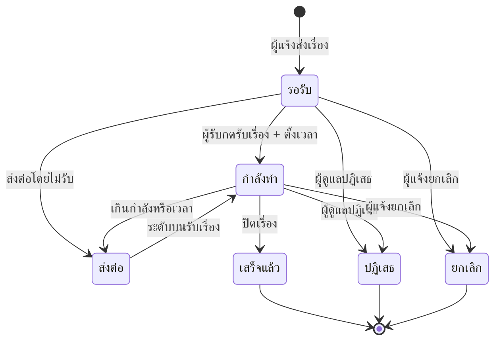

# จัดการเรื่องและขั้นตอนทำงาน

รับเรื่องมาแล้วต้องทำอะไรต่อ บทนี้ไล่ตั้งแต่เปิดคิว ยันกดปิดเรื่อง
รวมถึงการส่งต่อ ปฏิเสธ และการขอเผยแพร่เรื่องขึ้นบอร์ดสาธารณะ

- รับเรื่องแล้วต้องตั้งกำหนดแก้ไข ระบบจะนับถอยหลังให้
- เรื่องที่เกินมือให้ส่งต่อขึ้นระดับบน
- ปิดเรื่องแล้วย้อนกลับไม่ได้ ตรวจให้ดีก่อนกด

## ใครใช้บทนี้

หัวหน้าห้อง รองฝ่าย ประธานระดับ ผู้ช่วยหัวหน้าระดับ สภานักเรียน ครู และผู้ดูแลระบบ

ก่อนเริ่ม ต้องมีชื่อในรายชื่อสมาชิกของปีการศึกษาปัจจุบัน และมีตำแหน่งที่ให้สิทธิ์ `RECEIVE_ISSUES`
เรื่องที่จะรับต้องอยู่ในระดับของเรา
และรับได้คนละครั้งเท่านั้น ถ้ามีคนรับไปแล้ว ต้องใช้ **เปลี่ยนผู้รับ** หรือให้ผู้รับเดิมส่งต่อ

## เปิดคิวงานประจำวัน

**ทางเข้า:** แท็บ **เรื่อง** ➔ **ที่รับผิดชอบ**

ค่าเริ่มต้นคือชิป **ยังไม่เสร็จ** ซึ่งรวมรอรับ กำลังทำ และส่งต่อไว้ด้วยกัน
เรื่องที่ใกล้ครบกำหนดจะอยู่บนสุด กดเรื่องเพื่อเปิดรายละเอียด

ชิปที่สลับดูได้มี **ยังไม่เสร็จ** **ทุกสถานะ** **รอรับ** **กำลังทำ** **ส่งต่อ** **เสร็จแล้ว** **ปฏิเสธ** และ **ยกเลิก**

*ตัวเลขบนชิปคือจำนวนเรื่องในแต่ละสถานะของระดับที่เราดูแล*

## รับเรื่องและตั้งกำหนดแก้ไข

1. **เปิดเรื่องที่ยังเป็น รอรับ**
2. **กด รับเรื่อง + ตั้งเวลา**
3. **กรอกจำนวนวัน** 1–365 ตามที่คิดว่าจะแก้ได้
4. **กด รับเรื่อง**

ระบบเปลี่ยนสถานะเป็น **กำลังดำเนินการ** และเริ่มนับถอยหลังทันที

กำหนดแก้ไขนับจากเวลาที่เรากดรับ ไม่ใช่เวลาที่ผู้แจ้งส่งเรื่องเข้ามา
ถ้าประเมินเวลาต่ำไป ให้ใช้ **ยืดเวลา** ก่อนครบกำหนด

## เพิ่มขั้นตอนการทำงาน

**ทางเข้า:** เปิดเรื่องที่รับแล้ว ➔ **ขั้นตอนการดำเนินงาน** ➔ พิมพ์ชื่องานในช่อง **เพิ่มขั้นตอน...** ➔ **เพิ่มขั้นตอน**

ทำงานนั้นเสร็จจริงแล้วค่อยกดเครื่องหมายถูกหน้าขั้นตอน
ตัวนับ **N/M** ที่หัวข้อบอกว่าทำไปแล้วกี่ขั้นจากทั้งหมด

ไม่บังคับให้ครบทุกขั้นก่อนปิดเรื่อง แต่ใส่ไว้แล้วผู้แจ้งจะเห็นความคืบหน้า ไม่ต้องทักมาถาม

## ส่งต่อไประดับบน

ใช้เมื่อเรื่องเกินอำนาจ หรือเวลาไม่พอ

**ทางเข้า:** เปิดเรื่องที่เราเป็นผู้รับ ➔ เมนู **⋯** ➔ **ส่งต่อไประดับบน** ➔ กรอกเหตุผล (ไม่บังคับ) ➔ **ส่งต่อ**

ระบบเปลี่ยนสถานะเป็น **ส่งต่อ** และย้ายเรื่องขึ้นตามพีระมิด
ห้อง ➔ ระดับชั้น ➔ สภานักเรียน
พอถึงระดับสภานักเรียนแล้วส่งต่อขึ้นอีกไม่ได้

## ยืดเวลาก่อนครบกำหนด

**ทางเข้า:** เปิดเรื่องที่มี **กำหนดแก้ไข** ➔ เมนู **⋯** ➔ **ยืดเวลา** ➔ กรอกจำนวนวันใหม่ 1–365 ➔ **ยืดเวลา**

ถ้าเลยกำหนดโดยยังไม่ปิดเรื่อง ผู้แจ้งจะเห็นป้าย **เกินเวลา!**
เลยจะยืดเวลาหรือส่งต่อก่อนถึงวันครบจะดีกว่า

## ปิดเรื่องเมื่อแก้เสร็จ

1. **เปิดเรื่องที่กำลังดำเนินการ**
2. **เมนู ⋯ ➔ ปิดเรื่อง (เสร็จแล้ว)**
3. **กรอกสรุปผลการแก้ไข** (ไม่บังคับ แต่ควรใส่)
4. **กด ปิดเรื่อง**

หลังปิดแล้วแก้ไขไม่ได้ ผู้แจ้งจะเห็นสถานะ **แก้ไขเสร็จ** และอ่านสรุปผลได้

::: warning ปิดเรื่องแล้วเปิดกลับจากหน้าจอไม่ได้
ถ้ากดผิด ต้องให้ผู้ดูแลระบบแก้ที่ฐานข้อมูล
ให้อ่านสรุปผลให้ครบก่อนกดทุกครั้ง
:::

## ปฏิเสธเรื่อง

ใช้เมื่อเรื่องไม่ควรอยู่ในระบบ เช่น ซ้ำกับเรื่องเดิม ข้อมูลไม่พอ หรือไม่ใช่หน้าที่ของโรงเรียน

**ทางเข้า:** เปิดเรื่อง ➔ เมนู **⋯** ➔ **ปฏิเสธเรื่อง** ➔ กรอกเหตุผล ➔ **ปฏิเสธเรื่อง**

เรื่องจะเปลี่ยนเป็น **ถูกปฏิเสธ** และกู้คืนจากหน้าจอไม่ได้
ถ้าเป็นเรื่องที่ผู้แจ้งส่งผิด ให้เขาเป็นคนกด **ยกเลิกเรื่อง** เองจะตรงกว่า

## เปลี่ยนปลายทางของเรื่อง

ป้ายในเมนูชื่อ **เปลี่ยนผู้รับ** แต่ระบบเปลี่ยน **ปลายทาง** ของเรื่อง ไม่ได้เปลี่ยนตัวคน

**ทางเข้า:** เปิดเรื่อง ➔ เมนู **⋯** ➔ **เปลี่ยนผู้รับ** ➔ เลือก **ดำเนินการปกติ** **โหวตสาธารณะ** หรือ **พูดคุยสาธารณะ** ➔ **ถัดไป** ➔ ตรวจข้อความยืนยัน ➔ **เปลี่ยน**

เปลี่ยนเป็นโหวตหรือพูดคุย เรื่องจะถูกส่งไปสภานักเรียนพิจารณา
เปลี่ยนกลับเป็นดำเนินการปกติ ระบบถอนคำขอเผยแพร่และส่งเรื่องกลับระดับห้อง

## อนุมัติเรื่องขึ้นบอร์ดสาธารณะ

1. **เปิดเรื่องที่ขอ โหวตสาธารณะ หรือ พูดคุยสาธารณะ**
2. **กด อนุมัติเผยแพร่สาธารณะ**
3. **ตรวจประเภทบอร์ด** ซึ่งระบบล็อกตามที่ผู้แจ้งขอ
4. **บอร์ดโหวต** กรอกตัวเลือกอย่างน้อย 2 ตัว
5. **บอร์ดพูดคุย** เลือกว่าจะ **เปิดให้คอมเมนต์บนบอร์ดได้** หรือไม่
6. **กด อนุมัติเผยแพร่**

อนุมัติแล้วเรื่องจะผูกกับบอร์ดใหม่ และเมนูจะมี **ดู PIRI Board สาธารณะ**
ถ้าไม่อนุมัติ ให้ใช้ **เปลี่ยนผู้รับ** กลับเป็น **ดำเนินการปกติ** หรือ **ปฏิเสธเรื่อง** พร้อมเหตุผล

## สถานะและความหมาย

ในฐานข้อมูล สถานะที่เก็บจริงคือ `pending` `in_progress` `escalated` `resolved` `rejected` `cancelled`
หน้าจอแสดงเป็น **รอรับเรื่อง** **กำลังดำเนินการ** **ส่งต่อให้ระดับสูงขึ้น** **แก้ไขเสร็จ** **ถูกปฏิเสธ** **ถูกยกเลิก**

## ระบบทำอะไรเบื้องหลัง

- กดรับเรื่องแล้วระบบเขียนกำหนดแก้ไขลง `issue_countdowns` และบันทึกประวัติใน `issue_history`
- เพิ่มขั้นตอนและปิดขั้นตอนถูกบันทึกในประวัติของเรื่อง
- ส่งต่อแล้วเปลี่ยนระดับปัจจุบัน และแจ้งเตือนผู้รับระดับใหม่
- ปิดเรื่องและปฏิเสธเรื่องจะแจ้งเตือนผู้แจ้ง
- อนุมัติเป็นบอร์ดแล้วสร้างแถวใน `boards` และผูก `issue_id` กลับไปที่เรื่อง
- ทุกการกระทำเขียนบันทึกการใช้งานในทรานแซกชันเดียวกับการเปลี่ยนข้อมูล

## ข้อจำกัดและข้อควรระวัง

- รับเรื่องได้ครั้งเดียว ถ้ามีผู้รับแล้วระบบตอบ **เรื่องนี้มีผู้รับอยู่แล้ว**
- ส่งต่อได้เฉพาะผู้รับเรื่องหรือผู้ดูแลระบบ
- ระดับสภานักเรียนส่งต่อขึ้นไม่ได้อีก
- **เปลี่ยนผู้รับ** ในเมนูคือเปลี่ยนปลายทาง ไม่ใช่เปลี่ยนคน
- ปิดเรื่องแล้วแก้ไขหรือเปิดใหม่จากหน้าจอไม่ได้
- ไม่มี SLA อัตโนมัติ และไม่มีการแจ้งเตือนซ้ำตอนใกล้ครบกำหนด ต้องเปิดคิวดูเอง
- คนที่กด **ยกเลิกเรื่อง** ได้มีแค่ผู้แจ้ง ส่วนเจ้าหน้าที่ใช้ **ปฏิเสธเรื่อง**

## ติดปัญหาตรงไหน? ดูวิธีแก้ตรงนี้เลย

**Q: กดรับเรื่องแล้วขึ้น "เรื่องนี้มีผู้รับอยู่แล้ว"?**

👉 **วิธีแก้:** มีคนรับไปก่อนแล้ว ให้ดู **ผู้รับผิดชอบ** ในรายละเอียด ถ้าคนนั้นไม่อยู่แล้ว ให้ผู้ดูแลระบบมอบหมายใหม่ที่ **เรื่องที่ผู้รับหมดวาระ**

**Q: ไม่เห็นปุ่มรับเรื่อง?**

👉 **วิธีแก้:** เรื่องอาจอยู่คนละระดับ หรือบัญชีเรายังไม่มีสิทธิ์ `RECEIVE_ISSUES` ให้ดูระดับปัจจุบันในส่วน **สถานะปัจจุบัน** แล้วปรึกษาผู้ดูแลระบบ

**Q: ตั้งกำหนดผิด จะแก้วันเองได้ไหม?**

👉 **วิธีแก้:** ใช้ **ยืดเวลา** ใส่จำนวนวันใหม่ ระบบจะคำนวณกำหนดใหม่ให้ แก้ย้อนหลังเป็นวันที่ระบุเองไม่ได้

**Q: ปิดเรื่องผิด จะเปิดกลับได้ไหม?**

👉 **วิธีแก้:** จากหน้าจอไม่ได้ ต้องให้ผู้ดูแลระบบแก้ที่ฐานข้อมูล ก่อนปิดทุกครั้งให้เช็กว่าผู้แจ้งรับทราบผลแล้ว

**Q: เรื่องขอโหวตสาธารณะไม่ขึ้นบอร์ด?**

👉 **วิธีแก้:** ต้องมีคนที่มีสิทธิ์กด **อนุมัติเผยแพร่สาธารณะ** ก่อน การส่งเรื่องเข้ามาไม่ได้สร้างบอร์ดให้เอง

**Q: ส่งต่อแล้วเรื่องหายจากคิว?**

👉 **วิธีแก้:** ปกติ เรื่องย้ายไประดับบนแล้วไม่อยู่ในคิวเดิม เข้า **เรื่อง** ➔ **ทุกสถานะ** เพื่อติดตาม หรือให้ระดับบนไปดูคิวของเขา

**Q: ผู้แจ้งขอยกเลิกเอง ต้องทำยังไง?**

👉 **วิธีแก้:** ผู้แจ้งต้องกด **ยกเลิกเรื่อง** จากบัญชีของตัวเอง เจ้าหน้าที่กดแทนไม่ได้ แต่ใช้ **ปฏิเสธเรื่อง** พร้อมเหตุผลได้
