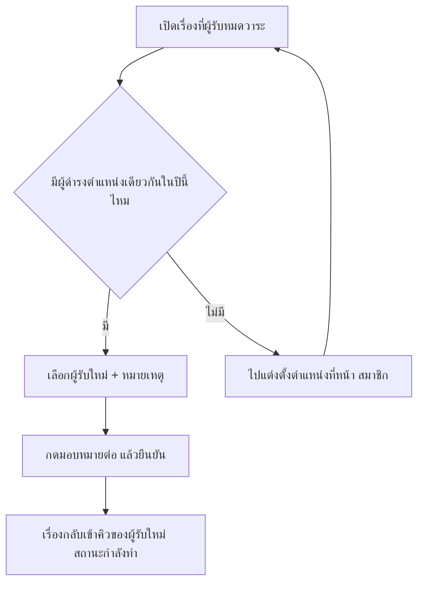

# เรื่องที่ผู้รับหมดวาระและกระทบยอดรายชื่อ

บทนี้รวมงานปิดท้ายของการขึ้นปีการศึกษาใหม่สองงาน
งานแรกคือมอบหมายเรื่องที่ยังค้างอยู่แต่ผู้รับเดิมไม่มีสมาชิกภาพในปีนี้ให้ผู้รับคนใหม่
งานที่สองคือตรวจว่ารายชื่อระหว่างสองปีต่างกันตรงไหน เพื่อจับคนที่ตกหล่นก่อนเปิดเทอม

## ใครใช้บทนี้

ผู้ดูแลระบบ ครูสภานักเรียน และประธานสภา
ทั้งสองหน้าใช้ประตูเดียวกัน คือต้องมีสิทธิ์ `MANAGE_STUDENTS` และมีขอบเขตจัดการระดับโรงเรียน

ครูประจำชั้น ประธานระดับ และสภานักเรียนเข้าสองหน้านี้ไม่ได้ แม้จะจัดการเรื่องรายคนได้ตามปกติ
เพราะการมอบหมายข้ามห้องและการเห็นรายชื่อทั้งสองปีเป็นงานส่วนกลาง

## ก่อนเริ่ม

- เลื่อนชั้นเข้าปีใหม่เรียบร้อยแล้ว หรืออย่างน้อยมีปีปัจจุบันที่สมาชิกครบ
- รู้ว่าใครรับหน้าที่แทนตำแหน่งที่ว่างอยู่ ถ้ายังไม่มี ต้องแต่งตั้งก่อน
- เตรียมรายชื่อนักเรียน ม.6 ที่จบไว้เทียบ เพื่อไม่ให้เข้าใจผิดว่าเป็นข้อมูลตกหล่น

## หาเรื่องที่ผู้รับหมดวาระ

เรื่องที่ขึ้นในหน้านี้คือเรื่องที่ยังไม่ปิด แต่ `current_assignee` เป็นคนที่ไม่มีแถวสมาชิกที่ใช้งานอยู่ในปีปัจจุบัน
ปกติเกิดหลังเลื่อนชั้น เพราะผู้รับเดิมจบการศึกษา ย้ายออก หรือถูกถอดจากตำแหน่ง
เรื่องกลุ่มนี้มีผู้รับอยู่แล้ว จึงกด **รับเรื่อง** ไม่ได้ และไม่มีใครเห็นเป็นงานของตัวเอง

สถานะที่ถูกนับเป็นเรื่องค้างคือ `pending` `in_progress` และ `escalated`

1. เปิด **เพิ่มเติม**
2. ในกลุ่ม **โรงเรียน** เลือก **เรื่องที่ผู้รับหมดวาระ**
3. อ่านจำนวนเรื่องที่หัวหน้า ซึ่งขึ้นว่า **เรื่องที่ยังเปิดอยู่แต่ผู้รับไม่มีสมาชิกภาพในปีการศึกษานี้ · N เรื่อง**
4. เปิดการ์ดแต่ละเรื่องเพื่อดูชื่อเรื่อง ห้อง วันที่แจ้ง สถานะ และผู้รับเดิม

การ์ดจะแสดงชื่อผู้รับเดิม พร้อมห้องที่เคยสังกัดในวงเล็บ และข้อความ **หมดสมาชิกภาพในปีนี้แล้ว**
ถ้าไม่มีเรื่องค้าง หน้าจะขึ้น **ไม่มีเรื่องค้าง** พร้อมคำอธิบายว่าทุกเรื่องมีผู้รับที่มีสมาชิกภาพในปีนี้แล้ว

> **ภาพที่ 22 — หน้าเรื่องที่ผู้รับหมดวาระ**
> - **ไฟล์:** `docs/assets/screenshots/staff/orphaned-assignments.webp`
> - **แคป:** การ์ดเรื่องค้างหนึ่งใบที่แสดงผู้รับเดิมและช่อง **ผู้รับใหม่** — **ใช้เป็น placeholder** เพราะ staging ไม่มีเรื่องที่ผู้รับหมดวาระในขณะแคป (ตัวเลขเป็นศูนย์) แคปเองได้หลังจบปีการศึกษาเมื่อมีเรื่องค้างถึงผู้รับเดิม แล้วเบลอชื่อผู้รับกับชื่อเรื่อง
> - **ครอป/ไฮไลต์:** ครอปกล่องผู้รับเดิม ช่อง **ผู้รับใหม่** และปุ่ม **มอบหมายต่อ**
> - **PDPA:** ใช้ข้อมูล e2e และเบลอชื่อผู้รับเดิมกับชื่อเรื่อง

## มอบหมายเรื่องให้ผู้รับคนใหม่

1. เปิดการ์ดของเรื่องที่ต้องการ
2. ตรวจช่อง **ผู้รับใหม่** ซึ่งระบบเลือกคนแรกที่ดำรงตำแหน่งเดียวกันให้ล่วงหน้า
3. เปลี่ยนเป็นคนอื่นได้จากรายการเดียวกัน
4. กรอก **หมายเหตุ (ไม่บังคับ)** ไม่เกิน 200 ตัวอักษร เช่น **ส่งต่อให้หัวหน้าห้องคนใหม่**
5. กด **มอบหมายต่อ**
6. ตรวจข้อความยืนยันที่ระบุชื่อเรื่องและชื่อผู้รับใหม่ แล้วกด **มอบหมาย**

หลังสำเร็จ ระบบขึ้น **มอบหมายสำเร็จ** และเรื่องนั้นหลุดจากรายการทันที เพราะผู้รับใหม่มีสมาชิกภาพในปีนี้แล้ว

รายชื่อในช่อง **ผู้รับใหม่** มาจากคนที่ดำรงตำแหน่งเดียวกับผู้รับเดิมในปีปัจจุบัน
ถ้าตำแหน่งนั้นผูกกับห้อง ระบบแสดงเฉพาะคนในห้องเดียวกัน เช่นรองวิชาการของห้องเดิม
ถ้าเป็นตำแหน่งระดับโรงเรียน ระบบแสดงทุกคนที่ดำรงตำแหน่งนั้นทั้งโรงเรียน

เมื่อไม่มีผู้ดำรงตำแหน่งเดียวกันเลย ระบบขึ้น **ยังไม่มีผู้ดำรงตำแหน่งเดียวกันในปีนี้ — ต้องแต่งตั้งก่อน**
ให้ไปตั้งตำแหน่งที่หน้า **สมาชิก** ตามขั้นตอนใน [ข้อมูลนักเรียนและประวัติ](student-records.md) แล้วกลับมาโหลดหน้านี้ใหม่

## กระทบยอดรายชื่อสองปี

ใช้ตรวจว่าหลังขึ้นปีใหม่มีใครหลุดจากระบบ หรือมีชื่อแปลกปลอมเพิ่มเข้ามา
ผลลัพธ์เป็นเพียงส่วนต่างของรายชื่อ ระบบไม่ตัดสินสาเหตุให้

1. เปิด **เพิ่มเติม**
2. ในกลุ่ม **โรงเรียน** เลือก **กระทบยอดรายชื่อ**
3. ช่อง **ปีก่อน** และ **ปีหลัง** ระบบตั้งค่าเริ่มต้นเป็นปีก่อนหน้ากับปีปัจจุบันให้แล้ว
4. เปลี่ยนปีได้ทั้งสองช่อง แต่ต้องเป็นคนละปี
5. กด **ตรวจกระทบยอด**

แถบสรุปด้านบนแสดงคู่ปีและจำนวน เช่น **ปีการศึกษา 2568 → ปีการศึกษา 2569 · หายจากปีใหม่ 214 คน · เพิ่มเข้ามา 8 คน**

ผลแบ่งเป็นสองคอลัมน์

| คอลัมน์ | ความหมาย | ข้อความเมื่อว่าง |
|---|---|---|
| **หายจากปีใหม่** | มีชื่อในปีก่อน แต่ไม่มีในปีใหม่ | **ไม่มีใครหาย — รายชื่อครบทั้งสองปี** |
| **เพิ่มเข้ามา** | มีชื่อในปีใหม่ แต่ไม่มีในปีก่อน | **ไม่มีคนใหม่ — ไม่มีชื่อแปลกปลอมในปีใหม่** |

แต่ละชื่อแสดงห้อง รหัสนักเรียน และตำแหน่งในห้อง ถ้าระบบไม่มีชื่อบุคคล จะขึ้น **(ไม่มีชื่อในระบบ · รหัส ...)** เพื่อไม่ให้เห็นเป็นช่องว่าง

ระบบเทียบด้วยบัญชีผู้ใช้ ไม่ใช่ชื่อหรือรหัสนักเรียน
ดังนั้นคนที่เปลี่ยนชื่อหรือรหัสยังถือว่าเป็นคนเดิม และไม่ถูกนับเป็นคนใหม่

## อ่านผลกระทบยอดให้ถูก

คอลัมน์ **หายจากปีใหม่** ปนกันสามกลุ่มที่ต้องแยกเอง

- นักเรียน ม.6 ที่จบการศึกษา เป็นกลุ่มที่หายตามปกติและคาดหมายไว้
- นักเรียนหรือบุคลากรที่ย้ายออกระหว่างปี
- คนที่ตกหล่นจากการนำเข้า Excel หรือถูกถอดจากห้องโดยไม่ตั้งใจ

ระบบไม่เดาให้ว่าคนไหนอยู่กลุ่มใด เพราะการเดาผิดจะกลายเป็นข้อมูลที่ไม่มีใครตรวจซ้ำ
วิธีที่เชื่อถือได้คือเทียบกับรายชื่อ ม.6 ที่โรงเรียนยืนยันแล้ว และตรวจห้องที่จำนวนคนไม่ตรงกับรายชื่อห้อง

ผลของ **เพิ่มเข้ามา** ที่ไม่ใช่การรับนักเรียนใหม่ มักเกิดจาก
การนำเข้าที่พิมพ์รหัสนักเรียนผิดจนกลายเป็นบัญชีใหม่ การสร้างบัญชีซ้ำจากหน้า **สมาชิก** หรือไฟล์ Excel ที่มีรหัสตัวอย่างหลุดเข้ามา

## ระบบทำอะไรเบื้องหลัง

- การมอบหมายตั้งผู้รับใหม่ ตำแหน่งของผู้รับใหม่ และเปลี่ยนสถานะเรื่องเป็น `in_progress` ในทรานแซกชันเดียว
- ระบบเขียนประวัติของเรื่อง โดยค่าเริ่มต้นเป็นข้อความ **มอบหมายต่อให้ «ชื่อผู้รับใหม่»** หรือใช้หมายเหตุที่ผู้ใช้กรอก
- ระบบไม่แตะ countdown เดิม แถวเดิมยังผูกกับผู้รับคนก่อน ผู้รับใหม่ที่กดยืดเวลาได้จะยืดจากกำหนดเดิม หรือให้ผู้ดูแลระบบตั้งใหม่
- ผู้รับใหม่ได้รับการแจ้งเตือนหัวข้อ **มีเรื่องที่ต้องดำเนินการต่อ**
- ผู้แจ้งได้รับการแจ้งเตือนหัวข้อ **อัปเดตสถานะเรื่อง** ว่าเรื่องถูกส่งต่อให้ผู้รับผิดชอบคนใหม่แล้ว
- การมอบหมายบันทึกเป็น `REASSIGN_ISSUE` พร้อมผู้รับเดิม ผู้รับใหม่ และสถานะเดิม
- เรื่องที่ปิดแล้วมอบหมายไม่ได้ ระบบตอบ **เรื่องนี้ปิดแล้ว — มอบหมายต่อไม่ได้**
- ผู้รับใหม่ต้องมีแถวสมาชิกที่ใช้งานในปีปัจจุบัน ไม่งั้นระบบตอบ **ผู้รับใหม่ไม่มีสมาชิกภาพในปีปัจจุบัน (หมดวาระ/ย้ายออกแล้ว)**
- การกระทบยอดอ่านอย่างเดียว ไม่เขียนข้อมูลใด ๆ ทั้งสิ้น
- ระบบเลือกเฉพาะแถวที่ยังไม่ถูกลบ และไม่กรองสถานะ จึงเห็นคนที่จบหรือถูกเลื่อนสถานะแล้วด้วย
- ระบบเรียงรายชื่อตามรหัสห้อง แล้วตามเลขที่ในห้อง

## ข้อจำกัดและข้อควรระวัง

- หน้านี้แสดงเรื่องของปีปัจจุบันเท่านั้น ไม่มีตัวเลือกดูปีอื่นบนหน้าจอ
- ถ้าไม่มีผู้ดำรงตำแหน่งเดียวกันในปีนี้ ระบบมอบหมายให้ตำแหน่งอื่นเองไม่ได้ ต้องแต่งตั้งก่อน
- มอบหมายได้ทีละเรื่อง ไม่มีมอบหมายทั้งชุดในครั้งเดียว
- ไม่มีปุ่มยกเลิกการมอบหมาย ย้อนได้เฉพาะโดยมอบหมายกลับให้คนเดิม
- ไม่มีการแจ้งเตือนผู้รับเดิมว่าเรื่องถูกย้ายไปแล้ว
- กระทบยอดดูได้ทีละคู่ปี ไม่มีส่งออกเป็นไฟล์ และไม่มีลิงก์ไปหน้าข้อมูลของแต่ละคน
- กระทบยอดไม่บอกสาเหตุที่หาย และไม่นับคนที่ถูกลบแบบ soft delete ในปีใดปีหนึ่ง
- กระทบยอดเทียบด้วยบัญชีผู้ใช้ ไม่ใช่รหัสนักเรียน

## แก้ไขปัญหาและคำถามที่พบบ่อย

**ถาม: เข้าหน้าเรื่องที่ผู้รับหมดวาระไม่ได้**
ตอบ: หน้าต้องใช้สิทธิ์ `MANAGE_STUDENTS` และตำแหน่งระดับโรงเรียน
ถ้าเป็นครูประจำชั้นหรือประธานระดับ ให้แจ้งผู้ดูแลระบบหรือครูสภานักเรียนมอบหมายแทน

**ถาม: เรื่องค้างเยอะ แต่ช่องผู้รับใหม่ว่างทุกรายการ**
ตอบ: ตำแหน่งของผู้รับเดิมไม่มีใครดำรงอยู่ในปีนี้แล้ว
ให้แต่งตั้งตำแหน่งนั้นที่หน้า **สมาชิก** ก่อน แล้วกลับมาโหลดหน้าใหม่

**ถาม: มอบหมายแล้วเรื่องยังไม่ขึ้นในคิวของผู้รับใหม่**
ตอบ: ตรวจว่าผู้รับใหม่ล็อกอินด้วยบัญชีที่ถูกมอบหมาย และเลือกดูคิว **ที่รับผิดชอบ**
ระบบเปลี่ยนสถานะเป็นกำลังทำแล้ว จึงอยู่ในคิวของผู้รับใหม่ทันที ไม่ต้องกดรับเรื่องซ้ำ

**ถาม: มอบหมายแล้วกำหนดเวลานับถอยหลังยังเป็นของผู้รับคนเก่า**
ตอบ: ระบบไม่สร้างกำหนดใหม่ให้อัตโนมัติ
ให้ผู้รับใหม่กด **ยืดเวลา** ในหน้าเรื่อง หรือให้ผู้ดูแลระบบตั้งเวลาใหม่ให้

**ถาม: กระทบยอดแล้วมีคนหายเยอะผิดปกติ**
ตอบ: เทียบกับรายชื่อ ม.6 ที่จบก่อน ถ้าจำนวนไม่ตรง ให้ตรวจว่าห้อง ม.6 ถูกปิดเป็นจบการศึกษาครบหรือไม่
จากนั้นตรวจการนำเข้า Excel ของห้องที่จำนวนคนไม่ตรง

**ถาม: กระทบยอดแล้วเห็นคนที่จบอยู่ในกลุ่มหาย**
ตอบ: เป็นเรื่องปกติ เพราะคนที่จบไม่ได้รับแถวใหม่ในปีถัดไป
ระบบตั้งใจไม่ตัดกลุ่มนี้ออก เพื่อให้เห็นภาพรวมของรายชื่อที่หายจริง

**ถาม: เลือกปีเดียวกันแล้วกดตรวจไม่ได้**
ตอบ: ระบบต้องเทียบสองปีที่ต่างกัน ข้อความใต้ช่องเลือกคือ **เลือกสองปีให้ต่างกันก่อน**
ถ้ามีปีในระบบเพียงปีเดียว จะขึ้น **ต้องมีอย่างน้อย 2 ปีการศึกษาจึงจะเทียบรายชื่อได้**

บทที่เกี่ยวข้อง: [เลื่อนชั้นนักเรียนทั้งโรงเรียน](student-promotion.md) · [จัดการเรื่องร้องเรียน](issue-management-sop.md) · [ข้อมูลนักเรียนและประวัติ](student-records.md)
