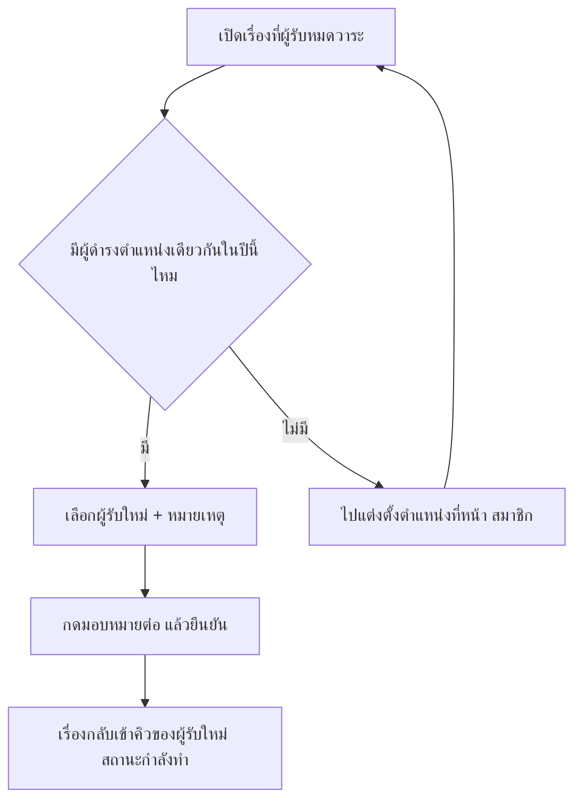

# เรื่องที่ผู้รับหมดวาระและกระทบยอดรายชื่อ

สองงานปิดท้ายของการขึ้นปีใหม่ ที่ต้องทำก่อนเปิดเทอม

- **เรื่องที่ผู้รับหมดวาระ** — เรื่องที่ยังค้างอยู่ แต่คนรับไปแล้วไม่มีชื่อในปีนี้แล้ว
- **กระทบยอดรายชื่อ** — เทียบรายชื่อสองปี ว่ามีใครหลุดไปหรือมีชื่อแปลกปลอมเพิ่มมา

ทั้งสองงานทำครั้งเดียวหลังเลื่อนชั้นก็จบ

## ใครใช้บทนี้

ผู้ดูแลระบบ ครูสภานักเรียน และประธานสภา
ทั้งสองหน้าใช้ประตูเดียวกัน คือต้องมีสิทธิ์จัดการข้อมูลนักเรียนในระดับโรงเรียน

ครูประจำชั้น ประธานระดับ และสภานักเรียนเข้าสองหน้านี้ไม่ได้ แม้จะจัดการเรื่องรายคนได้ตามปกติ
เพราะการมอบหมายข้ามห้องกับการเห็นรายชื่อสองปีเป็นงานส่วนกลาง

ก่อนเริ่ม ควรเลื่อนชั้นเข้าปีใหม่เรียบร้อยแล้ว หรืออย่างน้อยมีปีปัจจุบันที่สมาชิกครบ
และรู้ว่าใครจะรับหน้าที่แทนตำแหน่งที่ว่างอยู่ ถ้ายังไม่มีต้องแต่งตั้งก่อน

## หาเรื่องที่ผู้รับหมดวาระ

เรื่องที่ขึ้นในหน้านี้ คือเรื่องที่ยังไม่ปิด แต่คนที่ถืออยู่ไม่ได้เป็นสมาชิกของปีการศึกษานี้แล้ว
ส่วนใหญ่เกิดหลังเลื่อนชั้น เพราะคนรับเดิมจบการศึกษา ย้ายออก หรือถูกถอดจากตำแหน่ง

เรื่องกลุ่มนี้มีผู้รับอยู่แล้ว จึงกด **รับเรื่อง** ไม่ได้ และไม่มีใครเห็นเป็นงานของตัวเอง

นับเป็นเรื่องค้างเฉพาะสถานะ **รอรับ** **กำลังทำ** และ **ส่งต่อ**

**ทางเข้า:** แท็บ **เพิ่มเติม** ➔ กลุ่ม **โรงเรียน** ➔ **เรื่องที่ผู้รับหมดวาระ**

หัวหน้าขึ้นว่า **เรื่องที่ยังเปิดอยู่แต่ผู้รับไม่มีสมาชิกภาพในปีการศึกษานี้ · N เรื่อง**
กดการ์ดแต่ละใบเพื่อดูชื่อเรื่อง ห้อง วันที่แจ้ง สถานะ และผู้รับเดิม

การ์ดจะบอกชื่อผู้รับเดิม พร้อมห้องที่เคยสังกัดในวงเล็บ และข้อความ **หมดสมาชิกภาพในปีนี้แล้ว**
ถ้าไม่มีเรื่องค้าง จะขึ้น **ไม่มีเรื่องค้าง** พร้อมคำอธิบายว่าทุกเรื่องมีผู้รับที่มีสมาชิกภาพในปีนี้แล้ว

หน้าตาตอนที่ยังไม่มีเรื่องค้างเป็นแบบนี้

*หมายเลข 1 คือข้อความ ไม่มีเรื่องค้าง พร้อมคำอธิบายว่าทุกเรื่องมีผู้รับแล้ว*

## มอบหมายเรื่องให้คนใหม่

1. **เปิดการ์ดของเรื่องที่ต้องการ**
2. **ดูช่อง ผู้รับใหม่** ระบบเลือกคนแรกที่ดำรงตำแหน่งเดียวกันให้ล่วงหน้า
3. **เปลี่ยนเป็นคนอื่น** ได้จากรายการเดียวกัน
4. **กรอก หมายเหตุ** ถ้าอยากให้มี เช่น **ส่งต่อให้หัวหน้าห้องคนใหม่**
5. **กด มอบหมายต่อ**
6. **ตรวจข้อความยืนยัน** ที่ระบุชื่อเรื่องและชื่อผู้รับใหม่ แล้วกด **มอบหมาย**

สำเร็จแล้วจะขึ้น **มอบหมายสำเร็จ** และเรื่องนั้นหลุดจากรายการทันที
เพราะผู้รับใหม่มีชื่อในปีนี้แล้ว

รายชื่อในช่อง **ผู้รับใหม่** มาจากคนที่ดำรงตำแหน่งเดียวกับผู้รับเดิมในปีปัจจุบัน
ถ้าตำแหน่งนั้นผูกกับห้อง จะเห็นเฉพาะคนในห้องเดียวกัน เช่นรองวิชาการของห้องเดิม
ถ้าเป็นตำแหน่งระดับโรงเรียน จะเห็นทุกคนที่ดำรงตำแหน่งนั้นทั้งโรงเรียน

::: warning ไม่มีคนดำรงตำแหน่งเดียวกัน = มอบหมายไม่ได้
ระบบจะขึ้น **ยังไม่มีผู้ดำรงตำแหน่งเดียวกันในปีนี้ — ต้องแต่งตั้งก่อน**
ให้ไปตั้งตำแหน่งที่หน้า **สมาชิก** ตาม [ข้อมูลนักเรียนและประวัติ](student-records.md) แล้วกลับมาโหลดหน้านี้ใหม่
:::

## กระทบยอดรายชื่อสองปี

ใช้เช็กว่าหลังขึ้นปีใหม่มีใครหลุดจากระบบ หรือมีชื่อแปลกปลอมโผล่เข้ามา
ผลลัพธ์เป็นแค่ส่วนต่างของรายชื่อ ระบบไม่ตัดสินสาเหตุให้

**ทางเข้า:** แท็บ **เพิ่มเติม** ➔ กลุ่ม **โรงเรียน** ➔ **กระทบยอดรายชื่อ**

ถ้ามีปีการศึกษาเดียว ระบบยังเทียบให้ไม่ได้ และขึ้นสถานะว่างแบบนี้

*หมายเลข 1 คือข้อความ ยังเปรียบเทียบไม่ได้ หมายเลข 2 คือ ยังไม่มีผลกระทบยอด*

ช่อง **ปีก่อน** และ **ปีหลัง** ระบบตั้งค่าเริ่มต้นเป็นปีก่อนหน้ากับปีปัจจุบันให้แล้ว
เปลี่ยนปีได้ทั้งสองช่อง แต่ต้องเป็นคนละปี แล้วกด **ตรวจกระทบยอด**

แถบสรุปด้านบนแสดงคู่ปีและจำนวน เช่น **ปีการศึกษา 2568 → ปีการศึกษา 2569 · หายจากปีใหม่ 214 คน · เพิ่มเข้ามา 8 คน**

ผลแบ่งเป็นสองคอลัมน์

- 🔍 **หายจากปีใหม่** — มีชื่อในปีก่อน แต่ไม่มีในปีใหม่ (ว่างจะขึ้น **ไม่มีใครหาย — รายชื่อครบทั้งสองปี**)
- ➕ **เพิ่มเข้ามา** — มีชื่อในปีใหม่ แต่ไม่มีในปีก่อน (ว่างจะขึ้น **ไม่มีคนใหม่ — ไม่มีชื่อแปลกปลอมในปีใหม่**)

แต่ละชื่อแสดงห้อง รหัสนักเรียน และตำแหน่งในห้อง
ถ้าระบบไม่มีชื่อบุคคล จะขึ้น **(ไม่มีชื่อในระบบ · รหัส ...)** เพื่อไม่ให้เห็นเป็นช่องว่าง

ระบบเทียบด้วยบัญชีผู้ใช้ ไม่ใช่ชื่อหรือรหัสนักเรียน
คนที่เปลี่ยนชื่อหรือรหัสจึงยังถือว่าเป็นคนเดิม ไม่ถูกนับเป็นคนใหม่

## อ่านผลกระทบยอดให้ถูก

คอลัมน์ **หายจากปีใหม่** มีสามกลุ่มปนกัน ต้องแยกเองด้วยตา

- นักเรียน ม.6 ที่จบการศึกษา — หายตามปกติและคาดหมายไว้แล้ว
- นักเรียนหรือบุคลากรที่ย้ายออกระหว่างปี
- คนที่ตกหล่นจากการนำเข้า Excel หรือถูกถอดจากห้องโดยไม่ตั้งใจ

ระบบไม่เดาให้ว่าคนไหนอยู่กลุ่มไหน เพราะเดาผิดแล้วจะกลายเป็นข้อมูลที่ไม่มีใครตรวจซ้ำ
วิธีที่เชื่อถือได้คือเทียบกับรายชื่อ ม.6 ที่โรงเรียนยืนยันแล้ว และดูห้องที่จำนวนคนไม่ตรงกับรายชื่อห้อง

ส่วน **เพิ่มเข้ามา** ที่ไม่ใช่การรับนักเรียนใหม่ มักมาจากการนำเข้าที่พิมพ์รหัสผิดจนกลายเป็นบัญชีใหม่ การสร้างบัญชีซ้ำจากหน้า **สมาชิก** หรือไฟล์ Excel ที่มีรหัสตัวอย่างหลุดเข้ามา

## ระบบทำอะไรเบื้องหลัง

- การมอบหมายตั้งผู้รับใหม่ ตำแหน่งของผู้รับใหม่ และเปลี่ยนสถานะเรื่องเป็น **กำลังทำ** ให้พร้อมกันในครั้งเดียว
- ระบบเขียนประวัติของเรื่อง ค่าเริ่มต้นคือ **มอบหมายต่อให้ «ชื่อผู้รับใหม่»** หรือใช้หมายเหตุที่เรากรอก
- กำหนดแก้ไขเดิมยังอยู่และยังผูกกับผู้รับคนก่อน ผู้รับใหม่ยืดเวลาจากกำหนดเดิมได้ หรือให้ผู้ดูแลระบบตั้งใหม่
- ผู้รับใหม่ได้แจ้งเตือนหัวข้อ **มีเรื่องที่ต้องดำเนินการต่อ**
- ผู้แจ้งได้แจ้งเตือนหัวข้อ **อัปเดตสถานะเรื่อง** ว่าเรื่องถูกส่งต่อให้ผู้รับผิดชอบคนใหม่แล้ว
- การมอบหมายถูกบันทึกใน **บันทึกการใช้งาน** พร้อมผู้รับเดิม ผู้รับใหม่ และสถานะเดิม
- เรื่องที่ปิดแล้วมอบหมายไม่ได้ ระบบตอบ **เรื่องนี้ปิดแล้ว — มอบหมายต่อไม่ได้**
- ผู้รับใหม่ต้องมีแถวสมาชิกที่ใช้งานในปีปัจจุบัน ไม่งั้นระบบตอบ **ผู้รับใหม่ไม่มีสมาชิกภาพในปีปัจจุบัน (หมดวาระ/ย้ายออกแล้ว)**
- การกระทบยอดอ่านอย่างเดียว ไม่เขียนข้อมูลใด ๆ
- ระบบเลือกเฉพาะแถวที่ยังไม่ถูกลบ และไม่กรองสถานะ จึงเห็นคนที่จบหรือถูกเลื่อนสถานะแล้วด้วย
- เรียงรายชื่อตามรหัสห้อง แล้วตามเลขที่ในห้อง

## ข้อจำกัดและข้อควรระวัง

- หน้านี้แสดงเรื่องของปีปัจจุบันเท่านั้น ไม่มีตัวเลือกดูปีอื่น
- ถ้าไม่มีผู้ดำรงตำแหน่งเดียวกันในปีนี้ ระบบมอบหมายให้ตำแหน่งอื่นเองไม่ได้ ต้องแต่งตั้งก่อน
- มอบหมายได้ทีละเรื่อง มอบหมายทั้งชุดในครั้งเดียวไม่ได้
- ไม่มีปุ่มยกเลิกการมอบหมาย ย้อนได้แค่มอบหมายกลับให้คนเดิม
- ผู้รับเดิมไม่ได้รับการแจ้งเตือนว่าเรื่องถูกย้ายไปแล้ว
- กระทบยอดดูได้ทีละคู่ปี ส่งออกเป็นไฟล์ไม่ได้ และไม่มีลิงก์ไปหน้าข้อมูลของแต่ละคน
- กระทบยอดไม่บอกสาเหตุที่หาย และไม่นับคนที่ถูกนำออกจากรายชื่อในปีใดปีหนึ่ง
- กระทบยอดเทียบด้วยบัญชีผู้ใช้ ไม่ใช่รหัสนักเรียน

## ติดปัญหาตรงไหน? ดูวิธีแก้ตรงนี้เลย

**Q: เข้าหน้าเรื่องที่ผู้รับหมดวาระไม่ได้?**

👉 **วิธีแก้:** หน้าต้องใช้สิทธิ์จัดการข้อมูลนักเรียนและตำแหน่งระดับโรงเรียน ถ้าเป็นครูประจำชั้นหรือประธานระดับ ให้แจ้งผู้ดูแลระบบหรือครูสภานักเรียนมอบหมายแทน

**Q: เรื่องค้างเยอะ แต่ช่องผู้รับใหม่ว่างทุกรายการ?**

👉 **วิธีแก้:** ตำแหน่งของผู้รับเดิมไม่มีใครดำรงอยู่แล้วในปีนี้ ให้แต่งตั้งตำแหน่งนั้นที่หน้า **สมาชิก** ก่อน แล้วกลับมาโหลดหน้าใหม่

**Q: มอบหมายแล้วเรื่องยังไม่ขึ้นในคิวของผู้รับใหม่?**

👉 **วิธีแก้:** เช็กว่าผู้รับใหม่ล็อกอินด้วยบัญชีที่ถูกมอบหมาย และดูคิว **ที่รับผิดชอบ** ระบบเปลี่ยนสถานะเป็นกำลังทำแล้ว จึงอยู่ในคิวทันที ไม่ต้องกดรับเรื่องซ้ำ

**Q: มอบหมายแล้วกำหนดนับถอยหลังยังเป็นของผู้รับคนเก่า?**

👉 **วิธีแก้:** ระบบไม่สร้างกำหนดใหม่ให้เอง ให้ผู้รับใหม่กด **ยืดเวลา** ในหน้าเรื่อง หรือให้ผู้ดูแลระบบตั้งเวลาใหม่

**Q: กระทบยอดแล้วมีคนหายเยอะผิดปกติ?**

👉 **วิธีแก้:** เทียบกับรายชื่อ ม.6 ที่จบก่อน ถ้าจำนวนไม่ตรง ให้เช็กว่าห้อง ม.6 ถูกปิดเป็นจบการศึกษาครบหรือไม่ แล้วตรวจการนำเข้า Excel ของห้องที่จำนวนคนไม่ตรง

**Q: กระทบยอดแล้วเห็นคนที่จบอยู่ในกลุ่มหาย?**

👉 **วิธีแก้:** ปกติ เพราะคนที่จบไม่ได้รับแถวใหม่ในปีถัดไป ระบบตั้งใจไม่ตัดกลุ่มนี้ออก เพื่อให้เห็นภาพรวมของรายชื่อที่หายจริง

**Q: เลือกปีเดียวกันแล้วกดตรวจไม่ได้?**

👉 **วิธีแก้:** ระบบต้องเทียบสองปีที่ต่างกัน ข้อความใต้ช่องเลือกคือ **เลือกสองปีให้ต่างกันก่อน** ถ้าในระบบมีปีเดียว จะขึ้น **ต้องมีอย่างน้อย 2 ปีการศึกษาจึงจะเทียบรายชื่อได้**

บทที่เกี่ยวข้อง: [เลื่อนชั้นนักเรียนทั้งโรงเรียน](student-promotion.md) · [จัดการเรื่องร้องเรียน](issue-management-sop.md) · [ข้อมูลนักเรียนและประวัติ](student-records.md)
