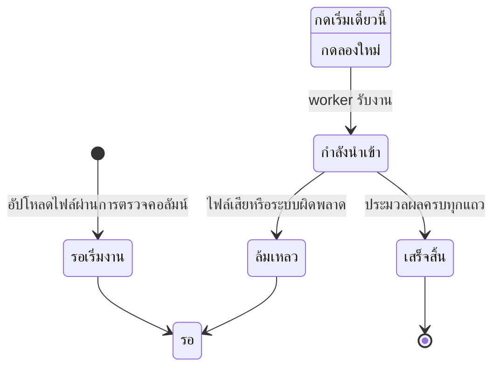

# นำเข้านักเรียนจาก Excel

อัปโหลดไฟล์รายชื่อเข้าคิว แล้วระบบจะสร้างบัญชีให้ทีละชุด
คนใหม่ได้ชื่อผู้ใช้กับรหัสผ่านเป็นรหัสนักเรียน และถูกบังคับให้เปลี่ยนรหัสตอนเข้าแรก

- รับเฉพาะไฟล์ `.xlsx` และหัวคอลัมน์ต้องตรงแม่แบบ
- ไฟล์ละไม่เกิน 10 MB และ 5,000 แถว
- นำเข้าซ้ำไม่สร้างคนซ้ำ เพราะระบบจับคู่ด้วยรหัสนักเรียน

## ใครใช้บทนี้

คนที่นำเข้านักเรียนได้ คือผู้ดูแลระบบ ครูสภานักเรียน ประธานสภา ครูทั่วไป ประธานระดับ และผู้ช่วยหัวหน้าระดับ
ครูทั่วไปและประธานระดับนำเข้าได้เฉพาะนักเรียนในระดับชั้นของตัวเอง

ก่อนเริ่ม ต้องมีปีการศึกษาที่จะนำเข้าในระบบแล้ว และตรวจให้แน่ใจว่าไม่มีนักเรียนคนเดียวกันอยู่สองห้องในไฟล์เดียว
เพราะการนำเข้าซ้ำจะเขียนทับข้อมูลเดิมของคนนั้นในปีเดียวกัน

## เตรียมไฟล์จากแม่แบบ

**ทางเข้า:** แท็บ **เพิ่มเติม** ➔ กลุ่ม **ผู้ดูแล** ➔ **สมาชิก** ➔ ปุ่ม **+** ลอยมุมจอ ➔ **นำเข้านักเรียน** ➔ **ดาวน์โหลดตัวอย่างไฟล์ (Template)**

หน้าแรกมีปุ่มดาวน์โหลดแม่แบบอยู่มุมขวา และตารางบอกคอลัมน์ที่ต้องมีครบ

*หมายเลข 1 คือปุ่มดาวน์โหลดไฟล์ตัวอย่าง หมายเลข 2 คือหัวตารางคอลัมน์ที่ระบบอ่าน*

เปิดไฟล์ใน Excel แล้วกรอกในชีต **ข้อมูล**
หัวคอลัมน์ต้องตรงตามนี้ ห้ามเพิ่ม ลบ เปลี่ยนชื่อ หรือทำคอลัมน์ซ้ำ

| คอลัมน์ | จำเป็น | หมายเหตุ |
|---|---|---|
| **รหัสนักเรียน** | ต้องมี | ใช้เป็นชื่อผู้ใช้และรหัสผ่านเริ่มต้น |
| **ห้องเรียน** | ต้องมี | รูปแบบ `ม.4/1` ระบบสร้างห้องให้ถ้ายังไม่มี |
| **เลขที่** | ต้องมี | ต้องเป็นตัวเลข |
| **คำนำหน้า** | เว้นได้ | เช่น นาย นางสาว |
| **ชื่อ** | แนะนำ | ห้ามเว้นทั้งชื่อและนามสกุล |
| **นามสกุล** | แนะนำ | — |
| **ชื่อเล่น** | เว้นได้ | — |
| **ตำแหน่งในห้องเรียน** | เว้นได้ | เว้นว่างแปลว่านักเรียนธรรมดา |
| **ปีการศึกษา** | เว้นได้ | ต้องตรงกับปีที่เลือกตอนอัปโหลด |

ไฟล์แม่แบบมีแถวตัวอย่างรหัส `00001` กับ `00002`
ระบบข้ามแถวที่รหัสขึ้นต้นด้วย `000` ให้เอง แต่ลบแถวตัวอย่างออกก่อนอัปโหลดจะเรียบร้อยกว่า

ตำแหน่งที่ใส่ในคอลัมน์ **ตำแหน่งในห้องเรียน** ได้แก่ หัวหน้าห้อง รองวิชาการ รองวินัย รองกิจกรรม รองปฏิคม ประธานระดับ ผู้ช่วยหัวหน้าระดับ สภานักเรียน ประธานสภา ครู ครูสภานักเรียน และผู้ดูแลระบบ

## อัปโหลดไฟล์เข้าคิว

1. **เลือก ปีการศึกษาที่นำเข้า** หรือคงค่า **ใช้ปีปัจจุบัน (ไม่ระบุ)**
2. **กด เลือกไฟล์ Excel (.xlsx)** แล้วเลือกไฟล์จากเครื่อง
3. **กด อัปโหลดเข้า Queue**
4. รอข้อความ **อัปโหลดเข้า Queue แล้ว!**

ก่อนกดอัปโหลด เลือกปีการศึกษาให้ตรงกับไฟล์ ส่วนรายการคิวด้านล่างบอกงานที่ส่งเข้าไปแล้ว

*หมายเลข 1 คือปุ่มอัปโหลดเข้า Queue หมายเลข 2 คือช่องเลือกปีการศึกษา และหมายเลข 3 คือหัวข้อ Queue List ที่บอกความคืบหน้าและจำนวนที่นำเข้าหรือข้าม*

ระบบตรวจหัวคอลัมน์ก่อนบันทึกไฟล์ ถ้าคอลัมน์ผิดจะปฏิเสธทันที และไม่ทิ้งไฟล์ขยะไว้

## สั่งให้ระบบเริ่มนำเข้า

**ทางเข้า:** เลื่อนลงไปที่รายการคิว ➔ หางานที่ป้าย **รอเริ่มงาน** ➔ **เริ่มเดี๋ยวนี้**

งานจะเปลี่ยนเป็น **รอ worker** แล้วเป็น **กำลังนำเข้า...** ตามลำดับ
ออกจากหน้านี้ได้ งานยังทำต่อ พอกลับมาเปิดใหม่จะเห็นความคืบหน้าล่าสุด

## อ่านผลและแถวที่ผิด

ตารางคิวมีห้าคอลัมน์ คือ ไฟล์ สถานะ ความคืบหน้า จำนวน นำเข้า/ข้าม และปุ่มจัดการ

- หลอดความคืบหน้าเติมตามเปอร์เซ็นต์ ตัวเลข **N/M แถว** บอกว่าประมวลผลไปแล้วกี่แถว
- ตัวเลขสีเขียวคือแถวที่นำเข้าสำเร็จ สีเทาคือแถวที่ถูกข้าม
- มีแถวผิดเมื่อไร จะมีแถบ **ข้อผิดพลาด N รายการ** ใต้แถวนั้น กดเพื่อเปิดรายการ
- ข้อความบอกเลขแถวและสาเหตุ เช่น **แถว 12: เลขที่ต้องเป็นตัวเลข**

ระบบเก็บข้อผิดพลาดได้สูงสุด 500 รายการต่องาน

## แก้ไฟล์แล้วนำเข้าซ้ำ

1. **แก้เฉพาะแถวที่ผิด** ในไฟล์เดิม
2. **อัปโหลดไฟล์ใหม่** ตามขั้นตอนเดิม
3. **กด เริ่มเดี๋ยวนี้**

นำเข้าซ้ำไม่สร้างนักเรียนซ้ำ เพราะระบบจับคู่ด้วยรหัสนักเรียน ห้อง และปีการศึกษา
แถวที่มีอยู่แล้วจะถูกอัปเดตชื่อ เลขที่ ตำแหน่ง และสิทธิ์ให้ตรงกับไฟล์

ถ้านักเรียนย้ายห้อง ให้ใส่ห้องใหม่แล้วนำเข้าซ้ำ
ระบบจะเปลี่ยนแถวเดิมของปีนั้นเป็นสถานะ `superseded` และเก็บแถวใหม่ในห้องที่ระบุ คนนั้นจะไม่โผล่สองห้องพร้อมกัน

## งานล้มเหลว ทำยังไงต่อ

**ทางเข้า:** หางานที่ป้าย **ล้มเหลว** ➔ อ่านสาเหตุใต้ป้าย ➔ **ลองใหม่**

ระบบล้างข้อผิดพลาดและความคืบหน้าเดิม แล้วเข้าคิวใหม่ให้
ไฟล์ของงานที่ล้มเหลวยังอยู่จนกว่าจะสำเร็จ

## สถานะของงานนำเข้า

หน้าจอแสดงสถานะเป็น **รอคิว** **กำลังประมวลผล** **เสร็จแล้ว** และ **ล้มเหลว**

## ระบบทำอะไรเบื้องหลัง

- ตรวจหัวคอลัมน์ก่อนบันทึกไฟล์ จึงไม่เหลือไฟล์ขยะเมื่อคอลัมน์ผิด
- ประมวลผลเบื้องหลังทีละ 50 แถว ถ้าชุดไหนผิด ชุดนั้นจะไม่ถูกบันทึกเลย ส่วนชุดอื่นที่ผ่านแล้วยังอยู่
- คนใหม่ได้ชื่อผู้ใช้และรหัสผ่านเริ่มต้นเป็นรหัสนักเรียน และถูกบังคับให้เปลี่ยนรหัสตอนเข้าแรก
- บัญชีที่มีอยู่แล้วไม่ถูกรีเซ็ตรหัสผ่าน
- เจอรหัสห้องที่ยังไม่มี ระบบสร้างห้องให้อัตโนมัติ
- แถวที่รหัสขึ้นต้น `000` ถูกข้ามเสมอ กันบัญชีตัวอย่างจากแม่แบบหลุดเข้าระบบ
- ครูระดับชั้นนำเข้าตำแหน่งระดับโรงเรียนไม่ได้ เช่น ผู้ดูแลระบบ ครูสภานักเรียน สภานักเรียน หรือประธานสภา
- งานที่ค้างเกิน 35 นาทีจะถูกดึงกลับเข้าคิวเองเมื่อ worker เริ่มทำงาน
- ไฟล์ถูกลบเมื่องานสำเร็จ แต่เก็บไว้ให้ลองใหม่เมื่อล้มเหลว
- ทุกการเปลี่ยนสถานะงานเขียนบันทึกการใช้งาน

## ข้อจำกัดและข้อควรระวัง

::: warning นำเข้าซ้ำจะทับข้อมูลเดิม
ระบบจับคู่ด้วยรหัสนักเรียน ห้อง และปีการศึกษา ถ้าเจอคนเดิมจะอัปเดตทับด้วยค่าจากไฟล์
ตรวจไฟล์ให้ดีก่อนอัปโหลดทุกครั้ง
:::

- รับเฉพาะ `.xlsx` ไม่รับ `.xls` หรือ `.csv`
- หัวคอลัมน์ต้องตรงแม่แบบ ห้ามมีคอลัมน์เกิน
- ไฟล์ละไม่เกิน 10 MB และ 5,000 แถว
- ยกเลิกงานที่กำลังทำจากหน้าจอไม่ได้
- แก้ข้อมูลรายแถวในหน้าจอไม่ได้ ต้องแก้ในไฟล์แล้วนำเข้าซ้ำ
- ส่งออกข้อมูลเป็น Excel ไม่ได้
- ระบบไม่แจ้งเตือนเมื่องานเสร็จ ต้องเปิดหน้านี้ดูเอง

## ติดปัญหาตรงไหน? ดูวิธีแก้ตรงนี้เลย

**Q: อัปโหลดแล้วขึ้นว่าคอลัมน์ผิด?**

👉 **วิธีแก้:** เช็กว่าหัวคอลัมน์ตรงกับแม่แบบทุกตัวอักษร และไม่มีคอลัมน์เกินหรือซ้ำ สามคอลัมน์ที่ต้องมีคือ **รหัสนักเรียน** **ห้องเรียน** และ **เลขที่**

**Q: งานขึ้น "ล้มเหลว" ต้องเริ่มใหม่ทั้งหมดไหม?**

👉 **วิธีแก้:** ไม่ต้อง กด **ลองใหม่** ระบบใช้ไฟล์เดิมและล้างผลรอบก่อนให้ ถ้าสาเหตุมาจากตัวไฟล์ ให้แก้ไฟล์แล้วอัปโหลดใหม่แทน

**Q: นำเข้าแล้วนักเรียนขึ้นสองห้อง?**

👉 **วิธีแก้:** เช็กว่าในไฟล์มีห้องต่างกันสำหรับรหัสเดียวกันไหม การนำเข้าซ้ำจะปิดแถวเก่าให้ แต่ถ้าไฟล์เองมีสองห้อง ระบบจะย้ายตามแถวที่ประมวลผลหลังสุด

**Q: นักเรียนล็อกอินไม่ได้หลังนำเข้า?**

👉 **วิธีแก้:** รหัสผ่านเริ่มต้นคือรหัสนักเรียน และระบบบังคับให้เปลี่ยนตอนเข้าแรก ถ้ายังไม่ได้ ให้เช็กว่าชื่อผู้ใช้ตรงกับรหัสนักเรียนในไฟล์

**Q: ทำไมบางแถวถูกข้ามทั้งที่ข้อมูลดูครบ?**

👉 **วิธีแก้:** เปิดแถบ **ข้อผิดพลาด** ใต้แถวนั้นเพื่ออ่านสาเหตุ สาเหตุที่เจอบ่อยคือเลขที่ไม่ใช่ตัวเลข รหัสขึ้นต้น `000` ไม่มีชื่อหรือนามสกุล หรือปีในไฟล์ไม่ตรงกับปีของงาน

**Q: นำเข้าปีหน้าได้เลยไหม?**

👉 **วิธีแก้:** ได้ เลือก **ปีการศึกษาที่นำเข้า** เป็นปีนั้น แต่ต้องสร้างปีการศึกษาก่อน และคนเดิมจะได้แถวใหม่ในปีใหม่ ไม่ทับแถวปีเก่า

**Q: ครูประจำชั้นนำเข้าตำแหน่งสภานักเรียนได้ไหม?**

👉 **วิธีแก้:** ไม่ได้ ระบบจะปฏิเสธว่าตำแหน่งนี้สร้างได้เฉพาะผู้ดูแลทั้งโรงเรียน ให้ผู้ดูแลระบบหรือครูสภานักเรียนเป็นคนนำเข้าแทน
