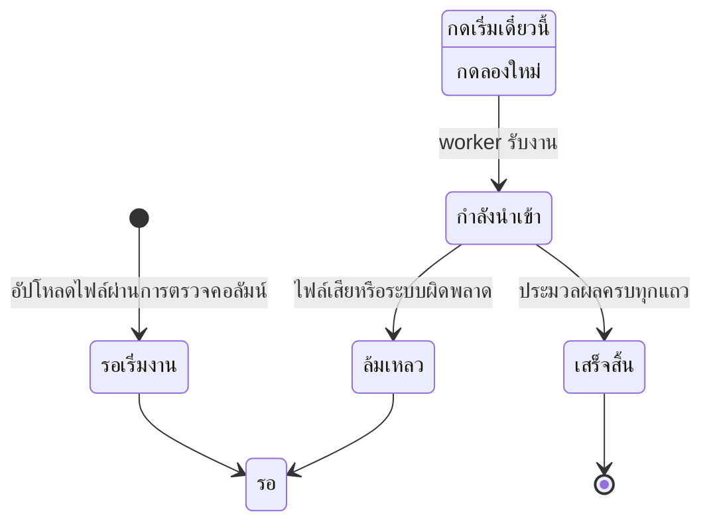

# นำเข้านักเรียนจาก Excel

บทนี้อธิบายวิธีเตรียมไฟล์รายชื่อ อัปโหลดเข้าคิว สั่งงาน ติดตามผล และแก้แถวที่ผิด

## ใครใช้บทนี้

ผู้มีสิทธิ์ `MANAGE_STUDENTS` ได้แก่ ผู้ดูแลระบบ ครูสภานักเรียน ประธานสภา ครูทั่วไป ประธานระดับ และผู้ช่วยหัวหน้าระดับ
ครูทั่วไปและประธานระดับนำเข้าได้เฉพาะนักเรียนในระดับชั้นของตน

## ก่อนเริ่ม

- มีปีการศึกษาที่จะนำเข้าแล้วในระบบ
- มีไฟล์ `.xlsx` ที่หัวคอลัมน์ตรงตามแม่แบบ
- ตรวจว่าไม่มีนักเรียนคนเดียวกันปรากฏสองห้องในไฟล์เดียวกัน
- การนำเข้าแทนที่ข้อมูลเดิมของนักเรียนคนเดิมในปีเดียวกัน จึงควรตรวจไฟล์ก่อนอัปโหลด

## เตรียมไฟล์จากแม่แบบ

1. เปิด **เพิ่มเติม**
2. ในกลุ่ม **ผู้ดูแล** เลือก **สมาชิก**
3. กดปุ่ม **+** ลอยมุมจอ แล้วเลือก **นำเข้านักเรียน**
4. กด **ดาวน์โหลดตัวอย่างไฟล์ (Template)**
5. เปิดไฟล์ใน Excel แล้วกรอกข้อมูลในชีต **ข้อมูล**

ไฟล์ต้องมีหัวคอลัมน์ตามนี้ และห้ามเพิ่ม ลบ เปลี่ยนชื่อ หรือทำคอลัมน์ซ้ำ

| คอลัมน์ | จำเป็น | หมายเหตุ |
|---|---|---|
| **รหัสนักเรียน** | ต้องมี | ใช้เป็นชื่อผู้ใช้และรหัสผ่านเริ่มต้น |
| **ห้องเรียน** | ต้องมี | รูปแบบ `ม.4/1` ระบบสร้างห้องให้ถ้ายังไม่มี |
| **เลขที่** | ต้องมี | ต้องเป็นตัวเลข |
| **คำนำหน้า** | เว้นได้ | เช่น นาย นางสาว |
| **ชื่อ** | แนะนำ | ห้ามเว้นทั้งชื่อและนามสกุล |
| **นามสกุล** | แนะนำ | — |
| **ชื่อเล่น** | เว้นได้ | — |
| **ตำแหน่งในห้องเรียน** | เว้นได้ | เว้นว่างหมายถึงนักเรียนธรรมดา |
| **ปีการศึกษา** | เว้นได้ | ต้องตรงกับปีที่เลือกตอนอัปโหลด |

ไฟล์แม่แบบมีแถวตัวอย่างรหัส `00001` และ `00002` ระบบข้ามแถวที่รหัสขึ้นต้นด้วย `000` ให้อัตโนมัติ
ลบแถวตัวอย่างก่อนอัปโหลดเพื่อความเรียบร้อย

ตำแหน่งที่รองรับในคอลัมน์ **ตำแหน่งในห้องเรียน** คือ หัวหน้าห้อง รองวิชาการ รองวินัย รองกิจกรรม รองปฏิคม ประธานระดับ ผู้ช่วยหัวหน้าระดับ สภานักเรียน ประธานสภา ครู ครูสภานักเรียน และผู้ดูแลระบบ

## อัปโหลดไฟล์เข้าคิว

1. เปิด **นำเข้านักเรียน**
2. เลือก **ปีการศึกษาที่นำเข้า** หรือคงค่า **ใช้ปีปัจจุบัน (ไม่ระบุ)**
3. กด **เลือกไฟล์ Excel (.xlsx)**
4. เลือกไฟล์จากเครื่อง
5. กด **อัปโหลดเข้า Queue**
6. รอข้อความ **อัปโหลดเข้า Queue แล้ว!**

ระบบตรวจหัวคอลัมน์ก่อนบันทึกไฟล์ ถ้าคอลัมน์ผิดจะปฏิเสธทันทีและไม่ทิ้งไฟล์ค้างไว้

ข้อจำกัดของไฟล์

- นามสกุล `.xlsx` เท่านั้น ไฟล์ `.xls` หรือ `.csv` ใช้ไม่ได้
- ขนาดไม่เกิน 10 MB
- ข้อมูลไม่เกิน 5,000 แถว ไฟล์ใหญ่กว่านี้ต้องแบ่ง

## สั่งให้ระบบเริ่มนำเข้า

1. ไปที่รายการคิวด้านล่างหน้า
2. หางานที่ป้าย **รอเริ่มงาน**
3. กด **เริ่มเดี๋ยวนี้**

งานเปลี่ยนเป็น **รอ worker** แล้วเป็น **กำลังนำเข้า...** ตามลำดับ
ออกจากหน้านี้ได้ งานยังทำต่อ เมื่อกลับมาเปิดใหม่ระบบแสดงความคืบหน้าล่าสุด

## ติดตามผลและอ่านแถวที่ผิด

ตารางคิวแสดงห้าคอลัมน์ คือ ไฟล์ สถานะ ความคืบหน้า จำนวน นำเข้า/ข้าม และปุ่มจัดการ

- หลอดความคืบหน้าเติมตามเปอร์เซ็นต์ และตัวเลข **N/M แถว** บอกว่าประมวลผลไปแล้วกี่แถว
- ตัวเลขสีเขียวคือจำนวนแถวที่นำเข้าสำเร็จ ตัวเลขสีเทาคือจำนวนแถวที่ถูกข้าม
- เมื่อมีแถวผิด จะมีแถบ **ข้อผิดพลาด N รายการ** ใต้แถวนั้น กดเพื่อเปิดรายการ
- ข้อความระบุเลขแถวและสาเหตุ เช่น **แถว 12: เลขที่ต้องเป็นตัวเลข**

ระบบเก็บข้อผิดพลาดได้สูงสุด 500 รายการต่องาน

## แก้ไฟล์แล้วนำเข้าซ้ำ

1. แก้ข้อมูลในไฟล์เดิมเฉพาะแถวที่ผิด
2. อัปโหลดไฟล์ใหม่ตามขั้นตอนเดิม
3. กด **เริ่มเดี๋ยวนี้**

การนำเข้าซ้ำไม่สร้างนักเรียนซ้ำ ระบบจับคู่ด้วยรหัสนักเรียน ห้อง และปีการศึกษา
แถวที่มีอยู่แล้วจะถูกอัปเดตชื่อ เลขที่ ตำแหน่ง และสิทธิ์ให้ตรงกับไฟล์

## แก้ข้อมูลนักเรียนที่ย้ายห้อง

ใส่ห้องใหม่ในไฟล์แล้วนำเข้าซ้ำ ระบบย้ายแถวเดิมของปีนั้นเป็นสถานะ `superseded`
และเก็บแถวใหม่ในห้องที่ระบุ ทำให้นักเรียนไม่ปรากฏสองห้องพร้อมกัน

## งานล้มเหลวและลองใหม่

1. หางานที่ป้าย **ล้มเหลว**
2. อ่านข้อความสาเหตุใต้ป้าย
3. กด **ลองใหม่**

ระบบล้างข้อผิดพลาดและความคืบหน้าเดิม แล้วเข้าคิวใหม่
ไฟล์ของงานที่ล้มเหลวยังอยู่จนกว่าจะสำเร็จ

## สถานะของงานนำเข้า

สถานะจริงในฐานข้อมูลคือ `PENDING`, `QUEUED`, `PROCESSING`, `COMPLETED` และ `FAILED`

## ระบบทำอะไรเบื้องหลัง

- ระบบตรวจหัวคอลัมน์ก่อนบันทึกไฟล์ จึงไม่เหลือไฟล์ขยะเมื่อคอลัมน์ผิด
- งานประมวลผลใน worker แยกจากเว็บ แบ่งทีละ 50 แถว แต่ละชุดเป็นทรานแซกชันแยก
- นักเรียนใหม่ได้ชื่อผู้ใช้เป็นรหัสนักเรียน และรหัสผ่านเริ่มต้นเป็นรหัสนักเรียน
- บัญชีที่สร้างใหม่ถูกบังคับให้เปลี่ยนรหัสเมื่อเข้าครั้งแรก
- บัญชีที่มีอยู่แล้วไม่ถูกรีเซ็ตรหัสผ่าน
- ระบบสร้างห้องให้อัตโนมัติเมื่อพบรหัสห้องที่ยังไม่มี
- แถวที่รหัสขึ้นต้น `000` ถูกข้ามเสมอเพื่อกันบัญชีตัวอย่างจากแม่แบบหลุดเข้าระบบ
- ครูระดับชั้นนำเข้าตำแหน่งระดับโรงเรียน เช่น ผู้ดูแลระบบ ครูสภานักเรียน สภานักเรียน หรือประธานสภา ไม่ได้
- งานที่ค้างเกิน 35 นาทีจะถูกดึงกลับเข้าคิวอัตโนมัติเมื่อ worker เริ่มทำงาน
- ไฟล์ถูกลบเมื่องานสำเร็จ แต่เก็บไว้ให้ลองใหม่เมื่อล้มเหลว
- ทุกการเปลี่ยนสถานะงานเขียนบันทึกการใช้งาน

## ข้อจำกัดและข้อควรระวัง

- รับเฉพาะ `.xlsx` ไม่รับ `.xls` หรือ `.csv`
- หัวคอลัมน์ต้องตรงตามแม่แบบ ห้ามมีคอลัมน์เกิน
- ไฟล์ละไม่เกิน 10 MB และ 5,000 แถว
- ยกเลิกงานที่กำลังทำจากหน้าจอไม่ได้
- ไม่มีการแก้ข้อมูลรายแถวในหน้าจอ ต้องแก้ในไฟล์แล้วนำเข้าซ้ำ
- ไม่มีส่งออกข้อมูลออกเป็น Excel
- การนำเข้าซ้ำจะเขียนทับข้อมูลเดิมของนักเรียนคนเดิมในปีเดียวกัน
- ระบบไม่แจ้งเตือนเมื่องานเสร็จ ต้องเปิดหน้านี้ดูเอง

## แก้ไขปัญหาและคำถามที่พบบ่อย

**ถาม: อัปโหลดแล้วขึ้นว่าคอลัมน์ผิด**
ตอบ: ตรวจว่าหัวคอลัมน์ตรงกับแม่แบบทุกตัวอักษร และไม่มีคอลัมน์เกินหรือซ้ำ
คอลัมน์ที่จำเป็นคือ **รหัสนักเรียน** **ห้องเรียน** และ **เลขที่**

**ถาม: งานขึ้น "ล้มเหลว" ต้องเริ่มใหม่ทั้งหมดไหม**
ตอบ: ไม่ต้อง กด **ลองใหม่** ระบบใช้ไฟล์เดิมและล้างผลรอบก่อน
ถ้าสาเหตุมาจากไฟล์ ให้แก้ไฟล์และอัปโหลดใหม่แทน

**ถาม: นำเข้าแล้วนักเรียนขึ้นสองห้อง**
ตอบ: ตรวจว่าแถวในไฟล์มีห้องต่างกันสำหรับรหัสเดียวกันหรือไม่
การนำเข้าซ้ำจะปิดแถวเก่าให้ แต่ถ้าไฟล์เองมีสองห้อง ระบบจะย้ายตามแถวที่ประมวลผลหลังสุด

**ถาม: นักเรียนล็อกอินไม่ได้หลังนำเข้า**
ตอบ: รหัสผ่านเริ่มต้นคือรหัสนักเรียน และระบบบังคับให้เปลี่ยนตอนเข้าครั้งแรก
ถ้ายังไม่ได้ ให้ตรวจว่าชื่อผู้ใช้ตรงกับรหัสนักเรียนในไฟล์

**ถาม: ทำไมบางแถวถูกข้ามทั้งที่ข้อมูลดูครบ**
ตอบ: เปิดแถบ **ข้อผิดพลาด** ใต้แถวนั้นเพื่ออ่านสาเหตุ
สาเหตุที่พบบ่อยคือเลขที่ไม่ใช่ตัวเลข รหัสขึ้นต้น `000` ไม่มีชื่อ-นามสกุล หรือปีในไฟล์ไม่ตรงกับปีของงาน

**ถาม: นำเข้าปีหน้าได้เลยไหม**
ตอบ: ได้ เลือก **ปีการศึกษาที่นำเข้า** เป็นปีนั้น
แต่ต้องสร้างปีการศึกษาก่อน และนักเรียนคนเดิมจะได้แถวใหม่ในปีใหม่ ไม่ทับแถวปีเก่า

**ถาม: ครูประจำชั้นนำเข้าตำแหน่งสภานักเรียนได้ไหม**
ตอบ: ไม่ได้ ระบบปฏิเสธพร้อมข้อความว่าตำแหน่งนี้สร้างได้เฉพาะผู้ดูแลทั้งโรงเรียน
ให้ผู้ดูแลระบบหรือครูสภานักเรียนเป็นผู้นำเข้าแทน
