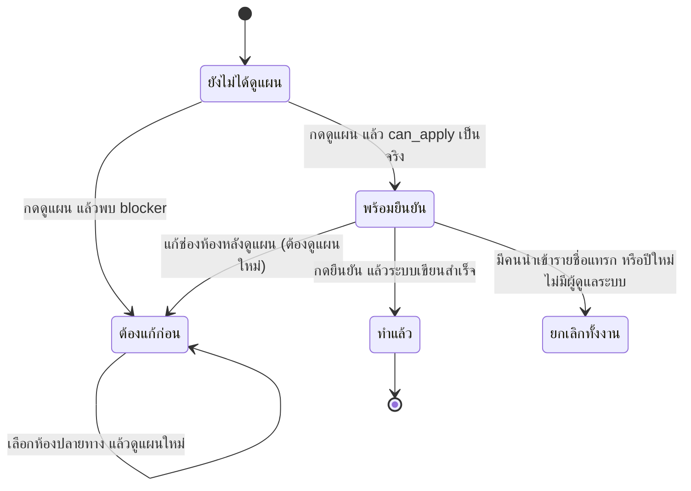

# เลื่อนชั้นนักเรียนทั้งโรงเรียน

ขึ้นปีการศึกษาใหม่ทั้งโรงเรียนในครั้งเดียว ตั้งแต่สร้างปีปลายทาง ดูแผน แก้ห้องที่ระบบเดาไม่ได้ จนถึงกดยืนยัน
งานนี้ทำปีละครั้ง และย้อนกลับไม่ได้ อ่านแผนให้ครบก่อนกดทุกครั้ง

- ระบบดูแผนให้ก่อนเสมอ ยังไม่เขียนอะไรจนกว่าจะยืนยัน
- ห้องที่เดาไม่ได้ ระบบไม่เดาแทน ต้องเลือกเอง
- กดยืนยันแล้วทั้งโรงเรียนถูกเขียนในทรานแซกชันเดียว

## ใครใช้บทนี้

คนที่มีสิทธิ์ `MANAGE_STUDENTS` และมีขอบเขตระดับโรงเรียน ได้แก่ ผู้ดูแลระบบ ครูสภานักเรียน และประธานสภา

ครูทั่วไป ประธานระดับ สภานักเรียน และผู้ช่วยหัวหน้าระดับจะไม่เห็นเมนูนี้ แม้มีสิทธิ์ `MANAGE_STUDENTS`
เพราะการเลื่อนชั้นเปลี่ยนสถานะสมาชิกทุกระดับพร้อมกัน

ก่อนเริ่ม เตรียมสามอย่างนี้ให้ครบ

- ปีการศึกษาปัจจุบันที่โรงเรียนใช้อยู่ และมีสมาชิกในปีนั้น
- ปีปลายทางที่ยังว่าง ถ้ายังไม่มีให้สร้างที่ **ปีการศึกษา** ก่อน
- ห้องปลายทางของทุกระดับชั้น

และปิดงานที่ค้างกับการแก้รายชื่อให้เรียบร้อย
ถ้าโรงเรียนยังใช้ระบบอยู่ ให้ทำนอกเวลาเรียน เพราะตอนกดยืนยันระบบจะหยุดรับการแก้ตารางสมาชิกชั่วครู่

## เตรียมปีปลายทางก่อน

1. **เปิด ปีการศึกษา** (แท็บ **เพิ่มเติม** ➔ กลุ่ม **โรงเรียน** ➔ **ปีการศึกษา**)
2. **ที่การ์ด ขั้นต่อไปของการขึ้นปีใหม่ กด สร้างปีการศึกษาใหม่**
3. **กรอก ปีการศึกษา (พ.ศ.)** กับวันเปิด–ปิดภาคเรียน แล้วบันทึก
4. **กลับมาดูรายการปี** ให้แน่ใจว่าปียังไม่ถูกกด **ใช้เป็นปีปัจจุบัน** — ขั้นนี้ยังไม่ต้องกด
5. **สร้างห้องของปีใหม่ให้ครบ** หรือปล่อยให้ระบบสร้างตอนนำเข้ารายชื่อก็ได้

การ์ด **ขั้นต่อไปของการขึ้นปีใหม่** เตือนลำดับงานหกขั้น คือ สร้างปี ➔ เลื่อนชั้นทั้งโรงเรียน ➔ นำเข้ารายชื่อด้วย Excel ➔ ตรวจกระทบยอดรายชื่อ ➔ ตั้งภาคเรียนของปีใหม่ ➔ มอบหมายเรื่องที่ผู้รับหมดวาระ

ระบบไม่ได้บังคับลำดับด้วยโค้ด แต่ข้ามขั้นแล้วต้องไล่แก้ทีหลัง

ระบบอ่านเฉพาะปีที่ยังไม่มีสมาชิก ถ้าปีปลายทางมีคนอยู่แล้วแม้คนเดียว จะไม่ยอมทำ
เพราะจะกลายเป็นการเอารายชื่อสองชุดมาทับกันโดยไม่มีใครรู้

## ดูแผนก่อน

**ทางเข้า:** แท็บ **เพิ่มเติม** ➔ กลุ่ม **โรงเรียน** ➔ **เลื่อนชั้นนักเรียน**

ช่อง **ปีต้นทาง** ระบบเลือกปีปัจจุบันให้แล้ว และจางข้อความกำกับ **(ต้องเป็นปีปัจจุบัน)**
ช่อง **ปีปลายทาง** เลือกปีใหม่ ตัวเลือกจะแสดงจำนวนสมาชิกของแต่ละปีให้เห็น

กด **ดูแผน** แล้วอ่านจากบนลงล่างตามนี้

| ส่วน | อ่านอะไร |
|---|---|
| **ต้องแก้ก่อน (N ข้อ)** | สีแดง ยังกดยืนยันไม่ได้จนกว่าจะแก้ครบ |
| **ควรตรวจก่อน (N ข้อ)** | สีเหลือง ทำได้ แต่ควรอ่านก่อน |
| การ์ดสรุป | **สมาชิกปีนี้** **เลื่อนขึ้นปีใหม่** **จบการศึกษา** |
| รายการหมายเหตุ | บุคลากรที่ยกไป ตำแหน่งที่รีเซ็ต สภานักเรียนที่วาระหมด และคนที่ไม่มีห้อง |
| **ต้องเลือกห้องปลายทางเอง (N ห้อง)** | ห้องที่ระบบแมปให้ไม่ได้ |
| ตารางต่อระดับชั้น | คู่ห้องต้นทาง ➔ ห้องปลายทาง และจำนวนคน |
| จบการศึกษา | รายชื่อห้อง ม.6 และจำนวนคน |

กด **ดูแผน** ซ้ำได้ไม่จำกัด เพราะไม่แก้อะไร
แต่ทุกครั้งจะเกิดแถวประวัติหนึ่งรายการ ไว้ย้อนดูว่าตอนนั้นระบบประเมินอะไรไว้

## แผนบอกอะไรบ้าง

ระบบจัดระดับชั้นปลายทางตามรหัสห้อง เช่นห้องที่ขึ้นต้น `ม.1/` ไป `ม.2/` และห้อง `ม.6/` ถือว่าจบการศึกษา
ถ้ารหัสห้องไม่ตรงรูปแบบที่รู้จัก ระบบจะไม่เดาและปล่อยห้องนั้นไว้ให้เลือกเอง

การ์ดสรุปมีสามตัวเลขที่ต้องตรงกับที่โรงเรียนคาดไว้

- **สมาชิกปีนี้** — จำนวนแถวที่ใช้งานอยู่ทั้งหมดในปีต้นทาง
- **เลื่อนขึ้นปีใหม่** — จำนวนคนที่จะได้แถวใหม่ในปีปลายทาง
- **จบการศึกษา** — จำนวนคนห้อง ม.6 ที่จะไม่ได้รับแถวใหม่

รายการหมายเหตุใต้การ์ดบอกว่าแผนจะทำอะไรกับแต่ละกลุ่ม

- **ยกบุคลากรไปปีใหม่** — ครู ผู้ดูแลระบบ และตำแหน่งระดับโรงเรียนยกไปทั้งบทบาทและสิทธิ์เดิม
- **ตำแหน่งในห้อง ... เป็นนักเรียนธรรมดา** — หัวหน้าห้องและรองฝ่ายทุกคนต้องแต่งตั้งใหม่หลังขึ้นปี
- **สมาชิกสภานักเรียน ... วาระหมด** — ตำแหน่งสภาต้องเลือกตั้งใหม่ ระบบไม่ยกให้
- **ไม่มีห้อง** — คนที่ยังไม่มีห้องจะถูกยกไปโดยไม่มีห้อง ต้องไปใส่ห้องทีหลัง

## เลือกห้องปลายทางที่ระบบเดาไม่ได้

เกิดเมื่อรหัสห้องต้นทางเลื่อนขึ้นระดับถัดไปไม่ได้ เช่น ชื่อห้องไม่ตรงรูปแบบ หรือเป็นห้องของระดับที่ไม่มีระดับถัดไป

1. **อ่านกล่อง ต้องเลือกห้องปลายทางเอง (N ห้อง)** ซึ่งบอกชื่อห้อง จำนวนคน และเหตุผล
2. **เลือก ห้องปลายทาง** ให้ครบทุกห้อง
3. **กด ดูแผนอีกครั้ง**
4. **เช็กว่ากล่องแดงหายไป** และปุ่มยืนยันกดได้แล้ว

ระบบไม่เดาแทน เพราะเดาผิดแล้วเด็กทั้งห้องไปอยู่ผิดที่โดยไม่มีใครรู้
ระหว่างแก้ช่องห้อง จะมีแถบ **แก้ห้องปลายทางแล้ว — แผนที่เห็นอยู่ยังไม่รู้จักค่าล่าสุด** และปุ่มยืนยันถูกล็อกไว้จนกว่าจะกด **ดูแผนใหม่**

ห้องปลายทางต้องมีอยู่จริงในระบบ ระบบไม่สร้างห้องใหม่ให้ตอนเลื่อนชั้น

## แก้ข้อที่ต้องแก้ก่อน

ข้อที่ทำให้กดยืนยันไม่ได้มีห้าประเภท ระบบเขียนไว้ในกล่อง **ต้องแก้ก่อน** ตรง ๆ

- **ปีต้นทางกับปีปลายทางเป็นปีเดียวกัน — ต้องเป็นคนละปี** ➔ เลือกปีปลายทางเป็นปีอื่น
- **ปีต้นทาง «...» ไม่ใช่ปีปัจจุบัน** ➔ ตั้งปีนั้นเป็นปีปัจจุบันก่อน หรือเลือกปีปัจจุบันเป็นต้นทาง
- **ปี «...» ไม่มีสมาชิกที่ใช้งานอยู่** ➔ เช็กว่านำเข้ารายชื่อปีนั้นแล้วหรือยัง
- **มี N คนใน N ห้องที่หาห้องปลายทางไม่ได้** ➔ เลือกห้องปลายทางให้ครบแล้วดูแผนใหม่
- **มีเลขประจำตัวนักเรียนซ้ำกันในห้องปลายทางเดียวกัน** ➔ แก้เลขที่ซ้ำในห้องต้นทางก่อน มักเกิดตอนเลือกห้องปลายทางให้สองห้องรวมเป็นห้องเดียว

อีกข้อจะเจอตอนกดยืนยัน คือ **ปีปลายทาง «...» มีสมาชิกอยู่แล้ว N คน** ซึ่งแปลว่ามีคนนำเข้ารายชื่อแทรกเข้ามาหลังดูแผน
ระบบจะยกเลิกทั้งงานและไม่เขียนอะไรเลย ให้ลบสมาชิกในปีนั้นหรือเลือกปีอื่น

## ยืนยันเลื่อนชั้น

1. **เช็กว่าปุ่ม ยืนยันเลื่อนชั้นทั้งโรงเรียน กดได้** และข้อความใต้ปุ่มขึ้นว่า **ย้อนกลับเองไม่ได้ — ระบบจะเขียนสมาชิกทั้งโรงเรียนในครั้งเดียว**
2. **กดปุ่มนั้น**
3. **อ่านข้อความยืนยัน** ซึ่งสรุปจำนวนคนที่จะยก จำนวนที่จบ จำนวนบุคลากร และปีที่จะกลายเป็นปีปัจจุบัน
4. **กด ยืนยัน เลื่อนชั้น**

::: warning งานนี้ย้อนกลับจากหน้าจอไม่ได้
ถ้าพลาด ทางเดียวคือกู้ฐานข้อมูลจากไฟล์สำรอง
อ่านตัวเลขในหน้าแผนเทียบกับที่โรงเรียนคาดไว้ให้ตรงก่อนกดทุกครั้ง
:::

หลังสำเร็จจะขึ้น **เลื่อนชั้นเรียบร้อย** พร้อมบรรทัดสรุป เช่น
**เลื่อนขึ้นปีใหม่ 812 คน · จบ 210 คน · บุคลากร 34 คน · ปิดแถวปีเก่า 1,056 แถว — ปี «2569» เป็นปีปัจจุบันแล้ว**
จากนั้นหน้าจะโหลดปีใหม่กับประวัติรอบใหม่ให้ทันที

สถานะในตาราง `rollover_runs` คือ `PREVIEWED` `APPLIED` และ `FAILED`
รอบที่ `APPLIED` แล้วใช้ซ้ำไม่ได้ ระบบจะตอบ **รอบการเลื่อนชั้นนี้ถูกใช้ไปแล้ว — ให้ preview ใหม่เพื่อดูสถานะปัจจุบัน ก่อนตัดสินใจอีกครั้ง**

## ดูประวัติการเลื่อนชั้น

**ทางเข้า:** **เลื่อนชั้นนักเรียน** ➔ แถบ **ประวัติการเลื่อนชั้น** ที่ท้ายหน้า

ป้ายสถานะมีสามแบบ คือ **ทำแล้ว** **ล้มเหลว** และ **ดูแผนไว้**
**ดูแผนไว้** แปลว่าเคยกดดูแผนแต่ยังไม่ยืนยัน จึงไม่มีอะไรถูกแก้
หน้านี้แสดงยี่สิบรอบล่าสุด และโหลดเมื่อกางออกเท่านั้น

## ระบบทำอะไรเบื้องหลัง

- ยืนยันทั้งหมดอยู่ในทรานแซกชันเดียว ขั้นไหนล้มก็ไม่มีอะไรถูกเขียน ไม่ต้องกู้คืน
- ระบบล็อกงานด้วย advisory lock กดพร้อมกันกี่คนก็ได้ผลเดียว และคนที่แพ้จะได้ข้อความว่ารอบถูกใช้ไปแล้ว
- ขั้นแรกยกบุคลากรไปปีใหม่พร้อมบทบาท ห้อง สิทธิ์ และหน้าที่เดิม
- ขั้นถัดมาสร้างแถวใหม่ให้คนที่เลื่อนขึ้น ทุกคนได้ตำแหน่ง **นักเรียน** และสิทธิ์ของนักเรียน
- เลขที่ในห้องยกไปตามเดิมโดยตั้งใจ เพราะยังไม่รู้เลขที่ของห้องใหม่ ให้ไฟล์ Excel ของปีใหม่ทับทีหลัง
- แถวเดิมของปีเก่าถูกปิดเป็น `promoted` ส่วนห้อง ม.6 ถูกปิดเป็น `graduated` และไม่สร้างแถวใหม่
- ถ้าปีใหม่ไม่เหลือผู้ดูแลระบบเลย ระบบยกเลิกทั้งงาน เพราะสิทธิ์ทั้งระบบอ่านจากตารางสมาชิกของปีปัจจุบัน
- ระบบตั้งปีปลายทางเป็นปีปัจจุบัน และเปลี่ยนค่าเริ่มต้นของปีการศึกษาในตารางสมาชิกให้ชี้ปีใหม่
- คนที่ไม่มีห้องถูกยกไปด้วยโดยไม่มีห้อง ไม่หายจากระบบ
- ครูที่สังกัดห้อง ม.6 ถูกยกไปปีใหม่ ไม่จบการศึกษา และระบบเตือนไว้ใน **ควรตรวจก่อน**
- ทุกครั้งที่ดูแผนบันทึก `PREVIEW_ROLLOVER` การยืนยันบันทึก `APPLY_ROLLOVER` พร้อมจำนวนทุกประเภท
- ระบบไม่แจ้งเตือนนักเรียนเมื่อเลื่อนชั้น

## ข้อจำกัดและข้อควรระวัง

- ย้อนกลับไม่ได้จากหน้าจอ ต้องกู้จากไฟล์สำรองฐานข้อมูลเท่านั้น
- ทำได้เฉพาะปีที่ตั้งเป็นปีปัจจุบัน ถ้าจะย้อนทำปีเก่า ต้องตั้งปีนั้นเป็นปัจจุบันก่อน
- ปีปลายทางต้องว่าง ระบบไม่ยอมเขียนทับรายชื่อที่มีอยู่
- ยกเลิกระหว่างทำงานไม่ได้ และตั้งเวลาให้ทำล่วงหน้าก็ไม่ได้
- กดดูแผนทุกครั้งเกิดแถวประวัติเพิ่มขึ้น แม้ไม่ได้ยืนยัน
- ส่งออกรายชื่อก่อนและหลังเลื่อนชั้นเป็นไฟล์ไม่ได้
- ระบบไม่สร้างห้องปลายทางให้ ต้องมีห้องอยู่ก่อน
- เลขที่ในห้องไม่ถูกจับคู่ใหม่ตามระดับ ต้องแก้ด้วยการนำเข้า Excel ของปีใหม่
- นักเรียนที่จบเข้าสู่ระบบไม่ได้ แต่ประวัติและเรื่องที่เคยแจ้งยังอยู่ และค้นชื่อได้ด้วยการค้นข้ามปี

## ติดปัญหาตรงไหน? ดูวิธีแก้ตรงนี้เลย

**Q: เข้าหน้าเลื่อนชั้นไม่ได้ หรือขึ้นว่าเฉพาะส่วนกลาง?**

👉 **วิธีแก้:** บัญชีต้องมีสิทธิ์ `MANAGE_STUDENTS` และมีตำแหน่งระดับโรงเรียน คือผู้ดูแลระบบ ครูสภานักเรียน หรือประธานสภา ครูประจำชั้นและประธานระดับจัดการรายคนได้ แต่เลื่อนชั้นทั้งโรงเรียนไม่ได้

**Q: กดดูแผนแล้วขึ้นว่าปีต้นทางไม่ใช่ปีปัจจุบัน?**

👉 **วิธีแก้:** ระบบบังคับให้เริ่มจากปีที่โรงเรียนใช้อยู่ ไปที่ **ปีการศึกษา** ตั้งปีที่ต้องการเป็นปีปัจจุบันก่อน แล้วกลับมาดูแผนใหม่

**Q: ปุ่มยืนยันกดไม่ได้ แต่ไม่เห็นข้อความสีแดง?**

👉 **วิธีแก้:** เช็กว่ากด **ดูแผน** แล้วหรือยัง และได้แก้ช่องห้องปลายทางหลังดูแผนหรือไม่ ถ้าแก้แล้วต้องกด **ดูแผนใหม่** เสมอ ระบบจึงจะตรวจเงื่อนไขใหม่ทั้งชุด

**Q: ห้องหนึ่งไม่มีคู่ปลายทาง ระบบจะเดาให้ไหม?**

👉 **วิธีแก้:** ไม่เดา ระบบจะแสดงห้องนั้นในกล่อง **ต้องเลือกห้องปลายทางเอง** พร้อมจำนวนคนและเหตุผล เลือกให้ครบแล้วกดดูแผนอีกครั้ง

**Q: กดยืนยันแล้วขึ้นว่าปีปลายทางมีสมาชิกอยู่แล้ว?**

👉 **วิธีแก้:** มีคนนำเข้ารายชื่อเข้าปีปลายทางหลังเราดูแผน ระบบยกเลิกทั้งงานและไม่มีอะไรถูกแก้ ให้ตรวจปีปลายทาง ลบรายชื่อที่แทรกเข้ามา หรือเลือกปีอื่น แล้วดูแผนใหม่

**Q: กดยืนยันแล้วขึ้นว่าปีใหม่จะไม่มีผู้ดูแลระบบ?**

👉 **วิธีแก้:** บุคลากรที่มีสิทธิ์ผู้ดูแลระบบในปีต้นทางไม่ได้ถูกยกไป หรือถูกถอดสิทธิ์ก่อนเลื่อนชั้น ระบบยกเลิกทั้งงานเพื่อไม่ให้โรงเรียนล็อกตัวเอง ให้เพิ่มผู้ดูแลระบบในปีปลายทางหรือยกบุคลากรให้ครบแล้วทำใหม่

**Q: หลังเลื่อนชั้นแล้วนักเรียนล็อกอินไม่ได้?**

👉 **วิธีแก้:** เช็กว่าบัญชีนั้นเป็นห้อง ม.6 ที่จบการศึกษา หรือแถวเดิมถูกปิดเป็น `promoted` โดยไม่มีแถวใหม่ ค้นชื่อด้วยการค้นข้ามปีในหน้า **สมาชิก** เพื่อดูสถานะแต่ละปี

**Q: ทำผิดแล้วอยากย้อนกลับ?**

👉 **วิธีแก้:** หน้าจอไม่มีปุ่มย้อนกลับ ต้องติดต่อผู้ดูแลระบบเพื่อกู้ฐานข้อมูลจากไฟล์สำรองรอบล่าสุด หรือแก้ด้วยมือทีละคน แต่ต้องตรวจรายชื่อทั้งโรงเรียนเอง

**Q: ดูแผนซ้ำหลายรอบแล้ว ประวัติจะรกไหม?**

👉 **วิธีแก้:** ทุกรอบถูกบันทึกโดยตั้งใจ เพื่อเป็นหลักฐานว่าตอนนั้นระบบประเมินอะไรไว้ ประวัติที่ขึ้น **ดูแผนไว้** ยืนยันได้ว่าไม่มีข้อมูลใดถูกแก้ในรอบนั้น

บทที่เกี่ยวข้อง: [ย้ายห้องและถอดนักเรียนออกจากห้อง](student-moves.md) · [กระทบยอดรายชื่อและเรื่องที่ผู้รับหมดวาระ](reassignment-and-reconciliation.md) · [นำเข้านักเรียนจาก Excel](student-import.md)
