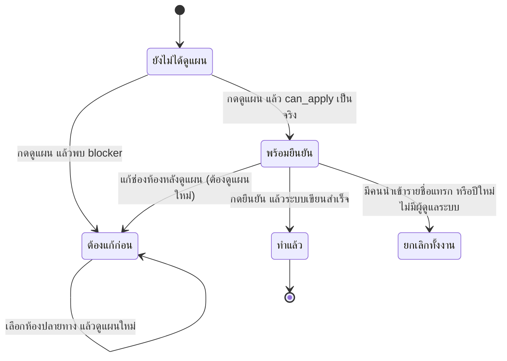

# เลื่อนชั้นนักเรียนทั้งโรงเรียน

บทนี้อธิบายวิธีขึ้นปีการศึกษาใหม่ทั้งโรงเรียน ตั้งแต่สร้างปีปลายทาง ตรวจแผน เลือกห้องที่ระบบเดาไม่ได้ จนถึงกดยืนยัน
การเลื่อนชั้นเป็นการทำงานครั้งเดียวต่อปี และย้อนกลับไม่ได้ ต้องอ่านแผนให้ครบก่อนกดทุกครั้ง

## ใครใช้บทนี้

ผู้มีสิทธิ์ `MANAGE_STUDENTS` และมีขอบเขตจัดการระดับโรงเรียน ได้แก่ ผู้ดูแลระบบ ครูสภานักเรียน และประธานสภา
ครูทั่วไป ประธานระดับ สภานักเรียน และผู้ช่วยหัวหน้าระดับเห็นเมนูไม่ได้ แม้มีสิทธิ์ `MANAGE_STUDENTS`
เพราะการเลื่อนชั้นเปลี่ยนสถานะของสมาชิกทุกระดับพร้อมกัน

## ก่อนเริ่ม

- ต้องมีปีการศึกษาปัจจุบันที่โรงเรียนกำลังใช้อยู่ และมีสมาชิกในปีนั้น
- ต้องมีปีปลายทางที่ยังว่างอยู่ ถ้ายังไม่มี ให้สร้างก่อนที่ **ปีการศึกษา**
- ปิดงานที่ค้างกับการแก้รายชื่อให้เรียบร้อย เพราะระหว่างดำเนินการไม่มีใครควรนำเข้าหรือย้ายห้อง
- เตรียมห้องปลายทางของทุกระดับชั้นไว้ล่วงหน้า เพื่อไม่ต้องหยุดกลางทาง
- ถ้าโรงเรียนยังใช้งานระบบอยู่ ให้ทำนอกเวลาเรียน เพราะระบบจะหยุดรับการแก้ตารางสมาชิกชั่วครู่ตอนกดยืนยัน

## เตรียมปีปลายทางก่อนเลื่อนชั้น

1. เปิด **เพิ่มเติม**
2. ในกลุ่ม **โรงเรียน** เลือก **ปีการศึกษา**
3. ที่การ์ด **ขั้นต่อไปของการขึ้นปีใหม่** กด **สร้างปีการศึกษาใหม่**
4. กรอก **ปีการศึกษา (พ.ศ.)** และวันเปิด-ปิดภาคเรียน แล้วบันทึก
5. กลับมาที่รายการปี แล้วตรวจว่าปีใหม่ยังไม่ถูกกด **ใช้เป็นปีปัจจุบัน** ขั้นนี้ยังไม่ต้องกด
6. สร้างห้องเรียนของปีใหม่ให้ครบตามระดับชั้น หรือปล่อยให้ระบบสร้างตอนนำเข้ารายชื่อก็ได้

การ์ด **ขั้นต่อไปของการขึ้นปีใหม่** เตือนลำดับงานทั้งหกขั้น คือ สร้างปี → เลื่อนชั้นทั้งโรงเรียน → นำเข้ารายชื่อด้วย Excel → ตรวจกระทบยอดรายชื่อ → ตั้งภาคเรียนของปีใหม่ → มอบหมายเรื่องที่ผู้รับหมดวาระ
ระบบไม่ได้บังคับลำดับด้วยโค้ด แต่การข้ามขั้นตอนทำให้ต้องไล่แก้ทีหลัง

ระบบเลื่อนชั้นอ่านเฉพาะปีที่ยังไม่มีสมาชิก ถ้าปีปลายทางมีคนอยู่แล้วแม้คนเดียว จะไม่ยอมให้ทำ
เพราะจะกลายเป็นการนำรายชื่อสองชุดมาทับกันโดยไม่มีใครรู้

## ดูแผนก่อนเลื่อนชั้น

1. เปิด **เพิ่มเติม**
2. ในกลุ่ม **โรงเรียน** เลือก **เลื่อนชั้นนักเรียน**
3. ช่อง **ปีต้นทาง** ระบบเลือกปีปัจจุบันให้แล้ว และจางข้อความกำกับ **(ต้องเป็นปีปัจจุบัน)**
4. ช่อง **ปีปลายทาง** เลือกปีใหม่ที่เตรียมไว้ ตัวเลือกแสดงจำนวนสมาชิกของแต่ละปี
5. กด **ดูแผน**
6. อ่านผลตั้งแต่บนลงล่าง ตามหัวข้อด้านล่าง

การกด **ดูแผน** ไม่แก้ข้อมูลใด ๆ จึงกดซ้ำได้ไม่จำกัด
ทุกครั้งที่กด ระบบบันทึกแถวประวัติไว้หนึ่งรายการ เพื่อให้ย้อนดูภายหลังได้ว่า ณ วันนั้นระบบประเมินอะไรไว้

หน้าแผนแสดงข้อมูลตามลำดับนี้

| ส่วน | อ่านอะไร |
|---|---|
| **ต้องแก้ก่อน (N ข้อ)** | สีแดง ระบบไม่ให้กดยืนยันจนกว่าจะแก้ครบ |
| **ควรตรวจก่อน (N ข้อ)** | สีเหลือง ทำได้ แต่ควรอ่านก่อน |
| การ์ดสรุป | **สมาชิกปีนี้** **เลื่อนขึ้นปีใหม่** **จบการศึกษา** |
| รายการหมายเหตุ | บุคลากรที่ยกไป ตำแหน่งที่รีเซ็ต สภานักเรียนที่วาระหมด และคนที่ไม่มีห้อง |
| **ต้องเลือกห้องปลายทางเอง (N ห้อง)** | ห้องที่ระบบแมปอัตโนมัติไม่ได้ |
| ตารางต่อระดับชั้น | คู่ห้องต้นทาง → ห้องปลายทาง และจำนวนคน |
| จบการศึกษา | รายชื่อห้องระดับ ม.6 และจำนวนคน |

> **ภาพที่ 21 — หน้าเลื่อนชั้นนักเรียนหลังกดดูแผน**
> - **ไฟล์:** `docs/assets/screenshots/staff/promotion.webp`
> - **แคป:** หน้าแผนที่ยังมีกล่อง **ต้องแก้ก่อน** อย่างน้อย 1 ข้อ และตารางต่อระดับชั้น — **ใช้เป็น placeholder** เพราะ staging มีปีการศึกษาเดียว จึงยังสร้างแผนที่มีปีปลายทางให้เลือกไม่ได้ แคปเองได้บนระบบที่มีอย่างน้อยสองปี โดยเปิดหน้าเลื่อนชั้นแล้วกดดูแผนก่อนยืนยัน
> - **ครอป/ไฮไลต์:** ครอปกล่อง **ต้องแก้ก่อน** การ์ดสรุปสามช่อง และปุ่ม **ยืนยันเลื่อนชั้นทั้งโรงเรียน** ที่กดไม่ได้
> - **PDPA:** ไม่มีชื่อนักเรียนบนหน้านี้ ใช้ข้อมูลสถิติของ staging ได้ แต่เบลอจำนวนคนหากเป็นข้อมูลจริง

## อ่านผลลัพธ์ที่แผนบอก

ระบบจัดระดับชั้นปลายทางตามรหัสห้อง เช่นห้องที่ขึ้นต้น `ม.1/` ไป `ม.2/` และห้อง `ม.6/` ถือว่าจบการศึกษา
ถ้ารหัสห้องไม่ตรงรูปแบบที่ระบบรู้จัก ระบบจะไม่เดาและปล่อยห้องนั้นไว้ให้เลือกเอง

การ์ดสรุปบอกสามตัวเลขที่ต้องตรงกับที่โรงเรียนคาดไว้

- **สมาชิกปีนี้** คือจำนวนแถวที่ใช้งานอยู่ทั้งหมดในปีต้นทาง
- **เลื่อนขึ้นปีใหม่** คือจำนวนคนที่จะได้แถวใหม่ในปีปลายทาง
- **จบการศึกษา** คือจำนวนคนห้อง ม.6 ที่จะไม่ได้รับแถวใหม่

รายการหมายเหตุใต้การ์ดบอกสิ่งที่แผนจะทำกับแต่ละกลุ่ม

- **ยกบุคลากรไปปีใหม่** ครู ผู้ดูแลระบบ และตำแหน่งระดับโรงเรียนยกไปทั้งบทบาทและสิทธิ์เดิม
- **ตำแหน่งในห้อง ... เป็นนักเรียนธรรมดา** หัวหน้าห้องและรองฝ่ายทุกคนต้องแต่งตั้งใหม่หลังขึ้นปี
- **สมาชิกสภานักเรียน ... วาระหมด** ตำแหน่งสภาต้องเลือกตั้งใหม่ ระบบไม่ยกให้อัตโนมัติ
- **ไม่มีห้อง** คนที่ยังไม่มีห้องจะถูกยกไปปีใหม่โดยไม่มีห้อง ต้องไปใส่ห้องภายหลัง

## เลือกห้องปลายทางที่ระบบเดาไม่ได้

เกิดเมื่อรหัสห้องต้นทางไม่สามารถเลื่อนขึ้นระดับถัดไปได้ เช่น ห้องที่ตั้งชื่อไม่ตรงรูปแบบ หรือห้องของระดับที่ไม่มีระดับถัดไป

1. อ่านกล่อง **ต้องเลือกห้องปลายทางเอง (N ห้อง)** ซึ่งระบุรหัสห้อง จำนวนคน และเหตุผลของแต่ละห้อง
2. เลือก **ห้องปลายทาง** ให้ครบทุกห้อง
3. กด **ดูแผนอีกครั้ง**
4. ตรวจว่ากล่องแดงหายไป และปุ่มยืนยันกดได้แล้ว

ระบบไม่เดาแทน เพราะการเดาผิดทำให้เด็กทั้งห้องไปอยู่ผิดที่โดยไม่มีใครรู้
ระหว่างที่แก้ช่องห้องปลายทาง หน้าจะขึ้นแถบ **แก้ห้องปลายทางแล้ว — แผนที่เห็นอยู่ยังไม่รู้จักค่าล่าสุด**
ปุ่มยืนยันจะถูกล็อกจนกว่าจะกด **ดูแผนใหม่**

ค่าห้องปลายทางที่เลือกได้ต้องเป็นห้องที่มีอยู่จริงในระบบ ระบบไม่สร้างห้องใหม่ให้ตอนเลื่อนชั้น

## แก้ข้อที่ต้องแก้ก่อน

ข้อที่ทำให้กดยืนยันไม่ได้ มีห้าประเภท และระบบเขียนไว้ในกล่อง **ต้องแก้ก่อน** ตรง ๆ

| ข้อความ | ต้องทำอะไร |
|---|---|
| **ปีต้นทางกับปีปลายทางเป็นปีเดียวกัน — ต้องเป็นคนละปี** | เลือกปีปลายทางคนละปี |
| **ปีต้นทาง «...» ไม่ใช่ปีปัจจุบัน — ...** | ไปตั้งปีนั้นเป็นปีปัจจุบันก่อน หรือเลือกปีปัจจุบันเป็นปีต้นทาง |
| **ปี «...» ไม่มีสมาชิกที่ใช้งานอยู่ — ไม่มีอะไรให้เลื่อน** | ตรวจว่านำเข้ารายชื่อปีนั้นแล้วหรือยัง |
| **มี N คนใน N ห้องที่หาห้องปลายทางไม่ได้ — ...** | เลือกห้องปลายทางให้ครบแล้วดูแผนใหม่ |
| **มีเลขประจำตัวนักเรียนซ้ำกันในห้องปลายทางเดียวกัน — ...** | แก้เลขที่ซ้ำในห้องต้นทางก่อน เกิดได้เมื่อเลือกห้องปลายทางให้สองห้องรวมเป็นห้องเดียว |

ข้อความ **ปีปลายทาง «...» มีสมาชิกอยู่แล้ว N คน** เกิดตอนกดยืนยันถ้ามีคนนำเข้ารายชื่อแทรกเข้ามาหลังดูแผน
ระบบยกเลิกทั้งงานและไม่เขียนอะไรเลย ให้ลบสมาชิกในปีนั้นหรือเลือกปีอื่น

## ยืนยันเลื่อนชั้น

1. ตรวจว่าปุ่ม **ยืนยันเลื่อนชั้นทั้งโรงเรียน** กดได้ และข้อความใต้ปุ่มขึ้นว่า **ย้อนกลับเองไม่ได้ — ระบบจะเขียนสมาชิกทั้งโรงเรียนในครั้งเดียว**
2. กดปุ่มดังกล่าว
3. อ่านข้อความยืนยัน ซึ่งสรุปจำนวนคนที่จะยก จำนวนที่จบ จำนวนบุคลากร และปีที่จะกลายเป็นปีปัจจุบัน
4. กด **ยืนยัน เลื่อนชั้น**

หลังสำเร็จ ระบบขึ้น **เลื่อนชั้นเรียบร้อย** พร้อมบรรทัดสรุป เช่น **เลื่อนขึ้นปีใหม่ 812 คน · จบ 210 คน · บุคลากร 34 คน · ปิดแถวปีเก่า 1,056 แถว — ปี «2569» เป็นปีปัจจุบันแล้ว**
หน้าจะโหลดปีใหม่และประวัติรอบใหม่ให้ทันที

ลำดับการทำงานของระบบ

สถานะที่บันทึกในตาราง `rollover_runs` คือ `PREVIEWED` `APPLIED` และ `FAILED`
รอบที่ `APPLIED` แล้วนำมาใช้ซ้ำไม่ได้ ระบบตอบ **รอบการเลื่อนชั้นนี้ถูกใช้ไปแล้ว — ให้ preview ใหม่เพื่อดูสถานะปัจจุบัน ก่อนตัดสินใจอีกครั้ง**

## อ่านประวัติการเลื่อนชั้น

1. เปิดหน้า **เลื่อนชั้นนักเรียน**
2. กดแถบ **ประวัติการเลื่อนชั้น** ที่ท้ายหน้า
3. อ่านรายการที่แสดงปีต้นทาง ปีปลายทาง จำนวนคน สถานะ และเวลาที่ทำ

ป้ายสถานะมีสามแบบ คือ **ทำแล้ว** **ล้มเหลว** และ **ดูแผนไว้**
**ดูแผนไว้** หมายถึงมีการกดดูแผนแต่ยังไม่ได้ยืนยัน จึงไม่มีอะไรถูกแก้
หน้านี้แสดงยี่สิบรอบล่าสุด และโหลดเมื่อกางออกเท่านั้น

## ระบบทำอะไรเบื้องหลัง

- การยืนยันทั้งหมดอยู่ในทรานแซกชันเดียว ถ้าขั้นใดล้ม จะไม่มีอะไรถูกเขียนเลย ไม่ต้องกู้ข้อมูลคืน
- ระบบล็อกงานด้วย advisory lock ทำให้มีผู้กดพร้อมกันกี่คนก็ได้ ผลลัพธ์เดียว และคำขอที่แพ้จะได้ข้อความว่ารอบถูกใช้ไปแล้ว
- ขั้นแรกยกบุคลากรไปปีใหม่พร้อมบทบาท ห้อง สิทธิ์ และหน้าที่เดิม
- ขั้นถัดมาสร้างแถวใหม่ให้ผู้ที่เลื่อนขึ้น ทุกคนได้ตำแหน่ง **นักเรียน** และสิทธิ์ของนักเรียน
- เลขที่ในห้องยกไปตามเดิมโดยตั้งใจ เพราะเลขที่ของห้องใหม่ยังไม่รู้ตอนนี้ ให้ไฟล์ Excel ของปีใหม่ทับภายหลัง
- แถวเดิมของปีเก่าถูกปิดเป็น `promoted` และห้อง ม.6 ถูกปิดเป็น `graduated` ไม่สร้างแถวใหม่
- ถ้าปีใหม่ไม่เหลือผู้ดูแลระบบเลย ระบบยกเลิกทั้งงาน เพราะสิทธิ์ทั้งระบบอ่านจากตารางสมาชิกของปีปัจจุบัน
- ระบบตั้งปีปลายทางเป็นปีปัจจุบัน และเปลี่ยนค่าเริ่มต้นของปีการศึกษาในตารางสมาชิกให้ชี้ปีใหม่
- คนที่ไม่มีห้องถูกยกไปด้วยโดยไม่มีห้อง ไม่หายไปจากระบบ
- ครูที่สังกัดห้อง ม.6 ถูกยกไปปีใหม่ ไม่จบการศึกษา และระบบเตือนไว้ใน **ควรตรวจก่อน**
- ทุกครั้งที่ดูแผนบันทึก `PREVIEW_ROLLOVER` และการยืนยันบันทึก `APPLY_ROLLOVER` พร้อมจำนวนทุกประเภท
- ระบบไม่ส่งแจ้งเตือนถึงนักเรียนเมื่อเลื่อนชั้น

## ข้อจำกัดและข้อควรระวัง

- ย้อนกลับไม่ได้จากหน้าจอ ต้องกู้จากไฟล์สำรองฐานข้อมูลเท่านั้น
- ทำได้เฉพาะปีที่ตั้งเป็นปีปัจจุบัน ถ้าต้องย้อนทำปีเก่า ต้องตั้งปีนั้นเป็นปัจจุบันก่อน
- ปีปลายทางต้องว่าง ระบบไม่ยอมเขียนทับรายชื่อที่มีอยู่
- ไม่มีปุ่มยกเลิกระหว่างทำงาน และไม่มีตั้งเวลาให้ทำล่วงหน้า
- ทุกครั้งที่กดดูแผนจะเกิดแถวประวัติเพิ่มขึ้น แม้ไม่ได้ยืนยัน
- ไม่มีระบบส่งออกรายชื่อก่อนและหลังเลื่อนชั้นเป็นไฟล์
- ระบบไม่สร้างห้องปลายทางให้อัตโนมัติ ต้องมีห้องอยู่ก่อน
- เลขที่นั่งไม่ถูกจับคู่ใหม่ตามระดับ ต้องแก้ด้วยการนำเข้า Excel ของปีใหม่
- นักเรียนที่จบเข้าสู่ระบบไม่ได้ แต่ประวัติและเรื่องที่เคยแจ้งยังอยู่ และค้นชื่อได้ด้วยการค้นข้ามปี

## แก้ไขปัญหาและคำถามที่พบบ่อย

**ถาม: เข้าหน้าเลื่อนชั้นนักเรียนไม่ได้ หรือขึ้นว่าเฉพาะส่วนกลาง**
ตอบ: บัญชีต้องมีสิทธิ์ `MANAGE_STUDENTS` และมีตำแหน่งระดับโรงเรียน คือผู้ดูแลระบบ ครูสภานักเรียน หรือประธานสภา
ครูประจำชั้นและประธานระดับจัดการรายคนได้ แต่เลื่อนชั้นทั้งโรงเรียนไม่ได้

**ถาม: กดดูแผนแล้วขึ้นว่าปีต้นทางไม่ใช่ปีปัจจุบัน**
ตอบ: ระบบบังคับให้เริ่มจากปีที่โรงเรียนกำลังใช้อยู่
ไปที่ **ปีการศึกษา** แล้วตั้งปีที่ต้องการเป็นปีปัจจุบันก่อน แล้วกลับมาดูแผนใหม่

**ถาม: ปุ่มยืนยันกดไม่ได้ แต่ไม่เห็นข้อความสีแดง**
ตอบ: ตรวจว่ากด **ดูแผน** แล้วหรือยัง และตรวจว่าได้แก้ช่องห้องปลายทางหลังดูแผนหรือไม่
ถ้าแก้แล้วต้องกด **ดูแผนใหม่** เสมอ ระบบจึงจะตรวจเงื่อนไขครบชุดใหม่

**ถาม: ห้องหนึ่งไม่มีคู่ปลายทาง ระบบจะเดาให้ไหม**
ตอบ: ไม่เดา ระบบแสดงห้องนั้นในกล่อง **ต้องเลือกห้องปลายทางเอง** พร้อมจำนวนคนและเหตุผล
เลือกห้องให้ครบแล้วกดดูแผนอีกครั้ง

**ถาม: กดยืนยันแล้วขึ้นว่าปีปลายทางมีสมาชิกอยู่แล้ว**
ตอบ: มีคนนำเข้ารายชื่อเข้าปีปลายทางหลังคุณดูแผน ระบบยกเลิกทั้งงานและไม่มีอะไรถูกแก้
ให้ตรวจปีปลายทาง ลบรายชื่อที่แทรกเข้ามา หรือเลือกปีอื่น แล้วดูแผนใหม่

**ถาม: กดยืนยันแล้วขึ้นว่าปีใหม่จะไม่มีผู้ดูแลระบบ**
ตอบ: บุคลากรที่มีสิทธิ์ผู้ดูแลระบบในปีต้นทางไม่ได้ถูกยกไป หรือถูกถอดสิทธิ์ก่อนเลื่อนชั้น
ระบบยกเลิกทั้งงานเพื่อไม่ให้โรงเรียนล็อกตัวเอง ให้เพิ่มผู้ดูแลระบบในปีปลายทางหรือยกบุคลากรให้ครบแล้วทำใหม่

**ถาม: หลังเลื่อนชั้นแล้วนักเรียนล็อกอินไม่ได้**
ตอบ: ตรวจว่าบัญชีนั้นเป็นห้อง ม.6 ที่จบการศึกษา หรือแถวเดิมถูกปิดเป็น `promoted` โดยไม่มีแถวใหม่
ค้นชื่อด้วยการค้นข้ามปีในหน้า **สมาชิก** เพื่อดูสถานะของแต่ละปี

**ถาม: ทำผิดแล้วอยากย้อนกลับ**
ตอบ: หน้าจอไม่มีปุ่มย้อนกลับ ให้ติดต่อผู้ดูแลระบบเพื่อกู้ฐานข้อมูลจากไฟล์สำรองรอบล่าสุด
การแก้ด้วยมือทีละคนทำได้ แต่ต้องตรวจรายชื่อทั้งโรงเรียนเอง

**ถาม: ดูแผนซ้ำหลายรอบแล้ว ประวัติจะรกไหม**
ตอบ: ทุกรอบถูกบันทึกไว้โดยตั้งใจ เพื่อเป็นหลักฐานว่าตอนนั้นระบบประเมินอะไร
ประวัติที่ขึ้นสถานะ **ดูแผนไว้** ยืนยันได้ว่าไม่มีข้อมูลใดถูกแก้ในรอบนั้น

บทที่เกี่ยวข้อง: [ย้ายห้องและถอดนักเรียนออกจากห้อง](student-moves.md) · [กระทบยอดรายชื่อและเรื่องที่ผู้รับหมดวาระ](reassignment-and-reconciliation.md) · [นำเข้านักเรียนจาก Excel](student-import.md)
