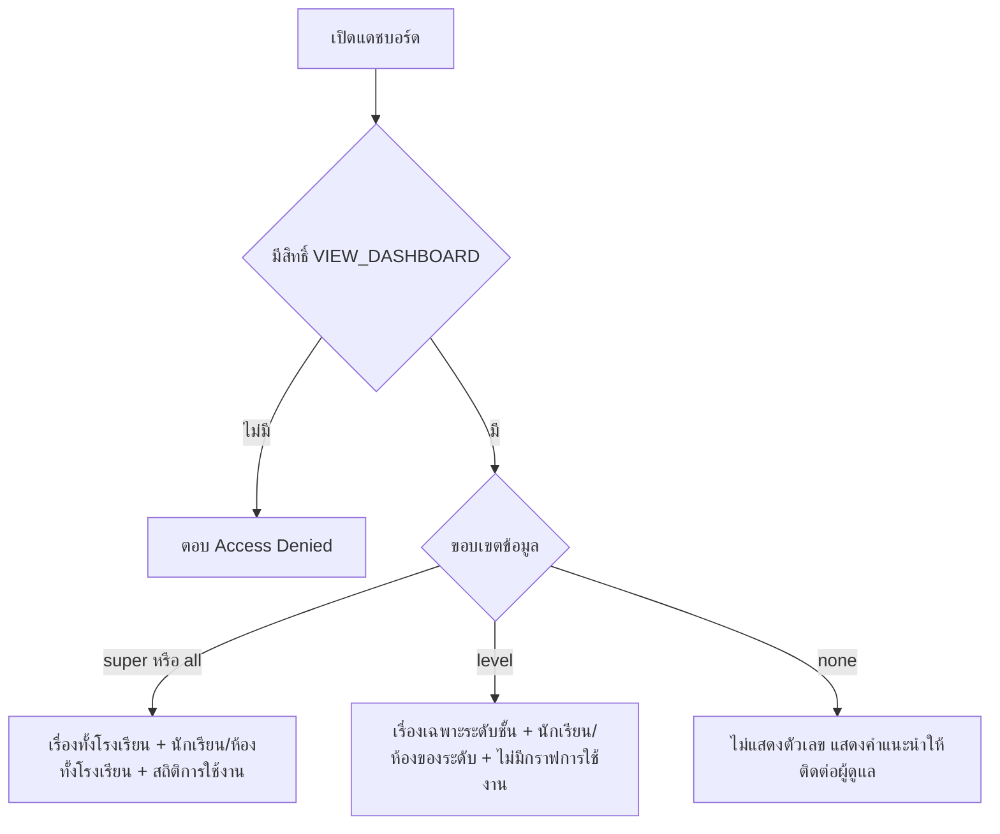

# แดชบอร์ดและรายงาน

บทนี้อธิบายวิธีอ่านแดชบอร์ดเพื่อตอบคำถามในที่ประชุม วิธีเจาะจากตัวเลขไปยังรายการจริง
และวิธีใช้สถิติการเข้าใช้งานตรวจพฤติกรรมของระบบ
แดชบอร์ดแสดงข้อมูลสดจากฐานข้อมูล ไม่ใช่รายงานที่สร้างไว้ล่วงหน้า

## ใครใช้บทนี้

ผู้มีสิทธิ์ `VIEW_DASHBOARD` ได้แก่ ผู้ดูแลระบบ ครูสภานักเรียน ประธานสภา ครูทั่วไป และสภานักเรียน

สิ่งที่เห็นขึ้นกับขอบเขตข้อมูล ไม่ใช่แค่สิทธิ์

| ตำแหน่ง | ขอบเขต (`scope`) | ข้อมูลที่เห็น |
|---|---|---|
| ผู้ดูแลระบบ ครูสภานักเรียน ประธานสภา สภานักเรียน | `all` | เรื่องทั้งโรงเรียน จำนวนนักเรียนและห้องทั้งโรงเรียน และสถิติการเข้าใช้งาน |
| ครูทั่วไปที่มี `staff_level` | `level` | เฉพาะห้องในระดับชั้นที่ดูแล และเห็นเฉพาะกราฟแนวโน้มกับหมวดของระดับนั้น |
| ครูทั่วไปที่ยังไม่มี `staff_level` | `none` | ไม่เห็นตัวเลขใดเลย |

บัญชีที่กำหนดใน `SUPER_ADMIN_ID` ได้ขอบเขต `super` ซึ่งทำงานเหมือน `all` ในทุกส่วน

ถ้าบัญชีไม่มีสิทธิ์ `VIEW_DASHBOARD` เลย ระบบตอบ **Access Denied: คุณไม่มีสิทธิ์ 'VIEW_DASHBOARD'**

## ก่อนเริ่ม

- เข้าใจว่าแดชบอร์ดนับเฉพาะเรื่องที่ยังไม่ถูกลบ และนับเฉพาะปีการศึกษาปัจจุบันในส่วนจำนวนคน
- รู้ว่าตัวเลขบนแดชบอร์ดกับหน้ารวมเรื่องอาจไม่เท่ากันถ้าขอบเขตต่างกัน ระบบแก้ให้ตรงกันเมื่อขอบเขตเป็น `all` แล้ว
- การแคปหน้าจอแดชบอร์ดทั้งโรงเรียนต้องเบลอชื่อผู้ใช้ในส่วน **การเข้าใช้งานล่าสุด** ก่อนเผยแพร่

## ดูภาพรวมว่าเรื่องค้างอยู่ที่ไหน

ใช้ก่อนประชุมสภาหรือเมื่อต้องการรู้ว่าสัปดาห์นี้มีงานค้างมากน้อยแค่ไหน

1. เปิด **เพิ่มเติม**
2. ในกลุ่ม **ผู้ดูแล** เลือก **แดชบอร์ด**
3. อ่านป้ายขอบเขตมุมขวาบน ถ้าเป็น **ภาพรวมทั้งโรงเรียน** ตัวเลขทั้งหมดคือทั้งโรงเรียน
4. อ่านแถวการ์ดตัวเลขหกใบ
5. ดูแถบสีใต้การ์ดเพื่อเทียบสัดส่วนสถานะทั้งหมดในครั้งเดียว
6. กด **รีเฟรช** ถ้าต้องการข้อมูลใหม่ ระบบไม่รีเฟรชเองตามเวลา

บรรทัดใต้หัวเรื่องว่า **ภาพรวมเรื่องร้องเรียน · แตะการ์ดเพื่อดูรายการที่กรองแล้ว** ใช้เตือนว่าการ์ดส่วนใหญ่กดได้

ป้ายขอบเขตมีสามแบบ

| ป้าย | ความหมาย |
|---|---|
| **ภาพรวมทั้งโรงเรียน** | เห็นทุกห้องทุกปีการศึกษาของโรงเรียน |
| **กำลังแสดงสถิติเฉพาะระดับชั้น …** | เห็นเฉพาะห้องในระดับชั้นนั้น |
| **ยังไม่ได้กำหนดระดับชั้นที่รับผิดชอบ** | ยังไม่มีขอบเขต ระบบไม่แสดงตัวเลขใดเลย |

ถ้าเห็นป้ายแบบที่สาม ให้ติดต่อผู้ดูแลระบบเพื่อตั้งระดับชั้นในบัญชี ระบบแสดงคำแนะนำนี้แทนการแสดงเลขศูนย์

## อ่านตัวเลขหกใบให้ถูก

| การ์ด | คือนับอะไร | กดแล้วไปไหน |
|---|---|---|
| **เรื่องทั้งหมด** | เรื่องที่ยังไม่ถูกลบทุกสถานะ | หน้ารวมเรื่องโดยไม่กรองสถานะ |
| **รอรับเรื่อง** | เรื่องที่ยังไม่มีผู้รับ | หน้ารวมเรื่องกรองสถานะรอรับ |
| **กำลังดำเนินการ** | เรื่องที่รับแล้วและยังไม่ปิด | หน้ารวมเรื่องกรองสถานะกำลังทำ |
| **ส่งต่อ** | เรื่องที่ถูกส่งขึ้นระดับสูงกว่า | หน้ารวมเรื่องกรองสถานะส่งต่อ |
| **แก้ไขเสร็จ** | เรื่องที่ปิดด้วยผลว่าแก้แล้ว | หน้ารวมเรื่องกรองสถานะเสร็จ |
| **งานเกินเวลา** | เรื่องที่กำลังทำและกำหนดนับถอยหลังล่าสุดผ่านไปแล้ว | ไม่มี ใช้เป็นการแจ้งเตือนเท่านั้น |

**งานเกินเวลา** ไม่ใช่ลิงก์ เพราะหน้ารวมเรื่องไม่มีตัวกรองตามกำหนดเวลา
ถ้าต้องการดูรายการที่เกินเวลา ให้เปิดการ์ดหมวดหลักซึ่งแสดงป้าย **เกินเวลา N** แล้วหาด้วยตาในรายการ

การ์ด **เรื่องทั้งหมด** นับทุกสถานะรวมยกเลิกและปฏิเสธ
ถ้าตัวเลขนี้สูงกว่าผลรวมของสีในแถบสถานะ ให้ตรวจว่ามีเรื่องที่ถูกยกเลิกหรือปฏิเสธอยู่

## หาหมวดที่ต้องแก้ก่อน

1. เลื่อนลงมาที่การ์ดหมวดหลักสามใบ คือ **เสนอความคิดเห็น** **สุขภาวะทางกายและใจ** และ **แจ้งเหตุ**
2. อ่านตัวเลขขนาดใหญ่ทางขวาของแต่ละใบ ซึ่งคือจำนวนเรื่องในหมวดนั้น
3. อ่านบรรทัดใต้ตัวเลขที่บอก **เสร็จ X%** เพื่อดูว่าหมวดใดแก้ได้ช้ากว่าหมวดอื่น
4. อ่านป้าย **เกินเวลา N** สีแดงที่อยู่ข้างชื่อหมวด ถ้ามี
5. ดูรายการ **หมวดย่อยที่แจ้งมากที่สุด** ทางซ้ายล่าง ซึ่งเรียงจากมากไปน้อย
6. กดที่แถวหมวดย่อยเพื่อเปิดรายการเรื่องของหมวดนั้น

แถวหมวดย่อยแสดงจำนวนเรื่อง สัดส่วนเมื่อเทียบกับหมวดย่อยที่มากที่สุด และจำนวนแยกตามสถานะ
อันดับหนึ่งถูกเน้นสี เพื่อให้เห็นว่าปัญหากระจุกที่ใด

ถ้าเห็นแถวชื่อ **อื่นๆ** แปลว่ามีเรื่องที่ใช้รหัสหมวดย่อยซึ่งไม่อยู่ในไฟล์ตั้งค่าปัจจุบัน
แถวนี้กดไม่ได้ และคำอธิบายคือ **หมวดย่อยที่ไม่อยู่ในระบบปัจจุบัน**
ข้อมูลไม่ได้หาย แต่หลุดออกจากการจัดกลุ่มตามหมวดที่กำหนด

## เปิดเรื่องล่าสุดจากแดชบอร์ด

1. ในการ์ดหมวด เลื่อนไปที่คอลัมน์ขวา **เรื่องล่าสุด**
2. กดชื่อเรื่องเพื่อเปิดรายละเอียด พร้อมดูสถานะปัจจุบันได้ทันที
3. ถ้าต้องการดูทั้งหมดในหมวด กดแถบหัวการ์ดหรือคำว่า **ดูทั้งหมด**

รายการล่าสุดแสดงห้าเรื่องต่อหมวด พร้อมหมวดย่อย ห้อง และเวลาที่แจ้ง
ถ้าห้องว่าง ระบบแสดง **ไม่ระบุห้อง** ซึ่งปกติคือเรื่องที่แจ้งโดยไม่ระบุตัวตนหรือไม่ผูกห้อง

## ดูแนวโน้มเจ็ดวันย้อนหลัง

กราฟ **แนวโน้มเรื่องที่แจ้ง (7 วัน)** อยู่ใต้การ์ดหมวด แสดงจำนวนเรื่องที่แจ้งในแต่ละวันย้อนหลังรวมวันนี้
ใช้ตอบคำถามว่าเรื่องเพิ่มขึ้นผิดปกติหรือไม่ และเรื่องที่เพิ่มตรงกับกิจกรรมใดของโรงเรียน

กราฟนับตามวันเวลาไทย และเติมวันที่ไม่มีเรื่องเป็นศูนย์ เพื่อให้เห็นช่วงที่เงียบจริง ไม่ใช่เส้นขาด

การ์ด **สถิติระบบ** ทางขวาแสดง **นักเรียนในระบบ** และ **ห้องเรียน** ของปีการศึกษาปัจจุบัน
ถ้าตัวเลขนักเรียนสูงหรือต่ำกว่าความจริงมาก ให้ตรวจว่าปีปัจจุบันถูกต้องหรือไม่

## ตรวจการใช้งานระบบ

ส่วน **การเข้าใช้งาน (30 วัน)** แสดงเฉพาะบัญชีที่มีขอบเขต `all` หรือ `super`
ครูทั่วไปไม่เห็นส่วนนี้ เพราะข้อมูลการเข้าสู่ระบบเป็นข้อมูลข้ามระดับชั้น

1. เลื่อนลงไปที่หัวข้อ **การเข้าใช้งาน (30 วัน)**
2. อ่านกล่องสามใบ คือ **เข้าสู่ระบบสะสม** **ผู้ใช้ที่ใช้งาน** และ **ล็อกอินล้มเหลว**
3. อ่านกราฟ **ผู้เข้าใช้ต่อวัน** เพื่อดูว่าวันไหนมีคนเข้าใช้งานน้อยผิดปกติ
4. อ่านกราฟ **กิจกรรมทั้งระบบต่อวัน** ซึ่งนับทุกคำขอที่ระบบบันทึก ไม่ใช่แค่การล็อกอิน
5. อ่านวงกลม **สัดส่วนการใช้งาน** ซึ่งแสดงสิบกิจกรรมที่เกิดมากที่สุด
6. กด **รีเฟรชสถิติการใช้งาน** ที่มุมขวาของหัวข้อ ถ้าต้องการข้อมูลใหม่

**ผู้ใช้ที่ใช้งาน** คือนับคนไม่ซ้ำ ไม่ใช่จำนวนครั้ง จึงต่ำกว่า **เข้าสู่ระบบสะสม** เสมอในทางปฏิบัติ

**ล็อกอินล้มเหลว** ที่สูงผิดปกติอาจหมายถึงคนลืมรหัสจำนวนมาก หรือมีการเดารหัส
ให้เทียบกับช่วงเวลา แล้วเปิด **บันทึกการใช้งาน** กรองสถานะ **ผิดพลาด** เพื่อหาชื่อผู้ใช้ที่เกี่ยวข้อง

ในส่วน **สถิติระบบ** ยังมีบรรทัด **ครั้ง (ยอดสะสม)** และรายการ **การเข้าใช้งานล่าสุด** ห้าคน
ชื่อที่แสดงคือชื่อผู้ใช้ที่ใช้ล็อกอิน ไม่ใช่ชื่อ-นามสกุล

## ใช้แดชบอร์ดเตรียมรายงานประชุม

แดชบอร์ดไม่มีปุ่มส่งออก ต้องอ่านแล้วจดหรือแคปหน้าจอเอง ลำดับที่แนะนำคือ

1. บันทึกวันที่และเวลาที่เห็นข้อมูลจากบรรทัด **อัปเดตล่าสุด**
2. จดตัวเลขหกใบและจำนวนเรื่องรายหมวด
3. จดหมวดย่อยสามอันดับแรกของแต่ละหมวด
4. จดจำนวนงานเกินเวลารวมและรายหมวด
5. ระบุขอบเขตที่ใช้ เพราะตัวเลขระดับชั้นกับทั้งโรงเรียนใช้แทนกันไม่ได้

ถ้าต้องการรายงานย้อนหลังหลายช่วง ระบบยังไม่มีหน้าจอเลือกช่วงวันที่ ต้องใช้ฐานข้อมูลหรือบันทึกจากแดชบอร์ดเป็นระยะ

## ระบบทำอะไรเบื้องหลัง

- แดชบอร์ดเรียกข้อมูลใหม่ทุกครั้งที่เปิดหน้าหรือกดรีเฟรช ไม่มีแคชฝั่งเซิร์ฟเวอร์
- ระบบตรวจสิทธิ์ `VIEW_DASHBOARD` ก่อน แล้วจึงหาขอบเขตข้อมูล
- ขอบเขตที่ไม่รู้จักถูกตีเป็น `none` ไม่ใช่ `all` เพื่อกันการเห็นข้อมูลทั้งโรงเรียนโดยไม่ตั้งใจ
- ตัวเลขนักเรียนและห้องนับเฉพาะปีการศึกษาปัจจุบัน ถ้าไม่มีปีปัจจุบันจะนับแถวที่ไม่มีปีเท่านั้น
- งานเกินเวลาคือเรื่องที่สถานะเป็นกำลังดำเนินการ และกำหนดนับถอยหลังล่าสุดผ่านไปแล้ว
- เรื่องที่ปิดแล้วแต่กำหนดเดิมผ่านไปก่อนปิด ไม่ถูกนับเป็นงานเกินเวลา
- แนวโน้มนับเจ็ดวันตามเวลาไทย รวมวันนี้ และนับเฉพาะหมวดหลักที่ระบบรู้จัก
- สถิติการเข้าใช้งานย้อนหลัง 30 วันตามเวลาไทย นับเฉพาะการล็อกอินที่สำเร็จในกราฟผู้เข้าใช้ต่อวัน
- กิจกรรมทั้งระบบนับทุกแถวในบันทึกการใช้งาน รวมการอ่านข้อมูล
- ระบบบันทึกการเปิดแดชบอร์ดเป็น `READ_DASHBOARD` ในบันทึกการใช้งาน
- ตัวเลขถูกส่งเป็น JSON ก้อนเดียว ไม่มีการเรียกแยกทีละการ์ด

## ข้อจำกัดและข้อควรระวัง

- ไม่มีปุ่มส่งออก Excel CSV หรือ PDF
- ไม่มีตัวเลือกช่วงวันที่สำหรับตัวเลขหลัก ทุกตัวเลขคือสถานะปัจจุบัน ยกเว้นกราฟที่ระบุช่วงไว้
- กราฟการใช้งานย้อนหลังได้ 30 วันเท่านั้น และไม่มีตัวเลือกขยายช่วง
- ผู้ใช้ระดับชั้นเห็นเฉพาะข้อมูลของระดับตน ไม่มีปุ่มสลับไปดูระดับอื่น
- การ์ด **งานเกินเวลา** กดไม่ได้ และไม่มีการกรองตามกำหนดเวลาในหน้ารวมเรื่อง
- จำนวนนักเรียนและห้องอ้างปีปัจจุบัน การดูตัวเลขของปีอื่นต้องเปิดหน้าสมาชิกและเลือกปีนั้น
- เรื่องที่ถูกลบแล้วไม่ถูกนับในทุกกราฟ
- หมวดที่ไม่อยู่ในไฟล์ตั้งค่าถูกรวมใน **อื่นๆ** และยังอยู่ในยอดรวมของหมวดหลัก
- สถิติการใช้งานขึ้นกับบันทึกการใช้งาน ถ้าบันทึกการอ่านล้มเหลว ตัวเลขกิจกรรมจะต่ำกว่าความจริงเล็กน้อย
- แดชบอร์ดไม่ส่งแจ้งเตือนเมื่อตัวเลขผิดปกติ ต้องเปิดดูเอง

## แก้ไขปัญหาและคำถามที่พบบ่อย

**ถาม: เปิดแดชบอร์ดแล้วขึ้นว่า ยังไม่ได้กำหนดระดับชั้นที่รับผิดชอบ**
ตอบ: บัญชีเป็นครูทั่วไปที่ยังไม่มี `staff_level`
ให้ผู้ดูแลระบบตรวจระดับชั้นของบัญชีนั้น ถ้ายังไม่ตรง ให้แก้ที่ฐานข้อมูลหรือนำเข้าครูคนนั้นใหม่พร้อมห้องในระดับที่ต้องการ

**ถาม: ตัวเลขบนแดชบอร์ดไม่ตรงกับหน้ารวมเรื่อง**
ตอบ: ตรวจป้ายขอบเขตก่อน ทั้งสองหน้าใช้ขอบเขตคนละแบบในบางบทบาท
เมื่อขอบเขตเป็น **ภาพรวมทั้งโรงเรียน** ระบบแนบตัวกรองระดับให้หน้ารวมเรื่องแล้ว จึงควรตรงกัน
ถ้ายังไม่ตรง ให้กดรีเฟรชทั้งสองหน้าและเทียบเวลาที่โหลด

**ถาม: การ์ดงานเกินเวลาแสดง 5 แต่หาในรายการไม่ได้**
ตอบ: การ์ดนี้ไม่ได้เชื่อมไปยังรายการ เพราะไม่มีตัวกรองตามเวลา
ให้เปิดการ์ดหมวดหลักที่มีป้าย **เกินเวลา** แล้วดูเรื่องที่สถานะกำลังดำเนินการและกำหนดผ่านไปแล้ว

**ถาม: ครูเปิดแดชบอร์ดแล้วไม่เห็นกราฟการใช้งาน**
ตอบ: ส่วน **การเข้าใช้งาน (30 วัน)** แสดงเฉพาะขอบเขต `all` หรือ `super`
ครูทั่วไปเห็นเฉพาะระดับชั้น จึงไม่เห็นข้อมูลข้ามระดับชั้น ถ้าจำเป็นให้ขอให้ผู้ดูแลระบบดึงให้

**ถาม: จำนวนนักเรียนในระบบมากกว่าความจริง**
ตอบ: ระบบนับเฉพาะแถวของปีปัจจุบัน แต่ถ้าปีปัจจุบันยังไม่ถูกตั้ง หรือมีแถวซ้ำในปีเดียวกัน ตัวเลขจะคลาดเคลื่อน
ให้ตรวจที่หน้า **ปีการศึกษา** ว่าปีปัจจุบันถูกต้อง แล้วตรวจรายชื่อในหน้า **สมาชิก**

**ถาม: กราฟกิจกรรมทั้งระบบสูงกว่าจำนวนคนใช้งานมาก**
ตอบ: กราฟนี้นับทุกคำขอที่ระบบบันทึก ไม่ใช่จำนวนคน เช่นการเปิดหน้าและการเรียกข้อมูลแต่ละครั้งก็นับ
ใช้คู่กับ **ผู้ใช้ที่ใช้งาน** เพื่อดูจำนวนคนจริง

**ถาม: ตัวเลขในหมวด อื่นๆ สูงผิดปกติ**
ตอบ: มีเรื่องที่ใช้รหัสหมวดย่อยซึ่งไม่อยู่ในไฟล์ตั้งค่าปัจจุบัน
ให้ตรวจ `backend/config/categories.json` ว่าเคยลบคีย์ออกหรือไม่ และคืนคีย์เดิมถ้าต้องการจัดกลุ่มย้อนหลัง

**ถาม: ต้องการรายงานรายเดือนส่งผู้บริหาร**
ตอบ: ระบบยังไม่มีตัวสร้างรายงานหรือส่งออกไฟล์
วิธีที่ใช้ได้คือแคปแดชบอร์ดพร้อมบันทึกวันที่ หรือดึงข้อมูลจากฐานข้อมูลด้วยคำสั่งที่ทีมพัฒนาจัดให้

บทที่เกี่ยวข้อง: [ตรวจสอบย้อนหลังด้วยบันทึกการใช้งาน](audit-logs-investigation.md) · [จัดการผู้ใช้และตำแหน่ง](user-and-role-management.md) · [ตั้งค่าปีการศึกษาและภาคเรียน](academic-calendar.md) · [ติดตามเรื่องที่แจ้ง](../1-user-guide/issue-reporting-tracking.md)
