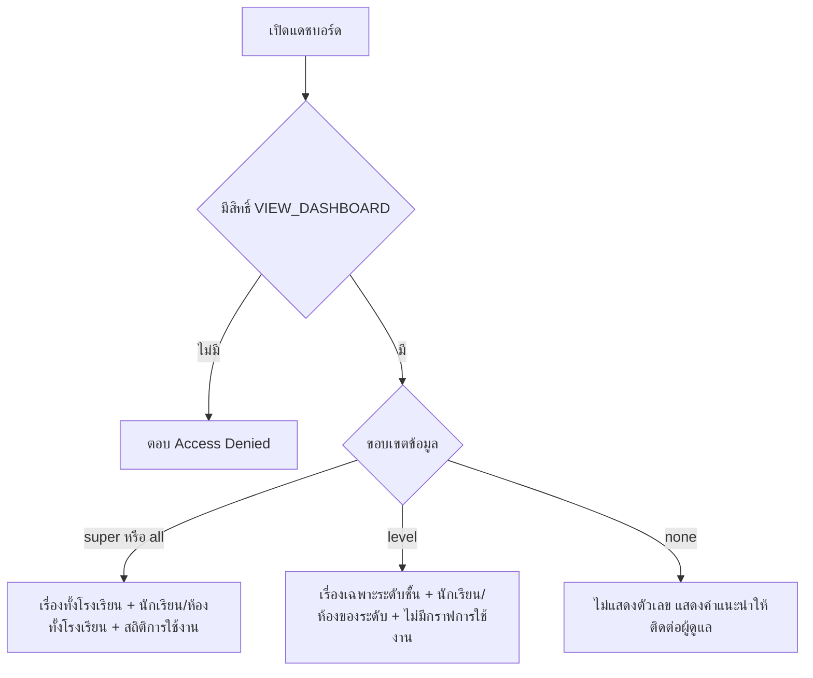

# แดชบอร์ดและรายงาน

อ่านตัวเลขให้ออกว่าเรื่องค้างอยู่ที่ไหน เจาะจากตัวเลขลงไปถึงรายการจริงได้
และใช้สถิติการเข้าใช้งานดูว่ามีอะไรแปลกในระบบ

- 📊 ตัวเลขสดจากฐานข้อมูล ไม่ใช่รายงานที่สร้างไว้ล่วงหน้า
- 👆 การ์ดส่วนใหญ่กดได้ แตะแล้วไปหน้ารวมเรื่องที่กรองให้แล้ว
- 🚫 ไม่มีปุ่มส่งออก ต้องจดหรือแคปเอง

## ใครใช้บทนี้

ผู้มีสิทธิ์ `VIEW_DASHBOARD` ได้แก่ ผู้ดูแลระบบ ครูสภานักเรียน ประธานสภา ครูทั่วไป และสภานักเรียน

เห็นอะไรขึ้นกับขอบเขตข้อมูล ไม่ใช่แค่สิทธิ์

| ตำแหน่ง | ขอบเขต (`scope`) | ข้อมูลที่เห็น |
|---|---|---|
| ผู้ดูแลระบบ ครูสภานักเรียน ประธานสภา สภานักเรียน | `all` | เรื่องทั้งโรงเรียน จำนวนนักเรียนและห้องทั้งโรงเรียน และสถิติการเข้าใช้งาน |
| ครูทั่วไปที่มี `staff_level` | `level` | เฉพาะห้องในระดับชั้นที่ดูแล และเห็นเฉพาะกราฟแนวโน้มกับหมวดของระดับนั้น |
| ครูทั่วไปที่ยังไม่มี `staff_level` | `none` | ไม่เห็นตัวเลขใดเลย |

บัญชีที่กำหนดใน `SUPER_ADMIN_ID` ได้ขอบเขต `super` ซึ่งทำงานเหมือน `all` ในทุกส่วน

ถ้าบัญชีไม่มีสิทธิ์ `VIEW_DASHBOARD` เลย ระบบตอบ **Access Denied: คุณไม่มีสิทธิ์ 'VIEW_DASHBOARD'**

## ก่อนเริ่ม

- แดชบอร์ดนับเฉพาะเรื่องที่ยังไม่ถูกลบ และนับเฉพาะปีการศึกษาปัจจุบันในส่วนจำนวนคน
- ตัวเลขบนแดชบอร์ดกับหน้ารวมเรื่องอาจไม่เท่ากันถ้าขอบเขตต่างกัน ระบบแนบตัวกรองให้แล้วเมื่อขอบเขตเป็น `all`
- ถ้าจะแคปแดชบอร์ดทั้งโรงเรียนออกไปเผยแพร่ ต้องเบลอชื่อผู้ใช้ในส่วน **การเข้าใช้งานล่าสุด** ก่อน

## ดูภาพรวมว่าเรื่องค้างอยู่ที่ไหน

ใช้ก่อนประชุมสภาหรือตอนอยากรู้ว่าสัปดาห์นี้มีงานค้างมากแค่ไหน

**ทางเข้า:** แท็บ **เพิ่มเติม** ➔ กลุ่ม **ผู้ดูแล** ➔ **แดชบอร์ด**

1. **อ่านป้ายขอบเขตมุมขวาบน** ถ้าเป็น **ภาพรวมทั้งโรงเรียน** ตัวเลขทั้งหมดคือทั้งโรงเรียน
2. **อ่านแถวการ์ดตัวเลขหกใบ**
3. **ดูแถบสีใต้การ์ด** เพื่อเทียบสัดส่วนสถานะทั้งหมดในครั้งเดียว
4. **กด รีเฟรช** ถ้าอยากได้ข้อมูลใหม่ ระบบไม่รีเฟรชเองตามเวลา

บรรทัดใต้หัวเรื่องว่า **ภาพรวมเรื่องร้องเรียน · แตะการ์ดเพื่อดูรายการที่กรองแล้ว** ใช้เตือนว่าการ์ดส่วนใหญ่กดได้

ป้ายขอบเขตมีสามแบบ

- 🏫 **ภาพรวมทั้งโรงเรียน** — เห็นทุกห้องทุกปีการศึกษาของโรงเรียน
- 🎓 **กำลังแสดงสถิติเฉพาะระดับชั้น …** — เห็นเฉพาะห้องในระดับชั้นนั้น
- ⚠️ **ยังไม่ได้กำหนดระดับชั้นที่รับผิดชอบ** — ยังไม่มีขอบเขต ระบบไม่แสดงตัวเลขใดเลย

เจอป้ายแบบที่สาม ให้ติดต่อผู้ดูแลระบบเพื่อตั้งระดับชั้นในบัญชี ระบบแสดงคำแนะนำนี้แทนการโชว์เลขศูนย์

ภาพนี้รวมป้ายขอบเขต การ์ดหกใบ และแถบสีสถานะไว้ในจอเดียว

*วงแดงชี้ป้าย ภาพรวมทั้งโรงเรียน การ์ด เรื่องทั้งหมด กับ รอรับเรื่อง การ์ด งานเกินเวลา และแถบคำอธิบายสีใต้การ์ด*

## อ่านตัวเลขหกใบให้ถูก

| การ์ด | คือนับอะไร | กดแล้วไปไหน |
|---|---|---|
| **เรื่องทั้งหมด** | เรื่องที่ยังไม่ถูกลบทุกสถานะ | หน้ารวมเรื่องโดยไม่กรองสถานะ |
| **รอรับเรื่อง** | เรื่องที่ยังไม่มีผู้รับ | หน้ารวมเรื่องกรองสถานะรอรับ |
| **กำลังดำเนินการ** | เรื่องที่รับแล้วและยังไม่ปิด | หน้ารวมเรื่องกรองสถานะกำลังทำ |
| **ส่งต่อ** | เรื่องที่ถูกส่งขึ้นระดับสูงกว่า | หน้ารวมเรื่องกรองสถานะส่งต่อ |
| **แก้ไขเสร็จ** | เรื่องที่ปิดด้วยผลว่าแก้แล้ว | หน้ารวมเรื่องกรองสถานะเสร็จ |
| **งานเกินเวลา** | เรื่องที่กำลังทำและกำหนดนับถอยหลังล่าสุดผ่านไปแล้ว | ไม่มี ใช้เป็นการแจ้งเตือนเท่านั้น |

**งานเกินเวลา** ไม่ใช่ลิงก์ เพราะหน้ารวมเรื่องไม่มีตัวกรองตามกำหนดเวลา
ถ้าอยากดูรายการที่เกินเวลา ให้เปิดการ์ดหมวดหลักที่มีป้าย **เกินเวลา N** แล้วหาด้วยตาในรายการ

การ์ด **เรื่องทั้งหมด** นับทุกสถานะรวมยกเลิกและปฏิเสธ
ถ้าตัวเลขนี้สูงกว่าผลรวมของสีในแถบสถานะ ให้ตรวจว่ามีเรื่องที่ถูกยกเลิกหรือปฏิเสธอยู่

## หาหมวดที่ต้องแก้ก่อน

1. **เลื่อนลงมาที่การ์ดหมวดหลักสามใบ** คือ **เสนอความคิดเห็น** **สุขภาวะทางกายและใจ** และ **แจ้งเหตุ**
2. **อ่านตัวเลขขนาดใหญ่ทางขวา** ของแต่ละใบ คือจำนวนเรื่องในหมวดนั้น
3. **อ่านบรรทัดใต้ตัวเลขที่บอก เสร็จ X%** เพื่อดูว่าหมวดไหนแก้ได้ช้ากว่าหมวดอื่น
4. **อ่านป้าย เกินเวลา N สีแดง** ข้างชื่อหมวด ถ้ามี
5. **ดูรายการ หมวดย่อยที่แจ้งมากที่สุด** ทางซ้ายล่าง ซึ่งเรียงจากมากไปน้อย
6. **กดที่แถวหมวดย่อย** เพื่อเปิดรายการเรื่องของหมวดนั้น

แถวหมวดย่อยแสดงจำนวนเรื่อง สัดส่วนเมื่อเทียบกับหมวดย่อยที่มากที่สุด และจำนวนแยกตามสถานะ
อันดับหนึ่งถูกเน้นสี เพื่อให้เห็นว่าปัญหากระจุกที่ไหน

ถ้าเห็นแถวชื่อ **อื่นๆ** แปลว่ามีเรื่องที่ใช้รหัสหมวดย่อยซึ่งไม่อยู่ในไฟล์ตั้งค่าปัจจุบัน
แถวนี้กดไม่ได้ และคำอธิบายคือ **หมวดย่อยที่ไม่อยู่ในระบบปัจจุบัน**
ข้อมูลไม่ได้หาย แต่หลุดออกจากการจัดกลุ่มตามหมวดที่กำหนด

ขยายการ์ดหมวดออกมาจะเห็นทั้งยอดรวม ป้ายเกินเวลา และอันดับหมวดย่อยในใบเดียว

*วงแดงชี้หัวการ์ด เสนอความคิดเห็น ลิงก์ ดูทั้งหมด หัวข้อ หมวดย่อยที่แจ้งมากที่สุด และแท่งหมวด วิชาการ ที่นำอยู่*

## เปิดเรื่องล่าสุดจากแดชบอร์ด

1. **ในการ์ดหมวด เลื่อนไปที่คอลัมน์ขวา เรื่องล่าสุด**
2. **กดชื่อเรื่อง** เพื่อเปิดรายละเอียด พร้อมดูสถานะปัจจุบันได้ทันที
3. **ถ้าอยากดูทั้งหมดในหมวด** กดแถบหัวการ์ดหรือคำว่า **ดูทั้งหมด**

รายการล่าสุดแสดงห้าเรื่องต่อหมวด พร้อมหมวดย่อย ห้อง และเวลาที่แจ้ง
ถ้าห้องว่าง ระบบแสดง **ไม่ระบุห้อง** ซึ่งปกติคือเรื่องที่แจ้งโดยไม่ระบุตัวตนหรือไม่ผูกห้อง

## ดูแนวโน้มเจ็ดวันย้อนหลัง

กราฟ **แนวโน้มเรื่องที่แจ้ง (7 วัน)** อยู่ใต้การ์ดหมวด แสดงจำนวนเรื่องที่แจ้งในแต่ละวันย้อนหลังรวมวันนี้
ใช้ตอบว่าเรื่องเพิ่มขึ้นผิดปกติไหม และเรื่องที่เพิ่มตรงกับกิจกรรมใดของโรงเรียน

กราฟนับตามวันเวลาไทย และเติมวันที่ไม่มีเรื่องเป็นศูนย์ เพื่อให้เห็นช่วงที่เงียบจริง ไม่ใช่เส้นขาด

กราฟเส้นจะแบนติดศูนย์ในวันที่ไม่มีเรื่องเข้า — นั่นคือข้อมูลจริง ไม่ใช่กราฟโหลดไม่ขึ้น

*วงแดงชี้หัวข้อ แนวโน้มเรื่องที่แจ้ง (7 วัน) ซึ่งนับตามวันเวลาไทยและเติมวันที่ไม่มีเรื่องเป็นศูนย์*

การ์ด **สถิติระบบ** ทางขวาแสดง **นักเรียนในระบบ** และ **ห้องเรียน** ของปีการศึกษาปัจจุบัน
ถ้าจำนวนนักเรียนสูงหรือต่ำกว่าความจริงมาก ให้ตรวจว่าปีปัจจุบันถูกต้องหรือไม่

การ์ดสถิติระบบอยู่ข้างกราฟแนวโน้ม ใช้เทียบจำนวนคนในระบบกับความจริงได้ทันที

*วงแดงชี้ นักเรียนในระบบ ห้องเรียน และ การเข้าใช้งานล่าสุด ซึ่งปิดชื่อผู้ใช้ไว้ในภาพตัวอย่าง*

## ตรวจการใช้งานระบบ

ส่วน **การเข้าใช้งาน (30 วัน)** แสดงเฉพาะบัญชีที่มีขอบเขต `all` หรือ `super`
ครูทั่วไปไม่เห็นส่วนนี้ เพราะข้อมูลการเข้าสู่ระบบเป็นข้อมูลข้ามระดับชั้น

1. **เลื่อนลงไปที่หัวข้อ การเข้าใช้งาน (30 วัน)**
2. **อ่านกล่องสามใบ** คือ **เข้าสู่ระบบสะสม** **ผู้ใช้ที่ใช้งาน** และ **ล็อกอินล้มเหลว**
3. **อ่านกราฟ ผู้เข้าใช้ต่อวัน** เพื่อดูว่าวันไหนมีคนเข้าใช้งานน้อยผิดปกติ
4. **อ่านกราฟ กิจกรรมทั้งระบบต่อวัน** ซึ่งนับทุกคำขอที่ระบบบันทึก ไม่ใช่แค่การล็อกอิน
5. **อ่านวงกลม สัดส่วนการใช้งาน** ซึ่งแสดงสิบกิจกรรมที่เกิดมากที่สุด
6. **กด รีเฟรชสถิติการใช้งาน** ที่มุมขวาของหัวข้อ ถ้าอยากได้ข้อมูลใหม่

หัวข้อการเข้าใช้งานแยกเป็นสามไทล์ให้อ่านเร็ว ๆ ก่อนลงไปดูกราฟ

*วงแดงชี้หัวข้อ การเข้าใช้งาน (30 วัน) และไทล์ เข้าสู่ระบบสะสม ผู้ใช้ที่ใช้งาน กับ ล็อกอินล้มเหลว*

**ผู้ใช้ที่ใช้งาน** นับคนไม่ซ้ำ ไม่ใช่จำนวนครั้ง จึงต่ำกว่า **เข้าสู่ระบบสะสม** เสมอในทางปฏิบัติ

กราฟเส้น **ผู้เข้าใช้ต่อวัน** ทำให้เห็นว่าวันไหนคนเข้าน้อย หรือพุ่งสูงผิดปกติ

*วงแดงชี้กราฟ ผู้เข้าใช้ต่อวัน ซึ่งนับเฉพาะการล็อกอินที่สำเร็จในแต่ละวัน*

**ล็อกอินล้มเหลว** ที่สูงผิดปกติอาจหมายถึงคนลืมรหัสจำนวนมาก หรือมีการเดารหัส
ให้เทียบกับช่วงเวลา แล้วเปิด **บันทึกการใช้งาน** กรองสถานะ **ผิดพลาด** เพื่อหาชื่อผู้ใช้ที่เกี่ยวข้อง

ถ้าล็อกอินล้มเหลวสูง ให้เลื่อนลงดูกราฟกิจกรรมและสัดส่วนการใช้งานประกอบ

*วงแดงชี้กราฟ กิจกรรมทั้งระบบต่อวัน กับโดนัท สัดส่วนการใช้งาน ที่เรียงสิบกิจกรรมที่เกิดมากที่สุด*

ในส่วน **สถิติระบบ** ยังมีบรรทัด **ครั้ง (ยอดสะสม)** และรายการ **การเข้าใช้งานล่าสุด** ห้าคน
ชื่อที่แสดงคือชื่อผู้ใช้ที่ใช้ล็อกอิน ไม่ใช่ชื่อ–นามสกุล

::: warning แคปออกไปเผยแพร่ต้องเบลอก่อน
ส่วน **การเข้าใช้งานล่าสุด** มีชื่อผู้ใช้จริงติดมาด้วย
ถ้าจะเอาไปใส่รายงานหรือส่งในกลุ่ม ให้ปิดชื่อส่วนนั้นก่อน — ชื่อผู้ใช้ใช้เดารหัสผ่านได้ง่ายกว่าที่คิด
:::

## ใช้แดชบอร์ดเตรียมรายงานประชุม

แดชบอร์ดไม่มีปุ่มส่งออก ต้องอ่านแล้วจดหรือแคปหน้าจอเอง ลำดับที่แนะนำคือ

1. **จดวันที่และเวลาที่เห็นข้อมูล** จากบรรทัด **อัปเดตล่าสุด**
2. **จดตัวเลขหกใบและจำนวนเรื่องรายหมวด**
3. **จดหมวดย่อยสามอันดับแรกของแต่ละหมวด**
4. **จดจำนวนงานเกินเวลารวมและรายหมวด**
5. **ระบุขอบเขตที่ใช้** เพราะตัวเลขระดับชั้นกับทั้งโรงเรียนใช้แทนกันไม่ได้

ถ้าอยากได้รายงานย้อนหลังหลายช่วง ระบบยังไม่มีหน้าจอเลือกช่วงวันที่ ต้องใช้ฐานข้อมูลหรือจดจากแดชบอร์ดเป็นระยะ

## ระบบทำอะไรเบื้องหลัง

- แดชบอร์ดเรียกข้อมูลใหม่ทุกครั้งที่เปิดหน้าหรือกดรีเฟรช ไม่มีแคชฝั่งเซิร์ฟเวอร์
- ระบบตรวจสิทธิ์ `VIEW_DASHBOARD` ก่อน แล้วจึงหาขอบเขตข้อมูล
- ขอบเขตที่ไม่รู้จักถูกตีเป็น `none` ไม่ใช่ `all` เพื่อกันการเห็นข้อมูลทั้งโรงเรียนโดยไม่ตั้งใจ
- ตัวเลขนักเรียนและห้องนับเฉพาะปีการศึกษาปัจจุบัน ถ้าไม่มีปีปัจจุบันจะนับแถวที่ไม่มีปีเท่านั้น
- งานเกินเวลาคือเรื่องที่สถานะเป็นกำลังดำเนินการ และกำหนดนับถอยหลังล่าสุดผ่านไปแล้ว
- เรื่องที่ปิดแล้วแต่กำหนดเดิมผ่านไปก่อนปิด ไม่ถูกนับเป็นงานเกินเวลา
- แนวโน้มนับเจ็ดวันตามเวลาไทย รวมวันนี้ และนับเฉพาะหมวดหลักที่ระบบรู้จัก
- สถิติการเข้าใช้งานย้อนหลัง 30 วันตามเวลาไทย นับเฉพาะการล็อกอินที่สำเร็จในกราฟผู้เข้าใช้ต่อวัน
- กิจกรรมทั้งระบบนับทุกแถวในบันทึกการใช้งาน รวมการอ่านข้อมูล
- ระบบบันทึกการเปิดแดชบอร์ดเป็น `READ_DASHBOARD` ในบันทึกการใช้งาน
- ตัวเลขถูกส่งเป็น JSON ก้อนเดียว ไม่มีการเรียกแยกทีละการ์ด

## ข้อจำกัดและข้อควรระวัง

- ไม่มีปุ่มส่งออก Excel CSV หรือ PDF
- ไม่มีตัวเลือกช่วงวันที่สำหรับตัวเลขหลัก ทุกตัวเลขคือสถานะปัจจุบัน ยกเว้นกราฟที่ระบุช่วงไว้
- กราฟการใช้งานย้อนหลังได้ 30 วันเท่านั้น และไม่มีตัวเลือกขยายช่วง
- ผู้ใช้ระดับชั้นเห็นเฉพาะข้อมูลของระดับตน ไม่มีปุ่มสลับไปดูระดับอื่น
- การ์ด **งานเกินเวลา** กดไม่ได้ และไม่มีการกรองตามกำหนดเวลาในหน้ารวมเรื่อง
- จำนวนนักเรียนและห้องอ้างปีปัจจุบัน การดูตัวเลขของปีอื่นต้องเปิดหน้าสมาชิกและเลือกปีนั้น
- เรื่องที่ถูกลบแล้วไม่ถูกนับในทุกกราฟ
- หมวดที่ไม่อยู่ในไฟล์ตั้งค่าถูกรวมใน **อื่นๆ** และยังอยู่ในยอดรวมของหมวดหลัก
- สถิติการใช้งานขึ้นกับบันทึกการใช้งาน ถ้าการบันทึกการอ่านล้มเหลว ตัวเลขกิจกรรมจะต่ำกว่าความจริงเล็กน้อย
- แดชบอร์ดไม่ส่งแจ้งเตือนเมื่อตัวเลขผิดปกติ ต้องเปิดดูเอง

## ติดปัญหาตรงไหน? ดูวิธีแก้ตรงนี้เลย

**Q: เปิดแดชบอร์ดแล้วขึ้นว่า ยังไม่ได้กำหนดระดับชั้นที่รับผิดชอบ?**

👉 **วิธีแก้:** บัญชีเป็นครูทั่วไปที่ยังไม่มี `staff_level` ให้ผู้ดูแลระบบตรวจระดับชั้นของบัญชีนั้น ถ้ายังไม่ตรง ให้แก้ที่ฐานข้อมูลหรือนำเข้าครูคนนั้นใหม่พร้อมห้องในระดับที่ต้องการ

**Q: ตัวเลขบนแดชบอร์ดไม่ตรงกับหน้ารวมเรื่อง?**

👉 **วิธีแก้:** ตรวจป้ายขอบเขตก่อน ทั้งสองหน้าใช้ขอบเขตคนละแบบในบางบทบาท เมื่อขอบเขตเป็น **ภาพรวมทั้งโรงเรียน** ระบบแนบตัวกรองระดับให้หน้ารวมเรื่องแล้ว จึงควรตรงกัน ถ้ายังไม่ตรงให้รีเฟรชทั้งสองหน้าแล้วเทียบเวลาที่โหลด

**Q: การ์ดงานเกินเวลาแสดง 5 แต่หาในรายการไม่ได้?**

👉 **วิธีแก้:** การ์ดนี้ไม่ได้เชื่อมไปยังรายการ เพราะไม่มีตัวกรองตามเวลา ให้เปิดการ์ดหมวดหลักที่มีป้าย **เกินเวลา** แล้วดูเรื่องที่สถานะกำลังดำเนินการและกำหนดผ่านไปแล้ว

**Q: ครูเปิดแดชบอร์ดแล้วไม่เห็นกราฟการใช้งาน?**

👉 **วิธีแก้:** ส่วน **การเข้าใช้งาน (30 วัน)** แสดงเฉพาะขอบเขต `all` หรือ `super` ครูทั่วไปเห็นแค่ระดับชั้น จึงไม่เห็นข้อมูลข้ามระดับชั้น ถ้าจำเป็นให้ขอให้ผู้ดูแลระบบดึงให้

**Q: จำนวนนักเรียนในระบบมากกว่าความจริง?**

👉 **วิธีแก้:** ระบบนับเฉพาะแถวของปีปัจจุบัน แต่ถ้าปีปัจจุบันยังไม่ถูกตั้ง หรือมีแถวซ้ำในปีเดียวกัน ตัวเลขจะคลาดเคลื่อน ให้ตรวจที่หน้า **ปีการศึกษา** ว่าปีปัจจุบันถูกต้อง แล้วตรวจรายชื่อในหน้า **สมาชิก**

**Q: กราฟกิจกรรมทั้งระบบสูงกว่าจำนวนคนใช้งานมาก?**

👉 **วิธีแก้:** กราฟนี้นับทุกคำขอที่ระบบบันทึก ไม่ใช่จำนวนคน เช่นเปิดหน้าและการเรียกข้อมูลแต่ละครั้งก็นับ ใช้คู่กับ **ผู้ใช้ที่ใช้งาน** เพื่อดูจำนวนคนจริง

**Q: ตัวเลขในหมวด อื่นๆ สูงผิดปกติ?**

👉 **วิธีแก้:** มีเรื่องที่ใช้รหัสหมวดย่อยซึ่งไม่อยู่ในไฟล์ตั้งค่าปัจจุบัน ให้ตรวจ `backend/config/categories.json` ว่าเคยลบคีย์ออกหรือไม่ และคืนคีย์เดิมถ้าอยากจัดกลุ่มย้อนหลัง

**Q: ต้องการรายงานรายเดือนส่งผู้บริหาร?**

👉 **วิธีแก้:** ระบบยังไม่มีตัวสร้างรายงานหรือส่งออกไฟล์ วิธีที่ใช้ได้คือแคปแดชบอร์ดพร้อมบันทึกวันที่ หรือให้ทีมพัฒนาดึงข้อมูลจากฐานข้อมูลให้

บทที่เกี่ยวข้อง: [ตรวจสอบย้อนหลังด้วยบันทึกการใช้งาน](audit-logs-investigation.md) · [จัดการผู้ใช้และตำแหน่ง](user-and-role-management.md) · [ตั้งค่าปีการศึกษาและภาคเรียน](academic-calendar.md) · [ติดตามเรื่องที่แจ้ง](../1-user-guide/issue-reporting-tracking.md)
