# System Architecture & Technical Design Document (SAD)

> **ระบบ:** PIRIvoice (เดิมชื่อ PRSC Portal) — ระบบรับฟังความคิดเห็นและปัญหาสภานักเรียน
> **เวอร์ชันระบบที่เอกสารนี้อ้างอิง:** `2.3.0`
> **เวอร์ชันเอกสาร:** 1.0 · **ปรับปรุงล่าสุด:** 31 ตุลาคม 2026
> **ขอบเขต:** ทั้งระบบ — frontend, backend, worker, ฐานข้อมูล, เครือข่าย และการนำขึ้นระบบ
> **ผู้อ่าน:** นักพัฒนาใหม่ · สถาปนิก · ผู้ดูแลระบบ · ผู้มีส่วนได้ส่วนเสียที่ต้องเข้าใจระบบทั้งก้อน

เอกสารนี้ตอบคำถามเดียวว่า **"ระบบนี้ประกอบจากอะไร และคำขอหนึ่งครั้งเดินทางอย่างไรตั้งแต่ต้นจนจบ"**
มันเป็นแผนที่ระดับระบบ ไม่ใช่คู่มือใช้งาน และไม่ใช่ที่เก็บรายละเอียดเชิงลึกทุกบรรทัด
รายละเอียดเชิงลึกแยกอยู่ในบทอื่นของเล่มนี้ (ดู [ภาคผนวก A](#ภาคผนวก-ก-แผนที่เอกสาร))

::: tip
เอกสารทุกบทในเล่มนี้ **ตามโค้ดจริง ไม่ใช่ตามความจำ**
ถ้าอ่านแล้วเจอชื่อไฟล์ ฟังก์ชัน หรือพฤติกรรมที่ไม่ตรง ให้เปิดโค้ดก่อน
แล้วแก้เอกสารในรอบเดียวกับที่แก้โค้ด
:::

---

## สารบัญ

1. [System Overview — ภาพรวมระบบ](#1-system-overview--ภาพรวมระบบ)
2. [Technology Stack — เครื่องมือที่ใช้](#2-technology-stack--เครื่องมือที่ใช้)
3. [End-to-End Request Flow — เส้นทางของคำขอ](#3-end-to-end-request-flow--เส้นทางของคำขอ)
4. [Architecture Diagram — แผนภาพสถาปัตยกรรม](#4-architecture-diagram--แผนภาพสถาปัตยกรรม)
5. [Directory Structure — โครงสร้างโฟลเดอร์](#5-directory-structure--โครงสร้างโฟลเดอร์)
6. [Data & Database Architecture — ข้อมูลและฐานข้อมูล](#6-data--database-architecture--ข้อมูลและฐานข้อมูล)
7. [Authentication & Security Flow — ตัวตนและความปลอดภัย](#7-authentication--security-flow--ตัวตนและความปลอดภัย)
8. [Infrastructure & Deployment — โครงสร้างพื้นฐานและการนำขึ้นระบบ](#8-infrastructure--deployment--โครงสร้างพื้นฐานและการนำขึ้นระบบ)
9. [ภาคผนวก](#ภาคผนวก-ก-แผนที่เอกสาร)

---

## 1. System Overview — ภาพรวมระบบ

### 1.1 ระบบนี้คืออะไร

**PIRIvoice** (เสียงจากชาวพิริยาลัย) คือระบบรับเรื่องร้องเรียน ความคิดเห็น และปัญหาของนักเรียน
ที่ไหลขึ้นตาม **พีระมิดการส่งต่อ (Escalation Pyramid)** ตั้งแต่หัวหน้าห้องไปจนถึงสภานักเรียนและครู

ระบบถูกออกแบบให้ทุกคน — นักเรียน เจ้าหน้าที่สภา และผู้ดูแลระบบ — เห็นข้อมูลคนละระดับ
ตามบทบาทของตน และทุกการเปลี่ยนแปลงสำคัญถูกบันทึกใน `audit_logs` เพื่อตรวจย้อนหลังได้

### 1.2 ปัญหาที่ระบบแก้

ก่อนมีระบบนี้ เรื่องร้องเรียนของนักเรียนมักกระจายอยู่ในกลุ่มแชท กระดาษ หรือการบอกปากต่อปาก
ทำให้เกิดปัญหาสี่อย่าง

| ปัญหา | สิ่งที่ระบบนี้ทำ |
|---|---|
| เรื่องหาย / ไม่มีใครรับผิดชอบ | ทุกเรื่องมีแถวใน `issues` มีผู้รับ (assignee) และมีสถานะที่ตรวจได้ |
| ไม่รู้ว่าเรื่องถึงไหนแล้ว | ผู้แจ้งดูสถานะ ขั้นตอน และกำหนดนับถอยหลังได้ตลอดเวลา |
| เรื่องเล็กค้างที่คนเดียว | ส่งต่อขึ้นระดับได้ (`escalate`) พร้อมเหตุผลและประวัติ |
| ไม่มีหลักฐานว่าใครทำอะไร | `audit_logs` บันทึกทุก mutation พร้อม IP, user-agent, trace_id |

### 1.3 ผู้ใช้งานหลัก

| กลุ่มผู้ใช้ | บทบาทในระบบ | สิ่งที่ทำเป็นหลัก |
|---|---|---|
| **นักเรียน** | `student` | แจ้งเรื่อง ติดตามสถานะของตัวเอง โหวต/คอมเมนต์บอร์ด สมัครกิจกรรม |
| **หัวหน้าห้อง + รอง 4 ฝ่าย** | `class_president`, `vice_*` | รับเรื่องในห้อง ตั้งนับถอยหลัง เพิ่มขั้นตอน ส่งต่อ |
| **ประธานระดับ / รองประธานระดับ** | `level_president`, `level_vice_president` | ดูแลเรื่องทั้งระดับชั้น จัดการสมาชิกในระดับ |
| **สภานักเรียน** | `council_member`, `council_president` | ดูแลภาพรวม ประกาศ อนุมัติเผยแพร่บอร์ด ตรวจเนื้อหา |
| **ครูสภา / ผู้ดูแลระบบ** | `teacher_council`, `admin`, `teacher` | จัดการนักเรียน นำเข้า Excel เลื่อนชั้น ตั้งค่า ดู audit |
| **ระบบภายนอก** | `is_system=True` ผ่าน `X-API-Key` | งาน automation ภายในเท่านั้น ไม่ใช่ผู้ใช้จริง |

รายละเอียดสิทธิ์ทั้ง 13 ตำแหน่งอยู่ใน [การยืนยันตัวตนและสิทธิ์](auth-and-rbac.md)

### 1.4 วงจรหลักของระบบ (Core Loop)

หัวใจของระบบคือวงจรนี้ ซึ่งทุกหน้าจอและทุกตารางหมุนรอบมัน

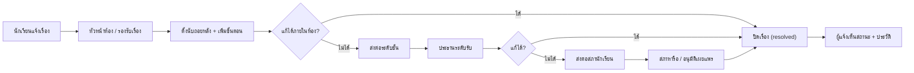

สถานะจริงของเรื่องมีหกค่า และเปลี่ยนตามลำดับนี้

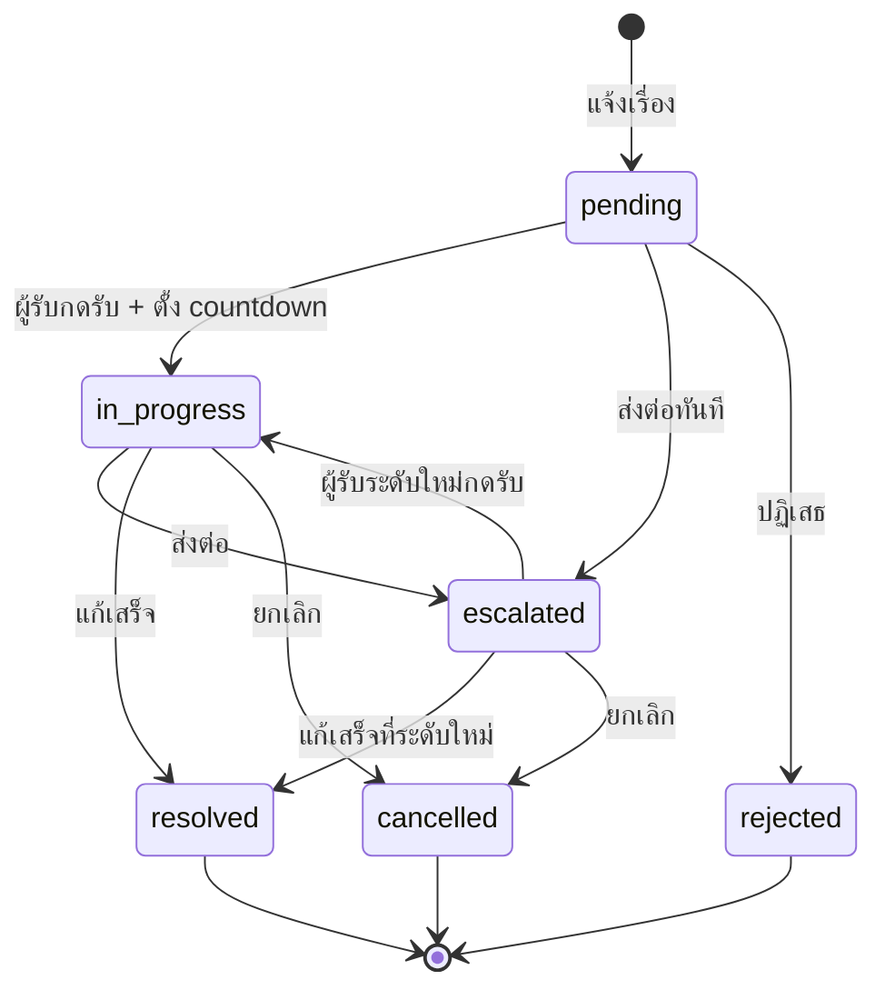

### 1.5 ฟีเจอร์ประกอบ

| โมดูล | ทำอะไร | ตารางหลัก |
|---|---|---|
| **Issues & Escalation** | แจ้งเรื่อง ติดตาม ส่งต่อ ขั้นตอน นับถอยหลัง คอมเมนต์ | `issues` และตารางลูก 5 ตัว |
| **PIRI Boards** | กระดานสาธารณะ 3 แบบ: `talk` / `vote` / `suggestion` พร้อม moderation | `piri_boards` และตารางลูก 6 ตัว |
| **Events** | สร้างกิจกรรม ลงทะเบียน คิวสำรอง QR check-in | `events`, `event_registrations` |
| **Announcements** | ประกาศบนหน้า Landing (normal / high / urgent) | `announcements` |
| **Notifications** | ศูนย์แจ้งเตือนในแอป + badge สด (SSE) + Web Push | `notifications`, `push_*` |
| **Student Records** | นำเข้า Excel ย้ายห้อง เลื่อนชั้น กระทบยอด | `students`, `student_*` |
| **Academic Calendar** | ปีการศึกษาและภาคเรียน พร้อมปี/ภาคปัจจุบัน | `academic_years`, `academic_terms` |
| **Dashboard & Audit** | สถิติโรงเรียนและบันทึกการใช้งาน | `audit_logs` + query สถิติ |
| **Playbooks / Help Center** | คู่มือการทำงานและคู่มือผู้ใช้ (VitePress) | ไฟล์ static |

### 1.6 สิ่งที่ระบบนี้ **ไม่ทำ** (Non-goals)

การรู้ขอบเขตสำคัญพอ ๆ กับการรู้ฟีเจอร์ เพราะมันอธิบายว่าทำไมสถาปัตยกรรมหน้าตาแบบนี้

- ❌ **ไม่มีระบบสมัครสมาชิกเอง** — บัญชีมาจากการนำเข้า/ผู้ดูแลสร้างเท่านั้น
- ❌ **ไม่มี "ลืมรหัสผ่าน" และไม่มีหน้าจอให้ผู้ดูแลตั้งรหัสแทน**
- ❌ **ไม่มี 2FA / OTP / ยืนยันอีเมล**
- ❌ **ไม่มี refresh token และเพิกถอน token รายใบไม่ได้**
- ❌ **ไม่มี WebSocket และไม่มี GraphQL** — ใช้ HTTP + SSE
- ❌ **ไม่มี Redis pub/sub สำหรับแจ้งเตือนในแอป** — ใช้ PostgreSQL `LISTEN/NOTIFY`
- ❌ **ไม่มี ORM** — backend เขียน SQL ตรงผ่าน `asyncpg`
- ❌ **ไม่มี CI pipeline บน GitHub** — ด่านทั้งหมดรันบนเครื่องก่อน push
- ❌ **ไม่รองรับ multi-tenant เกินกว่า staging/production** — แต่ละ environment แยกด้วย `ENV_NAME`

### 1.7 รูปแบบการติดตั้งโดยย่อ

ระบบเป็น **monorepo เดียว** ที่สร้าง image สองตัว (backend/frontend) แล้วรันเป็น
**Docker Swarm stack สองชุดต่อ environment** คือ infra (Postgres + Redis) และ app
(backend ×3, frontend ×3, worker, push_worker) อยู่หลัง **Traefik** ตัวเดียวที่แชร์กันทั้งเครื่อง

```
Cloudflare → Traefik (:80) → frontend ×3 หรือ backend ×3
                                      ↓
                              PostgreSQL 16 + Redis 7
```

---

## 2. Technology Stack — เครื่องมือที่ใช้

### 2.1 ตารางสรุปตามชั้น

| ชั้น | เทคโนโลยี | ใช้ทำอะไรในระบบนี้ |
|---|---|---|
| **Client** | Vue 3.5 (Composition API) + TypeScript 6 | SPA สำหรับนักเรียนและเจ้าหน้าที่ |
| | Vite 8 | dev server และ production build |
| | Vue Router 5 | routing, guard, redirect path เก่า |
| | Pinia 3 | state ของ auth และ notifications |
| | Tailwind CSS 3 + Bootstrap Icons | design system และไอคอน |
| | Chart.js 4 + vue-chartjs | กราฟในแดชบอร์ด |
| | SweetAlert2 | dialog/แจ้งเตือนทุกชนิด |
| | qrcode-generator + jsQR | สร้าง QR และสแกนเช็คอินกิจกรรม |
| | Service Worker (`public/sw.js`) + manifest | PWA ติดตั้งบนมือถือ |
| **Backend** | Python 3.12 + FastAPI 0.136 | HTTP API และ dependency injection |
| | Uvicorn 0.46 | ASGI server |
| | asyncpg 0.31 | connection pool + raw SQL |
| | Pydantic 2.13 + pydantic-settings | request/response schema และ config จาก `.env` |
| | python-jose | ออกและตรวจ JWT (HS256) |
| | bcrypt | แฮชรหัสผ่าน |
| | openpyxl + pandas | อ่านไฟล์ Excel นำเข้านักเรียน |
| | httpx + http-ece + py-vapid | ส่ง Web Push โดยไม่พึ่ง pywebpush |
| | ARQ 0.28 + redis-py | คิวงาน async สองคิว |
| **Database** | PostgreSQL 16-alpine | แหล่งความจริงเดียวของข้อมูล |
| **Cache / Queue** | Redis 7-alpine (appendonly) | **คิว ARQ เท่านั้น** — ไม่ใช่ cache และไม่ใช่ session store |
| **Realtime** | PostgreSQL `LISTEN/NOTIFY` → SSE | badge แจ้งเตือนสดขณะเปิดแอป |
| **Push** | VAPID + Web Push → FCM / APNs | แจ้งเตือนขณะปิดแอป |
| **Ingress** | Traefik v3 | reverse proxy + load balancer ตาม `Host` |
| | Cloudflare | DNS, TLS, CDN, WAF หน้า origin |
| **Orchestration** | Docker Engine + Docker Swarm | service, replica, rolling update, overlay network |
| **Host** | Ubuntu VPS | รัน Docker ทั้งหมด |
| **Docs** | VitePress 1.6 | คู่มือผู้ใช้/เจ้าหน้าที่/ผู้ดูแล (build ไปที่ `/docs/`) |
| **Test** | pytest + pytest-asyncio + httpx | integration test กับ PostgreSQL จริง |
| | Vitest + jsdom + @vue/test-utils | unit test frontend |
| | Playwright | end-to-end test |
| **Lint/Format** | oxlint + ESLint 10 + Prettier 3 | มาตรฐานโค้ด frontend |
| | สคริปต์ `lint:colors` / `lint:palette` | ด่านกันสีแบรนด์และจานสีผิด |

### 2.2 Frontend — รายละเอียด

- **Vue 3 แบบ `<script setup>` + TypeScript strict** — ห้ามใช้ `any`
- **แยกชั้นชัดเจน**: `views` (หน้าจอ) → `services` (เรียก API) → `types` (สัญญาข้อมูล)
  หน้าเว็บ **ไม่เรียก `api.get/post` ตรง ๆ** แต่เรียกผ่าน service
- **Design system ของตัวเอง** อยู่ใน `components/ui/` (AppCard, AppButton, AppChip, AppTabs, AppSheet, AppEmptyState, AppEmptyRow, IconButton, PageHeader, StatusBadge)
- **Shell ของแอป** อยู่ใน `components/layout/` ประกอบโดย `layouts/MainLayout.vue` ตัวเดียว
- **PWA**: service worker แคช app shell แต่ **ไม่แคช `/api/`** และรอแท็บเก่าปิดก่อน activate
- **คู่มือผู้ใช้** ถูก build จาก `docs/` แล้วฝังใน `frontend/public/docs/` — เสิร์ฟใต้ path `/docs/`
- **ค่า `VITE_*` ถูกฝังตอน build** ไม่ใช่ตอน runtime → เปลี่ยน `VITE_API_BASE_URL` ต้อง build ใหม่

### 2.3 Backend — รายละเอียด

- **FastAPI + asyncpg แบบ raw SQL** — ไม่มี ORM, ไม่มี SQLAlchemy
- **แยกชั้นแบบ MVC-like**: `routers/` (HTTP) → `services/` (business logic + SQL) → `models/` (Pydantic)
- **ทุก mutation สำคัญอยู่ใน transaction** และเขียน `audit_logs` ใน transaction เดียวกัน
- **ทุก router ประกาศ `response_model`** เพื่อกรองฟิลด์ลับ (ข้อยกเว้นมี 3 จุดและมีคอมเมนต์กำกับ)
- **config มาจาก root `.env` ไฟล์เดียว** ผ่าน `pydantic-settings`
- **ไม่มี state ในหน่วยความจำที่ต้องตรงกันข้าม replica** — สถานะร่วมอยู่ใน PostgreSQL (ข้อมูล) และ Redis (คิว) เท่านั้น

### 2.4 Data, Cache และคิว — จุดที่คนมักเข้าใจผิด

::: warning
**Redis ในระบบนี้ไม่ใช่ cache และไม่ใช่ที่เก็บ session**
มันถูกใช้เป็น **backend ของคิว ARQ สองคิว** เท่านั้น คือ `arq:queue:import` และ `arq:queue:push`
Session เป็น **JWT แบบ stateless** ที่ไม่ต้องเก็บฝั่งเซิร์ฟเวอร์
ส่วนการแจ้งเตือนสดใช้ **PostgreSQL `LISTEN/NOTIFY`** ไม่ใช่ Redis pub/sub
:::

| ต้องการอะไร | ระบบนี้ใช้อะไร | ไม่ใช้อะไร |
|---|---|---|
| เก็บ session | JWT ใน `localStorage` + ตรวจลายเซ็นทุกคำขอ | Redis |
| cache ผลลัพธ์ | ไม่มี cache ชั้นแอป (อ่าน PostgreSQL ตรง) | Redis |
| คิวงาน async | Redis + ARQ | PostgreSQL queue |
| แจ้งเตือนสด | PostgreSQL `LISTEN/NOTIFY` → SSE | Redis pub/sub, WebSocket |
| แจ้งเตือนตอนปิดแอป | Web Push (VAPID) → FCM/APNs | SMS, email |

### 2.5 เวอร์ชันที่ตรึงไว้ (snapshot ณ เอกสารนี้)

| องค์ประกอบ | เวอร์ชัน |
|---|---|
| Python | 3.12-slim |
| Node (build frontend) | 22-alpine |
| nginx (runtime frontend) | alpine |
| PostgreSQL | 16-alpine |
| Redis | 7-alpine |
| Traefik | `traefik:latest` (ไม่ได้ pin — ดูข้อควรระวังใน §8) |
| FastAPI / Starlette / Uvicorn | 0.136.1 / 1.0.0 / 0.46.0 |
| asyncpg / Pydantic | 0.31.0 / 2.13.3 |
| Vue / Vite / TypeScript | 3.5.x / 8.0.x / 6.0.x |
| ARQ | 0.28.0 |

---

## 3. End-to-End Request Flow — เส้นทางของคำขอ

บทนี้เล่าเป็นเรื่องราวว่าเมื่อผู้ใช้คนหนึ่งเปิดเว็บแล้วกดปุ่ม เกิดอะไรขึ้นบ้าง
ตั้งแต่สายลมบนอินเทอร์เน็ตจนถึงแถวในฐานข้อมูล และกลับมาเป็นหน้าจอ

### 3.1 ภาพใหญ่: เจ็ดชั้นที่คำขอต้องผ่าน

```
① Client        เบราว์เซอร์ / PWA (Vue 3)
② Edge          Cloudflare — DNS, TLS, CDN, WAF
③ Ingress       Docker Swarm routing mesh (published port 80)
④ Proxy         Traefik — เลือก service จาก Host header
⑤ Application   FastAPI — middleware → dependency → router → service
⑥ Data          asyncpg pool → PostgreSQL (+ Redis สำหรับคิว)
⑦ Response      JSON + X-Trace-Id กลับไปที่เบราว์เซอร์
```

### 3.2 เรื่องเล่า: หนึ่งคำขอเดินทางอย่างไร

#### ฉากที่ 0 — เปิดหน้าเว็บครั้งแรก

ผู้ใช้พิมพ์ `https://www.pirivoice.com` ในเบราว์เซอร์

1. **DNS** ของโดเมนชี้ไปที่ Cloudflare
2. **Cloudflare** ยุติ TLS ที่ edge แล้วส่งต่อ HTTP ไปยัง origin port `80`
   พร้อมแนบ header เช่น `CF-Connecting-IP` และ `X-Forwarded-For`
3. ที่เครื่อง VPS พอร์ต `80` ถูก publish โดย **Docker Swarm** (routing mesh)
   แล้วส่งต่อไปยัง task ของ **Traefik**
4. **Traefik** อ่าน `Host: www.pirivoice.com` แล้วเลือก router ที่ติด label ไว้
   จากนั้น load balance ไปยัง **frontend container** หนึ่งในสาม replica
5. **nginx ใน container frontend** ตอบไฟล์ static จาก image:
   `index.html`, JS/CSS ที่มี content hash, `manifest.json`, `sw.js`
   - path ที่ไม่ใช่ไฟล์จริงจะ fallback ไป `index.html` เพื่อให้ Vue Router ทำงาน
   - path ใต้ `/docs/` ถูกเสิร์ฟเป็นคู่มือ VitePress ไม่ใช่ SPA

#### ฉากที่ 1 — SPA เริ่มทำงาน

6. Vue boot ขึ้น อ่าน `localStorage` ว่าเคยมี `access_token` ไหม
7. ถ้าไม่มี token และ route ต้องล็อกอิน → guard พาไป `/login`
8. ถ้ามี token → เรียก `GET /api/auth/me` เพื่อโหลดตัวตนและสิทธิ์ล่าสุด

#### ฉากที่ 2 — ผู้ใช้กด "เข้าสู่ระบบ"

9. หน้า Login เรียก `POST /api/auth/login` ผ่าน axios
   - `baseURL` มาจาก `VITE_API_BASE_URL` ที่ถูกฝังตอน build
   - คำขอนี้เป็น **cross-origin** ระหว่างโดเมนเว็บกับโดเมน API
10. คำขอวิ่งผ่าน Cloudflare → Swarm → Traefik → backend replica ตัวหนึ่ง
11. **FastAPI middleware** ทำงานก่อนถึง router:
    - `CORSMiddleware` ตรวจ origin กับ allowlist ใน `main.py`
    - `audit_context_middleware` สร้าง `trace_id` (UUID) และเก็บ IP, user-agent, endpoint ไว้ใน contextvar
12. **Router** `auth_router.login` รับ body ที่ผ่าน Pydantic แล้วเรียก `auth_service.authenticate_user`
13. **Service** ค้นหา `users` ด้วย `username` ที่ `deleted_at IS NULL`
    แล้วตรวจรหัสผ่านด้วย `bcrypt.checkpw`
14. สำเร็จ → ออก JWT (`HS256`, claim `user_id`, อายุ 30 วัน) แล้วบันทึก audit การล็อกอิน
15. Response กลับเป็น JSON พร้อม header `X-Trace-Id`
16. หน้าเว็บเก็บ token ลง `localStorage` แล้วโหลด `/api/auth/me`
17. Pinia เก็บ user + roles + permissions และเมนูถูกคำนวณตามสิทธิ์

#### ฉากที่ 3 — ผู้ใช้เปิดหน้า "เรื่องที่รับ"

18. View เรียก service ฝั่ง frontend → `GET /api/issues/received`
19. axios interceptor ขาออกแนบ `Authorization: Bearer <token>` ให้ทุกคำขอ
20. คำขอผ่านเส้นทางเดิมมาถึง backend
21. **`get_current_user`** (dependency) ตรวจ Bearer token:
    - decode ด้วย `JWT_SECRET` + `JWT_ALGORITHM`
    - คืน `{"user_id": int, "is_system": False}`
    - ถ้าไม่มี/หมดอายุ → `401`
22. **Router** เรียก service พร้อม `pool` และ `user_id` — ไม่รับ `user_id` จาก body/query
23. **Service** ตรวจสิทธิ์ (`require_permission`) และขอบเขตข้อมูล (`get_access_scope`)
    จากตาราง `students` ของปีการศึกษาปัจจุบัน
24. **Service** ยืม connection จาก `asyncpg.Pool` แล้ว query
    โดยมีเงื่อนไข `deleted_at IS NULL` และเงื่อนไขขอบเขตตามบทบาท
25. **Router** แปลงผลเป็น `response_model` แล้วตอบ JSON
26. หน้าเว็บแสดงรายการ พร้อม `X-Trace-Id` ที่ซ่อนอยู่ใน response (อ่านได้จาก DevTools)

#### ฉากที่ 4 — ผู้ใช้กด "ส่งเรื่องใหม่" (mutation)

นี่คือเส้นทางที่ครบที่สุด เพราะมีทั้ง validation, transaction, audit และ side effect

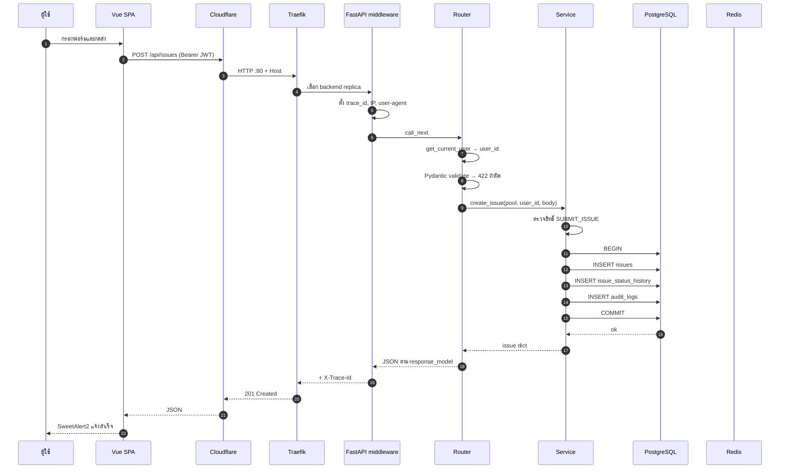

**จุดสำคัญที่ต้องเห็นจากภาพนี้**

- `user_id` มาจาก token ไม่ใช่จาก body → ปลอมตัวยาก
- validation เกิดที่ Pydantic **ก่อน** service → ข้อมูลผิดรูปไม่ทำให้ DB ทำงาน
- `audit_logs` อยู่ใน transaction เดียวกับข้อมูลหลัก → rollback พร้อมกัน ไม่มี log ผี
- Redis ไม่ได้อยู่ในเส้นทางนี้เลย — การแจ้งเตือนจะเข้าคิวผ่าน **trigger ใน PostgreSQL** ไม่ใช่จาก service

### 3.3 ภายใน backend: ลำดับชั้นและหน้าที่

```
HTTP request
  → main.audit_context_middleware      ตั้ง ip / user-agent / trace_id / endpoint
  → FastAPI dependency                 get_current_user, get_db_pool
  → router                             ตรวจ dependency, เรียก service, แปลง exception
  → service                            ตรวจสิทธิ์, เปิด transaction, เขียน SQL, เขียน audit
  → asyncpg pool                       คืน connection เมื่อจบคำขอ
```

| ชั้น | ห้ามทำ | ต้องทำ |
|---|---|---|
| **Router** | เขียน SQL, ใส่ business logic | รับ/แปลง request, เรียก service, แปลง exception เป็น HTTP status |
| **Service** | รู้จัก `Request` หรืออ่าน header เอง | รับ `pool` + `user_id`, ตรวจสิทธิ์, transaction, SQL, audit |
| **Model** | ใช้ `dict()` แบบ Pydantic v1 | Pydantic v2, ชนิดวันที่เป็น `date`/`datetime` |
| **Dependency** | รับ `user_id` จาก body | แปลง token เป็นตัวตนที่เชื่อถือได้ |

**ข้อยกเว้นของ `response_model`** มีสามแบบและต้องมีคอมเมนต์ทุกครั้ง
คือ ดาวน์โหลดไฟล์ template, SSE stream และ `204 No Content`

### 3.4 ลำดับการเริ่มระบบ (Lifespan)

ทุกครั้งที่ backend container เริ่ม `main.lifespan` ทำห้าอย่างตามลำดับ

1. สร้าง `asyncpg` pool (`min_size=1`, `max_size=10`)
2. เรียก `init_db` — สร้างตาราง รัน migration ที่ยังไม่ถูกบันทึก และสร้าง index
3. เรียก `seed_default_users` — สร้างบัญชีผู้ดูแลเริ่มต้นถ้ายังไม่มี
4. เปิด SSE hub ด้วย `LISTEN` บน channel `NOTIFY_CHANNEL`
5. ตอนปิด: ปิด hub **ก่อน** pool

::: info
`init_db` เป็น idempotent และรันทุกครั้งที่เริ่มระบบ แต่ **ไม่ใช่เครื่องมือแก้ schema**
บนฐานข้อมูลที่มีข้อมูลจริง — การเปลี่ยน schema ต้องเขียน migration คู่กันเสมอ
:::

### 3.5 ฝั่ง frontend: สิ่งที่เกิดก่อน/หลังคำขอ

| จังหวะ | สิ่งที่เกิด |
|---|---|
| ก่อนส่ง | `api.interceptors.request` แนบ `Bearer` จาก `localStorage` |
| สำเร็จ | interceptor unwrap `response.data` ให้ผู้เรียกได้ object ตรง ๆ |
| 401 | ล้าง token + `user_id_str` แล้วพาไป `/login?redirect=...` โดยจำ path เดิม |
| 422 | แปลง `detail` array ของ Pydantic เป็นข้อความไทยที่อ่านรู้เรื่อง |
| เน็ตหลุด | โยน `Error('ไม่สามารถเชื่อมต่อกับ Backend ได้...')` โดยไม่มี `status` |
| error อื่น | โยน `ApiError` ที่พก `status` มาด้วย เพื่อให้หน้าจอแยก 404 กับ 500 ได้ |

Route guard ทำงานตอนเปลี่ยนหน้า และใช้ `meta.requiresAuth` / `meta.requiresPermission`
แต่ **guard ไม่ใช่ด่านความปลอดภัย** — ด่านจริงอยู่ที่ backend ทุกครั้ง

### 3.6 งานที่ไม่ได้เกิดจากคำขอ (Background)

#### นำเข้านักเรียนจาก Excel

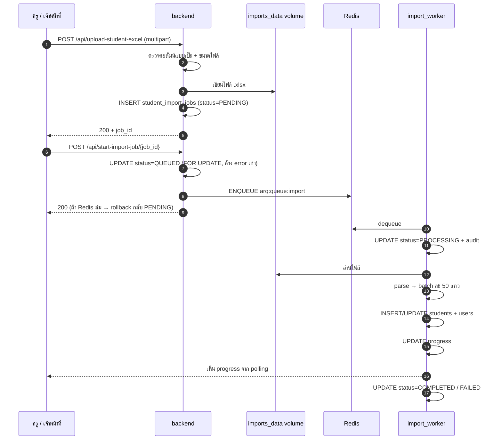

> อัปโหลดกับสั่งรันเป็น **สองคำขอแยกกัน** โดยเจตนา — ครูตรวจไฟล์และกดยืนยันก่อนงานหนักเริ่ม
> ถ้าเปิดอัตโนมัติ ไฟล์ผิดหนึ่งไฟล์จะลาก `max_jobs=1` ค้างเป็นชั่วโมง

- คิว `arq:queue:import`, `max_jobs=1`, `job_timeout=3600`
- จำกัดขนาดไฟล์ 10 MB และจำนวนแถว 5,000 แถว
- งานที่ค้าง `QUEUED`/`PROCESSING` เกิน 35 นาทีจะถูกกู้คืนตอน worker เริ่ม

#### แจ้งเตือนในแอปและ Web Push

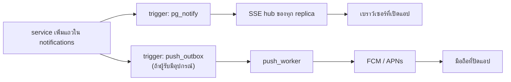

- **in-app**: trigger ยิง `pg_notify` หลัง commit → hub กรองตาม `user_id` → ส่ง SSE
- **fallback**: badge ยังอัปเดตด้วยการ poll ทุก 30 วินาที แม้ SSE ล่ม
- **push**: `push_worker` วนลูปทุก 5 วินาที claim แถวด้วย `FOR UPDATE SKIP LOCKED`
  ส่งพร้อมกันสูงสุด 20 คำขอ, ลองใหม่ 5 ครั้งแบบ exponential backoff,
  ทิ้งของเก่าเกิน 15 นาที, เคารพ quiet hours

#### เลื่อนชั้น / ปีการศึกษา

`rollover_service` ทำงาน **แบบ synchronous** ไม่ผ่านคิว โดยเจตนา
เพราะเป็น SQL ล้วน ใช้เวลา 2–4 วินาที และคิว import เป็น `max_jobs=1`
การเอาไปต่อคิวจะทำให้โรงเรียนต้องรอหลังงาน import ในสัปดาห์ลงทะเบียน

### 3.7 อาการ → ชั้นที่ควรตรวจ

| อาการ | ชั้นที่น่าสงสัยที่สุด | เริ่มตรวจที่ |
|---|---|---|
| 401 ทุก endpoint | token / `JWT_SECRET` | DevTools → header, log backend |
| 403 "ไม่พบข้อมูลของคุณ" | สมาชิกปีปัจจุบัน | `students` ของ user ในปี current |
| 403 "ไม่มีสิทธิ์ X" | `permissions` JSONB | `roles.json` + แถวสมาชิก |
| ได้ 200 แต่ข้อมูลว่าง | ขอบเขตข้อมูล | `get_access_scope` / เงื่อนไข level |
| 422 | Pydantic schema | ชื่อฟิลด์/ชนิดข้อมูลใน `models/` |
| 500 | constraint / transaction | log backend + `audit_logs` รอบ trace_id |
| badge ช้าแต่ push เข้า | SSE hub | log backend, channel, poll fallback |
| import ค้าง `QUEUED` | คิว ARQ | `queue_name`, worker รันอยู่ไหม |
| หน้าจอยังเก่าหลัง deploy | service worker / CDN | build id ของ `sw.js`, `VITE_*` ตอน build |
| API ตอบ HTML | ผิดโดเมน / SPA fallback | `VITE_API_BASE_URL`, `Host` ของ Traefik |

---

## 4. Architecture Diagram — แผนภาพสถาปัตยกรรม

### 4.1 แผนภาพเชิงตรรกะ (Logical Architecture)

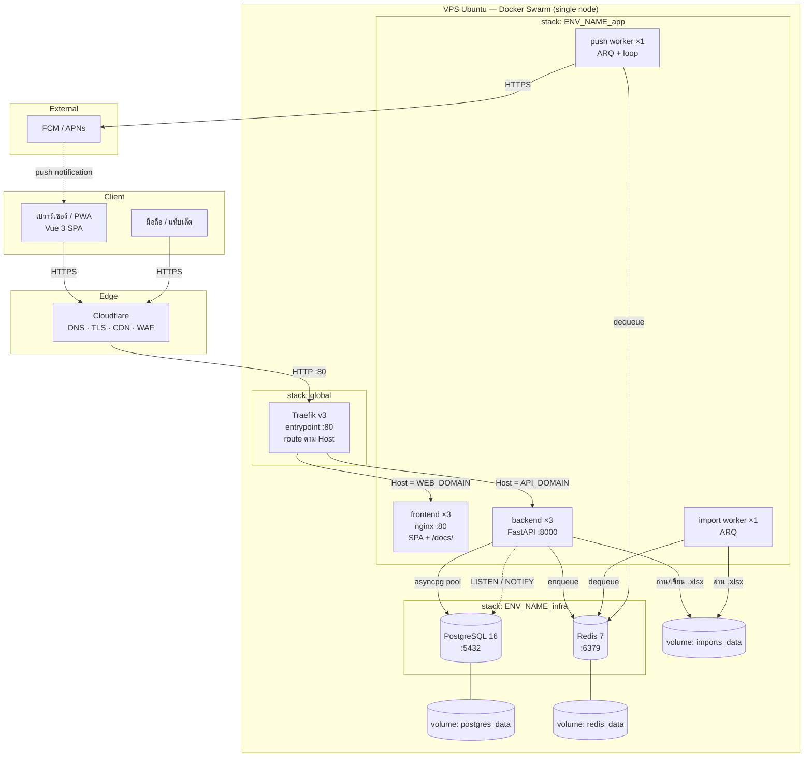

> **อ่านภาพนี้อย่างไร**
> - เส้นที่ผู้ใช้เห็นมีสองทางแยกกัน: `WEB_DOMAIN` → frontend, `API_DOMAIN` → backend
> - frontend กับ backend **ไม่ได้คุยกันภายใน** — เบราว์เซอร์เป็นคนเรียก API เอง
> - worker สองตัวใช้ image เดียวกับ backend แต่คนละคำสั่งเริ่ม
> - Redis อยู่เฉพาะเส้นทางคิว ไม่ได้อยู่ในเส้นทาง HTTP

### 4.2 แผนภาพการติดตั้ง (Deployment Topology)

production และ staging อยู่บน **เครื่องเดียวกัน** แต่แยกกันด้วยโฟลเดอร์ `ENV_NAME` และ stack

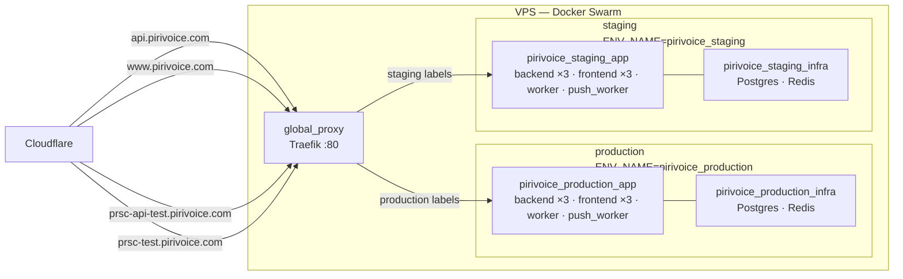

**หลักการแยก environment**

| สิ่งที่แยก | รูปแบบชื่อ | ผล |
|---|---|---|
| stack | `${ENV_NAME}_app`, `${ENV_NAME}_infra` | service ไม่ปนกัน |
| network | `app-internal-${ENV_NAME}` | container คุยข้าม environment ไม่ได้ |
| volume | `${ENV_NAME}_postgres_data`, `${ENV_NAME}_redis_data`, `${ENV_NAME}_imports_data` | ข้อมูลไม่ปนกัน |
| image | `pirivoice-${ENV_NAME}-backend:${IMAGE_TAG}` | build/rollback แยกกัน |
| โดเมน | `API_DOMAIN`, `WEB_DOMAIN` | Traefik แยกด้วย `Host` |

**สิ่งที่แชร์กัน** คือ Traefik ตัวเดียวและ network `traefik-public`
(รวมถึงเครื่องอื่นในระบบโรงเรียนที่ใช้ Traefik ตัวเดียวกัน)

### 4.3 พอร์ตและเครือข่าย

| พอร์ต | ใครฟัง | เปิดออกภายนอก? | หมายเหตุ |
|---|---|---|---|
| `80` | Traefik | ✅ ผ่าน Cloudflare | entrypoint เดียวของทุกเว็บ |
| `443` | Cloudflare edge | ✅ | TLS ยุติที่ Cloudflare |
| `8000` | backend container | ❌ | เข้าถึงผ่าน Traefik เท่านั้น |
| `80` (container) | nginx frontend | ❌ | เข้าถึงผ่าน Traefik เท่านั้น |
| `5432` | PostgreSQL | ❌ | อยู่ใน `app-internal-${ENV_NAME}` |
| `6379` | Redis | ❌ | อยู่ใน `app-internal-${ENV_NAME}` |
| `5435` | Postgres ทดสอบ | dev only | จาก `docker-compose.test.yml` |
| `5173` | Vite dev server | dev only | `npm run dev` |

**เครือข่ายสามชั้น**

| network | ชนิด | ใครอยู่ | ใช้ทำอะไร |
|---|---|---|---|
| `traefik-public` | overlay external | Traefik + frontend + backend | ให้ Traefik มองเห็น service |
| `app-internal-${ENV_NAME}` | overlay external | backend + worker + Postgres + Redis | คุยภายใน ไม่ควรออกอินเทอร์เน็ต |
| `db-management` | overlay external | Postgres | เครื่องมือจัดการ DB แยก (ถ้าใช้) |

### 4.4 เส้นทางของการแจ้งเตือนหนึ่งครั้ง

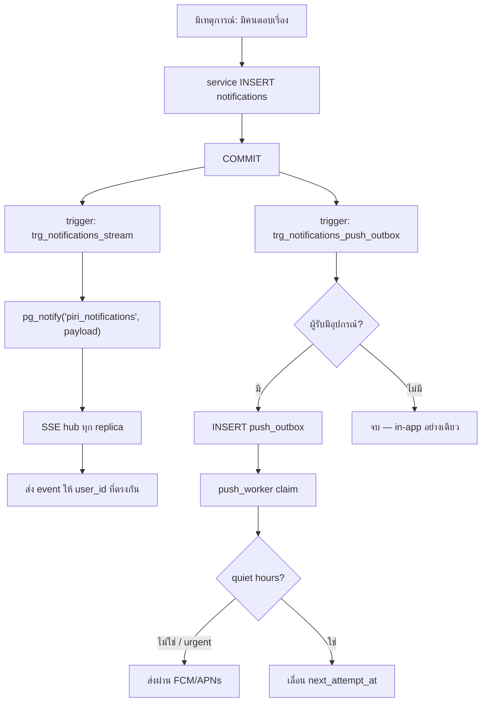

---

## 5. Directory Structure — โครงสร้างโฟลเดอร์

### 5.1 ระดับ root ของ repository

```text
prsc_portal/
├── backend/                    โค้ด API ทั้งหมด ( Python / FastAPI )
├── frontend/                   โค้ดเว็บทั้งหมด ( Vue 3 / Vite )
├── docs/                       เอกสารและคู่มือ ( VitePress + กฎวิศวกรรม )
│
├── docker-compose.infra.yml    Postgres 16 + Redis 7 ของ environment หนึ่ง
├── docker-compose.app.yml      backend ×3 · frontend ×3 · worker · push_worker
├── docker-compose.proxy.yml    Traefik ตัวกลาง (ติดตั้งครั้งเดียวต่อเครื่อง)
├── docker-compose.test.yml     Postgres ทดสอบ + pytest runner
│
├── setup.sh                    ติดตั้ง environment ใหม่แบบปุ่มเดียว
├── setup_traefik.sh            ติดตั้ง Traefik ครั้งเดียวต่อเครื่อง
├── pull_all.sh                 ดึงโค้ดล่าสุด → build image → deploy (ใช้ประจำ)
├── oh_shit.sh                  ย้อนกลับหนึ่ง commit (rollback)
├── push_all.sh                 add + commit + push แบบเร็ว
├── release.sh                  bump เวอร์ชัน → tag → push → GitHub Release
│
├── .env.example                รายการตัวแปรทั้งหมด (คัดลอกเป็น .env)
├── .env                        ค่าจริงของเครื่อง (ไม่ commit)
├── .gitattributes              Git LFS สำหรับ *.pdf และ *.webp
├── readme.md                   ภาพรวมโปรเจกต์และวิธีเริ่มต้น
├── CHANGELOG.md                ประวัติเวอร์ชัน (SemVer)
├── VERSION                     เลขเวอร์ชันปัจจุบัน
└── CLAUDE.md                   กฎการทำงานของ agent ใน repo นี้
```

### 5.2 `backend/` — API

```text
backend/
├── main.py                     สร้าง FastAPI, lifespan, middleware, mount 17 router
├── Dockerfile                  python:3.12-slim + non-root appuser
├── requirements.txt            dependency ทั้งหมด (pin เวอร์ชัน)
│
├── core/
│   ├── config.py               pydantic-settings อ่าน root .env
│   ├── dependencies.py         get_db_pool · get_current_user · verify_api_key
│   ├── rbac.py                 สิทธิ์ · ขอบเขต · ตำแหน่ง · permission codes
│   ├── init_db.py              DDL ทุกตาราง + index + seed (idempotent)
│   ├── migrations.py           ตัวรัน migration + ตาราง schema_migrations
│   ├── seed_users.py           บัญชีผู้ดูแลเริ่มต้น (บังคับเปลี่ยนรหัส)
│   ├── logger.py               AuditLogger เขียน audit_logs
│   ├── request_context.py      contextvar: ip, user-agent, trace_id, endpoint
│   ├── queues.py               ชื่อคิว ARQ (แหล่งความจริงเดียว)
│   ├── exceptions.py           ForbiddenError · NotFoundError · ValidationError
│   ├── categories.py           หมวดเรื่อง (สร้างจาก config/categories.json)
│   └── check_in_token.py       token สำหรับ QR เช็คอินกิจกรรม
│
├── config/
│   ├── roles.json              ตำแหน่ง → สิทธิ์ (13 ตำแหน่ง)
│   └── categories.json         หมวดหลัก/หมวดย่อยของเรื่อง
│
├── routers/                    HTTP ชั้นบาง (17 ไฟล์) — ดูตาราง §5.5
├── services/                   business logic + SQL (21 ไฟล์)
├── models/                     Pydantic schema (18 ไฟล์)
├── workers/
│   ├── import_worker.py        ARQ worker คิว import (max_jobs=1)
│   └── push_worker.py          ARQ worker คิว push (max_jobs=2 + delivery loop)
│
├── migrations/                 migration 001–029
├── scripts/                    seed_data · e2e_seed · generate_vapid_keys · rehearsal
└── tests/                      pytest integration tests (Postgres จริง)
```

**แผนที่ router → service (ย่อ)**

| Router file | โดเมน |
|---|---|
| `auth_router.py` | login, me, เปลี่ยนรหัส |
| `issue_router.py` | เรื่องทั้งหมด: สร้าง รับ ส่งต่อ ปิด คอมเมนต์ ขั้นตอน countdown |
| `dashboard_router.py` | สถิติและกราฟ |
| `student_router.py` | สมาชิก ย้ายห้อง เลื่อนชั้น กระทบยอด |
| `import_router.py` | อัปโหลด/ติดตามงานนำเข้า Excel |
| `audit_router.py` | ค้นหา audit log |
| `boards.py` | PIRI Boards: กระดาน คอมเมนต์ โหวต reaction report |
| `notification_router.py` | ศูนย์แจ้งเตือน + SSE stream + preferences |
| `announcement_router.py` | ประกาศหน้า Landing |
| `settings_router.py` | quiet hours และค่าตั้งระบบ |
| `rollover_router.py` | preview/apply การเลื่อนชั้น |
| `bookmark_router.py` | บันทึกไว้อ่านทีหลัง |
| `me_router.py` | โปรไฟล์และประวัติของตัวเอง |
| `event_router.py` | กิจกรรม ลงทะเบียน QR check-in |
| `home_router.py` | สรุปหน้าแรกตามบทบาท |
| `public_router.py` | API สาธารณะ `/api/v1/public/*` (ไม่ต้องล็อกอิน) |
| `version_router.py` | `/api/version` (version + commit) |

### 5.3 `frontend/` — เว็บ

```text
frontend/
├── src/
│   ├── main.ts                 จุดเริ่ม Vue app
│   ├── App.vue                 root component
│   ├── views/                  หน้าจอ แยกตามโดเมน
│   │   ├── Landing.vue         หน้าแรกสาธารณะ
│   │   ├── Home.vue            หน้าแรกหลังล็อกอิน
│   │   ├── Dashboard.vue
│   │   ├── auth/Login.vue
│   │   ├── issues/             NewIssue · EditIssue · IssueDetail · MyIssues ·
│   │   │                       ReceivedIssues · OrphanedAssignments
│   │   ├── boards/             PiriBoards · BoardDetail · NewSuggestion · ReportModeration
│   │   ├── events/             EventList · EventDetail · EventForm · EventManagement ·
│   │   │                       EventCheckIn · EventRegistrations
│   │   ├── students/           StudentList · ImportStudents · PromoteStudents · StudentMoves ·
│   │   │                       Reconciliation · UserManagement
│   │   ├── settings/           AcademicYears · AcademicYearForm · AcademicTerms
│   │   ├── announcements/      AnnouncementManagement
│   │   ├── audit/AuditLogs.vue
│   │   ├── notifications/NotificationCenter.vue
│   │   ├── me/MyActivity.vue
│   │   └── playbooks/          PlaybooksCatalog · PlaybookReader
│   │
│   ├── components/
│   │   ├── ui/                 design system (AppCard, AppButton, …)
│   │   ├── layout/             shell (Header, Sidebar, BottomNav, TabBar, Fab, …)
│   │   ├── boards/             ชิ้นส่วนเฉพาะบอร์ด
│   │   └── playbooks/          ชิ้นส่วนอ่านคู่มือ
│   │
│   ├── composables/            useNavItems · useAppChrome · useIdentity · useMediaQuery
│   ├── constants/              nav · roles · status · brand · chart · importStatus · schoolSystems
│   ├── layouts/MainLayout.vue  shell เดียวของแอป
│   ├── router/index.ts         route + guard + redirect path เก่า
│   ├── services/               axios API calls (ไฟล์ละโดเมน + api.ts)
│   ├── stores/                 Pinia: auth · notifications
│   ├── types/                  interface ของทุกโมเดล
│   ├── utils/                  avatar (กันบั๊กสระนำ)
│   ├── datetime.ts             รูปแบบเวลาไทย / Asia/Bangkok
│   ├── push.ts                 ลงทะเบียน Web Push
│   ├── pwa.ts                  จัดการ service worker
│   ├── qr.ts / qrReader.ts / qrScanner.ts
│   └── __tests__/              vitest unit tests
│
├── e2e/                        Playwright specs
├── public/
│   ├── docs/                   ★ VitePress build output (gen จาก docs/)
│   ├── playbooks/              PDF คู่มือการทำงาน (Git LFS)
│   ├── icons/ · logos/         PWA icons และโลโก้
│   ├── manifest.json           PWA manifest
│   ├── sw.js                   service worker
│   ├── robots.txt · sitemap.xml
│   └── favicon.png
├── scripts/                    check-brand-colors · check-status-palette
├── Dockerfile                  stage 1: Node build → stage 2: nginx
├── vite.config.ts              alias @, build id, VITE_* 
├── package.json                scripts: dev/build/type-check/lint/test
└── playwright.config.ts · vitest.config.ts
```

### 5.4 `docs/` — เอกสาร

```text
docs/
├── 1-user-guide/               คู่มือนักเรียน (เผยแพร่บน /docs/)
├── 2-staff-operations/         คู่มือหัวหน้าห้อง/สภา (เผยแพร่)
├── 3-admin-guide/              คู่มือครู/ผู้ดูแล (เผยแพร่)
├── 4-developer-playbook/       ★ เอกสารวิศวกรรม (ไม่ build ลง public)
├── rules/                      กฎ backend / frontend / testing
├── system_prompt.md            กฎร่วมของทุกชั้น
├── skills.md                   บทเรียนที่เคยแก้มาแล้ว (อ่านก่อนแก้บั๊ก)
├── scope.md                    ขอบเขตงาน
├── glossary.md                 คำศัพท์
└── .vitepress/config.mts       ตั้งค่า VitePress, sidebar, srcExclude
```

::: info
`docs/4-developer-playbook/**` และ `rules/**` ถูกใส่ใน `srcExclude`
จึง **ไม่ถูก build ลง `frontend/public/docs`** — เอกสารวิศวกรรมอยู่ใน Git เท่านั้น
การแก้เอกสารเล่มนี้จึงไม่ต้อง deploy ใหม่
:::

### 5.5 หาโค้ดที่ต้องการจากที่ไหน

| ต้องการ... | เปิดไฟล์ |
|---|---|
| เพิ่ม endpoint ใหม่ | `backend/routers/<domain>_router.py` + `services/<domain>_service.py` |
| รู้ว่าตารางถูกสร้างที่ไหน | `backend/core/init_db.py` และ `backend/migrations/` |
| เปลี่ยนสิทธิ์/ตำแหน่ง | `backend/config/roles.json` + `backend/core/rbac.py` |
| เพิ่มฟิลด์ใน response | `backend/models/<domain>_schemas.py` |
| เพิ่มหน้าจอ | `frontend/src/views/` + `router/index.ts` + `constants/nav.ts` |
| เพิ่มฟังก์ชันเรียก API | `frontend/src/services/<domain>.ts` + `types/` |
| เปลี่ยนสี/สถานะ | `frontend/src/constants/brand.ts` · `status.ts` |
| เปลี่ยนคิว/worker | `backend/core/queues.py` + `backend/workers/` |
| เปลี่ยน proxy/route | `docker-compose.app.yml` labels + `docker-compose.proxy.yml` |
| เปลี่ยนค่า environment | `.env.example` (แล้วคัดลอกไป `.env`) |

### 5.6 ข้อตกลงการตั้งชื่อ

- **backend**: snake_case, router/service/model แยกไฟล์ตามโดเมน
- **frontend**: component เป็น PascalCase, composable ขึ้นต้น `use`, service/type เป็น camelCase/PascalCase
- **migration**: `<ลำดับ 3 หลัก>_<ชื่อสั้น>.py` ต้องมี `VERSION`, `DESCRIPTION`, `async def upgrade(conn)`
- **test**: `test_<โดเมน>.py` และชื่อฟังก์ชันอธิบายพฤติกรรม
- **audit action**: ตัวพิมพ์ใหญ่ เช่น `CREATE_ISSUE`, `UPDATE_STUDENT`

---

## 6. Data & Database Architecture — ข้อมูลและฐานข้อมูล

### 6.1 หลักการออกแบบหกข้อ

1. **แถวสมาชิกผูกกับปีการศึกษา** — หนึ่งคนมีได้หลายแถว คนละปี การเลื่อนชั้นคือการสร้างแถวใหม่ ไม่ใช่เขียนทับ
2. **ข้อมูลที่ต้องตรวจย้อนหลังไม่มี FK** — `audit_logs`, `announcements.created_by`, `events.created_by` เพราะการลบผู้ใช้ไม่ควรลบหลักฐาน
3. **ตารางโดเมนของผู้ใช้ใช้ soft delete** ด้วย `deleted_at` และใช้ partial unique index
4. **ตารางชั่วคราว/junction ใช้ hard delete** เช่น `bookmarks`, `push_subscriptions`, `push_outbox`, `issue_countdowns`
5. **ค่าที่ชุดจะโตใช้ JSONB หรือไม่ใส่ CHECK** เช่น `app_settings.value`, `bookmarks.entity_type`
6. **"มีได้ตัวเดียว" บังคับด้วย partial unique index** เช่น ปีปัจจุบันหนึ่งปี ภาคปัจจุบันหนึ่งภาค

### 6.2 แผนที่โดเมน — 32 ตาราง

| โดเมน | ตาราง | จำนวน |
|---|---|---|
| ตัวตนและปีการศึกษา | `users` `rooms` `academic_years` `students` `academic_terms` `rollover_runs` `student_moves` `student_import_jobs` | 8 |
| เรื่อง | `issues` `issue_escalations` `issue_status_history` `issue_steps` `issue_countdowns` `issue_comments` | 6 |
| บอร์ดสาธารณะ | `piri_boards` `piri_board_comments` `piri_vote_choices` `piri_votes` `piri_board_reactions` `piri_board_reports` `piri_board_views` | 7 |
| กิจกรรมและประกาศ | `events` `event_registrations` `announcements` | 3 |
| แจ้งเตือนและค่าส่วนตัว | `notifications` `notification_preferences` `push_subscriptions` `push_outbox` `bookmarks` `app_settings` | 6 |
| บันทึกการใช้งาน | `audit_logs` | 1 |
| ตัวรัน migration | `schema_migrations` | 1 |
| **รวม** | | **32** |

### 6.3 ER Diagram — แกนตัวตนและปีการศึกษา

`students` เป็นตารางเชื่อมระหว่าง **คน · ห้อง · ปี**
หนึ่งคนมีได้หลายแถวเมื่อขึ้นปีใหม่ และ `room_id` เป็น `ON DELETE CASCADE`

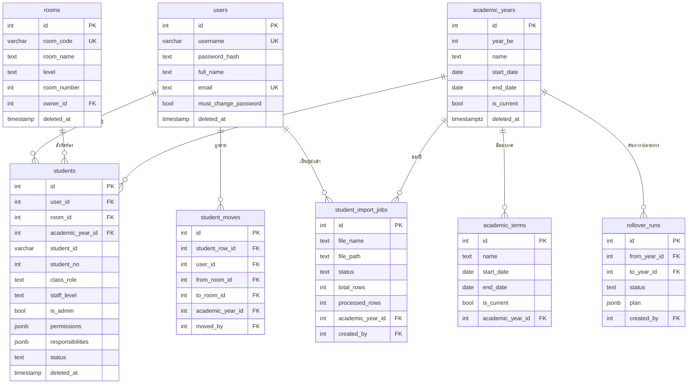

**อ่าน diagram นี้ให้ถูก**

- `users` = **บัญชี** (username, password_hash) — ใช้ล็อกอินเท่านั้น
- `students` = **สมาชิกภาพในปีหนึ่ง** (ตำแหน่ง, สิทธิ์, ห้อง, ปี) — ใช้ตัดสินสิทธิ์
- คนเดียวจึงมี `users` หนึ่งแถว แต่มี `students` หลายแถวได้ตลอดชีวิตในโรงเรียน
- ครูก็เป็นแถวใน `students` ที่มี `class_role='teacher'` และ `staff_level`

### 6.4 ER Diagram — เรื่อง บอร์ด กิจกรรม และการแจ้งเตือน

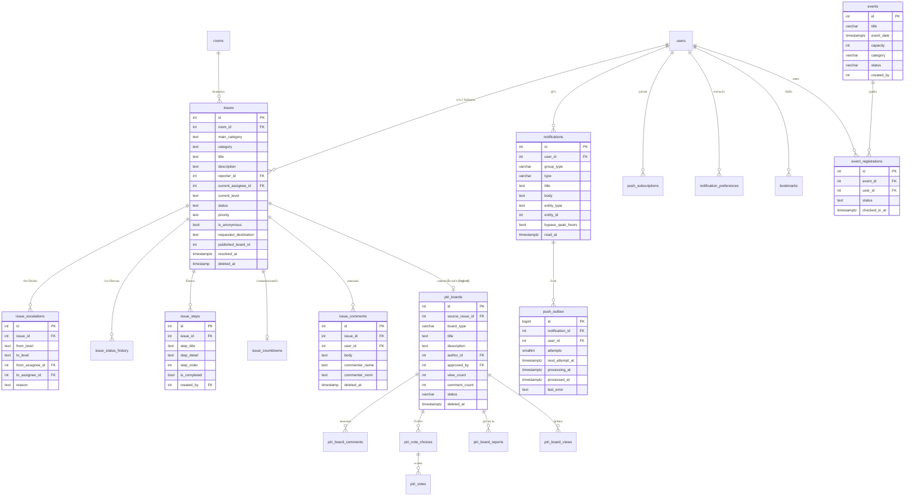

::: info
`piri_board_reactions.target_type/target_id` และ `bookmarks.entity_type/entity_id`
เป็น **polymorphic** จึงไม่มี FK ไปตารางปลายทาง (ตรวจความถูกต้องที่ service)
ส่วน `issues.published_board_id` เป็น **INTEGER เปล่า ไม่ประกาศ FK**
(คอมเมนต์ใน DDL บอกว่าชี้ `piri_boards.id` แต่ฐานข้อมูลไม่ได้บังคับ)
⇒ ถ้าเขียน query ที่ join สองตารางนี้ ต้องกรอง `deleted_at IS NULL` เองทั้งคู่
และ relation `issues |o--o| piri_boards` ในภาพจึงเป็นความสัมพันธ์เชิงตรรกะ ไม่ใช่ FK
:::

### 6.5 แคตตาล็อกตาราง — หน้าที่และวิธีลบ

| ตาราง | หน้าที่ | ความสัมพันธ์สำคัญ | การลบ |
|---|---|---|---|
| `users` | บัญชีล็อกอิน | 1–N `students` | soft delete |
| `rooms` | ห้องเรียน/ระดับ | 1–N `students` (CASCADE) | soft delete |
| `academic_years` | ปีการศึกษา (พ.ศ.) | 1–N `students`, `academic_terms` | soft delete |
| `students` | สมาชิกภาพของคนในปี | FK → users, rooms, years | soft delete |
| `academic_terms` | ภาคเรียน | FK → academic_years | soft delete |
| `rollover_runs` | ประวัติการเลื่อนชั้น | FK → years, users | เก็บถาวร |
| `student_moves` | ประวัติย้ายห้องในปี | FK → students, users, rooms | เก็บถาวร |
| `student_import_jobs` | งานนำเข้า Excel | FK → years, users | เก็บถาวร |
| `issues` | เรื่อง/ปัญหา | FK → rooms, users · `published_board_id` **ไม่มี FK** | soft delete |
| `issue_escalations` | ประวัติส่งต่อ | FK → issues, users | เก็บถาวร |
| `issue_status_history` | ประวัติสถานะ | FK → issues, users | เก็บถาวร |
| `issue_steps` | ขั้นตอนดำเนินงาน | FK → issues, users | เก็บถาวร |
| `issue_countdowns` | กำหนดนับถอยหลัง (1 แถวต่อเรื่อง) | FK → issues, users | ไม่มี `deleted_at` — ตั้งใหม่ = DELETE แล้ว INSERT / ต่อเวลา = UPDATE |
| `issue_comments` | คอมเมนต์ในเรื่อง | FK → issues, users | soft delete |
| `piri_boards` | กระดานสาธารณะ | FK → issues, users | soft delete |
| `piri_board_comments` | คอมเมนต์บอร์ด (threaded) | FK → boards, users | soft delete |
| `piri_vote_choices` | ตัวเลือกโหวต | FK → boards | soft delete |
| `piri_votes` | เสียงโหวต 1 คน/บอร์ด | FK → boards, choices, users | soft delete |
| `piri_board_reactions` | reaction ต่อบอร์ด/คอมเมนต์ | polymorphic | soft delete |
| `piri_board_reports` | รายงานเนื้อหา | FK → boards, comments, users | soft delete |
| `piri_board_views` | กันปั่นยอดชม | PK (board_id, user_id) | hard delete |
| `announcements` | ประกาศหน้า Landing | `created_by` ไม่มี FK | soft delete |
| `events` | กิจกรรม | `created_by` ไม่มี FK | soft delete |
| `event_registrations` | ลงทะเบียน/เช็คอิน | FK → events, users | เปลี่ยน `status` |
| `notifications` | แจ้งเตือนในแอป | FK → users, actor | เก็บถาวร |
| `notification_preferences` | เปิด/ปิดรายกลุ่ม | FK → users | เก็บถาวร |
| `push_subscriptions` | อุปกรณ์รับ push | FK → users | hard delete |
| `push_outbox` | คิวส่ง push (outbox) | FK → notifications, users | hard delete ตามอายุ 7 วัน |
| `bookmarks` | บันทึกไว้อ่าน | FK → users, polymorphic | hard delete |
| `app_settings` | ค่าตั้งโรงเรียน (JSONB) | `updated_by` FK | เก็บถาวร |
| `audit_logs` | บันทึกการใช้งาน | **ไม่มี FK** โดยเจตนา | เก็บถาวร |
| `schema_migrations` | เวอร์ชัน migration | — | เก็บถาวร |

### 6.6 วงจรชีวิตของข้อมูล

#### นักเรียนหนึ่งคนข้ามปี

```
ปี 2568: users#10 ── students#100 (ม.4/1, class_president, year=2568, status=promoted)
ปี 2569: users#10 ── students#250 (ม.5/1, student,        year=2569, status=active)
```

- การเลื่อนชั้น **สร้างแถวใหม่** ไม่ได้ UPDATE แถวเดิม
- `uq_students_room_year_student` กันซ้ำภายในห้อง+ปีเดียวกัน
- แถวปีเก่ายังอยู่เพื่อดูประวัติ และไม่ถูกนับในสิทธิ์ปัจจุบัน

#### Soft delete

```
UPDATE issues SET deleted_at = NOW() WHERE id = $1
```

ทุกคำสั่งอ่านต้องมี `deleted_at IS NULL` — การลืมเงื่อนไขนี้คือบั๊กที่พบบ่อยที่สุด
และเทสต์ปกติอาจไม่จับ เพราะแถวยังอยู่ในฐานข้อมูล

#### เรื่องหนึ่งเรื่อง

```
issues (1)
  ├── issue_status_history (N)   ทุกการเปลี่ยนสถานะ
  ├── issue_escalations   (N)    ทุกการส่งต่อ
  ├── issue_steps         (N)    ขั้นตอนที่ผู้รับเพิ่ม
  ├── issue_countdowns    (0..1) กำหนดปัจจุบัน
  ├── issue_comments      (N)    บทสนทนา
  └── piri_boards         (0..1) ถ้าอนุมัติเผยแพร่
```

### 6.7 Constraint, Index และ Trigger ที่ห้ามลบ

| วัตถุ | เหตุผล |
|---|---|
| `uq_notification_prefs_user_group` | `ON CONFLICT (user_id, group_type)` พึ่ง index นี้ |
| `uq_push_subscriptions_endpoint` | `ON CONFLICT (endpoint) DO UPDATE` พึ่ง index นี้ |
| `uq_bookmarks_user_entity` | กันบันทึกซ้ำ |
| `uq_students_room_year_student` | งานนำเข้าและเลื่อนชั้นพึ่ง index นี้ |
| `uq_event_registrations_event_user` | กันสมัครซ้ำ |
| `uq_academic_years_single_current` | บังคับปีปัจจุบันหนึ่งปี |
| `uq_academic_terms_single_current` | บังคับภาคปัจจุบันหนึ่งภาค |
| `uq_push_outbox_notification_user` | กัน trigger ยิงซ้ำแล้วได้สองแถว |
| `idx_push_outbox_pending` | worker ใช้หางานที่ยังไม่จบ |

**Trigger สองตัวบน `notifications`**

| Trigger | ไฟล์ | หน้าที่ |
|---|---|---|
| `trg_notifications_push_outbox` | `migrations/018` (แก้ใน `019`) | เข้าคิว push เมื่อผู้รับมีอุปกรณ์ |
| `trg_notifications_stream` | `migrations/020` | ยิง `pg_notify` ให้ SSE |

Trigger ทั้งสอง **ไม่ได้ mirror ใน `init_db.py`** โดยเจตนา — พฤติกรรมอยู่ที่ migration ที่เดียว

### 6.8 เวลา (Timezone)

- เวลาหลัก (`created_at`, `updated_at`, เวลาที่มีความหมายทางธุรกิจ) เก็บเป็น `TIMESTAMPTZ`
- ⚠️ **`deleted_at` ไม่สม่ำเสมอ** — `users` `rooms` `students` `issues` `issue_comments` เป็น `TIMESTAMP` ไม่มีเขตเวลา
  ส่วนตารางอื่นเป็น `TIMESTAMPTZ` (แจกแจงรายตารางใน [โครงสร้างฐานข้อมูล](database-schema.md))
  ⇒ เขียน query เทียบเวลาต้องระวังชนิดให้ตรงคอลัมน์
- แสดงผลเป็น **Asia/Bangkok (UTC+7)** และปี พ.ศ.
- การจัดกลุ่มรายวันใช้ `(created_at AT TIME ZONE 'Asia/Bangkok')::date`
- **ห้ามใช้ `toISOString()` เพื่อแสดงผล** เพราะคืน UTC และปี ค.ศ.

### 6.9 ขั้นตอนแก้ schema ให้ครบทั้งสองทาง

1. แก้ `core/init_db.py` ให้ฐานข้อมูลใหม่ได้ตาราง/คอลัมน์นั้น
2. เขียน migration ใหม่ใน `migrations/` พร้อม `VERSION`, `DESCRIPTION`, `upgrade(conn)`
3. ถ้าเพิ่ม index ให้ใส่ทั้ง migration และบล็อก index ท้าย `init_db.py` ด้วยชื่อเดียวกัน
4. เพิ่มชื่อตารางใน `_TABLES` ของ `backend/tests/conftest.py`
5. รันเทสต์ที่สร้างฐานข้อมูลใหม่

::: warning
`CREATE TABLE IF NOT EXISTS` **ไม่แก้อะไร** ถ้าตารางมีอยู่แล้ว
การแก้ `init_db.py` อย่างเดียวจึงไม่เปลี่ยนฐานข้อมูลจริง — ต้องมี migration คู่กันเสมอ
:::

---

## 7. Authentication & Security Flow — ตัวตนและความปลอดภัย

### 7.1 หลักคิด: สองคำถามที่แยกจากกัน

| คำถาม | ผู้ตอบ | เมื่อไม่ผ่าน |
|---|---|---|
| **คุณคือใคร** — ผู้ใช้คือใคร | `get_current_user` | `401 Unauthorized` |
| **ทำอะไรได้** — มีสิทธิ์ไหม | `require_permission` / `require_permission_anywhere` | `403 Forbidden` |
| **เห็นได้กว้างแค่ไหน** — ขอบเขตข้อมูล | `get_access_scope` / `get_manage_mode` | ไม่ error แต่ได้ข้อมูลน้อยลง/ว่าง |

การแยกสามอย่างนี้คือกุญแจวินิจฉัยปัญหา: 401 ≠ 403 ≠ "ข้อมูลไม่ครบ"

### 7.2 ลำดับการล็อกอิน

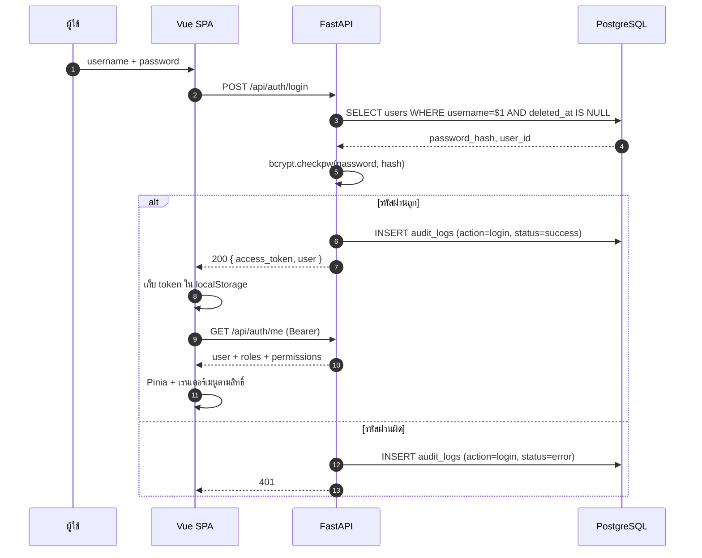

### 7.3 Token model

| คุณสมบัติ | ค่า |
|---|---|
| รูปแบบ | JWT |
| อัลกอริทึม | `HS256` |
| Secret | `JWT_SECRET` จาก `.env` (ทุก replica ต้องตรงกัน) |
| Claim | `user_id` (+ `exp`) — **ไม่มี roles/permissions ใน token** |
| อายุ | `ACCESS_TOKEN_EXPIRE_MINUTES` ค่าเริ่มต้น 43,200 นาที = **30 วัน** |
| Refresh token | ❌ ไม่มี |
| เพิกถอนรายใบ | ❌ ไม่มี |
| ที่เก็บฝั่ง client | `localStorage` (`access_token`, `user_id_str`) |

**ผลที่ตามมาที่ต้องรู้**

- เปลี่ยนรหัสผ่าน **ไม่ตัด token ที่ออกไปแล้ว**
- ถ้าต้องเตะทุกคนออกพร้อมกัน ทางเดียวคือเปลี่ยน `JWT_SECRET` แล้ว redeploy
- token ที่หลุดใช้ได้จนหมดอายุ 30 วัน
- token อยู่ใน `localStorage` จึงอ่านได้ด้วย JavaScript — XSS คือความเสี่ยงจริง
  (มาตรการคือไม่ render HTML จากผู้ใช้ และใช้ `v-text`/interpolation ไม่ใช่ `v-html`)

### 7.4 การยืนยันตัวตนทุกคำขอ

`get_current_user` คืน dict สองรูปแบบ

| วิธี | Header | ผลลัพธ์ |
|---|---|---|
| Web | `Authorization: Bearer <jwt>` | `{"user_id": int, "is_system": False}` |
| ระบบ | `X-API-Key: <API_KEY>` | `{"user_id": None, "is_system": True}` |
| ไม่มี | — | `401 Not authenticated: Bearer Token required` |

- `verify_api_key` ยังอยู่ในไฟล์แต่ **ไม่มี router ใช้** เพราะ `get_current_user` ตรวจให้แล้ว
  ห้ามเพิ่ม `Depends(verify_api_key)` ซ้อน
- API key เป็นตัวตนระดับระบบ ถ้ารั่ว = เข้าระบบได้แบบไม่ระบุตัวตน
- สิทธิ์ **ไม่ได้อยู่ใน token** — อ่านจาก `students.permissions` ทุกคำขอ
  ผู้ใช้จึงได้สิทธิ์ใหม่ทันทีหลังรีเฟรชหน้า โดยไม่ต้องล็อกอินใหม่

### 7.5 การอนุญาต: ตำแหน่งและสิทธิ์ 13 อย่าง

ตำแหน่งเก็บใน `students.class_role` สิทธิ์เพิ่มเติมใน `students.permissions` (JSONB array)
แผนที่ตำแหน่ง → สิทธิ์อยู่ใน `backend/config/roles.json`

| รหัสตำแหน่ง | `is_admin` | สิทธิ์หลัก |
|---|---|---|
| `student` | ❌ | `SUBMIT_ISSUE`, `VIEW_OWN_ISSUES` |
| `class_president` | ❌ | `RECEIVE_ISSUES`, `MANAGE_ISSUE_STEPS`, `SET_COUNTDOWN`, `ESCALATE_ISSUE`, `VIEW_LEVEL_PYRAMID` |
| `vice_academic` / `vice_discipline` / `vice_activity` / `vice_reception` | ❌ | เหมือนหัวหน้าห้อง |
| `level_president` / `level_vice_president` | ❌ | เพิ่ม `MANAGE_STUDENTS` |
| `council_member` | ❌ | เพิ่ม `VIEW_DASHBOARD`, `MANAGE_ANNOUNCEMENTS` |
| `council_president` | ✅ | ชุดผู้ดูแลทั้งหมด |
| `teacher_council` | ✅ | ชุดผู้ดูแลทั้งหมด |
| `admin` | ✅ | ชุดผู้ดูแลทั้งหมด |
| `teacher` | ❌ | `MANAGE_STUDENTS`, `VIEW_DASHBOARD` |

**สิทธิ์ 13 ตัวที่ใช้จริง**

`SUBMIT_ISSUE` · `VIEW_OWN_ISSUES` · `RECEIVE_ISSUES` · `MANAGE_ISSUE_STEPS` ·
`SET_COUNTDOWN` · `ESCALATE_ISSUE` · `VIEW_LEVEL_PYRAMID` · `MANAGE_STUDENTS` ·
`VIEW_DASHBOARD` · `MANAGE_SETTINGS` · `VIEW_AUDIT_LOG` · `MANAGE_ANNOUNCEMENTS` ·
`MANAGE_EVENTS`

::: warning
ชื่อสิทธิ์ **ตรงตัวพิมพ์ทุกตัวอักษร** — `manage_students` ตัวเล็กจะได้ 403
โดยไม่มีเบาะแสว่าพิมพ์ผิด
:::

**สองวิธีตรวจสิทธิ์**

- `require_permission(conn, room_id, user_id, perm)` — ตรวจในห้องที่ระบุ (งานที่ผูกห้อง)
- `require_permission_anywhere(conn, user_id, perm)` — ตรวจจากทุกแถวที่ผู้ใช้ถือ (งานไม่ผูกห้อง)

ทั้งสองข้ามการตรวจเมื่อเป็น `SUPER_ADMIN_ID` หรือ `is_admin=True`
`SUPER_ADMIN_ID` อยู่ใน `.env` ค่า `0` = ปิดการใช้งาน

### 7.6 ขอบเขตข้อมูลห้าระดับ

`get_access_scope(conn, user_id)` คืน `{scope, level, is_admin}`

| ขอบเขต | ได้มาเมื่อ | เห็นอะไร |
|---|---|---|
| `super` | `user_id == SUPER_ADMIN_ID` (และไม่ใช่ 0) | ทุกอย่าง |
| `all` | `is_admin` หรือ `admin`/`teacher_council`/`council_president` | ทั้งโรงเรียน |
| `all` | `council_member` (แยกเงื่อนไข ไม่ได้ `is_admin`) | ทั้งโรงเรียน แต่ไม่ผ่านด่านผู้ดูแล |
| `level` | `teacher` + มี `staff_level` | เฉพาะห้องในระดับชั้นนั้น |
| `none` | `teacher` แต่ไม่มี `staff_level` | ไม่มีขอบเขตข้อมูล |
| `pyramid` | ไม่เข้าเงื่อนไขใดเลย | เห็นตามสายงานของตัวเอง |

**โหมดจัดการ (`get_manage_mode`)** แยกจากขอบเขตข้อมูล

| โหมด | ใคร | หมายถึง |
|---|---|---|
| `school` | admin, teacher_council, council_president | จัดการทั้งโรงเรียน |
| `teacher` | teacher ที่มี staff_level | จัดการเฉพาะระดับชั้น |
| `level` | level_president / level_vice_president | จัดการเฉพาะระดับ |
| `none` | ที่เหลือ | ไม่มีเครื่องมือจัดการ |

**อันดับการจัดการ (`MANAGE_RANK`)** — จัดการได้เฉพาะคนที่อันดับไม่เกินตัวเอง

| อันดับ | ตำแหน่ง |
|---|---|
| 0 | `student` |
| 1 | หัวหน้าห้องและรอง 4 ฝ่าย |
| 2 | ประธานระดับ/รองประธานระดับ |
| 3 | `council_member` |
| 4 | `council_president` |

### 7.7 พีระมิดการส่งต่อและด่านสิทธิ์

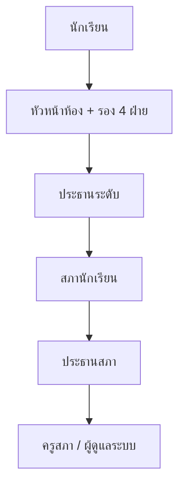

- ต้องมี `ESCALATE_ISSUE`
- ระดับปลายทางต้องสูงกว่าปัจจุบัน
- ผู้รับปลายทางต้องมีแถวสมาชิกใน **ปีการศึกษาปัจจุบัน** ไม่งั้นเรื่องจะค้างที่คนที่ไม่มีอยู่

### 7.8 Audit log และ trace

ทุก create/update/delete สำคัญต้องเขียน `audit_logs` **ใน transaction เดียวกัน**

```python
async with conn.transaction():
    row = await conn.fetchrow("UPDATE students SET ... WHERE id = $1 RETURNING *", student_id)
    await AuditLogger("student_service").log(
        conn=conn,
        action="UPDATE_STUDENT",
        actor_identifier=str(actor_id),
        client_source="web",
        entity_type="student",
        entity_id=str(student_id),
        old_values=old,
        new_values=new,
    )
```

`AuditLogger` ดึงข้อมูลต่อไปนี้จาก contextvar โดยไม่ต้องส่งจาก router

| ฟิลด์ | ที่มา |
|---|---|
| `ip_address` | `CF-Connecting-IP` → `X-Forwarded-For` → `X-Real-IP` → peer |
| `user_agent` | header |
| `trace_id` | UUID ที่ middleware สร้าง |
| `endpoint` | `METHOD /path` |
| เวลา | `CURRENT_TIMESTAMP` |

`X-Trace-Id` ถูกใส่ทุก response และตรงกับ `audit_logs.trace_id`
ใช้เมื่อผู้ใช้แจ้งปัญหาพร้อมรหัสจากเบราว์เซอร์

::: warning
**IP ที่บันทึกเชื่อถือได้ไม่เต็มร้อย**
Traefik อยู่หลัง Swarm ingress ซึ่ง SNAT source IP และ Traefik v3
(`forwardedHeaders.insecure=false`) เขียนทับ `X-Forwarded-For`
จึงต้องอ่าน `CF-Connecting-IP` ซึ่ง Traefik ไม่แตะ
แต่ header นี้ **ปลอมได้** ถ้ามีคนยิงเข้า origin port 80 ตรง ๆ ข้าม Cloudflare
⇒ ควรจำกัด firewall ของ origin ให้รับเฉพาะ IP ของ Cloudflare ก่อนใช้เป็นหลักฐาน
:::

### 7.9 Secret และการตั้งค่า

| Secret | ใช้ทำอะไร | ถ้ารั่ว/เปลี่ยน |
|---|---|---|
| `JWT_SECRET` | ลงนาม token | เปลี่ยน = ทุกคนถูกเตะออก |
| `API_KEY` | ตัวตนระบบ | รั่ว = เข้าระบบแบบ system ได้ |
| `SUPER_ADMIN_ID` | god mode | ตั้งผิด = ให้สิทธิ์เกิน |
| `POSTGRES_PASSWORD` | ฐานข้อมูล | รั่ว = เข้าข้อมูลตรง |
| `VAPID_PRIVATE_KEY` | ลงนาม push | เปลี่ยน = subscription เดิมใช้ไม่ได้ทั้งหมด |
| `SECRET_KEY` | ค่าทั่วไปของแอป | ใช้ใน config |

- ค่าจริงอยู่ใน **root `.env` ไฟล์เดียว** และ `.env` ถูก gitignore
- ห้าม hardcode secret ในโค้ดหรือ compose
- `.env.example` มีแต่ชื่อตัวแปร ไม่มีค่าจริง

### 7.10 ขอบเขตความปลอดภัยและข้อจำกัดที่รู้อยู่

| หัวข้อ | สถานะปัจจุบัน | ผล |
|---|---|---|
| TLS | ยุติที่ Cloudflare, origin รับ HTTP :80 | ต้องพึ่ง Cloudflare และควรล็อก origin |
| CSRF | ใช้ Bearer header ไม่ใช่ cookie | ความเสี่ยงต่ำ แต่ CORS ต้องถูก |
| XSS | token ใน `localStorage` | ถ้ามี XSS = ขโมย token ได้ |
| Brute force | ไม่มี rate limit ใน backend | ต้องพึ่ง Cloudflare/WAF หรือเพิ่มเอง |
| Token revocation | ไม่มี | ต้องรอหมดอายุหรือ rotate secret |
| 2FA | ไม่มี | บัญชีหลุด = เข้าได้ทันที |
| Password reset | ไม่มี | ต้องแก้ที่ DB/สคริปต์ |
| SQL injection | parameterized queries ทุกที่ | ป้องกันได้ถ้าไม่ใช้ f-string SQL |
| File upload | จำกัดชนิด/ขนาด/จำนวนแถว | ลด DoS จากไฟล์ยักษ์ |
| Audit integrity | ไม่มี FK, เขียนใน transaction | ลบผู้ใช้ไม่ลบหลักฐาน |

**Endpoint ที่ไม่ต้องล็อกอิน**

- `GET /health`
- `GET /api/version`
- `POST /api/auth/login`
- `GET /api/v1/public/*` (stats, trend, resolved cases, announcements)

### 7.11 เช็กลิสต์เมื่อเพิ่ม endpoint ที่ต้องมีสิทธิ์

1. ประกาศ `response_model` (ยกเว้นสามข้อยกเว้นที่ต้องคอมเมนต์)
2. ใช้ `Depends(get_current_user)` — ห้ามรับ `user_id` จาก body/query
3. ตรวจสิทธิ์ใน **service** ด้วย `require_permission` หรือ `require_permission_anywhere`
4. ถ้าเป็นข้อมูลระดับโรงเรียน ตรวจ `get_access_scope` เพิ่ม
5. ถ้าเป็น mutation: เปิด transaction + เขียน audit ใน transaction เดียว
6. ใช้ parameterized query — ห้าม f-string SQL
7. เขียนเทสต์ที่ตรวจทั้ง HTTP status และแถวใน DB

---

## 8. Infrastructure & Deployment — โครงสร้างพื้นฐานและการนำขึ้นระบบ

### 8.1 เครื่องและรูปแบบการรัน

| องค์ประกอบ | รายละเอียด |
|---|---|
| Host | Ubuntu VPS หนึ่งเครื่อง (ชื่อโฮสต์และบัญชี SSH ไม่บันทึกใน repo — ดู `~/.ssh/config` ของผู้ดูแล) |
| Container runtime | Docker Engine + **Docker Swarm แบบ single-node manager** |
| Reverse proxy | Traefik v3 ใน stack `global` (ตัวเดียวต่อเครื่อง) |
| Edge | Cloudflare (DNS proxy, TLS, CDN, WAF) |
| Runtime | backend (FastAPI/Uvicorn), frontend (nginx), worker (ARQ) |
| ฐานข้อมูล | PostgreSQL 16 + Redis 7 ต่อ environment |

> **ทำไม single-node Swarm?**
> ระบบนี้ไม่ได้ต้องการ cluster หลายเครื่อง แต่ใช้ Swarm เพราะได้ **declarative service,
> replica, rolling update, overlay network และ secret/config management**
> โดยไม่ต้องติดตั้ง orchestrator ตัวใหญ่กว่า

### 8.2 Environment: staging และ production บนเครื่องเดียวกัน

| | production | staging |
|---|---|---|
| โฟลเดอร์ | `<deploy-root>/piri_voice` | `<deploy-root>/prsc_test` |
| `ENV_NAME` | `pirivoice_production` | `pirivoice_staging` |
| stack | `pirivoice_production_app` / `_infra` | `pirivoice_staging_app` / `_infra` |
| DB container | `pirivoice_production_infra_db` | `pirivoice_staging_infra_db` |
| DB user | `piri_admin` | `prsc_admin` |
| โดเมนเว็บ | `https://www.pirivoice.com` | `https://prsc-test.pirivoice.com` |
| โดเมน API | `https://api.pirivoice.com` | `https://prsc-api-test.pirivoice.com` |

::: info
`<deploy-root>` คือโฟลเดอร์ที่ clone repo ไว้บนเครื่องจริง — **ไม่บันทึกไว้ในเอกสารนี้โดยเจตนา**
(เอกสารนี้อยู่ใน Git) สิ่งที่ต้องจำคือ **สอง environment เป็น clone คนละชุดในระดับพี่น้องกัน**
และชื่อโฟลเดอร์ลงท้ายด้วย `piri_voice` (production) กับ `prsc_test` (staging)
ถ้าไม่แน่ใจว่ากำลังอยู่ที่ไหน ให้ `pwd` + `grep '^ENV_NAME=' .env` ก่อนรันสคริปต์ใด ๆ
:::

::: warning
**สอง environment ใช้คำสั่ง deploy เหมือนกันทุกตัวอักษร**
สิ่งที่ตัดสินว่า deploy ตัวไหนคือ **โฟลเดอร์ที่ยืนอยู่** (`.env` ใน cwd)
การ `cd` ผิดโฟลเดอร์ = deploy ทับ production ทันที
:::

### 8.3 Stack, Service, Network, Volume

#### Stack

| stack | compose file | services |
|---|---|---|
| `global` | `docker-compose.proxy.yml` (+ bytebase) | `traefik` |
| `${ENV_NAME}_infra` | `docker-compose.infra.yml` | `db` (Postgres), `redis` |
| `${ENV_NAME}_app` | `docker-compose.app.yml` | `backend` ×3, `frontend` ×3, `worker`, `push_worker` |

#### Service ที่รันจริง

| service | replicas | image | port ภายใน | หน้าที่ |
|---|---|---|---|---|
| `backend` | 3 | `pirivoice-${ENV_NAME}-backend:${IMAGE_TAG}` | 8000 | HTTP API + SSE |
| `frontend` | 3 | `pirivoice-${ENV_NAME}-frontend:${IMAGE_TAG}` | 80 | SPA + `/docs/` |
| `worker` | 1 | backend image | — | คิว import |
| `push_worker` | 1 | backend image | — | คิว push + delivery loop |
| `db` | 1 | `postgres:16-alpine` | 5432 | ฐานข้อมูล |
| `redis` | 1 | `redis:7-alpine` | 6379 | คิว ARQ |
| `traefik` | 1 | `traefik:latest` | 80 | ingress |

#### Routing ด้วย Traefik label

```yaml
labels:
  - "traefik.enable=true"
  - "traefik.http.routers.${ENV_NAME}_backend.rule=Host(`${API_DOMAIN}`)"
  - "traefik.http.services.${ENV_NAME}_backend.loadbalancer.server.port=8000"
  - "traefik.docker.network=traefik-public"
```

- Traefik เลือก service จาก **Host header** ไม่ใช่ path
- frontend และ backend เป็นคนละโดเมน → CORS ต้องอนุญาตโดเมนเว็บ
- backend ทั้ง 3 replica ได้รับคำขอแบบ round-robin โดย Traefik

#### Rolling update แบบไม่ขาดช่วง

```yaml
update_config:
  parallelism: 1
  order: start-first
```

- เริ่ม container ใหม่ก่อน แล้วค่อยหยุดตัวเก่า
- backend มี healthcheck `GET /health` ทุก 10 วินาที
- frontend เป็น static จึงสลับได้เร็ว

### 8.4 Image และ build

#### Backend image

- `python:3.12-slim`
- ติดตั้ง `build-essential`, `libpq-dev`, `curl`
- สร้าง user `appuser` (non-root)
- `ARG GIT_SHA` → `ENV GIT_SHA` เพื่อให้ `/api/version` ตอบ commit ได้
- รัน `uvicorn main:app --host 0.0.0.0 --port 8000 --proxy-headers --forwarded-allow-ips *`

#### Frontend image (multi-stage)

```
stage 1: node:22-alpine
  npm install → VITE_API_BASE_URL (build arg) → npm run build → /app/dist

stage 2: nginx:alpine
  COPY dist → /usr/share/nginx/html
  SPA fallback: try_files $uri /index.html
  /docs/: try_files $uri $uri/ $uri.html =404
  sw.js / manifest.json: no-cache
```

::: tip
`VITE_API_BASE_URL` ถูก **ฝังลง JS ตอน build**
การแก้ค่าใน `.env` แล้ว restart ไม่มีผล — ต้อง build image ใหม่และ deploy
:::

### 8.5 ลำดับการนำขึ้นปกติ (`pull_all.sh`)

```bash
cd <deploy-root>/piri_voice   # หรือ prsc_test สำหรับ staging
grep '^ENV_NAME=' .env        # ยืนยันว่าเป็น environment ที่ตั้งใจ
git status --porcelain        # ต้องว่าง
./pull_all.sh
```

สคริปต์ทำตามลำดับ

1. โหลด `.env` และหยุดถ้าไม่พบ
2. อ่าน branch ปัจจุบัน
3. `git fetch origin` → `git reset --hard origin/<branch>`
4. `git lfs pull` (สูงสุด 3 รอบ) แล้วตรวจว่าไม่มีไฟล์ใดยังเป็น LFS pointer — ถ้ายังเหลือให้หยุด deploy
   (ไม่งั้น image จะได้ไฟล์ชี้ขนาดหลักสิบไบต์แทนรูป/PDF จริง)
5. ตั้ง `IMAGE_TAG` = commit ย่อ 7 หลัก
6. build backend image
7. build frontend image (`--no-cache`, ส่ง `VITE_API_BASE_URL`)
8. `docker stack deploy -c docker-compose.app.yml ${ENV_NAME}_app`

**ผลข้างเคียงที่ต้องรู้**

- `reset --hard` **ทิ้งงานที่ยังไม่ commit** — ต้อง commit/push ก่อน
- การ build frontend ใหม่ทุกครั้งทำให้ deploy ใช้เวลานานขึ้น แต่หลีกเลี่ยง stale bundle
- `IMAGE_TAG` เป็น commit SHA → ย้อนกลับได้ถ้า image ยังอยู่

### 8.6 Rollback

| วิธี | คำสั่ง | ย้อนอะไร |
|---|---|---|
| ย้อนหนึ่ง commit | `./oh_shit.sh` | โค้ด + image ของ commit ก่อน |
| ย้อนเอง | `git reset --hard <commit>` + deploy tag นั้น | โค้ด |
| คืนฐานข้อมูล | restore dump | ข้อมูล (ต้องมี dump) |

::: warning
**ย้อนโค้ดไม่ย้อนข้อมูล**
ถ้า commit ที่ผิดรัน migration ไว้ ต้องเขียน migration แก้ย้อนกลับ
หรือ restore dump — ห้ามแก้ตารางจริงด้วยมือโดยไม่มี backup
:::

### 8.7 ติดตั้งครั้งแรก

```bash
cp .env.example .env      # แก้ ENV_NAME, โดเมน, รหัส DB, JWT_SECRET, VITE_API_BASE_URL
./setup_traefik.sh        # ครั้งเดียวต่อเครื่อง — สร้าง Swarm, network, Traefik
./setup.sh                # สร้าง network ของ env, deploy infra, build, deploy app
```

`setup.sh` ทำ: เปิด Swarm → สร้าง network จาก `ENV_NAME` → ตรวจ Traefik →
deploy infra → build image → deploy app

### 8.8 ตาราง configuration ที่สำคัญ

| กลุ่ม | ตัวแปร | ใช้ที่ |
|---|---|---|
| identity | `ENV_NAME`, `API_DOMAIN`, `WEB_DOMAIN` | stack/network/volume/image + Traefik |
| database | `POSTGRES_USER`, `POSTGRES_PASSWORD`, `POSTGRES_DB`, `DATABASE_URL` | Postgres + backend |
| auth | `JWT_SECRET`, `JWT_ALGORITHM`, `ACCESS_TOKEN_EXPIRE_MINUTES`, `API_KEY`, `SUPER_ADMIN_ID` | backend |
| redis | `REDIS_URL` | ARQ queue |
| import | `IMPORT_STORAGE_DIR`, `IMPORT_FILE_SIZE_LIMIT_MB`, `IMPORT_MAX_ROWS`, `IMPORT_BATCH_SIZE`, `IMPORT_RECOVERY_STALE_MINUTES` | backend + import worker |
| push | `VAPID_*`, `PUSH_TICK_SECONDS`, `PUSH_DRAIN_SECONDS`, `PUSH_MAX_ATTEMPTS`, `PUSH_MAX_AGE_MINUTES`, `PUSH_RECOVER_MINUTES`, `PUSH_SEND_CONCURRENCY`, `PUSH_TTL_SECONDS`, `PUSH_URGENCY` | push worker |
| SSE | `NOTIFY_CHANNEL`, `STREAM_HEARTBEAT_SECONDS`, `STREAM_MAX_SUBSCRIBERS` | backend |
| frontend | `VITE_API_BASE_URL` | build frontend |

### 8.9 Capacity และจุดที่ขยายได้/ไม่ได้

| ทรัพยากร | ค่าปัจจุบัน | ขยายอย่างไร |
|---|---|---|
| backend | 3 replicas × pool 10 = 30 connection สูงสุด | เพิ่ม replica (Traefik balance ให้) |
| frontend | 3 replicas | เพิ่ม replica ได้ทันที (stateless) |
| SSE | 2,000 subscribers ต่อ replica | เพิ่ม replica หรือเพิ่มเพดาน |
| push | 100 ข้อความ/รอบ × รอบทุก 5 วิ | เพิ่ม replica (SKIP LOCKED รองรับ) แต่ cron ยัง unique |
| import | 1 งาน/ครั้ง (`max_jobs=1`) | ต้องออกแบบใหม่ถ้าต้องขนาน (กัน users ซ้ำ) |
| PostgreSQL | 1 instance | **single point of failure** — ต้อง backup/restore |
| Redis | 1 instance | **single point of failure** — คิวหายได้ |
| Traefik | 1 instance | ถ้าล่ม ทุกเว็บบนเครื่องล่ม |

### 8.10 สุขภาพระบบและการตรวจหลัง deploy

```bash
curl -s https://api.pirivoice.com/health
# {"status":"ok","database":"connected"}

curl -s https://api.pirivoice.com/api/version
# {"version":"2.3.0","commit":"<short sha>"}

docker service ls
docker service ps <service> --no-trunc
docker service logs <service>
```

เช็กลิสต์

1. `/health` ต้อง `ok`
2. ทุก service ต้อง `3/3` หรือ `1/1`
3. ไม่มี task ที่ restart วน
4. log backend ต้องเห็น `init_db` จบและไม่มี traceback
5. `/api/version` ต้องตรงกับ commit ที่ deploy
6. ล็อกอินบัญชีทดสอบและเปิดหน้าแรก
7. ลองงานที่ใช้ worker บนข้อมูลทดสอบ

### 8.11 ข้อควรระวังเชิงปฏิบัติการ

| เรื่อง | รายละเอียด |
|---|---|
| **ไม่มี CI** | ด่านทั้งหมดรันบนเครื่องก่อน push |
| **`pull_all.sh` ทับงาน** | `reset --hard` — commit ก่อนเสมอ |
| **Cloudflare แคช `sw.js`** | CF เขียนทับ `Cache-Control` เป็น `max-age=14400` → ใช้ `sw.js?v=<build id>` |
| **Cloudflare แคช SPA fallback** | path ที่ยังไม่มีไฟล์อาจถูกแคชเป็น `index.html` → อย่ายิง path ก่อน deploy |
| **`VITE_*` เป็น build-time** | เปลี่ยนแล้วต้อง build ใหม่ |
| **`/docs/` ไม่ถูก build อัตโนมัติ** | ต้องรัน `npm run docs:build` ก่อน deploy ถ้าแก้คู่มือ |
| **Traefik ไม่ pin version** | `traefik:latest` อาจเปลี่ยนพฤติกรรมเมื่อ pull ใหม่ |
| **origin รับ HTTP** | ต้องพึ่ง Cloudflare + firewall จำกัด IP |
| **single Postgres/Redis** | ไม่มี HA — backup และ restore คือแผนหลัก |
| **migration 028 ไม่ additive** | rollback ต้อง restore dump ไม่ใช่ `oh_shit.sh` |

---

## ภาคผนวก ก. แผนที่เอกสาร

เอกสารนี้เป็นภาพรวม ถ้าต้องลงลึกเรื่องใด เปิดบทเหล่านี้

| เรื่อง | บท |
|---|---|
| ชั้นของ backend, SSE, คิว, transaction | [สถาปัตยกรรมภายใน](architecture-internals.md) |
| ตัวตน สิทธิ์ ขอบเขต และพีระมิด | [การยืนยันตัวตนและสิทธิ์](auth-and-rbac.md) |
| ตารางทุกตาราง คอลัมน์ index และ migration | [โครงสร้างฐานข้อมูล](database-schema.md) |
| endpoint และสิทธิ์ที่ต้องใช้ | [API Reference](api-reference.md) |
| import, push, quiet hours, SSE | [งานเบื้องหลัง การแจ้งเตือน และ push](background-jobs-and-push.md) |
| มาตรฐาน UI/UX และ design system | [มาตรฐาน UI/UX](ui-ux-design-standards.md) |
| กฎการเขียนโค้ดทั้งสามชั้น | [มาตรฐานการเขียนโค้ด](coding-standards-rules.md) |
| เทสต์ build และ deploy | [การทดสอบและการนำขึ้นระบบ](testing-and-deployment.md) |
| SemVer, `release.sh`, CHANGELOG | [เวอร์ชันและการปล่อยงาน](versioning-and-releases.md) |
| ข้อขัดแย้งระหว่างเอกสารเดิมกับโค้ด | [ข้อขัดแย้ง](known-discrepancies.md) |

**กฎของโปรเจกต์ (ต้องอ่านก่อนแก้โค้ด)**

- [docs/system_prompt.md](../system_prompt.md) — กฎร่วมทุกชั้น
- [docs/rules/backend.md](../rules/backend.md) — router/service/model/transaction/audit
- [docs/rules/frontend.md](../rules/frontend.md) — view/service/type/UI rules
- [docs/rules/testing.md](../rules/testing.md) — integration test + DB verification
- [docs/skills.md](../skills.md) — บทเรียนที่เคยแก้มาแล้ว (อ่านก่อนแก้บั๊ก)

---

## ภาคผนวก ข. คำศัพท์

| คำ | ความหมายในระบบนี้ |
|---|---|
| **`ENV_NAME`** | ชื่อ environment (`pirivoice_production`, `pirivoice_staging`) ใช้ตั้งชื่อ stack/network/volume/image |
| **stack** | กลุ่ม service ที่ deploy พร้อมกันด้วย `docker stack deploy` |
| **service** | นิยามของ container ใน Swarm (replica, image, network, labels) |
| **task** | container จริงหนึ่งตัวที่ Swarm สร้างจาก service |
| **replica** | จำนวน task ที่ service รันพร้อมกัน |
| **ingress / routing mesh** | การ publish พอร์ตของ Swarm ที่รับ traffic ทุก node แล้วส่งต่อ task |
| **overlay network** | เครือข่ายเสมือนข้าม container/node |
| **named volume** | volume ที่ Docker จัดการ ชื่อคงที่ แยกตาม `ENV_NAME` |
| **SPA** | Single Page Application — frontend ที่ route ฝั่งเบราว์เซอร์ |
| **PWA** | Progressive Web App — ติดตั้งบนมือถือได้และมี service worker |
| **SSE** | Server-Sent Events — ช่องทางส่งข้อมูลทางเดียวจาก server ไป browser |
| **JWT** | JSON Web Token — token ที่ลงนามและตรวจสอบได้โดยไม่ต้องเก็บ session |
| **RBAC** | Role-Based Access Control — สิทธิ์ตามตำแหน่ง |
| **scope** | ขอบเขตข้อมูลที่ผู้ใช้เห็น (`super`/`all`/`level`/`none`/`pyramid`) |
| **soft delete** | ตั้ง `deleted_at` แทนการลบแถว |
| **outbox** | ตาราง `push_outbox` ที่กันแจ้งเตือนหายเมื่อ worker ล่ม |
| **ARQ** | ไลบรารีคิวงาน async บน Redis |
| **migration** | สคริปต์แก้ schema ที่รันครั้งเดียวและบันทึกใน `schema_migrations` |
| **`trace_id`** | UUID ต่อคำขอ ใช้เชื่อม response กับ audit log |
| **`pool` / `conn`** | `asyncpg.Pool` ที่แชร์ทั้งโปรเซส และ connection ที่ยืมมาต่อคำขอ |
| **`init_db`** | ฟังก์ชันสร้าง schema + รัน migration ตอน backend เริ่ม |
