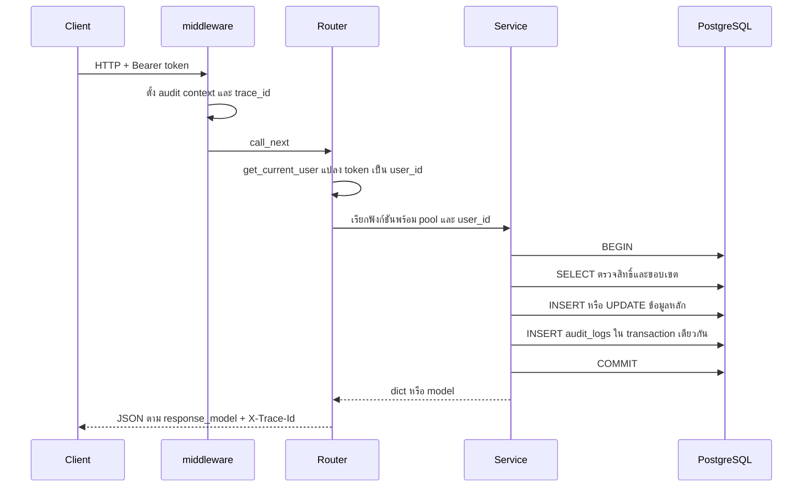

# สถาปัตยกรรมภายใน

บทนี้อธิบายเส้นทางของคำขอหนึ่งครั้ง ตั้งแต่ TCP เข้ามาจนถึงแถวในฐานข้อมูล
และอธิบายงานที่ไม่เกิดจากคำขอ ได้แก่ worker การแจ้งเตือน และการ deploy หลาย replica
อ่านบทนี้ก่อนแก้โค้ดข้ามชั้น เพราะข้อผิดพลาดส่วนใหญ่เกิดจากการข้ามชั้นเพียงจุดเดียว

## ใครใช้บทนี้

นักพัฒนาทุกคนที่ต้องเพิ่ม endpoint, แก้ service หรือเปลี่ยนพฤติกรรมร่วมของทั้งระบบ
ไม่จำเป็นต้องอ่านบทนี้ถ้าเพียงใช้ API

## ภาพรวมโปรเซส

| โปรเซส | จำนวน replica | หน้าที่ |
|---|---|---|
| `backend` | 3 | รับ HTTP ทุก endpoint และเปิด SSE stream |
| `frontend` | 3 | เสิร์ฟไฟล์ SPA ผ่าน Traefik |
| `worker` | 1 | ประมวลผลงานนำเข้า Excel จากคิว `arq:queue:import` |
| `push_worker` | 1 | ส่ง Web Push จากตาราง `push_outbox` |

ทั้งสี่โปรเซสใช้ image `pirivoice-${ENV_NAME}-backend` ยกเว้น frontend
ประกาศไว้ใน `docker-compose.app.yml` และใช้ root `.env` ชุดเดียวกัน

backend ทั้งสาม replica ไม่แชร์หน่วยความจำกัน จึงห้ามเก็บ state ที่ต้องตรงกันไว้ในตัวแปรระดับโมดูล
สถานะที่ต้องแชร์กันอยู่ใน PostgreSQL และ Redis เท่านั้น

## เลเยอร์ของ backend

```
HTTP request
  → main.audit_context_middleware     ตั้ง ip, user-agent, trace_id, endpoint
  → router                            ตรวจ dependency, เรียก service, แปลง exception
  → service                           ตรวจสิทธิ์, เปิด transaction, เขียน SQL, เขียน audit
  → asyncpg pool                      คืน connection เมื่อจบคำขอ
```

กฎที่บังคับใช้

- router ไม่มี SQL และไม่มี business logic
- service รับ `pool: asyncpg.Pool` และไม่รู้จัก `Request`
- model เป็น Pydantic v2 และ router ทุกตัวประกาศ `response_model`
- ตัวตนผู้ใช้มาจาก `get_current_user` เท่านั้น ไม่รับ `user_id` จาก body หรือ query

ข้อยกเว้นของ `response_model` มีสามแบบ และต้องมีคอมเมนต์กำกับทุกครั้ง
คือ ดาวน์โหลดไฟล์ `GET /api/import-student-template`, SSE `GET /api/notifications/stream`
และ `204 No Content` ของ `DELETE /api/bookmarks/{id}`

## ลำดับของคำขอหนึ่งครั้ง



`X-Trace-Id` ถูกใส่ทุก response และตรงกับ `audit_logs.trace_id`
ใช้เมื่อผู้ใช้แจ้งปัญหาพร้อมรหัสจากเบราว์เซอร์

## การสร้างแอปและ lifespan

`main.py` สร้าง `FastAPI` พร้อม `lifespan` ที่ทำห้าอย่างตามลำดับ

1. สร้าง `asyncpg` pool ขนาดต่ำสุด 1 สูงสุด 10
2. เรียก `init_db` สร้างตาราง รัน migration แล้วสร้าง index
3. เรียก `seed_default_users` สร้างบัญชีผู้ดูแลเริ่มต้นถ้ายังไม่มี
4. เปิด SSE hub ด้วย `LISTEN` บน channel ที่กำหนดใน `NOTIFY_CHANNEL`
5. เมื่อปิดแอป ปิด hub ก่อน pool

ลำดับนี้สำคัญ เพราะ `init_db` เป็นผู้สร้าง trigger ที่ยิง `pg_notify`
และ seed ต้องรันหลังตารางมีอยู่แล้ว

`init_db` ทำงานเป็น idempotent ทั้งไฟล์ เรียกซ้ำได้ทุกครั้งที่ backend เริ่ม
แต่ไม่ควรใช้แทน migration เมื่อแก้โครงสร้างตารางบนฐานข้อมูลจริง

## การยืนยันตัวตนก่อนถึง router

`get_current_user` ใน `core/dependencies.py` คืน dict สองรูปแบบ

| ทางเข้า | ผลลัพธ์ |
|---|---|
| `Authorization: Bearer <jwt>` | `{"user_id": int, "is_system": False}` |
| `X-API-Key: <key>` | `{"user_id": None, "is_system": True}` |
| ไม่มีทั้งสอง | 401 `Not authenticated: Bearer Token required` |

JWT ลงนามด้วย `HS256` และมีอายุตาม `ACCESS_TOKEN_EXPIRE_MINUTES` ค่าเริ่มต้น 43200 นาที หรือ 30 วัน
token ไม่มี refresh token และไม่มีรายการเพิกถอน การเปลี่ยนรหัสผ่านจึงไม่ตัด token ที่ออกไปแล้ว

`verify_api_key` ยังอยู่ในไฟล์ แต่ไม่มี router ใดใช้ เพราะ `get_current_user` ตรวจคีย์ให้แล้ว
อย่าเพิ่ม `Depends(verify_api_key)` ซ้อน

## สิทธิ์และขอบเขตข้อมูล

สองอย่างนี้แยกกัน

- `require_permission` และ `require_permission_anywhere` ตอบว่า "มีสิทธิ์หรือไม่"
- `get_access_scope` ตอบว่า "เห็นข้อมูลได้กว้างแค่ไหน"

ครูทั่วไปมี `VIEW_DASHBOARD` เหมือนผู้ดูแล แต่เห็นเฉพาะระดับชั้นของตน
การตรวจสิทธิ์อย่างเดียวจึงไม่พอสำหรับข้อมูลระดับโรงเรียน

รายละเอียดของสิทธิ์ทั้ง 13 ตำแหน่งและตารางสิทธิ์อยู่ใน [การยืนยันตัวตนและสิทธิ์](auth-and-rbac.md)

## Transaction และ audit log

ทุก mutation ที่แตะมากกว่าหนึ่งตารางต้องอยู่ใน `async with conn.transaction()`
และการเขียน audit ต้องอยู่ใน transaction เดียวกัน

```python
async with conn.transaction():
    row = await conn.fetchrow("UPDATE students SET ... WHERE id = $1 RETURNING *", student_id)
    await AuditLogger("student_service").log(
        conn=conn,
        action="UPDATE_STUDENT",
        actor_identifier=str(actor_id),
        client_source="web",
        entity_type="student",
        entity_id=str(student_id),
        old_values=old,
        new_values=new,
    )
```

ถ้าเขียน audit นอก transaction ข้อมูลหลักอาจ rollback แต่ log อยู่ต่อ ทำให้หลักฐานผิด
`AuditLogger` ดึง ip, user-agent, trace_id และเวลาเองจาก contextvar ไม่ต้องส่งจาก router

การอ่านข้อมูลบางประเภทถูกบันทึกแบบ best-effort ผ่าน `audit_service.log_read`
ถ้าเขียน log ไม่ได้ คำขอหลักยังสำเร็จ

## Soft delete

ข้อมูลโดเมนของผู้ใช้ใช้ `UPDATE ... SET deleted_at = NOW()` และทุกคำสั่งอ่านต้องมี `deleted_at IS NULL`
การลืมเงื่อนไขนี้ทำให้ข้อมูลที่ลบแล้วกลับมาแสดง โดยที่เทสต์ปกติอาจไม่จับ

hard delete ใช้ได้เฉพาะแถวชั่วคราวหรือ junction ที่ไม่ต้องเก็บประวัติ

| ตาราง | เหตุผล |
|---|---|
| `push_subscriptions` | ปิดรับแจ้งเตือนแล้วไม่ต้องเก็บอุปกรณ์ |
| `bookmarks` | ยกเลิกบุ๊กมาร์กคือการลบรายการบันทึก |
| `push_outbox` | ตัดแถวเก่าตามอายุเก็บ |
| `issue_countdowns` | ลบเพื่อตั้งกำหนดใหม่ |

ทุกคำสั่ง hard delete ต้องมีเงื่อนไขแคบและผูกกับเจ้าของ

## การแจ้งเตือนในแอปและ SSE

เมื่อ service เพิ่มแถวใน `notifications` ภายใน transaction trigger ของ Postgres จะยิง `pg_notify`
บน channel `piri_notifications` หลัง commit

`notification_stream` ในแต่ละ replica ฟัง channel นี้และส่ง event ไปยังผู้เชื่อมต่อที่ตรงกับ `user_id`
ถ้า hub ไม่ทำงาน เบราว์เซอร์ยังได้ badge จากการ poll ทุก 30 วินาที
ดังนั้น SSE จึงเป็นตัวเร่ง ไม่ใช่เงื่อนไขที่ทำให้ระบบทำงานได้

ข้อจำกัดที่ต้องรู้

- `STREAM_MAX_SUBSCRIBERS` เป็นเพดานต่อหนึ่ง replica ไม่ใช่ทั้งระบบ
- heartbeat ทุก 20 วินาที กัน proxy ตัด connection ที่เงียบ
- การเพิ่ม event ใหม่ต้องส่งผ่านตาราง `notifications` ไม่ใช่เรียก hub ตรง ๆ จาก service

## Web Push

push ไม่ได้ส่งจาก backend ทันที แต่เข้าคิวผ่าน trigger บน `notifications`
เมื่อผู้รับมีอุปกรณ์ลงทะเบียนไว้เท่านั้น

`push_worker` วนลูปทุก `PUSH_TICK_SECONDS` แล้ว claim แถวด้วย `FOR UPDATE SKIP LOCKED`
จึงรันได้หลาย replica โดยไม่ส่งซ้ำ รายละเอียดสถานะ การลองใหม่ และ quiet hours อยู่ใน
[งานเบื้องหลัง การแจ้งเตือน และ push](background-jobs-and-push.md)

## คิวของ worker

คิวสองชุดแยกกันเด็ดขาด

| คิว | ผู้รับ | ผู้ส่ง |
|---|---|---|
| `arq:queue:import` | `workers/import_worker.py` | `import_service.enqueue_import_job` |
| `arq:queue:push` | `workers/push_worker.py` | ARQ cron ของ worker เอง |

ARQ ใช้ชื่อ `arq:queue` เป็นค่าเริ่มต้นเมื่อไม่ตั้ง `queue_name`
ถ้าลืมตั้ง งานจะตกไปถึง worker อีกตัวที่ไม่มีฟังก์ชันนั้น แล้วถูกทิ้งโดย API ยังตอบ 200
มีเทสต์ `tests/test_worker_queue_isolation.py` คุมเรื่องนี้อยู่

## เวลา

ระบบเก็บเวลาเป็น `TIMESTAMPTZ` และแสดงผลเป็น `Asia/Bangkok`
การจัดกลุ่มรายวันในสถิติใช้ `(created_at AT TIME ZONE 'Asia/Bangkok')::date`
ห้ามใช้ `toISOString()` เพื่อแสดงผล เพราะคืน UTC และปี ค.ศ.

## เพิ่มฟีเจอร์หนึ่งอย่างต้องแตะอะไร

1. ตารางและ index ใน `core/init_db.py` พร้อม migration ถ้าฐานข้อมูลจริงมีข้อมูลแล้ว
2. Pydantic schema ใน `models/`
3. service ใหม่หรือฟังก์ชันใหม่ใน `services/` พร้อม transaction และ audit
4. router บาง ๆ ใน `routers/` พร้อม `response_model`
5. ฟังก์ชันเรียก API ใน `frontend/src/services/`
6. type ใน `frontend/src/types/`
7. view หรือ component ใน `frontend/src/views/`
8. route และเมนูใน `frontend/src/router/index.ts` และ `constants/nav.ts`
9. เทสต์ backend ที่ตรวจ DB จริง และเทสต์ frontend ถ้ามีตรรกะในหน้า
10. ภาพหน้าจอในคู่มือ ถ้าผู้ใช้เห็นหน้าจอใหม่

## ข้อจำกัดและข้อควรระวัง

- ไม่มี Redis pub/sub สำหรับแจ้งเตือนในแอป ใช้ Postgres LISTEN/NOTIFY
- ไม่มี WebSocket และไม่มี GraphQL
- ไม่มี service layer ที่เรียกข้ามกันแบบอิสระ ถ้าต้องใช้ร่วมให้แยกเป็นฟังก์ชันใน service ปลายทาง
- backend ทั้งสาม replica ต้องไม่ถือ state ที่ต่างกัน
- `init_db` สร้างตารางแต่ไม่ใช่เครื่องมือแก้ schema บนฐานข้อมูลที่มีข้อมูลแล้ว ให้เขียน migration
- SSE และ push เป็นคนละเส้นทาง ปิดอันหนึ่งไม่กระทบอีกอัน
- การเปลี่ยน `NOTIFY_CHANNEL` ต้องแก้ทั้ง `core/config.py` และ migration 020

## แก้ไขปัญหาและคำถามที่พบบ่อย

**ถาม: เพิ่ม endpoint แล้วได้ 422 ทั้งที่ส่ง JSON ครบ**
ตอบ: ตรวจชื่อฟิลด์และชนิดข้อมูลใน Pydantic schema เพราะ FastAPI ตอบ 422 ก่อนถึง service
ถ้าเป็นวันที่ ให้ส่งรูปแบบที่ schema กำหนด ไม่ใช่สตริงอิสระ

**ถาม: service ทำงานสำเร็จแต่ audit log ไม่มีแถว**
ตอบ: ตรวจว่าเรียก `AuditLogger.log` ด้วย `conn` ตัวเดียวกับ transaction หลัก
และตรวจว่า `action` กับ `actor_identifier` ถูกส่งมา ไม่ใช่ปล่อยเป็นค่าว่าง

**ถาม: หน้าเว็บได้ 401 ทั้งที่ token ยังไม่หมดอายุ**
ตอบ: ตรวจว่า `JWT_SECRET` ตรงกันทุก replica และ token ออกโดย backend ชุดเดียวกัน
ถ้าเพิ่งเปลี่ยนคีย์ ทุก token เดิมใช้ไม่ได้ทันที

**ถาม: ข้อมูลที่ลบแล้วยังแสดงในบางหน้า**
ตอบ: ค้นหา query ที่หน้านั้นใช้ แล้วเติม `deleted_at IS NULL`
ถ้าเป็น query ใหม่ ให้คัดลอกเงื่อนไขจาก query เดิมใน service เดียวกัน

**ถาม: SSE ไม่ส่ง badge แต่ push ยังเข้า**
ตอบ: hub อาจเชื่อม LISTEN ไม่ได้ตอน start ซึ่งไม่ทำให้แอปล่ม
ให้ตรวจ log ของ backend และตรวจว่า channel ตรงกับ migration 020 ระหว่างนั้น badge จะอัปเดตด้วยการ poll

**ถาม: งานนำเข้าค้างที่ QUEUED ไม่มีใครประมวลผล**
ตอบ: ตรวจว่า `worker` รันอยู่ และตั้ง `queue_name` เป็น `arq:queue:import`
ถ้า worker อีกตัวกินงานนี้ งานจะถูกทิ้งโดยไม่มี error ที่ API

**ถาม: เพิ่มตารางใหม่แล้วเทสต์ล้างข้อมูลไม่ครบ**
ตอบ: เพิ่มชื่อตารางใน `_TABLES` ของ `backend/tests/conftest.py`
ที่เดียวคุมทั้งการล้างและการตรวจว่า schema ครบ

**ถาม: ต้องแก้ `docs/system_prompt.md` ไหมเมื่อเพิ่มฟีเจอร์**
ตอบ: แก้เมื่อกฎของโปรเจกต์เปลี่ยน ไม่ใช่ทุกฟีเจอร์
คำอธิบายพฤติกรรมให้อยู่ในคู่มือชุดนี้ และกฎที่บังคับใช้ให้อยู่ใน `docs/rules/`

บทที่เกี่ยวข้อง: [การยืนยันตัวตนและสิทธิ์](auth-and-rbac.md) · [โครงสร้างฐานข้อมูล](database-schema.md) · [งานเบื้องหลัง การแจ้งเตือน และ push](background-jobs-and-push.md) · [มาตรฐานการเขียนโค้ด](coding-standards-rules.md)
