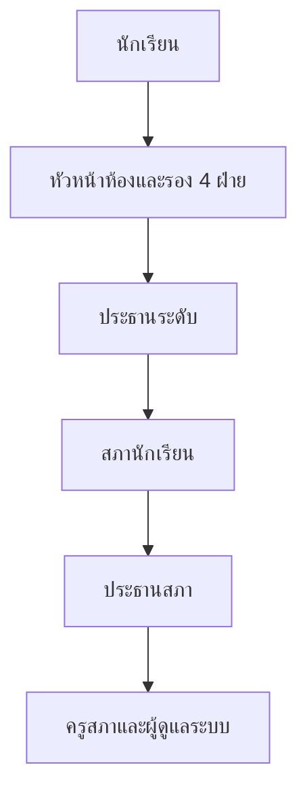

# การยืนยันตัวตนและสิทธิ์

ระบบตอบสองคำถามนี้แยกกัน — "คุณคือใคร" กับ "คุณทำอะไรได้บ้าง"
เวลาแก้ปัญหาสิทธิ์ ส่วนใหญ่เริ่มจากการแยกว่าเป็น 401, 403 หรือแค่เห็นข้อมูลไม่ครบ

- 🪪 **ตัวตน (401)** — token บอกว่าเราเป็นใคร และหมดอายุเมื่อไร
- 🚪 **การอนุญาต (403)** — ตำแหน่งไหนได้สิทธิ์อะไร
- 🔭 **ขอบเขตข้อมูล** — เห็นทั้งโรงเรียน ระดับชั้น หรือแค่ห้องของตัวเอง

## ใครใช้บทนี้

นักพัฒนาที่ต้องเพิ่มสิทธิ์ใหม่ แก้ตำแหน่ง เพิ่มครูเข้าระบบ หรือวินิจฉัยว่าเหตุใดผู้ใช้รายหนึ่งเห็นเมนูไม่เหมือนคนอื่น

## ก่อนเริ่ม

- เปิด `backend/config/roles.json` และ `backend/core/rbac.py` ประกอบ เพราะสองไฟล์นี้เป็นแหล่งความจริง
- เข้าใจว่าระบบไม่มีระบบสมัครสมาชิกเอง ไม่มีการรีเซ็ตรหัสผ่าน และไม่มี 2FA

## สามคำถามที่ต้องแยกให้ออก

| คำถาม | ผู้ตอบ | ผลเมื่อไม่ผ่าน |
|---|---|---|
| ผู้ใช้คือใคร | `get_current_user` | 401 |
| ผู้ใช้มีสิทธิ์ทำสิ่งนี้หรือไม่ | `require_permission` / `require_permission_anywhere` | 403 `Access Denied: …` |
| ผู้ใช้เห็นข้อมูลได้กว้างแค่ไหน | `get_access_scope` / `get_manage_mode` | ไม่เกิด error แต่ได้ข้อมูลน้อยลงหรือว่าง |

ถ้าผู้ใช้ได้ 403 แปลว่าระบบรู้จักตัวตนแล้วแต่ไม่มีสิทธิ์
ถ้าได้ข้อมูลไม่ครบแต่ไม่มี error แปลว่าสิทธิ์ผ่านแต่ขอบเขตแคบ

## การล็อกอินและสิ่งที่ได้กลับมา

1. **กรอกชื่อผู้ใช้และรหัสผ่าน** ที่หน้าเข้าสู่ระบบ
2. **`POST /api/auth/login`** ค้นหาแถวใน `users` ด้วย `username` ที่ยังไม่ถูกลบ
3. **ตรวจรหัสผ่านด้วยแฮช** แล้วออก JWT ที่มี `user_id` เป็น claim
4. **หน้าจอเก็บ token** แล้วแนบเป็น `Authorization: Bearer <token>` ทุกคำขอ
5. **ถ้า `must_change_password` เป็นจริง** ระบบพาไปหน้าบังคับเปลี่ยนรหัสก่อนเข้าหน้าอื่น

ข้อผิดพลาดของ endpoint นี้

| กรณี | สถานะ | ข้อความ |
|---|---|---|
| ไม่พบชื่อผู้ใช้ | 404 | `ไม่พบผู้ใช้` |
| รหัสผ่านผิด หรือบัญชีถูกลบ | 401 | ข้อความกลางของ `HTTPException` จาก `ForbiddenError`/`NotFoundError` ที่ router แปลง |

token อายุ 30 วันตามค่าเริ่มต้น `ACCESS_TOKEN_EXPIRE_MINUTES=43200`
ไม่มี refresh token และไม่มีรายการเพิกถอนกลาง การเปลี่ยนรหัสผ่านจึงไม่ตัด session ที่เปิดค้างอยู่
ถ้าต้องการตัดผู้ใช้ทุกคนพร้อมกัน ทางเดียวคือเปลี่ยน `JWT_SECRET` แล้ว redeploy

::: warning token เพิกถอนรายใบไม่ได้
บัญชีที่หลุดจึงใช้ได้ต่อจนกว่าจะหมดอายุ 30 วัน ทางเดียวที่ตัดได้ทันทีคือเปลี่ยน `JWT_SECRET` แล้ว redeploy ซึ่งเตะทุกคนออกพร้อมกัน
:::

## บทบาททั้ง 13 ตำแหน่ง

ตำแหน่งเก็บใน `students.class_role` และสิทธิ์เพิ่มเติมเก็บใน `students.permissions` ซึ่งเป็น JSONB อาร์เรย์

| รหัส | `is_admin` | สิทธิ์จาก `roles.json` |
|---|---|---|
| `student` | ไม่ | `SUBMIT_ISSUE` `VIEW_OWN_ISSUES` |
| `class_president` | ไม่ | `RECEIVE_ISSUES` `MANAGE_ISSUE_STEPS` `SET_COUNTDOWN` `ESCALATE_ISSUE` `VIEW_LEVEL_PYRAMID` |
| `vice_academic` | ไม่ | เหมือนหัวหน้าห้อง |
| `vice_discipline` | ไม่ | เหมือนหัวหน้าห้อง |
| `vice_activity` | ไม่ | เหมือนหัวหน้าห้อง |
| `vice_reception` | ไม่ | เหมือนหัวหน้าห้อง |
| `level_president` | ไม่ | เพิ่ม `MANAGE_STUDENTS` |
| `level_vice_president` | ไม่ | เพิ่ม `MANAGE_STUDENTS` |
| `council_member` | ไม่ | เพิ่ม `VIEW_DASHBOARD` `MANAGE_ANNOUNCEMENTS` |
| `council_president` | ใช่ | ชุดของผู้ดูแลระบบทั้งหมด |
| `teacher_council` | ใช่ | ชุดของผู้ดูแลระบบทั้งหมด |
| `admin` | ใช่ | ชุดของผู้ดูแลระบบทั้งหมด |
| `teacher` | ไม่ | `MANAGE_STUDENTS` `VIEW_DASHBOARD` |

ชุดของผู้ดูแลระบบประกอบด้วย `MANAGE_STUDENTS` `VIEW_DASHBOARD` `MANAGE_SETTINGS` `VIEW_AUDIT_LOG`
`MANAGE_ANNOUNCEMENTS` `MANAGE_EVENTS`

`council_member` เป็นกรณีเดียวที่ `is_admin` เป็นเท็จแต่ยังได้ขอบเขต `all`
เพราะสิทธิ์ `VIEW_DASHBOARD` ไม่มีประโยชน์ถ้าเห็นได้เพียงห้องเดียว
แต่การเป็น `is_admin` เท็จทำให้ยังไม่ผ่านด่านของ `require_permission_anywhere` ที่ใช้สิทธิ์ระดับผู้ดูแล

## สิทธิ์ที่ใช้ในโค้ด

| สิทธิ์ | ใช้กับ |
|---|---|
| `SUBMIT_ISSUE` | ส่งเรื่องใหม่ |
| `VIEW_OWN_ISSUES` | ดูเรื่องที่ตัวเองแจ้ง |
| `RECEIVE_ISSUES` | กดรับเรื่องเข้าคิวของตัวเอง |
| `MANAGE_ISSUE_STEPS` | เพิ่มและปิดขั้นตอน |
| `SET_COUNTDOWN` | ตั้งกำหนดนับถอยหลัง |
| `ESCALATE_ISSUE` | ส่งต่อขึ้นระดับสูงกว่า |
| `VIEW_LEVEL_PYRAMID` | เห็นเรื่องในระดับของตัวเอง |
| `MANAGE_STUDENTS` | แก้ข้อมูลนักเรียน ย้ายห้อง นำเข้า |
| `VIEW_DASHBOARD` | เปิดแดชบอร์ด |
| `MANAGE_ANNOUNCEMENTS` | สร้างและแก้ประกาศ |
| `MANAGE_EVENTS` | สร้างและแก้กิจกรรม |
| `MANAGE_SETTINGS` | ตั้งค่าช่วงเวลาไม่ส่งแจ้งเตือน |
| `VIEW_AUDIT_LOG` | เปิดบันทึกการใช้งาน |

ชื่อสิทธิ์ต้องตรงตัวพิมพ์ทุกตัวอักษร เพราะ `require_permission` เทียบสตริงตรง
การพิมพ์ `manage_students` ตัวเล็กจะไม่ผ่านและตอบ 403 โดยไม่มีเบาะแสว่าพิมพ์ผิด

## วิธีตรวจสิทธิ์สองแบบ

`require_permission(conn, room_id, user_id, permission)` ตรวจสิทธิ์ในห้องที่ระบุ
ใช้เมื่อการกระทำผูกกับห้องหรือเรื่องที่มีห้องกำกับ

`require_permission_anywhere(conn, user_id, permission)` ตรวจสิทธิ์จากทุกแถวที่ผู้ใช้ถืออยู่
ใช้เมื่อการกระทำไม่ผูกห้อง เช่น การเปิดแดชบอร์ดหรือการสร้างประกาศ

ทั้งสองแบบข้ามการตรวจเมื่อผู้ใช้เป็น `SUPER_ADMIN_ID` หรือมี `is_admin` เป็นจริง
`SUPER_ADMIN_ID` ตั้งใน `.env` ค่าเริ่มต้นคือ `0` ซึ่งหมายถึงปิดการใช้งาน

ข้อความเมื่อไม่ผ่าน

- 🚫 **ไม่มีแถวสมาชิกที่ยังใช้งาน** — `Access Denied: ไม่พบข้อมูลของคุณ`
- 🚫 **มีแถวแต่ไม่มีสิทธิ์** — `Access Denied: คุณไม่มีสิทธิ์ '<ชื่อสิทธิ์>'`

ความต่างของสองข้อความมีประโยชน์ตอนวินิจฉัย
แบบแรกหมายถึงบัญชียังไม่ผูกกับปีการศึกษาหรือห้องใด แบบที่สองหมายถึงผูกแล้วแต่ตำแหน่งไม่พอ

## ขอบเขตข้อมูลห้าระดับ

`get_access_scope(conn, user_id)` คืน dict ที่มี `scope`, `level`, `is_admin`
ลำดับการตรวจคือ super → แถวสมาชิกทั้งหมด → เงื่อนไขทีละแถว

| ขอบเขต | ได้มาเมื่อ | เห็นอะไร |
|---|---|---|
| `super` | `user_id` ตรงกับ `SUPER_ADMIN_ID` ที่ไม่ใช่ `0` | ทุกอย่าง |
| `all` | มีแถว `is_admin` หรือตำแหน่งอยู่ใน `SCOPE_ALL_ROLES` คือ `admin` `teacher_council` `council_president` | ทั้งโรงเรียน |
| `all` | ตำแหน่งเป็น `council_member` (แยกเงื่อนไข ไม่ได้ `is_admin`) | ทั้งโรงเรียน แต่ยังไม่ผ่านด่านผู้ดูแล |
| `level` | ตำแหน่งเป็น `teacher` และมี `staff_level` | เฉพาะห้องในระดับชั้นนั้น |
| `none` | ตำแหน่งเป็น `teacher` แต่ยังไม่มี `staff_level` | ไม่มีขอบเขตข้อมูล |
| `pyramid` | ไม่เข้าเงื่อนไขใดเลย รวมถึงกรณีไม่มีแถวสมาชิก | เห็นตามสายงานของตัวเอง |

`none` ถูกเพิ่มเพื่อปิดช่องรั่วเดิมที่ครูไม่มีระดับชั้นตกไปเป็น `pyramid` แล้วแดชบอร์ดแปลงเป็น `all`
ถ้าเพิ่มตำแหน่งใหม่แล้วลืมใส่ในรายการที่เกี่ยวข้อง ผู้ใช้จะเห็นน้อยลง ไม่ใช่เห็นมากขึ้น

แถวที่ `status` ไม่ใช่ `active` ถูกข้ามในการคำนวณขอบเขต แต่ `is_admin` คำนวณจากทุกแถวที่ active

## โหมดจัดการ

`get_manage_mode` ตอบคำถามต่างจาก `get_access_scope` คือ "หน้านี้ควรแสดงเครื่องมือจัดการแบบใด"

- 🏫 **`school`** — ผู้ดูแลระบบ ครูสภานักเรียน ประธานสภา ตาม `SCHOOL_WIDE_MANAGE_ROLES`
- 👩‍🏫 **`teacher`** — ครูที่มีระดับชั้น
- 🏷️ **`level`** — ประธานระดับและรองประธานระดับ
- ⬜ **`none`** — ที่เหลือ

ลำดับความสำคัญของตำแหน่งจัดการอยู่ใน `MANAGE_RANK` ตัวเลขสูงจัดการได้มากกว่า
และจัดการได้เฉพาะคนที่มีอันดับไม่เกินตัวเอง

- **0** — `student`
- **1** — หัวหน้าห้องและรองทั้งสี่ฝ่าย
- **2** — ประธานระดับและรองประธานระดับ
- **3** — `council_member`
- **4** — `council_president`

`SCHOOL_WIDE_MANAGE_ROLES` ข้ามทั้งอันดับและระดับชั้น แต่ `council_member` ไม่อยู่ในชุดนี้
จึงไม่สามารถแก้ข้อมูลนักเรียนได้แม้จะเห็นทั้งโรงเรียน
ห้ามใช้ `is_admin` แทนอันดับ เพราะ `is_admin` ไม่บอกลำดับชั้นภายในสภา

## พีระมิดการส่งต่อ

การส่งต่อต้องผ่าน `ESCALATE_ISSUE` และระดับปลายทางต้องสูงกว่าปัจจุบัน
ผู้รับปลายทางต้องมีแถวสมาชิกในปีการศึกษาปัจจุบัน ไม่งั้นเรื่องจะค้างที่ผู้รับที่ไม่มีอยู่

## ขั้นตอนเปลี่ยนสิทธิ์ของผู้ใช้หนึ่งคน

**ทางเข้า:** **สมาชิก** ➔ ค้นหาชื่อหรือรหัสนักเรียน ➔ เปิดแถวของคนนั้น ➔ เปลี่ยน **ตำแหน่ง** ➔ เพิ่มหรือถอดสิทธิ์ในช่องสิทธิ์เพิ่มเติมถ้าจำเป็น ➔ บันทึก แล้วให้ผู้ใช้รีเฟรชหน้าจอ

สิทธิ์ถูกอ่านจากฐานข้อมูลทุกครั้งที่เรียก `require_permission` ไม่ได้เก็บใน token
ผู้ใช้จึงได้สิทธิ์ใหม่ทันทีโดยไม่ต้องล็อกอินใหม่ แต่เมนูบนหน้าจอคำนวณตอนโหลดหน้า

::: tip เปลี่ยนสิทธิ์แล้วไม่ต้องให้ล็อกอินใหม่
สิทธิ์อ่านสดจากฐานข้อมูลทุกคำขอ แค่ให้ผู้ใช้รีเฟรชหน้าจอหนึ่งครั้ง เมนูก็จะตรงกับสิทธิ์ใหม่
:::

## ขั้นตอนเพิ่มครูเข้าสู่ระบบ

ครูต้องมีสองอย่างพร้อมกัน คือบัญชีใน `users` และแถวใน `students` ที่ผูกกับปีปัจจุบันและมี `staff_level`

1. **สร้างบัญชี** ด้วยรหัสผ่านชั่วคราว
2. **สร้างแถวสมาชิก** พร้อม `class_role` เป็น `teacher`
3. **ใส่ `staff_level`** เป็นระดับชั้นที่ดูแล
4. **ให้ครูเปลี่ยนรหัสผ่าน** เมื่อล็อกอินครั้งแรก

ถ้าใส่ `class_role` เป็น `teacher` แต่ไม่ใส่ `staff_level` ครูจะได้ขอบเขต `none`
และเห็นแดชบอร์ดว่างพร้อมข้อความให้ติดต่อผู้ดูแลระบบ

## ระบบทำอะไรเบื้องหลัง

- token เป็น JWT อัลกอริทึม `HS256` ลงนามด้วย `JWT_SECRET` จาก `.env`
- คำขอล็อกอินที่ล้มเหลวถูกบันทึกเป็น `action='login'` และ `status='error'`
- การล็อกอินสำเร็จถูกบันทึกเป็น `status='success'` และเป็นแหล่งข้อมูลของสถิติการใช้งาน
- `X-API-Key` ให้ตัวตนแบบ `is_system=True` ที่ `user_id` เป็นค่าว่าง ใช้กับงานระบบเท่านั้น
- `roles.json` ถูกโหลดครั้งเดียวและแคชไว้ในโปรเซส การแก้ไฟล์ต้อง restart backend ทุก replica
- การตรวจสิทธิ์อ่านจาก `students.permissions` ซึ่งเป็น JSONB ไม่ใช่ตารางแยก
- การลบสมาชิกคือการตั้ง `deleted_at` แถวยังอยู่ในประวัติและไม่ถูกนับในสิทธิ์อีก
- `change-password` ปฏิเสธการตั้งรหัสใหม่ให้เหมือนรหัสเดิมด้วยสถานะ 400

## ข้อจำกัดและข้อควรระวัง

- ไม่มีการรีเซ็ตรหัสผ่านเอง และไม่มีหน้าจอให้ผู้ดูแลตั้งรหัสผ่านใหม่จาก UI
- ไม่มี 2FA ไม่มี OTP และไม่มีการยืนยันทางอีเมล
- token เพิกถอนรายใบไม่ได้ ต้องรอหมดอายุหรือเปลี่ยนคีย์ทั้งระบบ
- ไม่มีระบบสิทธิ์รายห้องแบบละเอียด สิทธิ์ผูกกับตำแหน่งและระดับชั้น
- `SUPER_ADMIN_ID` อยู่ใน `.env` ไม่ใช่ในฐานข้อมูล การเปลี่ยนต้อง redeploy
- การแก้ `roles.json` ไม่มีผลจนกว่า backend ทุก replica จะ restart
- ชื่อสิทธิ์ผิดตัวพิมพ์จะได้ 403 โดยไม่บอกสาเหตุที่แท้จริง
- ผู้ใช้ที่ไม่มีแถวในปีการศึกษาปัจจุบันจะไม่เห็นเมนูเจ้าหน้าที่แม้ตำแหน่งเดิมจะสูง
- การเปลี่ยน `class_role` ไม่ได้ล้าง `permissions` เดิม ผู้ใช้จึงอาจถือสิทธิ์ค้างจากตำแหน่งก่อน

## ติดปัญหาตรงไหน? ดูวิธีแก้ตรงนี้เลย

**Q: ผู้ใช้ล็อกอินได้แต่ทุกหน้าได้ 403 ไม่พบข้อมูลของคุณ?**

👉 **วิธีแก้:** บัญชีมีใน `users` แต่ไม่มีแถวใน `students` ที่ยังใช้งาน ให้เปิดหน้า **สมาชิก** ตรวจว่ามีรายชื่อในปีที่ตั้งเป็นปัจจุบัน แล้วจึงตรวจตำแหน่ง

**Q: เปลี่ยนตำแหน่งแล้วเมนูไม่เปลี่ยน?**

👉 **วิธีแก้:** สิทธิ์มีผลทันทีแต่เมนูคำนวณตอนโหลดหน้า ให้รีเฟรชหน้าจอหนึ่งครั้ง ถ้ายังไม่เปลี่ยน ให้ตรวจว่าผู้ใช้มีแถวในปีปัจจุบันหรือไม่

**Q: ครูเปิดแดชบอร์ดแล้วขึ้นว่าให้ติดต่อผู้ดูแลระบบ?**

👉 **วิธีแก้:** บัญชีเป็นครูที่ยังไม่มี `staff_level` จึงได้ขอบเขต `none` ให้ใส่ระดับชั้นในแถวสมาชิกของครูคนนั้น แล้วให้รีเฟรชหน้าจอ

**Q: ต้องการให้ผู้ใช้รายหนึ่งเห็นเรื่องทุกห้องโดยไม่เป็นผู้ดูแลระบบ?**

👉 **วิธีแก้:** ระบบไม่มีสิทธิ์แบบนั้นแยกจากตำแหน่ง ทางที่ทำได้คือให้ตำแหน่งที่ได้ขอบเขต `all` เช่น `council_member` ซึ่งได้สิทธิ์อื่นตามมาด้วย

**Q: เพิ่มสิทธิ์ใหม่ใน `roles.json` แล้วยังไม่ได้ผล?**

👉 **วิธีแก้:** ไฟล์ถูกแคชในโปรเซส ให้ restart backend ทุก replica และตรวจว่ามีโค้ดเรียก `require_permission` ด้วยชื่อสิทธิ์นั้นจริง การเพิ่มในไฟล์อย่างเดียวไม่ทำให้เกิดการตรวจ

**Q: ลืมรหัสผ่าน ต้องทำอย่างไร?**

👉 **วิธีแก้:** ระบบยังไม่มีฟีเจอร์ลืมรหัสผ่าน และไม่มี endpoint ให้ผู้ดูแลตั้งรหัสแทน ตอนนี้ต้องแก้ที่ฐานข้อมูลหรือให้ผู้พัฒนารันสคริปต์ตั้งรหัสให้ แล้วแจ้งผู้ใช้ให้เปลี่ยนทันที

**Q: token ยังไม่หมดอายุแต่ระบบให้ล็อกอินใหม่?**

👉 **วิธีแก้:** มักเกิดจาก `JWT_SECRET` ถูกเปลี่ยน หรือผู้ใช้ถูกลบและสร้างใหม่จน `user_id` เปลี่ยน ให้ตรวจ log ของ backend และตรวจว่าแถว `users` ยังไม่ถูกลบ

**Q: ถอดตำแหน่งแล้วผู้ใช้ยังทำอะไรได้อยู่?**

👉 **วิธีแก้:** ตรวจช่องสิทธิ์เพิ่มเติมในแถวสมาชิก เพราะ `permissions` ไม่ได้ถูกล้างอัตโนมัติเมื่อเปลี่ยนตำแหน่ง ให้ถอดรายการที่ค้างออกแล้วบันทึกใหม่

บทที่เกี่ยวข้อง: [สถาปัตยกรรมภายใน](architecture-internals.md) · [API Reference](api-reference.md) · [จัดการผู้ใช้ บทบาท และสิทธิ์](../3-admin-guide/user-and-role-management.md)
