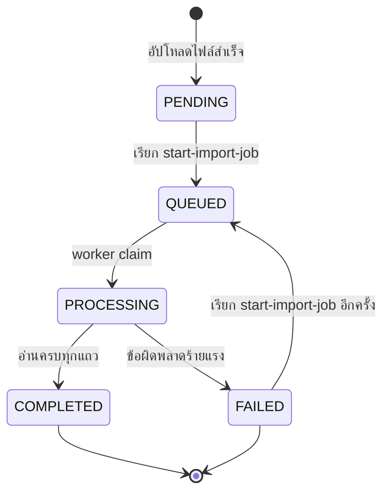
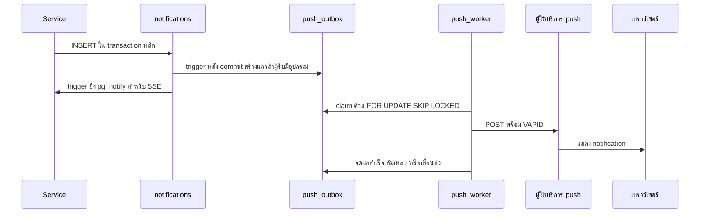

# งานเบื้องหลัง การแจ้งเตือน และ push

งานที่ไม่ได้เกิดจากคำขอตรงๆ อย่าง import Excel, push และ badge สด มีจังหวะของตัวเอง
อ่านบทนี้แล้วจะรู้ว่าอะไรวิ่งอยู่ที่ไหน และทำไมบางคนถึงไม่ได้รับแจ้งเตือน

- 📥 **คิวสองชุดแยกกันเด็ดขาด** — import กับ push ห้ามใช้คิวร่วมกัน
- 🔔 **push มีด่านสองชั้น** — ไม่มีอุปกรณ์หรือปิดกลุ่มไว้ ก็ไม่เข้าคิวเลย
- ⚡ **badge สดผ่าน SSE** — หลุดเมื่อไรก็ถอยไป poll ทุก 30 วินาที

## ใครใช้บทนี้

บทนี้สำหรับคนที่ดูแล worker และการแจ้งเตือน รวมถึงผู้ดูแลระบบเทคนิคที่ต้องตรวจว่าคิวยังทำงานอยู่
ควรอ่าน [สถาปัตยกรรมภายใน](architecture-internals.md) กับ [โครงสร้างฐานข้อมูล](database-schema.md) มาก่อนนะ

## ก่อนเริ่ม

- เปิด `core/config.py` ประกอบ เพราะค่าความถี่ ขนาด batch และอายุของงานอยู่ในไฟล์นี้ทั้งหมด
- จำไว้ว่าระบบมีช่องทางแจ้งเตือนสามช่องที่ทำงานแยกกัน
- จำไว้ว่าคิวของ import กับคิวของ push ต้องแยกกันเด็ดขาด

| ช่องทาง | ใครรอ | กลไก | ถ้าล่ม |
|---|---|---|---|
| ข้อมูลในแอป | ผู้ใช้ที่เปิดแอป | แถวใน `notifications` | ไม่มีข้อมูล |
| badge สด | ผู้ใช้ที่เปิดแอปค้างไว้ | `LISTEN/NOTIFY` แล้วส่งผ่าน SSE | กลับไปช้า 30 วินาที |
| push | ผู้ใช้ที่ปิดแอป | ตาราง `push_outbox` และ worker | ไม่มี push แต่ข้อมูลในแอปยังครบ |

## คิวสองชุดที่ห้ามปนกัน

| คิว | ผู้รับ | ผู้ส่ง | เหตุผลที่แยก |
|---|---|---|---|
| `arq:queue:import` | `workers/import_worker.py` | `services/import_service.enqueue_import_job` | งานนานและต้องทีละงาน |
| `arq:queue:push` | `workers/push_worker.py` | ARQ cron ของ worker เอง | ต้องไม่ถูกงาน import บล็อก |

ชื่อคิวถูกนิยามที่ `core/queues.py` ที่เดียว และมีเทสต์ `tests/test_worker_queue_isolation.py` คุมไว้

::: warning ตั้ง `queue_name` ไม่ครบ งานหายเงียบ
ARQ ใช้ `arq:queue` เป็นชื่อเริ่มต้นเมื่อไม่ตั้ง `queue_name`
ถ้าตั้งไม่ครบ งานจะตกไปถึง worker อีกตัวที่ไม่มีฟังก์ชันนั้น แล้วถูกทิ้งโดย API ยังตอบ 200
:::

### ถ้าต้องการเพิ่มงานเบื้องหลังชนิดใหม่

1. **เขียนฟังก์ชันใน `services/`** ที่รับ `pool` และ `job_id` ไม่รับ `Request`
2. **เปิด `audit_scope` ใน worker** ด้วย endpoint ขึ้นต้นด้วย `arq:` เพื่อให้ audit มี `trace_id`
3. **เพิ่มชื่อคิวใน `core/queues.py`** ถ้าเป็นงานกลุ่มใหม่ แล้วตั้ง `queue_name` ทั้งฝั่งผู้ส่งและผู้รับ
4. **ตั้ง `max_jobs` ตามลักษณะงาน** ถ้างานสร้างข้อมูลที่ชนกันได้ให้ใช้ `1`
5. **ตั้ง `job_timeout` ให้มากกว่าเวลาทำงานจริง** และตั้ง `max_tries = 1` ถ้าฟังก์ชันจดสถานะล้มเหลวเอง
6. **เพิ่ม service ของ worker ใน `docker-compose.app.yml`** และผูก volume ถ้าต้องอ่านไฟล์
7. **เขียนเทสต์** ที่ยืนยันว่าผู้ส่งกับผู้รับใช้ชื่อคิวเดียวกัน

## งานนำเข้านักเรียน

### ลำดับสถานะ

`PENDING` และ `FAILED` เป็นสถานะที่เริ่มงานได้ ส่วน `QUEUED` และ `PROCESSING` เริ่มซ้ำไม่ได้
ระบบตอบ 409 พร้อมชื่อสถานะปัจจุบันถ้าพยายามเริ่มงานที่ยังค้างอยู่

### ขั้นตอนที่ระบบทำ

1. **รับไฟล์** — `POST /api/upload-student-excel` ตรวจนามสกุลและขนาดไฟล์ตาม `IMPORT_FILE_SIZE_LIMIT_MB` คือ 10 MB
2. **เช็คจำนวนแถว** — ต้องไม่เกิน `IMPORT_MAX_ROWS` คือ 5,000 แถว
3. **เก็บไฟล์** — ไว้ใน `IMPORT_STORAGE_DIR` ซึ่ง backend และ worker ใช้ volume เดียวกัน
4. **สร้างงาน** — แถวใน `student_import_jobs` สถานะ `PENDING` พร้อม audit `UPLOAD_IMPORT_EXCEL`
5. **เริ่มงาน** — `POST /api/start-import-job/{job_id}` ล็อกแถว ตรวจสิทธิ์และสถานะ แล้วตั้ง `QUEUED`
6. **ส่งเข้าคิว** — ผู้ส่งต้องเรียก `enqueue_job` พร้อม `_queue_name=IMPORT_QUEUE` ถ้า Redis ล้มจะ rollback กลับสถานะเดิมและตอบ 503
7. **ประมวลผล** — worker ตั้ง `PROCESSING` แล้วอ่านทีละ `IMPORT_BATCH_SIZE` คือ 50 แถว
8. **ข้ามแถวที่ผิด** — แถวที่ผิดถูกบันทึกใน `error_logs` แล้วข้ามไป ไม่ทำให้ทั้งไฟล์ล้ม
9. **จบงาน** — เขียน `COMPLETED` หรือ `FAILED` พร้อม audit `COMPLETE_IMPORT_JOB` หรือ `FAIL_IMPORT_JOB`
10. **เก็บกวาด** — งาน `COMPLETED` ลบไฟล์ทิ้ง ส่วนงาน `FAILED` เก็บไฟล์ไว้ให้เริ่มใหม่ได้

### รหัสผ่านเริ่มต้น

ถ้าไม่ได้ระบุรหัสผ่านหรือระบุเป็น `1234` ระบบใช้รหัสนักเรียนเป็นรหัสผ่านเริ่มต้น
ผู้ใช้ต้องเปลี่ยนรหัสเมื่อล็อกอินครั้งแรกเพราะ `must_change_password` เป็นจริง

### การกู้งานค้าง

เมื่อ worker เริ่มทำงาน จะเรียก `recover_stuck_jobs`
งานที่ค้างใน `PROCESSING` หรือ `QUEUED` นานเกิน `IMPORT_RECOVERY_STALE_MINUTES` คือ 35 นาที
จะถูกตั้งกลับเป็น `QUEUED` แล้วยิงเข้าคิวใหม่ พร้อม audit `RECOVER_IMPORT_JOB`

ค่ากู้ต้องมากกว่าเวลางานปกติ แต่ไม่ควรเกินหนึ่งชั่วโมง เพราะครูจะรอโดยไม่เห็นความคืบหน้า

### สิทธิ์ที่ใช้เริ่มงาน

- ครูที่ยังไม่มีระดับชั้นเริ่มงานไม่ได้ และได้ 403 `คุณยังไม่มีระดับชั้นที่รับผิดชอบ — ไม่สามารถเริ่มงานนำเข้าได้`
- ครูระดับชั้นเริ่มได้เฉพาะงานที่ `allowed_level` ตรงกับระดับของตัวเอง
  ถ้าไม่ตรงจะได้ 403 `งานนี้ไม่ใช่ระดับชั้นของคุณ — ไม่สามารถเริ่มได้`
- ผู้ดูแลระบบเริ่มได้ทุกงาน

## การส่ง Web Push

### เส้นทางของแจ้งเตือนหนึ่งรายการ

### ประตูสองชั้นก่อนเข้าคิว

แถวใน `push_outbox` ถูกสร้างโดย trigger ไม่ใช่โดย service
ประตูทั้งสองอยู่ในฟังก์ชัน `push_outbox_enqueue()` ที่นิยามใน migration 018 และถูกแทนที่ใน 019

| ด่าน | เงื่อนไข | ผล |
|---|---|---|
| เปิดรับกลุ่มนี้หรือไม่ | `notification_preferences` ของผู้รับ | service กรองก่อน insert |
| มีอุปกรณ์หรือไม่ | มีแถวใน `push_subscriptions` | ไม่มี = ไม่เข้าคิวเลย |
| ทะลุ quiet hours หรือไม่ | `notifications.bypass_quiet_hours` | อ่านตอนส่ง ไม่ใช่ตอนเข้าคิว |

ด่านอุปกรณ์ทำให้คนที่ไม่ได้เปิด push ไม่สร้างแถวรอในคิว
การเพิ่มด่านประเภทนี้ต้องตัดสินจากข้อมูลในฐานข้อมูลเท่านั้น ถ้าต้องอ่าน env หรือเวลา ให้อยู่ใน `push_service`

### รอบการส่ง

| ค่า | ค่าเริ่มต้น | ความหมาย |
|---|---|---|
| `PUSH_TICK_SECONDS` | 5 | ระยะที่ลูปลำเลียงตื่น |
| `PUSH_BATCH_SIZE` | 100 | จำนวนแถวต่อการ claim หนึ่งครั้ง |
| `PUSH_DRAIN_SECONDS` | 45 | งบเวลาต่อการระบายหนึ่งรอบ |
| `PUSH_SEND_CONCURRENCY` | 20 | จำนวนคำขอที่ยิงพร้อมกัน |
| `PUSH_MAX_ATTEMPTS` | 5 | จำนวนครั้งสูงสุดก่อนยอมแพ้ |
| `PUSH_MAX_AGE_MINUTES` | 15 | อายุสูงสุดของแจ้งเตือนที่ยังส่ง |
| `PUSH_RECOVER_MINUTES` | 5 | เกณฑ์กู้แถวที่ถูก claim ค้าง |
| `PUSH_RETENTION_DAYS` | 7 | อายุของแถวที่จบแล้วก่อนลบ |
| `PUSH_TTL_SECONDS` | 3600 | อายุของ push ที่ผู้ให้บริการถือ |
| `PUSH_URGENCY` | `high` | ค่าตาม RFC 8030 |

ตัวกำหนดจังหวะส่งจริงคือลูปใน `workers/push_worker.py` ที่ตื่นทุก `PUSH_TICK_SECONDS`
ไม่ใช่ ARQ cron เพราะ cron ของ ARQ เคยยิงไม่ตรงนัดเมื่อ heartbeat ห่าง
cron ทุกวินาทีที่ 0 20 และ 40 ยังอยู่เพื่อเป็นตาข่ายกันลูปตาย
ส่วนงานลบแถวเก่ารันวันละครั้งตอนตีสาม

`drain` ระบายคิวจนว่างหรือจนหมดงบเวลา แล้วหยุดเองก่อน `job_timeout` คือ 120 วินาที
ถ้าเห็น log ว่าระบายไม่ทันบ่อยครั้ง แปลว่าคิวโตเกินกำลังส่ง ไม่ใช่ค่าตั้งผิดเพียงอย่างเดียว

::: tip เพิ่ม replica ของ `push_worker` ได้เลย
เพราะ `_claim` ใช้ `FOR UPDATE SKIP LOCKED` หลายโปรเซสจึงช่วยกันส่งได้โดยไม่ส่งซ้ำ
เพิ่มเมื่อคิวโตถาวร ไม่ใช่เพราะ worker ตาย
:::

### การจองแถว

`_claim` ใช้ `FOR UPDATE SKIP LOCKED` ใน transaction สั้น แล้ว commit ก่อนยิง HTTP
จึงรันได้หลายโปรเซสโดยไม่ส่งซ้ำ และไม่ถือ connection ระหว่างรอผู้ให้บริการตอบ

ห้ามย้ายการยิง HTTP เข้าไปใน transaction ของ claim เพราะจะกิน connection ของ pool ที่ backend ใช้ร่วมกัน

### ผลลัพธ์ของแต่ละคำขอ

| สถานะจากผู้ให้บริการ | ผล | สิ่งที่ระบบทำ |
|---|---|---|
| 200–299 | `ok` | ปิดแถว และตั้ง `last_success_at` |
| 404 หรือ 410 | `gone` | ลบ subscription แล้วปิดแถว |
| 429 | `retry` | เลื่อนส่งตาม backoff |
| 4xx อื่น | `permanent` | ปิดแถว ไม่ลองซ้ำ |
| 5xx หรือ timeout | `retry` | เลื่อนส่งตาม backoff |

คนเดียวอาจมีหลายอุปกรณ์
ถ้าสำเร็จอย่างน้อยหนึ่งเครื่อง ระบบถือว่าจบ เพราะข้อมูลในแอปยังครบทุกเครื่อง
ถ้าล้มเหลวทั้งหมดและมีตัวที่ลองใหม่ได้ ระบบเลื่อนส่งทั้งแถว

### การลองใหม่และการยอมแพ้

ระยะรอคำนวณจาก `30 × 2^attempts` วินาที และมีเพดานที่ 1 ชั่วโมง
เมื่อครบ `PUSH_MAX_ATTEMPTS` แถวถูกปิดด้วย `last_error` ที่ลงท้ายด้วย `max-attempts`
และถูกนับในตัวนับ `dropped` ซึ่งหมายถึง push ที่หายถาวร

แถวที่ถูกปิดเพราะ `max-attempts` ไม่ได้แปลว่าข้อมูลในแอปหาย
เพราะแถวใน `notifications` ยังอยู่ครบ

### แถวที่ถูกทิ้ง

| สาเหตุ | `last_error` | ตัวนับ | ผู้ใช้ยังเห็นในแอป |
|---|---|---|---|
| ไม่ได้ตั้ง VAPID | `vapid-not-configured` | `skipped` | เห็น |
| ไม่มีอุปกรณ์ | ไม่มี | `skipped` | เห็น |
| เก่าเกิน `PUSH_MAX_AGE_MINUTES` | `stale` | `stale` | เห็น |
| อยู่ใน quiet hours | `quiet-hours` | `quiet` | เห็น |
| ลองครบจำนวนครั้ง | ลงท้าย `max-attempts` | `dropped` | เห็น |

`stale` และ `dropped` คือของที่หายถาวร ให้ถือเป็นสัญญาณเตือน ไม่ใช่สถิติปกติ
ส่วน `quiet` เป็นพฤติกรรมที่ตั้งใจให้เป็นแบบนี้ จึงบันทึกเป็นระดับ INFO

### ปลายทางเมื่อผู้ใช้กด push

ระบบคำนวณ `data.url` จากกติกาเดียวกับปุ่มในแอป เรียงตามลำดับนี้

1. **คิวรายงาน** — กลุ่ม `report` ชนิด `report_new` ไปที่ `/app/boards/reports`
2. **บอร์ดปลายทาง** — กลุ่ม `report` ชนิดอื่นที่มี `board_id` ไปที่บอร์ดนั้น
3. **หน้าแรก** — กลุ่ม `announcement` ไปที่ `/app/home` ซึ่งแสดงตัวประกาศ
4. **กิจกรรม** — กลุ่ม `event` ที่มี `entity_id` ไปที่ `/app/events/{id}` ไม่มีก็ไปที่รายการกิจกรรม
5. **รายละเอียดเรื่อง** — `entity_type` เป็น `issue` ที่มี `entity_id` ไปที่หน้ารายละเอียดเรื่อง
6. **ค่าสำรอง** — ที่เหลือถ้ามี `board_id` ไปที่บอร์ดนั้น ไม่มีก็ไปที่ `/app/notifications`

การสลับลำดับจะเปลี่ยนพฤติกรรมของผู้ใช้โดยที่เทสต์ที่ตรวจเพียงว่ามี URL จะไม่จับได้
เมื่อเพิ่มกลุ่มใหม่ ต้องนิยามปลายทางทั้งใน `_deep_link_url` และใน `deepLink.ts` ฝั่งหน้าจอ

## ช่วงเวลาไม่ส่งแจ้งเตือน

ค่าถูกเก็บใน `app_settings` ด้วยคีย์ `quiet_hours` เป็น `enabled` `start` และ `end`
รูปแบบเวลาคือ `HH:MM` และตีความในเขต `Asia/Bangkok`

- 🚫 **`enabled` เป็นเท็จ** ➔ ไม่มีช่วงปิด
- ⏸️ **`start` เท่ากับ `end`** ➔ ถือว่าปิด เพราะไม่มีช่วงเวลา
- 🌙 **`start` มากกว่า `end`** ➔ ช่วงข้ามเที่ยงคืน เช่น 22:00 ถึง 06:00
- ⚠️ **ค่าอ่านไม่ได้** ➔ ถือว่าปิด และบันทึก log เตือน

ด่านนี้อยู่ตอนส่ง ไม่ใช่ตอนเข้าคิว
ถ้าตัดทิ้งตอน insert แจ้งเตือนที่เกิดก่อนช่วงปิดจะไม่มีวันถูกส่งเลย
การปิดแถวตอนส่งจึงถูกต้อง เพราะในแอปยังมีข้อมูลครบ

ประกาศฉุกเฉินคือกรณียกเว้นเดียวที่ทะลุช่วงนี้ได้
ธง `bypass_quiet_hours` ติดมากับแถวใน `notifications` ไม่ได้ติดกับผู้รับ
จึงทะลุได้เฉพาะแถวที่เป็นประกาศฉุกเฉิน ไม่ใช่ทุกแจ้งเตือนของคนที่เปิดประกาศ

## badge สดผ่าน SSE

`GET /api/notifications/stream` คืน `text/event-stream` และต้องล็อกอิน
backend แต่ละ replica เปิด connection ฐานข้อมูลหนึ่งตัวเพื่อ `LISTEN` บน channel `piri_notifications`
แล้วกระจาย event ให้ผู้เชื่อมต่อในโปรเซสนั้น

- `NOTIFY_CHANNEL` = `piri_notifications`
- `STREAM_HEARTBEAT_SECONDS` = 20
- `STREAM_MAX_SUBSCRIBERS` = 2000 ต่อหนึ่ง replica

กติกาที่ต้องรักษา

- ใช้ connection เดียวต่อโปรเซส ไม่ใช่ต่อผู้ใช้
- connection ของ listener ต้องไม่ยืมจาก pool
- event เป็นสัญญาณให้ไปถามยอดจริง ไม่ใช่ตัวข้อมูลเอง
- ถ้าผู้เชื่อมต่อเกินเพดาน ระบบตอบ 503
- ถ้า hub ต่อ `LISTEN` ไม่ได้ ระบบยังทำงาน และ badge กลับไปอัปเดตทุก 30 วินาที

ฝั่งหน้าจอใช้ poll ทุก `POLL_INTERVAL_MS` คือ 30,000 มิลลิวินาทีเป็นตาข่ายชั้นสอง
และหยุด poll เมื่อล้มติดกัน 3 ครั้ง

## ระบบทำอะไรเบื้องหลัง

- worker ไม่ได้ผ่าน HTTP จึงต้องครอบ `audit_scope` เอง ไม่งั้น audit ของงานจะไม่มี `trace_id`
- trigger ยิง `pg_notify` ตอน commit เท่านั้น ถ้า transaction rollback จะไม่มี event
- push worker เรียก `logging.basicConfig` เอง เพราะไม่ import `main.py` ถ้าลบจะไม่เห็น log ระดับ INFO
- `cleanup_push_outbox` ลบเฉพาะแถวที่ `processed_at` ไม่เป็นค่าว่างและเก่ากว่า `PUSH_RETENTION_DAYS`
- `recover_stale_outbox` ทำงานตอน worker เริ่ม และต้องมีค่าน้อยกว่า `PUSH_MAX_AGE_MINUTES` เสมอ
- การลบ subscription ที่ตายแล้วทำก่อนปิดแถว outbox เพื่อไม่ให้ยิงซ้ำทุกครั้ง
- `get_status` ส่ง `public_key` ว่างเมื่อปิด push เพื่อไม่ให้คีย์รั่วออกไปโดยไม่จำเป็น

## ข้อจำกัดและข้อควรระวัง

- ไม่มี WebSocket ใช้ SSE และการ poll แทน
- ไม่มีการแจ้งเตือนทางอีเมลหรือ SMS
- ไม่มี per-subscription retry คนที่มีหลายอุปกรณ์จึงอาจพลาดบนเครื่องหนึ่ง
- push เก่าเกิน 15 นาทีถูกทิ้ง ไม่ส่งย้อนหลัง
- การเปิด push บนอุปกรณ์ใหม่ไม่ทำให้ได้รับแจ้งเตือนเก่าย้อนหลัง
- ระบบไม่มีหน้าจอให้ผู้ใช้ตั้ง quiet hours เอง ค่าเป็นของทั้งโรงเรียน
- ประกาศฉุกเฉินยิงถึงทุกคนที่ยังใช้งาน ไม่มีการยกเว้นรายบุคคล
- ไม่มีการจำกัดจำนวนงานนำเข้าที่ครูคนหนึ่งสร้างได้ในหนึ่งวัน
- worker import ทำงานทีละงาน การนำเข้าใหญ่จึงทำให้งานอื่นรอ

## ติดปัญหาตรงไหน? ดูวิธีแก้ตรงนี้เลย

**Q: ผู้ใช้บอกว่าไม่ได้รับ push แต่ badge ในแอปขึ้น?**

👉 **วิธีแก้:** ตรวจสามอย่างตามลำดับ
หนึ่ง ตรวจว่าผู้ใช้มีแถวใน `push_subscriptions` ผ่าน `GET /api/notifications/push/status`
สอง ตรวจว่าไม่ได้ปิดกลุ่มนั้นใน **ตั้งค่าการแจ้งเตือน**
สาม ตรวจ log ของ `push_worker` ว่ามีคำว่า `stale` `quiet` หรือ `dropped` ในรอบนั้นหรือไม่

**Q: log ของ push worker ขึ้น `stale` เป็นจำนวนมาก?**

👉 **วิธีแก้:** แปลว่าคิวตกค้างนานเกิน `PUSH_MAX_AGE_MINUTES`
ตรวจว่าลูปใน worker ยังทำงานอยู่หรือไม่ และตรวจจำนวนแถวที่ยังไม่จบใน `push_outbox`
ถ้าคิวโตเพราะผู้ใช้จำนวนมาก ไม่ใช่เพราะ worker ตาย ให้เพิ่ม replica ของ `push_worker` ได้
เพราะการ claim ใช้ `FOR UPDATE SKIP LOCKED`

**Q: งานนำเข้าค้างที่ `QUEUED` ไม่มีใครประมวลผล?**

👉 **วิธีแก้:** ตรวจว่า service `worker` รันอยู่ และ `queue_name` เป็น `arq:queue:import`
ถ้า Redis เพิ่ง restart งานค้างจะถูกกู้เมื่อ worker เริ่มใหม่ด้วย `recover_stuck_jobs` ที่เกณฑ์ 35 นาที
สามารถเริ่มงานเดิมใหม่ได้เมื่อสถานะกลับเป็น `FAILED` หรือสร้างใหม่อีกครั้ง

**Q: เรียก start-import-job แล้วได้ 409?**

👉 **วิธีแก้:** งานอยู่ในสถานะ `QUEUED` หรือ `PROCESSING`
ข้อความจะบอกสถานะปัจจุบัน ให้รอจนจบ หรือรอให้ระบบกู้งานค้างก่อน แล้วลองใหม่

**Q: อยากให้แจ้งเตือนถึงมือถือเร็วขึ้นกว่า 5 วินาที?**

👉 **วิธีแก้:** ลด `PUSH_TICK_SECONDS` และตรวจว่า `PUSH_BATCH_SIZE` กับ `PUSH_SEND_CONCURRENCY` รับโหลดได้
อย่าลด `PUSH_DRAIN_SECONDS` ให้มากกว่า `job_timeout` ของ worker เพราะงานจะถูกตัดกลางคันและแถวจะค้าง

**Q: ตั้ง quiet hours แล้วผู้ใช้ยังได้ push?**

👉 **วิธีแก้:** ตรวจว่าเวลาที่กรอกเป็น `HH:MM` และ `start` ไม่เท่ากับ `end`
ตรวจว่าแจ้งเตือนนั้นเป็นประกาศฉุกเฉินหรือไม่ เพราะประกาศด่วนทะลุช่วงนี้ได้ ตั้งใจให้เป็นแบบนี้
และตรวจว่า worker อ่านค่าใหม่แล้ว การอ่านเกิดขึ้นทุก batch จึงไม่ต้อง restart

**Q: ผู้ใช้เปิดแอปค้างไว้แล้ว badge ไม่อัปเดตทันที?**

👉 **วิธีแก้:** ตรวจ log ของ backend ว่ามี connection หลุดหรือไม่ และตรวจว่า channel ตรงกับ migration 020
ระหว่างที่ยังไม่แก้ badge จะอัปเดตทุก 30 วินาทีตามการ poll
ถ้าผู้เชื่อมต่อเกิน `STREAM_MAX_SUBSCRIBERS` ระบบจะตอบ 503 และหน้าจอต้องถอยไปใช้ poll

**Q: ต้องเพิ่มกลุ่มแจ้งเตือนที่ผู้ใช้ปิดได้ ทำอย่างไร?**

👉 **วิธีแก้:** เพิ่มชื่อกลุ่มใน `GROUP_TYPES` และ `PREFERENCE_GROUPS` ของ `notification_service`
จากนั้นเพิ่มนิยามปลายทางใน `_deep_link_url` และ `deepLink.ts`
สุดท้ายเพิ่มชื่อกลุ่มในรายการที่ใช้ตรวจทั้งสองภาษา ถ้าลืมฝั่งใดฝั่งหนึ่ง เทสต์จะจับได้

**Q: เพิ่มงาน cron ใหม่ใน push_worker ได้ไหม?**

👉 **วิธีแก้:** ได้ถ้างานนั้นไม่ต้องการจังหวะที่แม่นยำ
งานที่ผู้ใช้รอผลไม่ควรพึ่ง ARQ cron เพราะเคยยิงไม่ตรงนัด ให้ใช้ลูปที่ตื่นตามค่าตั้งแทน

บทที่เกี่ยวข้อง: [สถาปัตยกรรมภายใน](architecture-internals.md) · [โครงสร้างฐานข้อมูล](database-schema.md) · [API Reference](api-reference.md) · [ตั้งค่าการแจ้งเตือนและช่วงเวลาไม่รบกวน](../3-admin-guide/system-configuration.md)
