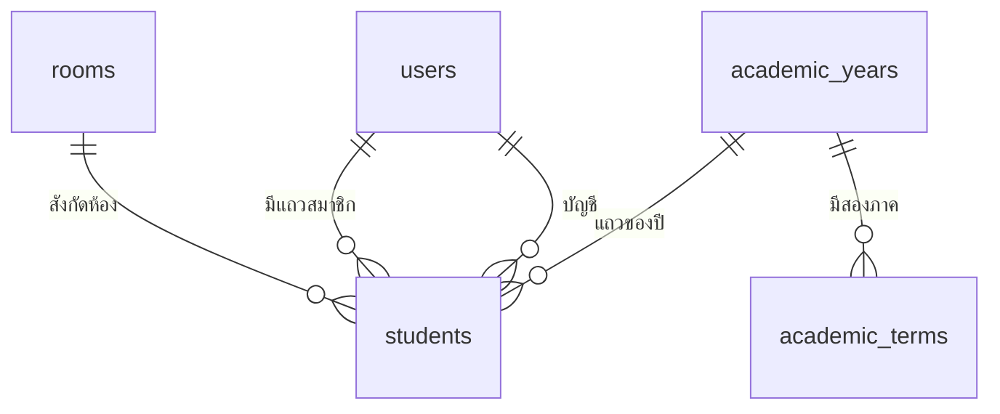
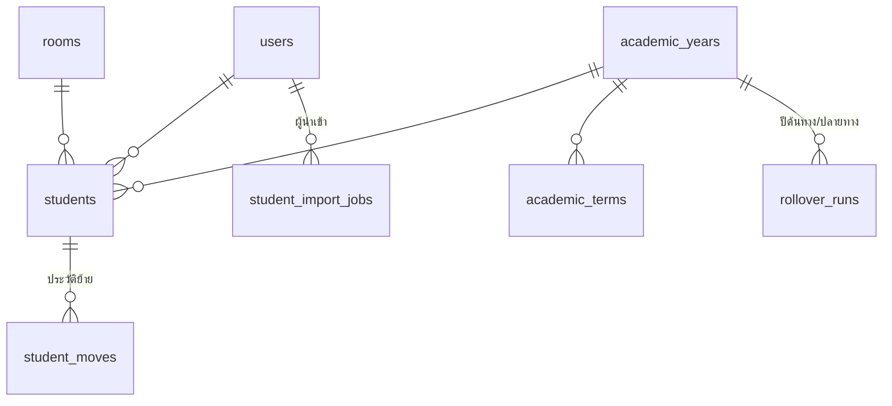
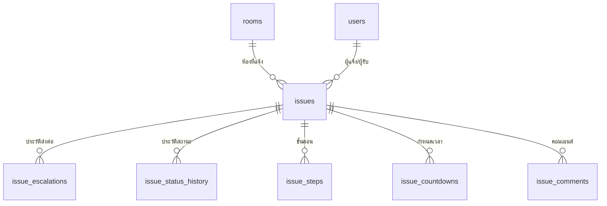
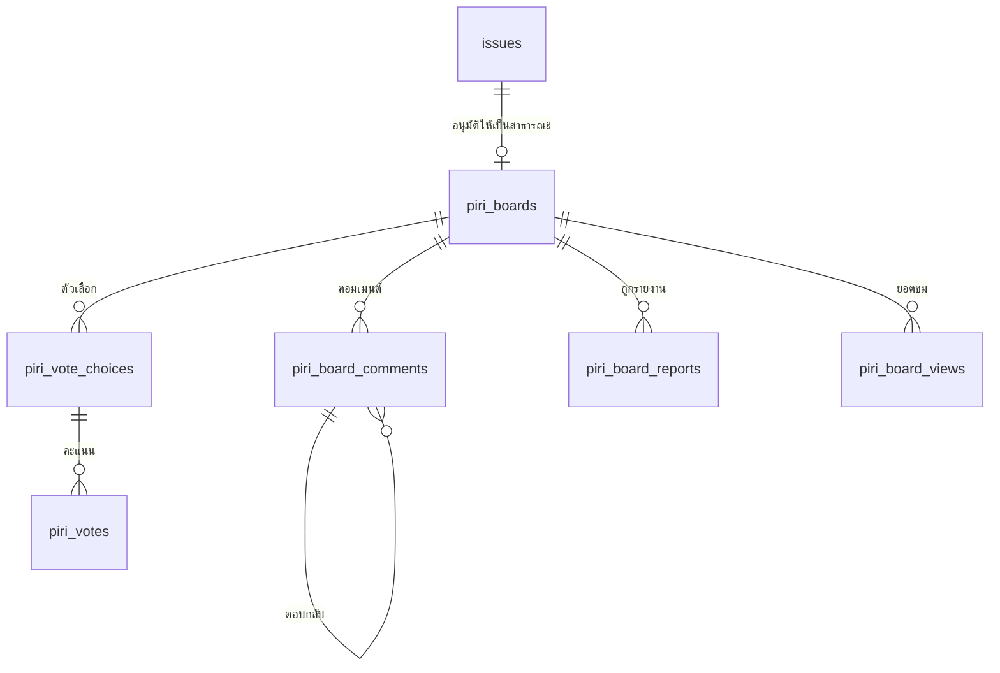
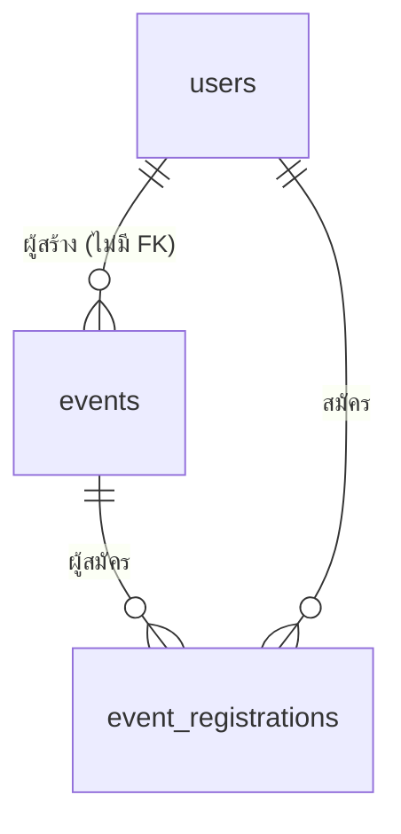
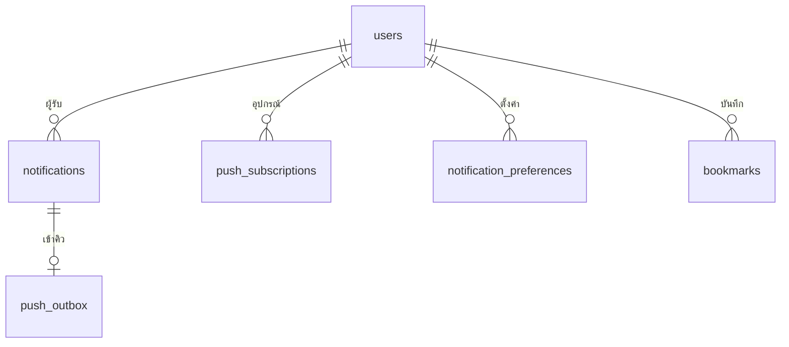
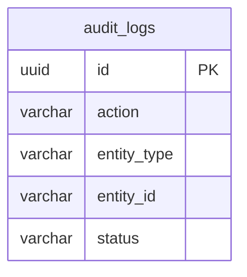

# โครงสร้างฐานข้อมูล

ทุกตารางใน PostgreSQL 16 อยู่หน้านี้ พร้อมคอลัมน์ ชนิดข้อมูล index ที่ห้ามลบ และ migration ทั้ง 29 ไฟล์

- 🗂️ **ตารางและคอลัมน์** — แยกตามโดเมน เปิดดูได้ทุกตาราง
- 🔗 **ความสัมพันธ์** — ERD ของแต่ละโดเมนกับ FK ที่ผูกกัน
- 🧱 **กับดักที่ต้องรู้** — index ที่ห้ามลบ ตารางที่ไม่มี FK และจุดที่ `init_db` กับ migration ไม่ตรงกัน

## ใครใช้บทนี้

คนที่เขียน service หรือ query ตรง ๆ คนที่ต้องตรวจข้อมูลย้อนหลัง และคนที่ต้องแก้ migration

## ก่อนเริ่ม

- ระบบไม่มี ORM — SQL ทั้งหมดเป็นข้อความใน `services/`
- ตารางถูกสร้างสองทาง คือ `core/init_db.py` สำหรับฐานข้อมูลใหม่ และ `migrations/` สำหรับฐานข้อมูลที่มีข้อมูลแล้ว
- สองทางต้องให้ผลเหมือนกัน ถ้าแก้ที่เดียว เทสต์ผ่านแต่ production พัง
- เอกสารนี้ยึด `core/init_db.py` เป็นหลัก และระบุทุกจุดที่ migration แก้เพิ่ม

## หลักการออกแบบหกข้อ

1. **แถวสมาชิกผูกกับปีการศึกษา** — หนึ่งคนมีได้หลายแถว คนละปี การเลื่อนชั้นคือการสร้างแถวใหม่ ไม่ใช่เขียนทับ
2. **ข้อมูลที่ต้องตรวจย้อนหลังไม่มี FK** เช่น `audit_logs`, `announcements.created_by`, `events.created_by` เพราะการลบผู้ใช้ไม่ควรลบหลักฐาน
3. **ตารางโดเมนของผู้ใช้ใช้ soft delete** ด้วย `deleted_at` และ index ที่บังคับความไม่ซ้ำเป็น partial index
4. **ตารางชั่วคราวหรือ junction ใช้ hard delete** เช่น `bookmarks`, `push_subscriptions`, `push_outbox`, `issue_countdowns`
5. **ค่าที่ชุดจะโตใช้ JSONB หรือไม่ใส่ CHECK** เช่น `app_settings.value`, `bookmarks.entity_type`, `notification_preferences.group_type`
6. **"มีได้ตัวเดียว" บังคับด้วย partial unique index** ไม่ใช่ด้วยโค้ด เช่น ปีปัจจุบันหนึ่งปี ภาคปัจจุบันหนึ่งภาค

## แผนที่โดเมน

| โดเมน | ตาราง |
|---|---|
| ตัวตนและปีการศึกษา | `users` `rooms` `academic_years` `students` `academic_terms` `rollover_runs` `student_moves` `student_import_jobs` |
| เรื่อง | `issues` `issue_escalations` `issue_status_history` `issue_steps` `issue_countdowns` `issue_comments` |
| บอร์ดสาธารณะ | `piri_boards` `piri_board_comments` `piri_vote_choices` `piri_votes` `piri_board_reactions` `piri_board_reports` `piri_board_views` |
| กิจกรรมและประกาศ | `events` `event_registrations` `announcements` |
| แจ้งเตือนและค่าส่วนตัว | `notifications` `notification_preferences` `push_subscriptions` `push_outbox` `bookmarks` `app_settings` |
| บันทึกการใช้งาน | `audit_logs` |
| ตัวรัน migration | `schema_migrations` |

รวม 32 ตาราง แบ่งเป็น 31 ตารางโดเมน และ 1 ตารางของตัวรัน migration

## ความสัมพันธ์หลัก

`students` เป็นตารางเชื่อมระหว่างคน ห้อง และปี
หนึ่งคนมีได้หลายแถวเมื่อขึ้นปีใหม่ และ `room_id` เป็น `ON DELETE CASCADE`
แปลว่าลบห้องแล้วแถวสมาชิกของห้องนั้นหายตามไปด้วย

::: warning ลบห้องแล้วแถวสมาชิกหายทั้งห้อง
`students.room_id` เป็น `ON DELETE CASCADE` — ลบห้องหนึ่งครั้ง แถวสมาชิกทุกแถวของห้องนั้นหายทันที
ถ้าอยากเก็บประวัติ ให้ใช้ soft delete กับห้องแทนการลบจริง
:::

## โดเมนตัวตนและปีการศึกษา

### `users`

| คอลัมน์ | ชนิด · ค่าเริ่มต้น · หมายเหตุ |
|---|---|
| `id` | `SERIAL PRIMARY KEY` |
| `username` | `VARCHAR(100) UNIQUE NOT NULL` ชื่อที่ใช้ล็อกอิน |
| `password_hash` | `TEXT NOT NULL` แฮช bcrypt |
| `full_name` | `TEXT` |
| `avatar_url` | `TEXT` |
| `phone_number` | `TEXT` |
| `email` | `TEXT UNIQUE` |
| `must_change_password` | `BOOLEAN NOT NULL DEFAULT FALSE` บังคับเปลี่ยนรหัสครั้งแรก |
| `created_at`, `updated_at` | `TIMESTAMPTZ DEFAULT CURRENT_TIMESTAMP` |
| `deleted_at` | `TIMESTAMP` ไม่มีเขตเวลา ต่างจากตารางอื่น |

### `rooms`

| คอลัมน์ | ชนิด · ค่าเริ่มต้น · หมายเหตุ |
|---|---|
| `id` | `SERIAL PRIMARY KEY` |
| `room_code` | `VARCHAR(10) UNIQUE` เช่น `ม.4/1` |
| `room_name` | `TEXT NOT NULL` |
| `level` | `TEXT` ระดับชั้น เช่น `ม.4` |
| `room_number` | `INTEGER` |
| `owner_id` | `INTEGER REFERENCES users(id) ON DELETE SET NULL` |
| `deleted_at` | `TIMESTAMP` |

### `academic_years`

| คอลัมน์ | ชนิด · ค่าเริ่มต้น · หมายเหตุ |
|---|---|
| `id` | `SERIAL PRIMARY KEY` |
| `year_be` | `INTEGER NOT NULL` พ.ศ. เช่น 2569 |
| `name` | `VARCHAR(50) NOT NULL` เช่น `ปีการศึกษา 2569` |
| `start_date`, `end_date` | `DATE` |
| `is_current` | `BOOLEAN NOT NULL DEFAULT FALSE` |
| `created_at`, `updated_at` | `TIMESTAMPTZ DEFAULT CURRENT_TIMESTAMP` |
| `deleted_at` | `TIMESTAMPTZ` |

กฎ: `CHECK (end_date IS NULL OR start_date IS NULL OR end_date >= start_date)`
index: `uq_academic_years_single_current` (partial), `uq_academic_years_year_be` (partial)

### `students`

| คอลัมน์ | ชนิด · ค่าเริ่มต้น · หมายเหตุ |
|---|---|
| `id` | `SERIAL PRIMARY KEY` |
| `room_id` | `INTEGER REFERENCES rooms(id) ON DELETE CASCADE` |
| `user_id` | `INTEGER REFERENCES users(id) ON DELETE SET NULL` |
| `student_id` | `VARCHAR(10)` รหัสนักเรียนหรือรหัสบุคลากร |
| `student_no` | `INTEGER` เลขที่ในห้อง |
| `prefix`, `first_name`, `last_name`, `nickname` | `TEXT` |
| `class_role` | `TEXT DEFAULT 'student'` |
| `staff_level` | `TEXT` ระดับชั้นที่ครูดูแล |
| `is_admin` | `BOOLEAN DEFAULT FALSE` |
| `permissions` | `JSONB DEFAULT '[]'` |
| `responsibilities` | `JSONB DEFAULT '[]'` หมวดที่รับผิดชอบ |
| `status` | `TEXT DEFAULT 'active'` |
| `academic_year_id` | `INTEGER REFERENCES academic_years(id) ON DELETE RESTRICT` |
| `created_at`, `updated_at` | `TIMESTAMPTZ DEFAULT CURRENT_TIMESTAMP` |
| `deleted_at` | `TIMESTAMP` |

**จุดที่ต้องระวัง:** ใน `init_db.py` คอลัมน์ `academic_year_id` เป็น nullable และไม่มี default
เพราะค่า default ต้องเป็น id ของปีปัจจุบัน ซึ่งรู้ตอนรันจริง
migration 027 เป็นคนตั้ง `NOT NULL DEFAULT <id ของปีปัจจุบัน>` หลัง backfill — ฐานข้อมูลใหม่จึงได้ default เป็นเลขนั้นในวันที่สร้าง

index: `idx_students_room_no_active`, `idx_students_role_active`, `idx_students_responsibilities` (GIN), `idx_students_year_room`,
`uq_students_room_year_student` (partial unique บน `room_id, academic_year_id, student_id`)

### `academic_terms`

| คอลัมน์ | ชนิด · ค่าเริ่มต้น · หมายเหตุ |
|---|---|
| `id` | `SERIAL PRIMARY KEY` |
| `name` | `VARCHAR(50) NOT NULL` |
| `start_date`, `end_date` | `DATE NOT NULL` `end_date` รวมวันสุดท้าย |
| `is_current` | `BOOLEAN NOT NULL DEFAULT FALSE` |
| `academic_year_id` | `INTEGER REFERENCES academic_years(id)` nullable |
| `created_at`, `updated_at`, `deleted_at` | `TIMESTAMPTZ` |

กฎ: `CHECK (end_date >= start_date)`
index: `uq_academic_terms_single_current` (partial), `idx_academic_terms_dates`

### `rollover_runs`

| คอลัมน์ | ชนิด · ค่าเริ่มต้น · หมายเหตุ |
|---|---|
| `id` | `SERIAL PRIMARY KEY` |
| `from_year_id`, `to_year_id` | `INTEGER NOT NULL REFERENCES academic_years(id) ON DELETE RESTRICT` |
| `status` | `TEXT NOT NULL DEFAULT 'PREVIEWED'` ค่า `PREVIEWED` `APPLIED` `FAILED` |
| `plan` | `JSONB NOT NULL DEFAULT '{}'` |
| `promoted_count`, `graduated_count`, `staff_carried_count`, `positions_reset_count`, `unmapped_count` | `INTEGER NOT NULL DEFAULT 0` |
| `error_message` | `TEXT` |
| `created_by` | `INTEGER REFERENCES users(id) ON DELETE SET NULL` |
| `created_at`, `applied_at`, `updated_at` | `TIMESTAMPTZ` |

index: `idx_rollover_runs_from_to`

### `student_moves`

| คอลัมน์ | ชนิด · ค่าเริ่มต้น · หมายเหตุ |
|---|---|
| `id` | `SERIAL PRIMARY KEY` |
| `student_row_id` | `INTEGER REFERENCES students(id) ON DELETE SET NULL` |
| `user_id` | `INTEGER REFERENCES users(id) ON DELETE SET NULL` |
| `student_id` | `VARCHAR(10)` |
| `from_room_id`, `to_room_id` | `INTEGER REFERENCES rooms(id) ON DELETE SET NULL` |
| `academic_year_id` | `INTEGER REFERENCES academic_years(id)` |
| `note` | `TEXT` |
| `moved_by` | `INTEGER REFERENCES users(id) ON DELETE SET NULL` |
| `moved_at` | `TIMESTAMPTZ DEFAULT CURRENT_TIMESTAMP` |

index: `idx_student_moves_user`, `idx_student_moves_year`

### `student_import_jobs`

| คอลัมน์ | ชนิด · ค่าเริ่มต้น · หมายเหตุ |
|---|---|
| `id` | `SERIAL PRIMARY KEY` |
| `file_name` | `TEXT NOT NULL` ชื่อที่ผู้ใช้เห็น |
| `file_path` | `TEXT NOT NULL` path บน storage ไม่ส่งออก API |
| `status` | `TEXT NOT NULL DEFAULT 'PENDING'` ค่า `PENDING` `QUEUED` `PROCESSING` `COMPLETED` `FAILED` |
| `total_rows`, `processed_rows`, `imported_count`, `skipped_count` | `INTEGER NOT NULL DEFAULT 0` |
| `error_logs` | `JSONB NOT NULL DEFAULT '[]'` |
| `error_message` | `TEXT` ระดับงาน |
| `default_password` | `TEXT` |
| `allowed_level` | `TEXT` |
| `academic_year_id` | `INTEGER REFERENCES academic_years(id)` |
| `created_by` | `INTEGER REFERENCES users(id) ON DELETE SET NULL` |
| `created_at`, `started_at`, `completed_at`, `updated_at` | `TIMESTAMPTZ` |

index: `idx_student_import_jobs_status`, `idx_student_import_jobs_created_at`

## โดเมนเรื่อง

### `issues`

| คอลัมน์ | ชนิด · ค่าเริ่มต้น · หมายเหตุ |
|---|---|
| `id` | `SERIAL PRIMARY KEY` |
| `room_id` | `INTEGER REFERENCES rooms(id) ON DELETE CASCADE` |
| `main_category` | `TEXT NOT NULL DEFAULT 'suggestion'` ค่า `suggestion` `wellbeing` `report` |
| `category` | `TEXT NOT NULL` หมวดย่อยตาม `config/categories.json` |
| `title`, `description` | `TEXT NOT NULL` |
| `image_url` | `TEXT` |
| `reporter_id` | `INTEGER REFERENCES users(id) ON DELETE SET NULL` |
| `reporter_room_id` | `INTEGER REFERENCES rooms(id) ON DELETE SET NULL` |
| `reporter_name` | `TEXT` snapshot |
| `current_level` | `TEXT DEFAULT 'room'` ค่า `room` `level` `council` |
| `current_assignee_id` | `INTEGER REFERENCES users(id) ON DELETE SET NULL` |
| `current_assignee_role` | `TEXT` |
| `status` | `TEXT DEFAULT 'pending'` |
| `priority` | `TEXT DEFAULT 'normal'` |
| `is_anonymous` | `BOOLEAN DEFAULT FALSE` |
| `requested_destination` | `VARCHAR(20) NOT NULL DEFAULT 'normal'` ค่า `normal` `vote` `talk` |
| `published_board_id` | `INTEGER` ชี้ `piri_boards.id` ไม่มี FK |
| `resolved_at` | `TIMESTAMPTZ` |
| `created_at`, `updated_at` | `TIMESTAMPTZ DEFAULT CURRENT_TIMESTAMP` |
| `deleted_at` | `TIMESTAMP` |

index: `idx_issues_room_status`, `idx_issues_reporter`, `idx_issues_level`, `idx_issues_main_category`, `idx_issues_category`

### `issue_escalations`

`id` · `issue_id` FK cascade · `from_level` `TEXT NOT NULL` · `to_level` `TEXT NOT NULL` ·
`from_assignee_id`, `to_assignee_id` FK users set null · `reason` `TEXT` · `created_at`

### `issue_status_history`

`id` · `issue_id` FK cascade · `status` `TEXT NOT NULL` · `changed_by` FK users set null ·
`note` `TEXT` · `created_at`

### `issue_steps`

`id` · `issue_id` FK cascade · `step_title` `TEXT NOT NULL` · `step_detail` `TEXT` ·
`step_order` `INTEGER NOT NULL DEFAULT 0` · `is_completed` `BOOLEAN DEFAULT FALSE` ·
`completed_at` `TIMESTAMPTZ` · `created_by` FK users set null · `created_at`

### `issue_countdowns`

`id` · `issue_id` FK cascade · `assignee_id` FK users set null · `estimated_days` `INTEGER NOT NULL` ·
`started_at` `TIMESTAMPTZ DEFAULT CURRENT_TIMESTAMP` · `deadline` `TIMESTAMPTZ NOT NULL` ·
`is_overdue` `BOOLEAN DEFAULT FALSE` · `created_at`

การตั้งกำหนดใหม่คือลบแถวเดิมแล้วเพิ่มแถวใหม่ ไม่ใช่แก้แถวเดิม
ตารางนี้จึงเป็นหนึ่งในสี่ตารางที่ใช้ hard delete

### `issue_comments`

| คอลัมน์ | ชนิด · ค่าเริ่มต้น · หมายเหตุ |
|---|---|
| `id` | `SERIAL PRIMARY KEY` |
| `issue_id` | `INTEGER NOT NULL REFERENCES issues(id) ON DELETE CASCADE` |
| `user_id` | `INTEGER REFERENCES users(id) ON DELETE SET NULL` |
| `commenter_name` | `TEXT` snapshot |
| `commenter_first_name` | `TEXT` **เพิ่มโดย migration 012 ไม่มีใน `init_db.py`** |
| `commenter_room` | `TEXT` |
| `body` | `TEXT NOT NULL` |
| `created_at` | `TIMESTAMPTZ DEFAULT CURRENT_TIMESTAMP` |
| `updated_at` | `TIMESTAMPTZ` `NULL` จนกว่าจะแก้ครั้งแรก |
| `deleted_at` | `TIMESTAMP` |

`commenter_first_name` เป็นคอลัมน์เดียวที่ไม่มีใน `init_db.py`
ฐานข้อมูลที่สร้างใหม่จะได้คอลัมน์นี้จาก migration 012 ตอนเริ่มระบบครั้งแรก
ถ้าเขียน query ที่ใช้คอลัมน์นี้ ให้ถือว่ามีเสมอหลัง `init_db` ทำงานครบ

index: `idx_issue_comments_issue`, `idx_issue_comments_user`

## โดเมนบอร์ดสาธารณะ

### `piri_boards`

| คอลัมน์ | ชนิด · ค่าเริ่มต้น · หมายเหตุ |
|---|---|
| `id` | `SERIAL PRIMARY KEY` |
| `source_issue_id` | `INTEGER REFERENCES issues(id) ON DELETE SET NULL` |
| `board_type` | `VARCHAR(20) NOT NULL DEFAULT 'talk'` |
| `title`, `description` | `TEXT NOT NULL` |
| `cover_image_url` | `TEXT` |
| `author_id` | `INTEGER REFERENCES users(id) ON DELETE SET NULL` |
| `is_anonymous` | `BOOLEAN NOT NULL DEFAULT FALSE` |
| `approved_by` | `INTEGER REFERENCES users(id) ON DELETE SET NULL` |
| `approved_at` | `TIMESTAMPTZ` |
| `view_count`, `comment_count`, `share_count` | `INTEGER NOT NULL DEFAULT 0` |
| `status` | `VARCHAR(20) NOT NULL DEFAULT 'active'` |
| `allow_comments` | `BOOLEAN NOT NULL DEFAULT TRUE` |
| `tags` | `JSONB NOT NULL DEFAULT '[]'` |
| `closed_at`, `closed_by`, `close_reason` | ปิดประเด็น |
| `created_at`, `updated_at`, `deleted_at` | `TIMESTAMPTZ` |

กฎ: `CHECK board_type IN ('talk','vote','suggestion')` และ `CHECK status IN ('active','closed','hidden')`
index: `idx_piri_boards_status_created`, `idx_piri_boards_source_issue`, `idx_piri_boards_author`

`board_type = 'suggestion'` ถูกเพิ่มโดย migration 022 ซึ่งต้องลบ CHECK เดิมก่อน
ถ้าจะเพิ่มชนิดใหม่ทีหลัง ต้องออก migration ที่ลบและสร้าง CHECK ใหม่

### `piri_board_comments`

`id` · `board_id` FK cascade · `parent_comment_id` FK self cascade · `user_id` FK users set null ·
`body` `TEXT NOT NULL` · `image_url` `TEXT` · `is_edited` `BOOLEAN DEFAULT FALSE` ·
`edit_history` `JSONB DEFAULT '[]'` · `ip_address` `VARCHAR(45)` · `user_agent` `TEXT` ·
`is_hidden_by_admin` `BOOLEAN DEFAULT FALSE` · `hidden_reason` `TEXT` · `hidden_by` FK users set null ·
`created_at`, `updated_at`, `deleted_at`

index: `idx_piri_board_comments_board`, `idx_piri_board_comments_parent`, `idx_piri_board_comments_user`

### `piri_vote_choices`

`id` · `board_id` FK cascade · `choice_text` `TEXT NOT NULL` · `description` `TEXT` · `image_url` `TEXT` ·
`sort_order` `INTEGER NOT NULL DEFAULT 0` · `vote_count` `INTEGER NOT NULL DEFAULT 0` ·
`created_at`, `updated_at`, `deleted_at`

index: `idx_piri_vote_choices_board`

### `piri_votes`

`id` · `board_id` FK cascade · `choice_id` FK choices cascade · `user_id` `INTEGER NOT NULL` FK users cascade ·
`ip_address` · `user_agent` · `created_at`, `updated_at`, `deleted_at`

index: `uq_piri_votes_board_user_active` (partial unique), `idx_piri_votes_board`, `idx_piri_votes_choice`, `idx_piri_votes_user`

### `piri_board_reactions`

`id` · `target_type` `VARCHAR(10) NOT NULL` · `target_id` `INTEGER NOT NULL` · `user_id` FK users cascade ·
`reaction_type` `VARCHAR(20) NOT NULL` · `created_at`, `updated_at`, `deleted_at`

กฎ: `CHECK target_type IN ('board','comment')`
`target_id` ไม่มี FK เพราะชี้ได้สองตาราง
index: `uq_piri_board_reactions_target_user_active` (partial unique), `idx_piri_board_reactions_target`, `idx_piri_board_reactions_user`

### `piri_board_reports`

`id` · `board_id` FK cascade · `comment_id` `INTEGER NOT NULL` FK comments cascade ·
`reporter_id` FK users cascade · `reason` `VARCHAR(30) NOT NULL` · `detail` `TEXT` ·
`status` `VARCHAR(20) NOT NULL DEFAULT 'open'` · `resolved_by` FK users set null · `resolved_at` ·
`resolution_note` · `created_at`, `updated_at`, `deleted_at`

กฎ: `CHECK reason IN ('bullying','profanity','spam','privacy','other')` และ `CHECK status IN ('open','resolved','dismissed')`
index: `uq_piri_board_report_user_comment_active` (partial unique), `idx_piri_board_reports_status`, `idx_piri_board_reports_board`, `idx_piri_board_reports_comment`, `idx_piri_board_reports_reporter`

### `piri_board_views`

`board_id` FK cascade · `user_id` FK users cascade · `viewed_at` `TIMESTAMPTZ NOT NULL DEFAULT CURRENT_TIMESTAMP`
`PRIMARY KEY (board_id, user_id)` ไม่มี `id` และไม่มี soft delete

ตารางนี้กันการกดรีเฟรชปั่นยอดชม — คนหนึ่งนับได้ครั้งเดียวต่อช่วงเวลาที่กำหนดใน service

## โดเมนกิจกรรมและประกาศ

### `events`

| คอลัมน์ | ชนิด · ค่าเริ่มต้น · หมายเหตุ |
|---|---|
| `id` | `SERIAL PRIMARY KEY` |
| `title` | `VARCHAR(200) NOT NULL` |
| `description` | `TEXT` |
| `location` | `VARCHAR(200)` |
| `cover_image_url` | `VARCHAR(500)` เก็บเป็น URL ไม่มีอัปโหลด |
| `event_date` | `TIMESTAMPTZ NOT NULL` |
| `registration_deadline` | `TIMESTAMPTZ` |
| `capacity` | `INTEGER` `NULL` คือไม่จำกัด |
| `category` | `VARCHAR(20) NOT NULL DEFAULT 'other'` |
| `status` | `VARCHAR(20) NOT NULL DEFAULT 'draft'` |
| `published_at`, `cancelled_at` | `TIMESTAMPTZ` |
| `created_by`, `updated_by` | `INTEGER` ไม่มี FK (ตั้งใจให้เป็นแบบนี้) |
| `created_at`, `updated_at`, `deleted_at` | `TIMESTAMPTZ` |

กฎ: `chk_events_status`, `chk_events_capacity` (`capacity IS NULL OR capacity > 0`), `chk_events_category`
หมวดที่อนุญาตคือ `academic` `sports` `arts` `service` `club` `meeting` `other`
index: `idx_events_status_date`, `idx_events_created_by`

### `event_registrations`

| คอลัมน์ | ชนิด · ค่าเริ่มต้น · หมายเหตุ |
|---|---|
| `id` | `SERIAL PRIMARY KEY` |
| `event_id` | `INTEGER NOT NULL REFERENCES events(id) ON DELETE CASCADE` |
| `user_id` | `INTEGER NOT NULL REFERENCES users(id) ON DELETE CASCADE` |
| `status` | `VARCHAR(20) NOT NULL DEFAULT 'registered'` |
| `registered_at` | `TIMESTAMPTZ NOT NULL DEFAULT CURRENT_TIMESTAMP` |
| `cancelled_at`, `checked_in_at` | `TIMESTAMPTZ` |
| `updated_at` | `TIMESTAMPTZ NOT NULL DEFAULT CURRENT_TIMESTAMP` |

กฎ: `chk_event_registrations_status` อนุญาต `registered` `waitlisted` `cancelled` `checked_in`
index: `uq_event_registrations_event_user` (unique ไม่ partial), `idx_event_registrations_event_status`, `idx_event_registrations_user`

unique เป็นแบบธรรมดาเพราะการยกเลิกคือการเปลี่ยน `status` ไม่ใช่การลบแถว
ประวัติการสมัครจึงไม่หาย และการสมัครซ้ำใช้ `ON CONFLICT` ได้

### `announcements`

| คอลัมน์ | ชนิด · ค่าเริ่มต้น · หมายเหตุ |
|---|---|
| `id` | `SERIAL PRIMARY KEY` |
| `message` | `TEXT NOT NULL` |
| `priority` | `VARCHAR(10) NOT NULL DEFAULT 'normal'` ค่า `normal` `high` `urgent` |
| `link` | `TEXT` |
| `created_by`, `updated_by` | `INTEGER` ไม่มี FK |
| `created_at`, `updated_at` | `TIMESTAMPTZ` |
| `deleted_at` | `TIMESTAMPTZ` |
| `retired_at` | `TIMESTAMPTZ` ปลดระวาง |

`retired_at` แยกจาก `deleted_at` ตั้งใจให้เป็นแบบนี้
กู้คืนประกาศที่ปลดระวางแล้วจะกลับมาเป็นปลดระวาง ไม่ใช่กลับไปแสดงบนหน้าแรก
ตารางนี้ถูก seed สองแถวเมื่อตารางว่าง และส่วนที่ seed มี `priority` เป็น `normal` หนึ่งแถวกับ `high` หนึ่งแถว

## โดเมนแจ้งเตือนและค่าส่วนตัว

### `notifications`

| คอลัมน์ | ชนิด · ค่าเริ่มต้น · หมายเหตุ |
|---|---|
| `id` | `SERIAL PRIMARY KEY` |
| `user_id` | `INTEGER NOT NULL REFERENCES users(id) ON DELETE CASCADE` |
| `group_type` | `VARCHAR(30) NOT NULL` |
| `type` | `VARCHAR(30) NOT NULL` |
| `title`, `body` | `TEXT NOT NULL` |
| `entity_type` | `VARCHAR(30)` |
| `entity_id` | `INTEGER` |
| `board_id` | `INTEGER` |
| `actor_id` | `INTEGER REFERENCES users(id) ON DELETE SET NULL` |
| `actor_name` | `TEXT` |
| `read_at` | `TIMESTAMPTZ` `NULL` คือยังไม่อ่าน |
| `bypass_quiet_hours` | `BOOLEAN NOT NULL DEFAULT FALSE` |
| `created_at` | `TIMESTAMPTZ DEFAULT CURRENT_TIMESTAMP` |

index: `idx_notifications_user_unread_group` (partial), `idx_notifications_user_created`, `idx_notifications_board` (partial), `idx_notifications_entity`

ตารางนี้มี trigger สองตัวที่ไม่ได้ประกาศใน `init_db.py` คือ trigger เข้าคิว push จาก migration 018 และ 019
และ trigger ยิง `pg_notify` จาก migration 020

### `notification_preferences`

| คอลัมน์ | ชนิด · ค่าเริ่มต้น · หมายเหตุ |
|---|---|
| `id` | `SERIAL PRIMARY KEY` |
| `user_id` | `INTEGER NOT NULL REFERENCES users(id) ON DELETE CASCADE` |
| `group_type` | `VARCHAR(30) NOT NULL` |
| `enabled` | `BOOLEAN NOT NULL DEFAULT TRUE` |
| `created_at`, `updated_at` | `TIMESTAMPTZ` |

ไม่มี `CHECK` บน `group_type` เพราะกลุ่มจะเพิ่มได้
index: `uq_notification_prefs_user_group` จำเป็นต่อ `ON CONFLICT (user_id, group_type) DO UPDATE`

การไม่มีแถวหมายถึงเปิด ระบบจึงไม่ต้อง backfill คนที่ใช้อยู่เดิม

### `push_subscriptions`

| คอลัมน์ | ชนิด · ค่าเริ่มต้น · หมายเหตุ |
|---|---|
| `id` | `SERIAL PRIMARY KEY` |
| `user_id` | `INTEGER NOT NULL REFERENCES users(id) ON DELETE CASCADE` |
| `endpoint` | `TEXT NOT NULL` |
| `p256dh`, `auth` | `TEXT NOT NULL` |
| `user_agent` | `TEXT` |
| `failure_count` | `INTEGER NOT NULL DEFAULT 0` |
| `last_success_at` | `TIMESTAMPTZ` |
| `created_at`, `updated_at` | `TIMESTAMPTZ NOT NULL DEFAULT CURRENT_TIMESTAMP` |

กฎ: `CHECK length(endpoint) BETWEEN 8 AND 1000`
index: `uq_push_subscriptions_endpoint` (unique บน `endpoint` เดี่ยว), `idx_push_subscriptions_user`

unique เป็น `endpoint` เดี่ยว ไม่ใช่คู่กับ `user_id` เพราะ endpoint คือเครื่อง ไม่ใช่คน
เครื่องที่ใช้ร่วมกันจะถูกยึดกับคนที่ล็อกอินล่าสุด

### `push_outbox`

| คอลัมน์ | ชนิด · ค่าเริ่มต้น · หมายเหตุ |
|---|---|
| `id` | `BIGSERIAL PRIMARY KEY` |
| `notification_id` | `INTEGER NOT NULL REFERENCES notifications(id) ON DELETE CASCADE` |
| `user_id` | `INTEGER NOT NULL REFERENCES users(id) ON DELETE CASCADE` |
| `attempts` | `SMALLINT NOT NULL DEFAULT 0` |
| `next_attempt_at` | `TIMESTAMPTZ NOT NULL DEFAULT CURRENT_TIMESTAMP` |
| `processing_at` | `TIMESTAMPTZ` ถูก claim แล้ว |
| `processed_at` | `TIMESTAMPTZ` `NULL` คือยังไม่จบ |
| `last_error` | `TEXT` |
| `created_at` | `TIMESTAMPTZ NOT NULL DEFAULT CURRENT_TIMESTAMP` |

index: `uq_push_outbox_notification_user` (unique), `idx_push_outbox_pending` (partial บน `id`)

### `bookmarks`

| คอลัมน์ | ชนิด · ค่าเริ่มต้น · หมายเหตุ |
|---|---|
| `id` | `SERIAL PRIMARY KEY` |
| `user_id` | `INTEGER NOT NULL REFERENCES users(id) ON DELETE CASCADE` |
| `entity_type` | `VARCHAR(20) NOT NULL` |
| `entity_id` | `INTEGER NOT NULL` |
| `created_at` | `TIMESTAMPTZ NOT NULL DEFAULT CURRENT_TIMESTAMP` |

ไม่มี `deleted_at` และไม่มี FK ไป `issues` หรือ `piri_boards` เพราะเป็น polymorphic
index: `uq_bookmarks_user_entity`, `idx_bookmarks_user_created`

การตรวจว่าเรื่องหรือบอร์ดปลายทางมีจริงอยู่ที่ `bookmark_service.create_bookmark`
ไม่ใช่ที่ฐานข้อมูล

### `app_settings`

| คอลัมน์ | ชนิด · ค่าเริ่มต้น · หมายเหตุ |
|---|---|
| `key` | `VARCHAR(60) PRIMARY KEY` |
| `value` | `JSONB NOT NULL` |
| `description` | `TEXT` |
| `updated_by` | `INTEGER REFERENCES users(id) ON DELETE SET NULL` |
| `created_at`, `updated_at` | `TIMESTAMPTZ NOT NULL DEFAULT CURRENT_TIMESTAMP` |

คีย์ที่ใช้จริงมีตัวเดียวคือ `quiet_hours` ซึ่งเก็บ `{"enabled", "start", "end"}`
การไม่มีแถวหมายถึงไม่ปิดกั้น push และไม่ต้อง seed

## โดเมนบันทึกการใช้งาน

### `audit_logs`

| คอลัมน์ | ชนิด · ค่าเริ่มต้น · หมายเหตุ |
|---|---|
| `id` | `UUID PRIMARY KEY DEFAULT gen_random_uuid()` |
| `trace_id` | `VARCHAR(50) NOT NULL DEFAULT '-'` |
| `room_id` | `INTEGER NOT NULL DEFAULT -1` **ไม่มี FK** |
| `user_id` | `INTEGER NOT NULL DEFAULT -1` **ไม่มี FK** |
| `actor_identifier` | `VARCHAR(100) NOT NULL DEFAULT '-'` |
| `client_source` | `VARCHAR(20) NOT NULL DEFAULT '-'` |
| `service_name` | `VARCHAR(50) NOT NULL DEFAULT '-'` |
| `action` | `VARCHAR(50) NOT NULL DEFAULT '-'` |
| `entity_type` | `VARCHAR(50) NOT NULL DEFAULT '-'` |
| `entity_id` | `VARCHAR(50) NOT NULL DEFAULT '-'` |
| `status` | `VARCHAR(20) NOT NULL DEFAULT 'success'` |
| `error_detail` | `TEXT NOT NULL DEFAULT '-'` |
| `old_values`, `new_values` | `JSONB NOT NULL DEFAULT '{}'` |
| `endpoint_or_command` | `TEXT NOT NULL DEFAULT '-'` |
| `ip_address` | `VARCHAR(45) NOT NULL DEFAULT '-'` |
| `user_agent` | `TEXT NOT NULL DEFAULT '-'` |
| `execution_time_ms` | `INTEGER NOT NULL DEFAULT 0` |
| `created_at` | `TIMESTAMPTZ NOT NULL DEFAULT CURRENT_TIMESTAMP` |

ทุกคอลัมน์ `NOT NULL` เพื่อให้ตรวจย้อนหลังได้ครบ ค่า `-` คือไม่ทราบค่า `-1` คือไม่ระบุห้องหรือตัวตน
migration 013 เป็นคนบังคับเงื่อนไขนี้และถอด FK เดิมออก

index: `idx_audit_logs_action_created`, `idx_audit_logs_user_id`, `idx_audit_logs_entity`, `idx_audit_logs_created_at`

## ตารางของตัวรัน migration

### `schema_migrations`

| คอลัมน์ | ชนิด · ค่าเริ่มต้น |
|---|---|
| `version` | `TEXT PRIMARY KEY` |
| `description` | `TEXT` |
| `applied_at` | `TIMESTAMPTZ DEFAULT CURRENT_TIMESTAMP` |

`core/migrations.py` สร้างตารางนี้เองก่อนรันทุกไฟล์
ไม่ถูกประกาศใน `init_db.py` และไม่อยู่ในรายการล้างข้อมูลของเทสต์

## Index ที่ห้ามลบ

| Index | เหตุผล |
|---|---|
| `uq_notification_prefs_user_group` | `ON CONFLICT (user_id, group_type)` พึ่ง index นี้ |
| `uq_push_subscriptions_endpoint` | `ON CONFLICT (endpoint) DO UPDATE` พึ่ง index นี้ |
| `uq_bookmarks_user_entity` | `ON CONFLICT (user_id, entity_type, entity_id)` พึ่ง index นี้ |
| `uq_students_room_year_student` | งานนำเข้าและเลื่อนชั้นพึ่ง index นี้ |
| `uq_event_registrations_event_user` | กันสมัครซ้ำ และเป็น index ของคำถาม "สมัครแล้วหรือยัง" |
| `uq_academic_years_single_current` | บังคับปีปัจจุบันหนึ่งปี |
| `uq_academic_terms_single_current` | บังคับภาคปัจจุบันหนึ่งภาค |
| `uq_push_outbox_notification_user` | กัน trigger ยิงซ้ำแล้วได้สองแถว |
| `idx_push_outbox_pending` | worker ใช้หางานที่ยังไม่จบ |

index ที่เป็น partial unique ทั้งหมดมีเงื่อนไข `WHERE deleted_at IS NULL` หรือเงื่อนไขเฉพาะ
ถ้าเปลี่ยนเป็น unique ธรรมดา การกู้คืนข้อมูลที่ลบแล้วจะล้มเหลว

## ตารางที่ตั้งใจไม่ใส่ FK

| คอลัมน์ | เหตุผล |
|---|---|
| `audit_logs.room_id`, `audit_logs.user_id` | FK แบบ cascade เคยทำให้ประวัติหายทั้งห้อง และ set null ทำให้ไม่รู้ว่าใครทำ |
| `announcements.created_by`, `announcements.updated_by` | ลบผู้ใช้แล้วต้องยังรู้ว่าใครประกาศ |
| `events.created_by`, `events.updated_by` | เหตุผลเดียวกับประกาศ |
| `issues.published_board_id` | ตั้งหลังอนุมัติ และไม่มี cascade ที่ต้องการ |
| `bookmarks.entity_type`, `bookmarks.entity_id` | polymorphic ชี้ได้หลายตาราง |
| `piri_board_reactions.target_type`, `piri_board_reactions.target_id` | polymorphic ชี้บอร์ดหรือคอมเมนต์ |

## Trigger สองตัวบน `notifications`

| Trigger | ไฟล์ | หน้าที่ |
|---|---|---|
| `trg_notifications_push_outbox` | `migrations/018` และแก้ใน `019` | เพิ่มแถวใน `push_outbox` เมื่อมีแจ้งเตือนใหม่และผู้รับมีอุปกรณ์ |
| `trg_notifications_stream` | `migrations/020` | ยิง `pg_notify` บน channel `piri_notifications` |

ทั้งสองไม่ได้ mirror ใน `init_db.py` ตั้งใจ เพราะเป็นฟังก์ชันที่ `CREATE OR REPLACE` ได้ง่าย และจะเพี้ยนถ้าอยู่สองที่
ถ้าจะแก้เงื่อนไขการเข้าคิว ให้อ่าน `019` เป็นหลักเพราะทับของ `018`

## Soft delete

| ตาราง | วิธีลบ | เงื่อนไขอ่าน |
|---|---|---|
| `users` `rooms` `students` `issues` `issue_comments` | ตั้ง `deleted_at` | `deleted_at IS NULL` |
| `piri_boards` `piri_board_comments` `piri_vote_choices` `piri_votes` | ตั้ง `deleted_at` | `deleted_at IS NULL` |
| `piri_board_reactions` `piri_board_reports` | ตั้ง `deleted_at` | `deleted_at IS NULL` |
| `academic_years` `academic_terms` `announcements` `events` | ตั้ง `deleted_at` | `deleted_at IS NULL` |
| `bookmarks` | `DELETE` | ไม่มี |
| `push_subscriptions` | `DELETE` | ไม่มี |
| `push_outbox` | `DELETE` ตามอายุเก็บ | ไม่มี |
| `issue_countdowns` | `DELETE` เมื่อตั้งใหม่ | ไม่มี |
| `event_registrations` | เปลี่ยน `status` เป็น `cancelled` | ไม่มี |

## Migration ทั้ง 29 ไฟล์

| Version | สิ่งที่ทำ |
|---|---|
| `001` | เพิ่ม `issues.main_category` และจัดหมวดย่อยใหม่ พร้อม backfill ข้อมูลเดิม |
| `002` | เพิ่ม `students.staff_level` ปลด `NOT NULL` ของ `student_no` และเพิ่ม index ตามตำแหน่ง |
| `003` | สร้าง `student_import_jobs` |
| `004` | เพิ่ม `users.must_change_password` |
| `005` | สร้าง `issue_comments` |
| `006` | เพิ่ม index บน `audit_logs` |
| `007` | เพิ่ม `issues.requested_destination` และ `published_board_id` พร้อมตารางบอร์ดห้าตาราง |
| `008` | สร้าง `piri_board_reports` และกระทบยอดตัวนับ |
| `009` | สร้าง `piri_board_views` กันการปั่นยอดชม |
| `010` | สร้าง `notifications` |
| `011` | เพิ่ม `students.responsibilities` |
| `012` | เพิ่ม `issue_comments.commenter_first_name` |
| `013` | บังคับ `audit_logs` ให้ครบทุกคอลัมน์ และถอด FK เดิมออก |
| `014` | เพิ่มผู้ประกาศใน `announcements` และ backfill สิทธิ์ `MANAGE_ANNOUNCEMENTS` |
| `015` | เพิ่ม `announcements.retired_at` |
| `016` | สร้าง `notification_preferences` |
| `017` | สร้าง `academic_terms` |
| `018` | สร้าง `push_subscriptions` และ `push_outbox` พร้อม trigger เข้าคิว |
| `019` | แก้ trigger ให้เข้าคิวเฉพาะเมื่อผู้รับมีอุปกรณ์จริง |
| `020` | เพิ่ม trigger ยิง `pg_notify` สำหรับ SSE |
| `021` | สร้าง `bookmarks` และเพิ่ม index ของ `piri_votes.user_id` กับ `issue_comments.user_id` |
| `022` | เปิด `board_type = 'suggestion'` โดยแก้ CHECK |
| `023` | สร้าง `app_settings` |
| `024` | เพิ่ม `notifications.bypass_quiet_hours` |
| `025` | สร้าง `events` และ `event_registrations` พร้อมสิทธิ์ `MANAGE_EVENTS` |
| `026` | เพิ่ม `events.category` |
| `027` | สร้าง `academic_years` และ `students.academic_year_id` พร้อม `rollover_runs` และตั้ง default เป็นปีปัจจุบัน |
| `028` | สลับ unique index ของ `students` ให้มีมิติปี และผูกปีเข้ากับงานนำเข้า |
| `029` | สร้าง `student_moves` |

## ขั้นตอนแก้ schema ให้ครบทั้งสองทาง

1. แก้ `core/init_db.py` ให้ฐานข้อมูลใหม่ได้ตารางหรือคอลัมน์นั้น
2. เขียน migration ใหม่ใน `migrations/` ด้วย `VERSION`, `DESCRIPTION` และ `async def upgrade(conn)`
3. ถ้าเพิ่ม index ให้ใส่ทั้งใน migration และบล็อก index ท้าย `init_db.py` ด้วยชื่อเดียวกัน
4. เพิ่มตารางใหม่ใน `_TABLES` ของ `backend/tests/conftest.py` เพื่อให้การล้างข้อมูลครบ
5. รันเทสต์ที่สร้างฐานข้อมูลใหม่ เพราะเทสต์สร้าง schema จาก `init_db` พร้อม migration

::: tip แก้ `init_db.py` อย่างเดียวไม่เปลี่ยนฐานข้อมูลจริง
`CREATE TABLE IF NOT EXISTS` ไม่แก้อะไรถ้าตารางมีอยู่แล้ว — ต้องมี migration คู่กันเสมอ
และถ้าเพิ่ม index ให้ใส่ทั้งใน migration กับบล็อก index ท้าย `init_db.py` ด้วยชื่อเดียวกัน
ไม่งั้นเทสต์บนฐานข้อมูลใหม่จะได้ index ไม่ตรงกับ production
:::

## ข้อจำกัดและข้อควรระวัง

- ไม่มี ORM และไม่มีตัวสร้าง schema อัตโนมัติ
- migration รันใน transaction เดียวทั้งหมด ถ้าไฟล์ใดล้มหลังตัวอื่นถูกบันทึกแล้ว การบันทึกถูกย้อนกลับทั้งชุด
- migration 027 และ 028 ไม่ใช่การเพิ่มอย่างเดียว ต้อง deploy พร้อมโค้ดที่รู้จักปี
- `init_db` รันทุกครั้งที่ backend เริ่ม จึงต้อง idempotent เสมอ
- `deleted_at` ของ `users` เป็น `TIMESTAMP` ไม่มีเขตเวลา ต่างจากตารางส่วนใหญ่
- `students.room_id` เป็น `ON DELETE CASCADE` การลบห้องจึงลบแถวสมาชิกทั้งหมดของห้องนั้น
- ไม่มีตารางสรุปสำหรับแดชบอร์ด ทุกตัวเลขคำนวณจากตารางจริง
- `piri_board_views` ไม่มี soft delete และไม่มี `id`
- การลบ `academic_years` ที่มีแถวสมาชิกอ้างอยู่จะถูกปฏิเสธด้วย `ON DELETE RESTRICT`

## ติดปัญหาตรงไหน? ดูวิธีแก้ตรงนี้เลย

**Q: เขียน query แล้วได้ error ว่าคอลัมน์ไม่มีอยู่ ทั้งที่เห็นในเอกสารนี้?**

👉 **วิธีแก้:** ตรวจว่าเป็นฐานข้อมูลที่ `init_db` รันครบแล้วหรือยัง โดยเฉพาะ `commenter_first_name` ซึ่งมาจาก migration 012 ให้ดูตาราง `schema_migrations` ว่ามี version นั้นอยู่

**Q: เพิ่มตารางใน `init_db.py` แล้วฐานข้อมูลจริงไม่เปลี่ยน?**

👉 **วิธีแก้:** `CREATE TABLE IF NOT EXISTS` ไม่แก้อะไรถ้าตารางมีอยู่ ต้องเขียน migration และรันผ่าน `init_db` ตอน backend เริ่ม

**Q: เทสต์ผ่านแต่ production ล้มเหลวเรื่อง index?**

👉 **วิธีแก้:** มักมาจากการสร้าง index ชื่อต่างกันใน migration กับ `init_db` ให้ตรวจชื่อให้ตรงกันทุกตัวอักษร แล้วลองรันกับฐานข้อมูลที่มี migration ครบ

**Q: ลบห้องแล้วข้อมูลนักเรียนหายหมด?**

👉 **วิธีแก้:** เป็นพฤติกรรมของ `ON DELETE CASCADE` บน `students.room_id` ถ้าต้องการเก็บประวัติ ให้ใช้ soft delete กับห้องแทนการลบจริง

**Q: ต้องการรายชื่อคนที่เคยทำรายการ แต่บัญชีถูกลบไปแล้ว?**

👉 **วิธีแก้:** ใช้ `audit_logs.actor_identifier` ซึ่งเก็บค่าไว้ตอนเกิดเหตุและไม่มี FK ชื่อในตาราง `users` จะหาย แต่รหัสผู้กระทำยังอยู่

**Q: เพิ่มหมวดกิจกรรมใหม่แล้วบันทึกไม่ผ่าน?**

👉 **วิธีแก้:** `events.category` มี CHECK ที่ลิสต์ค่าตายตัว ต้องออก migration ลบและสร้าง CHECK ใหม่ พร้อมแก้ schema ของ API และรายการบนหน้าจอ

**Q: ลบประกาศแล้วกู้คืนได้ไหม?**

👉 **วิธีแก้:** ได้ถ้าเป็นการลบแบบ soft delete และมี endpoint กู้คืน แต่ประกาศที่ถูกปลดระวางก่อนลบจะกลับมาเป็นปลดระวาง ไม่กลับไปแสดงบนหน้าแรก

**Q: ทำไม `piri_votes` มีแถวซ้ำของคนเดียวกันได้?**

👉 **วิธีแก้:** unique เป็น partial เฉพาะแถวที่ `deleted_at IS NULL` เมื่อยกเลิกโหวตแล้วโหวตใหม่ ระบบจะสร้างแถวใหม่หรือกู้แถวเดิมตาม service

บทที่เกี่ยวข้อง: [สถาปัตยกรรมภายใน](architecture-internals.md) · [API Reference](api-reference.md) · [งานเบื้องหลัง การแจ้งเตือน และ push](background-jobs-and-push.md)
